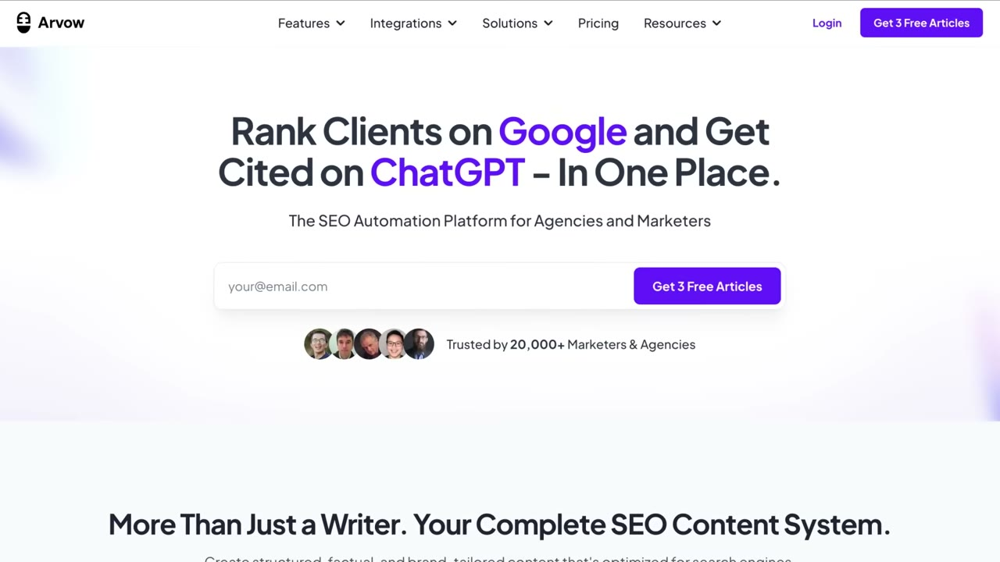
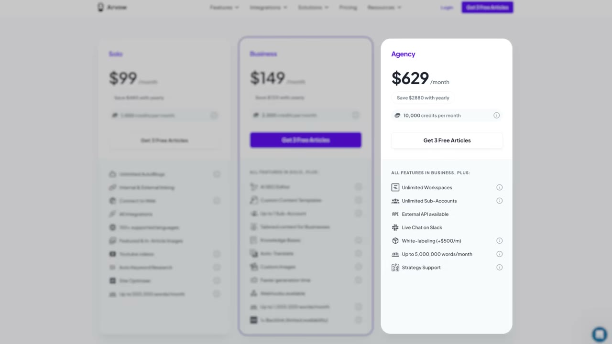
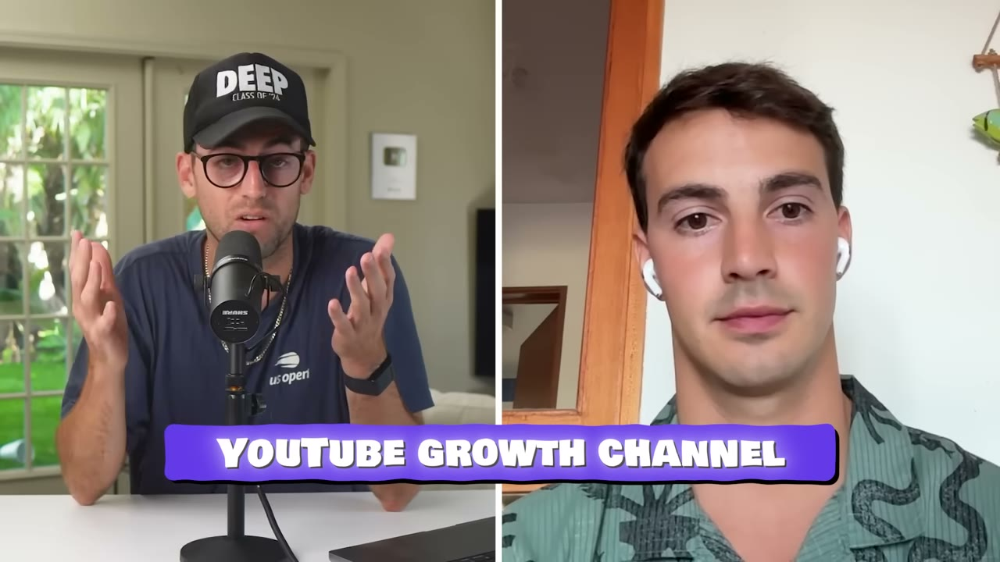
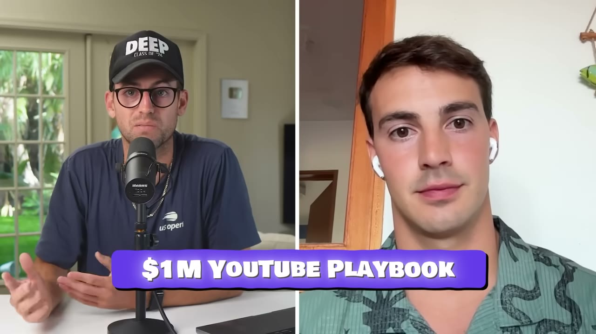
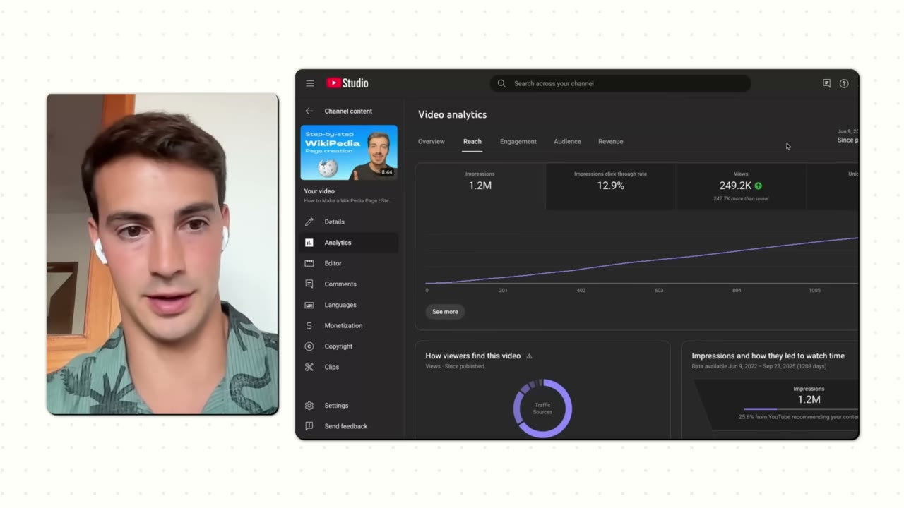
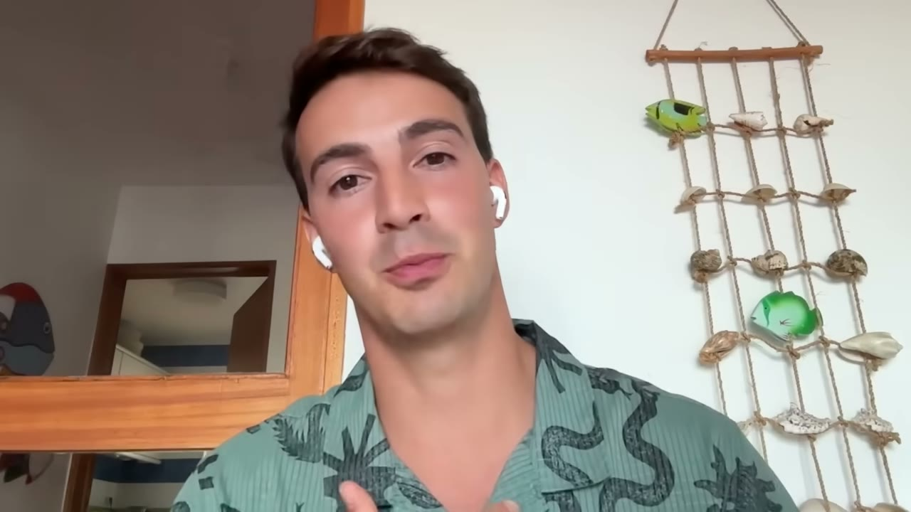
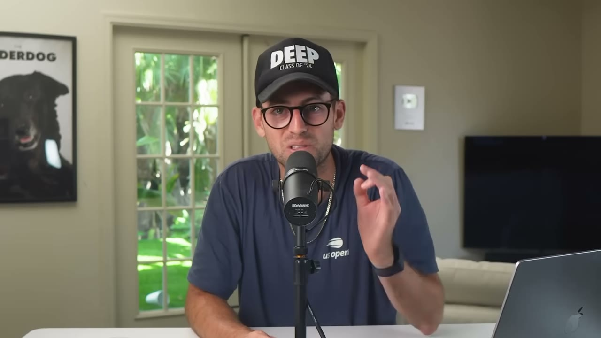

# Arvow — ~$70K MRR hoàn toàn từ YouTube, bằng cách nhân bản chính founder

> **Tóm tắt 30 giây:** Vasco và Afonso đưa **Arvow** (công cụ SEO chạy bằng AI) từ 0 lên **~$70K MRR hoàn toàn organic**, chỉ dùng **một kênh duy nhất là YouTube**. Điểm khác biệt so với mọi case YouTube khác trong kho: anh không dừng ở việc tự quay. Anh **mở nhiều kênh YouTube khác nhau** (Vasco SEO tips, SEO news...), lên **Upwork lọc người đã có video trên profile** để biến họ thành creator, trả **theo hiệu suất/theo video**, rồi **nhân bản sang tiếng Bồ Đào Nha và tiếng Tây Ban Nha**. Cuối cùng anh **chạy in-feed ads vào đúng những video đã chứng minh ra đơn** để hồi sinh chúng khi lượt xem chững lại. Anh cũng cá cược công khai — đăng video mỗi ngày 45 ngày, không kiếm được $5.000 thì anh **tự PayPal cho bạn $500**.

## 1. Con số

| Chỉ số | Giá trị |
|---|---|
| MRR | **~$70.000** (mô tả kênh ghi $79K — xem ghi chú) |
| Khách trả tiền | ~600 |
| Giá | **$99/tháng** đến **gần $700/tháng** |
| Kênh | 100% YouTube, hoàn toàn organic ở giai đoạn tăng trưởng |
| Video chủ lực | "How to make a Wikipedia page" — **1,2 triệu impression**, ~300 view/ngày sau 2 năm |
| Nguồn traffic video đó | 65% YouTube search · 20% Google search |
| Nhịp sản xuất | 1 video **20-30 phút mỗi ngày**, gần như liên tục **1 năm** |
| Đội ngũ | 2 founder + mạng lưới creator thuê ngoài |

**Mâu thuẫn số liệu cần ghi rõ:** phần mô tả video của Starter Story ghi *"grew Arvow from 0 to $79K/month"*, nhưng trong video Vasco nói **"around 70K in MRR"** và người dẫn nói **"$70,000 a month"** — ba lần đều là 70K. Tôi chọn **$70K** vì đó là con số founder tự nói. Kiểm tra chéo: 600 khách × $99 (giá thấp nhất) = $59.400; có gói tới $700/tháng nên ~$70K là hoàn toàn hợp lý. Tiêu đề "$1M SaaS" là **ARR** ($70K × 12 ≈ $840K, làm tròn lên) — không phải $1M đã thu được.

**Lưu ý tên riêng:** auto-caption đọc sai tên sản phẩm liên tục thành *"Arvo"*, *"Argo"*, *"arvogar.com"*, *"arbor"*. Tên đúng theo mô tả video là **Arvow** (arvow.com). Tương tự, transcript ghi *"Myro"* = **Miro**, *"Alexis said this"* nhiều khả năng là **Alex Hormozi**.

## 2. Nguồn gốc: một chuỗi nâng cấp liên tiếp trong cùng một ngách

Đường đi của Vasco là ví dụ sách giáo khoa về **ở lại một ngách và leo dần lên chuỗi giá trị**:

1. **2015-2016** — xem một video của Alex Becker nói kiếm $10K/tháng bằng *rank and rent SEO*. Mua domain đầu tiên, làm local SEO.
2. Chán làm việc với client → **bán dịch vụ SEO trên Fiverr và Upwork**.
3. Thấy các marketplace đó thiếu nhiều thứ → **tự xây marketplace SEO riêng tên Vetted**.
4. **Bán Vetted** (năm trước thời điểm quay) đúng lúc làn sóng AI ập tới.
5. Vẫn muốn ở trong ngách SEO nhưng lần này có AI → xây **Arvow**, công cụ viết/làm SEO bằng AI.

**Cơ chế đáng học:** anh không đổi ngành lần nào trong ~10 năm. Mỗi bước là **cùng một tệp khách hàng, sản phẩm có biên lợi nhuận cao hơn**: dịch vụ → marketplace → SaaS. Toàn bộ kiến thức SEO tích luỹ từ bước 1 trở thành **lợi thế không thể sao chép** ở bước 5 — và cũng chính là thứ giúp anh làm YouTube về SEO tốt hơn người khác.

## 3. Vì sao chọn YouTube chứ không phải nền tảng khác ⭐⭐

> *"Cách để người ta mua từ bạn là khi họ **know, like, and trust** bạn. Và tôi nghĩ cách tốt nhất để ai đó like và trust bạn là **họ nhìn thấy mặt bạn và nghe giọng bạn trong thời gian dài**."*
>
> *"Không phải TikTok không chạy, blog không chạy, Twitter, LinkedIn không chạy. Nhưng xét **tỉ lệ công sức trên kết quả**, tôi nghĩ YouTube là cái tốt nhất."*

**Cơ chế:** với SaaS B2B giá $99-700/tháng, rào cản không phải là biết đến sản phẩm mà là **tin tưởng**. Một bài blog cho bạn 3 phút với người đọc; một video 25 phút cho bạn 25 phút **có mặt và có giọng**. Với sản phẩm đắt tiền, thời lượng tiếp xúc chính là thứ trực tiếp làm ra tỉ lệ chuyển đổi.

Đây là lý do mô hình này **hợp với SaaS B2B giá cao hơn là app B2C $5/tháng** — ở app rẻ, chi phí sản xuất video không thu hồi được.

## 4. Playbook YouTube 3 bước — phần đáng giá nhất video ⭐⭐⭐

### Bước 1 — Sản xuất "money making assets" theo 3 rổ

Vasco phân loại mọi video vào **ba rổ có mục đích khác nhau**:

| Rổ | Đặc điểm | Nhiệm vụ |
|---|---|---|
| **Evergreen** | Đăng hôm nay, 1-2 năm sau vẫn ra view | **Tài sản** — ra đơn khi bạn ngủ. VD "best AI SEO writer" |
| **News/thời sự** | Bùng 2-3 ngày rồi tắt (VD "Google vừa ra update mới") | **Bơm subscriber và mắt mới** vào kênh, rồi phễu về sản phẩm |
| **Viral kiểu MrBeast** | Rất khó làm với sản phẩm phần mềm | Độ phủ — anh thừa nhận *"quite hard to do"* |

**Vì sao phải có cả ba:** evergreen ra tiền nhưng không kéo kênh lớn lên. News kéo kênh lớn nhưng không ra tiền trực tiếp. Bạn cần rổ hai để nuôi thuật toán, rổ một để nuôi ngân hàng.

Anh cũng nói thẳng: **đừng cố đoán video nào sẽ evergreen**:

> *"Quan trọng là trộn lẫn các video evergreen với chia sẻ case study, chia sẻ tin tức, cứ sản xuất nội dung có giá trị và biết rằng **có một xác suất nào đó** những video ấy sẽ trở thành evergreen về lâu dài."*

### Bước 2 — Nhân bản chính mình ⭐⭐⭐

Đây là phần **chưa case nào khác trong kho làm**, và là lý do case này đáng đọc:

> *"Vấn đề là tôi chỉ có một, nên tôi bị giới hạn ở số video tôi làm được. **Làm sao để nhân bản chính mình?**"*

Quy trình của anh:

1. **Mở nhiều kênh YouTube cùng lúc** — anh liệt kê: *Vasco SEO tips*, *Tim SEO guru*, *SEO news*... Tất cả đều do công ty sở hữu.
2. **Mỗi kênh gắn một creator.**
3. **Cách tìm creator — đây là chi tiết vàng:**

> *"Cách SAI để tìm creator là đi tìm creator, vì họ **rất đắt và có cái tôi rất lớn**. Nên cái tôi làm là: hãy tìm **những người tôi nghĩ có thể TRỞ THÀNH creator**. Tôi lên Upwork và lướt qua profile của những người, ví dụ, **có gắn video trên profile**. Có video trên profile Upwork nói với tôi rằng bạn khá thoải mái trước ống kính. Nên tôi đi săn đúng nhóm đó."*

4. **Trả theo hiệu suất và theo video** — không lương cứng.
5. **Nhân bản sang ngôn ngữ khác:** *"Sao không mở rộng sang ngôn ngữ khác? Chúng tôi tìm creator tiếng Bồ Đào Nha, tìm creator tiếng Tây Ban Nha, đúng như cách MrBeast làm với các kênh của ông ấy."*

**Vì sao cơ chế này hiệu quả:** một creator có sẵn tên tuổi đòi phí cao vì họ mang **audience** tới. Nhưng ở đây audience đến từ **YouTube search**, không đến từ tên creator. Nên bạn không cần mua audience — bạn chỉ cần **một người nói trước camera không ngượng**. Đó là kỹ năng có thể mua với giá rất rẻ trên Upwork. Vasco đã tách bạch đúng: **thứ đắt (audience) anh không cần mua; thứ anh cần (sự thoải mái trước camera) thì rẻ**.

**Đây cũng là chỗ mô hình này vượt qua giới hạn của solo founder.** So với [FollowBuddy](../2026-03-19_i-make-17k-month-with-one-strategy/case.md) — cũng dùng YouTube search nhưng một mình quay tất cả — Vasco đã biến playbook cá nhân thành **hệ thống có thể thuê ngoài**.

### Bước 3 — Khuếch đại bằng paid ads, nhưng chỉ vào video ĐÃ CHỨNG MINH ⭐⭐⭐

Đây là kỹ thuật khôn nhất video:

> *"Đồ thị của phần lớn video sẽ trông như thế này. Chúng đi lên, có view, rồi **chững lại và không có thêm view**. Tôi nhận ra là **khi có view thì có đơn, khi view chững lại thì hết đơn**. Tôi không muốn quay đi quay lại cùng một video chỉ để có được lượt xem ban đầu ấy. Và đó là chỗ paid ads xuất hiện."*

Cụ thể: **YouTube in-feed ads** — quảng cáo hiện ở trang chủ YouTube và ở sidebar bên phải khi đang xem video khác. *"Chúng trông như nội dung organic."*

> *"Tôi lấy những video đã chạy tốt, đã có view, **đã ra đơn**, rồi chững lại — và tôi trả tiền cho YouTube để chạy in-feed ads cho chúng."*

**Cơ chế:** đây là chuyển **rủi ro sáng tạo thành rủi ro toán học**. Với ads thông thường, bạn đốt tiền để tìm ra creative nào chạy được. Ở đây YouTube organic đã **test miễn phí** giúp bạn: video nào có view + có đơn thì đã là creative thắng. Bạn chỉ trả tiền để **kéo dài vòng đời của một tài sản đã kiểm chứng**.

Anh cảnh báo ngay: *"Bạn phải cẩn thận, vì bạn không bao giờ biết liệu mình có đang quảng bá một video không mang lại nhiều đơn hay không."* → dẫn thẳng tới vấn đề tracking bên dưới.

## 5. Ba cách đo YouTube organic — vấn đề mọi người bỏ qua ⭐⭐⭐

> *"Vấn đề với YouTube và YouTube ads là **rất khó đo**."*

Vasco dùng **ba lớp đo chồng lên nhau**:

1. **UTM riêng cho từng video** trong phần mô tả. *"Nếu có thể chỉ 1% người bấm link trong mô tả, thì bạn biết họ đến từ video đó."*
2. **Mã coupon riêng cho từng video** — và cách anh triển khai rất thông minh: anh **không** đọc mã trong video. Anh nói: *"Nếu bạn muốn mã giảm giá, hãy bấm vào bong bóng chat ở góc dưới website và hỏi bên hỗ trợ — nói là Vasco bảo tôi được mã, tôi đến từ video này."*
3. **Câu hỏi trong onboarding** — khi đăng ký, có bảng hỏi *bạn đến từ đâu*; nếu chọn YouTube thì **hiện ảnh mặt của các creator từ mọi kênh** để người dùng chỉ đúng người.

**Vì sao lớp 2 xuất sắc:** buộc khách **chủ động nhắn cho support** vừa cho bạn dữ liệu attribution 100% chính xác, vừa **mở một cuộc hội thoại bán hàng** với người đang ở đúng đỉnh ý định mua. Một thao tác, hai kết quả. Còn lớp 3 giải bài toán mà không ai giải được: khi bạn có **nhiều kênh và nhiều creator**, bạn cần biết kênh nào đáng đầu tư tiếp — và cách duy nhất là **hỏi thẳng khách**.

## 6. Hai mẹo CTA đã trực tiếp tăng số đăng ký ⭐⭐

> *"Trước đây tôi đặt call to action ở **cuối video**, và điều đó chẳng có ý nghĩa gì cả vì **phần lớn người ta không xem tới hết**. Nên chỉ riêng việc **chuyển CTA lên đầu và giữa video** đã làm số đăng ký của chúng tôi tăng lên rất nhiều."*
>
> *"Đừng làm CTA chung chung kiểu 'ừ thì vào website xem đi'. Cái chúng tôi làm là tạo **CTA cụ thể** — mang tính tương tác, **thúc họ làm một hành động cụ thể bên trong site**."*

**Cơ chế:** đường cong retention của YouTube là hàm giảm đơn điệu. CTA ở phút 25 chỉ tiếp cận 10-20% khán giả; CTA ở phút 2 tiếp cận 60-80%. Đây là cải thiện **miễn phí, có thể làm ngay hôm nay** — không cần thêm video nào.

## 7. Video đã thay đổi mọi thứ — và bài học về SEO đa nền tảng ⭐⭐

> *"Đây là video đầu tiên tôi nhận ra sức mạnh của YouTube, đăng khoảng 2 năm trước. Nó là video về **cách tạo một trang Wikipedia**. Đó là một **tutorial rất tệ**, nhưng tới tận hôm nay nó vẫn có **1,2 triệu impression**, khoảng **300 view mỗi ngày**."*

Phân bổ traffic của video đó:
- **65% từ YouTube search** ("how to create a Wikipedia page", "how to make a Wikipedia page")
- **20% từ Google search** — *"Video không chỉ xếp hạng trên YouTube, nó còn xếp hạng trên Google."*
- Và một lớp mới: *"Tôi có thể nói tới cả chuyện LLM, vì bây giờ chúng tôi thấy **cả đống video của mình được các LLM gợi ý**."*

**Ba điều rút ra:**

1. **Chất lượng sản xuất không phải yếu tố quyết định.** Chính founder gọi nó là *"a very bad tutorial"* — nó vẫn sống 2 năm và ra 1,2 triệu impression. Yếu tố quyết định là **truy vấn có người tìm và ít người phục vụ**.
2. **Một video YouTube là một tài sản trên BA kênh cùng lúc** — YouTube search, Google search, và giờ là LLM. Bài blog chỉ có một.
3. **Video này thậm chí không nói về Arvow.** "Cách tạo trang Wikipedia" là truy vấn của người làm SEO — đúng ICP, sai chủ đề sản phẩm. Đây là **đánh vào tầng nhận thức phía trên**, không phải tầng sẵn sàng mua.

## 8. Lời khuyên cho người mới — và cú cá cược $500 ⭐⭐

> *"Nghe sáo rỗng nhưng cũng như mọi thứ khác, bạn phải **kiên trì và làm khối lượng lớn**. Với YouTube, lời khuyên của tôi là: **đăng một video mỗi ngày trong 45 ngày**. Phần lớn người xem cái này sẽ không làm. Số còn lại sẽ thử và **bỏ cuộc sau một tuần**. Có lẽ một hoặc hai người trong tất cả sẽ thực sự làm — và những người làm sẽ thực sự thấy kết quả."*
>
> *"Nếu người xem nào làm video trên YouTube trong 45 ngày mà **không kiếm được ít nhất $5.000, tôi sẽ PayPal cho bạn $500**."*

Về chất lượng sản xuất:

> *"Đừng nghĩ bạn cần những video bóng bẩy. Tất cả video đưa chúng tôi từ **0 lên $70K MRR** chỉ là **tôi trong tầng hầm nhà mình**, quay một cái bảng trắng nhỏ, đi qua những thứ có giá trị."*

Và lời khuyên cuối, thẳng thắn:

> *"Rất quan trọng phải biết rằng **việc này rất khó**. Lời khuyên tốt nhất tôi có thể cho là muốn tăng cơ hội thành công thì **bạn phải làm việc rất chăm chỉ**. Tôi làm video 20 đến 30 phút **mỗi ngày trong gần một năm**. Ai sẵn sàng làm điều đó? Để nằm trong 1%, bạn phải sẵn sàng làm điều mà 99% còn lại không sẵn sàng làm."*

**Đọc kỹ cú cá cược này:** đây là ví dụ đẹp về **skin in the game** nhưng cũng là một phép tính tiếp thị. Xác suất người xem thực sự đăng 45 ngày liên tiếp rồi quay lại đòi $500 là cực thấp — chính anh vừa nói *"có lẽ một hoặc hai người"*. Rủi ro tài chính của anh gần bằng 0, còn hiệu ứng thuyết phục thì rất lớn. Đừng coi lời cá cược là bằng chứng thống kê.

## 9. Tech stack — rẻ đến mức đáng ngạc nhiên

| Hạng mục | Công cụ |
|---|---|
| Quay màn hình | **Loom** (bản premium để quay HD) |
| Bảng trắng | **Miro** |
| Dựng | **Camtasia** |
| Mic | **Shure SM7B** |

> *"Bạn không cần nhiều. Tôi nghĩ bạn nên **đổ công sức và tiền vào phần cứng hơn là phần mềm**. Hãy có mic tốt, camera tốt, và ánh sáng tốt. Đừng phức tạp hoá. Tôi nghĩ phần khó nhất là **bắt đầu**."*

**Lưu ý:** video **không nêu tech stack của chính sản phẩm Arvow** — toàn bộ phần "tech stack" nói về thiết bị quay video. Đây là video về phân phối, không phải về xây sản phẩm.

## 10. Mâu thuẫn với các case khác trong kho — và cách hoà giải ⭐⭐

| Quan điểm | Ai nói | Đúng khi nào |
|---|---|---|
| YouTube = **công cụ tìm kiếm**, video xấu cũng lên top nếu đúng từ khoá | [FollowBuddy](../2026-03-19_i-make-17k-month-with-one-strategy/case.md) | Sản phẩm giải vấn đề người ta chủ động đi tìm |
| YouTube = **máy tạo niềm tin**, cần mặt và giọng trong thời gian dài | **Vasco (case này)** | Sản phẩm B2B đắt tiền ($99-700/tháng), quyết định mua cần tin tưởng |
| YouTube = **bảo hiểm/kênh sở hữu** để tung sản phẩm mới | [Jacky Chow](../2026-03-22_i-make-250k-month-from-13-businesses-after-losing-ev/case.md) | Bạn có danh mục nhiều sản phẩm |
| Personal brand là động cơ chính | [Marc Lou](../2026-04-26_how-i-work-77k-month-solopreneur/case.md) | Bạn bán cho chính cộng đồng bạn thuộc về |

**Hoà giải:** Vasco thực ra dùng **cả hai chế độ** cùng lúc, và đó là điều tinh tế nhất. Video Wikipedia của anh là **search play** thuần tuý (65% từ YouTube search, tutorial dở vẫn sống). Còn luận điểm "know, like, trust" là **trust play**. Anh không chọn một bên — anh dùng search để **kéo người lạ vào**, rồi dùng thời lượng video dài để **biến họ thành người tin**.

**Điểm anh khác biệt hoàn toàn so với tất cả:** anh là người duy nhất trong kho **giải bài toán scale của chính mình** bằng cách thuê creator và mở nhiều kênh. Marc Lou, Ben, Jacky đều bị chặn ở trần "một người quay được bao nhiêu video". Vasco phá trần đó.

**Mâu thuẫn cần ghi nhận về mức đầu tư:** Vasco đòi hỏi **20-30 phút video mỗi ngày trong gần một năm**. Ben ở case FollowBuddy quay **một video 20 phút** và ăn 25.000 view suốt 7 tháng. Cả hai đều đúng — chỉ là Ben chọn ngách **cực hẹp và cực ít cạnh tranh** (app unfollow Instagram), còn Vasco chọn ngách **SEO — nơi mọi người đều đang làm content marketing**. Ngách càng cạnh tranh, khối lượng đòi hỏi càng lớn. Hãy chọn ngách trước khi tính khối lượng.

## 11. Cảnh báo thiên kiến nguồn

- Video có **quảng cáo Starter Story Build chèn giữa** (phút 7:15, đúng ngay sau phần playbook hay nhất) và lặp ở cuối, kèm UTM riêng cho case này. Cái cớ chuyển cảnh — *"bạn không thể làm video YouTube về một sản phẩm chưa tồn tại"* — được dựng lên để bán khoá học.
- **Không có ảnh dashboard doanh thu** trong video. Toàn bộ số liệu là **lời tự khai của founder**. Đây là điểm yếu so với các case có screenshot Stripe/RevenueCat.
- **Chênh lệch $70K vs $79K** giữa lời nói và mô tả kênh chưa được giải thích ở đâu.
- Tiêu đề "$1M SaaS" là **ARR quy đổi**, dễ gây hiểu nhầm là đã thu về $1M.
- Kênh chỉ phỏng vấn người thành công: **không ai đếm số người đã đăng video mỗi ngày 45 ngày rồi không có gì**.

## 12. Áp dụng cho tôi (indie hacker VN)

**Sao chép được gì:**

1. **Bắt chước trước bước 2, không phải bước 1.** Bước 1 (tự quay mỗi ngày) tốn 1 năm cuộc đời. Bước 2 (thuê người quay) là **lợi thế lớn của người Việt**: chi phí thuê creator nói tiếng Anh trên Upwork/Fiverr là khoản có thể chịu được, và bạn **không cần tự lên hình** — xoá luôn rào cản phát âm.
2. **Tiêu chí lọc creator của Vasco áp dụng nguyên xi:** vào Upwork, lọc người **có sẵn video giới thiệu trên profile**. Đó là bộ lọc miễn phí cho "thoải mái trước camera". Trả **theo video hoặc theo hiệu suất**, không lương cứng.
3. **Ba lớp tracking triển khai được ngay** kể cả khi bạn mới có 1 video: UTM riêng, mã coupon qua chat, câu hỏi onboarding "bạn đến từ đâu". Chi phí gần bằng 0, và không có nó thì bạn **không thể** biết nên đầu tư tiếp vào đâu.
4. **Chuyển CTA lên đầu và giữa video** — thắng miễn phí, làm được trong hôm nay.
5. **Nhân bản đa ngôn ngữ.** Vasco làm tiếng Bồ và Tây Ban Nha. Bạn có **tiếng Việt miễn phí** — một ngách gần như không ai làm YouTube SEO cho công cụ phần mềm.
6. **Nhớ rằng video hay nhất của anh không nói về sản phẩm.** "Cách tạo trang Wikipedia" phục vụ đúng ICP nhưng không bán gì cả. Hãy làm video giải **vấn đề của khách**, không phải video giới thiệu tính năng.

**Rào cản thật, không tô hồng:**

- **Khối lượng công việc là rào cản lớn nhất, không phải kỹ năng.** 20-30 phút video **mỗi ngày, gần một năm**, trước khi có $70K. Nếu bạn đang đi làm full-time ở VN, hãy tính thật: 1-2 tiếng mỗi tối cho quay + dựng, liên tục 300+ ngày, **chưa có đồng doanh thu nào trong nhiều tháng đầu**.
- **Ngách SEO là ngách cạnh tranh khốc liệt nhất trên YouTube tiếng Anh.** Vasco thắng được vì anh có **10 năm làm SEO thật** — anh nói được thứ người khác không nói được. Nếu bạn vào ngách này mà không có chiều sâu tương đương, bạn sẽ làm 300 video và không ai xem.
- **Chi phí thuê creator là chi phí trả trước, dòng tiền âm.** Trả theo hiệu suất giảm rủi ro, nhưng creator giỏi sẽ không nhận việc thuần hiệu suất khi kênh còn 0 view. Thực tế bạn phải trả cứng vài tháng đầu — hãy dự trù **$300-1.000/tháng cho mỗi kênh** trước khi có kết quả.
- **Quản lý nhiều kênh và nhiều creator là công việc vận hành, không phải công việc kỹ thuật.** Bạn phải viết brief, duyệt nội dung, xử lý người bỏ ngang. Nhiều indie hacker Việt giỏi code nhưng chưa từng quản lý freelancer nước ngoài — đây là kỹ năng phải học riêng, và nó ăn thời gian đúng bằng thời gian bạn tiết kiệm được từ việc không tự quay.
- **YouTube ads đòi thẻ quốc tế và ngân sách chịu lỗ.** In-feed ads chỉ đáng chạy khi bạn đã có video chứng minh ra đơn — nghĩa là bước 3 nằm sau ít nhất 6-12 tháng làm organic.
- **ARPU $99-700/tháng là mô hình B2B phương Tây.** Ở VN không có tệp khách nào trả $99/tháng cho công cụ SEO. Nếu làm mô hình này, bạn **buộc phải bán cho thị trường quốc tế** — kéo theo tiếng Anh, thanh toán quốc tế, và hỗ trợ theo múi giờ họ.
- **Rủi ro nền tảng.** Toàn bộ doanh nghiệp sống trên thuật toán của một công ty. Nhiều kênh làm giảm rủi ro một kênh bị chết, nhưng không giảm rủi ro **YouTube đổi cách phân phối**.

**Khi nào KHÔNG dùng mô hình này:**

- **Khi ARPU của bạn dưới ~$20/tháng.** Chi phí sản xuất một video (thời gian hoặc tiền thuê creator) không thu hồi được nếu mỗi khách chỉ mang về vài đô. Mô hình này cần **giá cao để trả cho chi phí nội dung**. App B2C $5/tháng nên đi hướng ASO hoặc paid ads, không phải YouTube dài.
- **Khi bạn cần doanh thu trong 90 ngày.** YouTube organic có độ trễ tính bằng quý. Nếu bạn đang cạn tiền, hãy chọn kênh có phản hồi nhanh hơn (cold email, cộng đồng ngách, lifetime deal như [Rabbitholes AI](../2025-10-08_my-app-failed-then-i-changed-one-thing-and-made-80k/case.md)).
- **Khi sản phẩm giải vấn đề không ai đi tìm.** Không ai search thứ họ chưa biết là vấn đề. Rổ evergreen sẽ trống, và bạn chỉ còn rổ viral — thứ chính Vasco thừa nhận là *"rất khó làm"* với phần mềm.
- **Khi bạn không chịu nổi việc làm một việc lặp lại rất lâu trước khi thấy kết quả.** Vasco nói thẳng: 99% bỏ cuộc. Nếu tự biết mình thuộc nhóm bỏ cuộc sau 3 tuần, đừng chọn kênh này — hãy chọn kênh có vòng phản hồi ngắn.

## Nguồn

- Video: <https://www.youtube.com/watch?v=VZ1XspToV1E> (12:09, đăng 04/10/2025, 68.358 view)
- Sản phẩm: <https://arvow.com/> · Founder: <https://x.com/vascoabm>
- [Transcript đầy đủ](transcript.md) · [Ảnh chụp](screenshots/)
