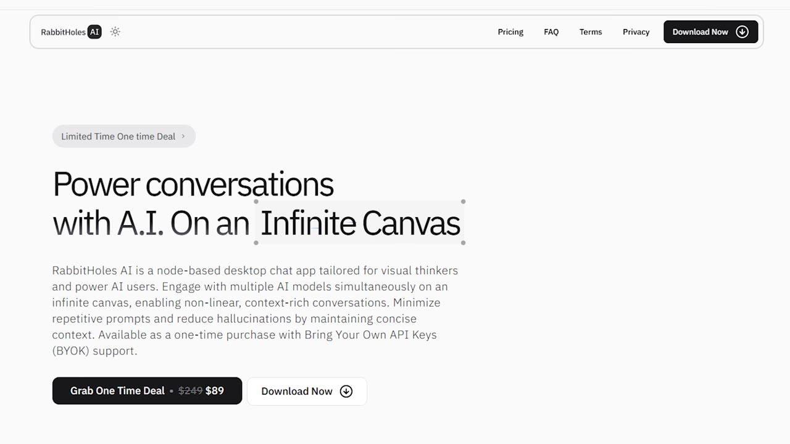
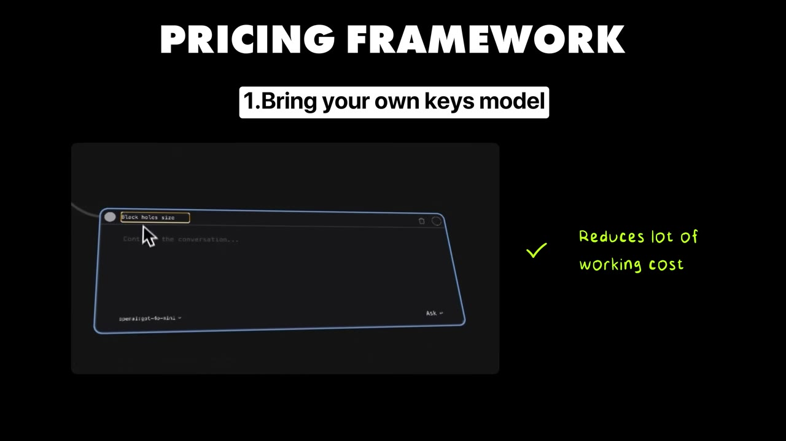

# My app failed, then I changed one thing, and made $80K

✅ **Đã phân tích sâu** → [`case.md`](case.md)

| | |
|---|---|
| **Video** | <https://www.youtube.com/watch?v=hYW9YDwHE20> |
| **Đăng** | 08/10/2025 |
| **Thời lượng** | 12:38 |
| **Lượt xem** | 51,373 |
| **Lượt thích** | 1,293 |
| **Video ID** | `hYW9YDwHE20` |

## Trong thư mục này

| File | Nội dung |
|---|---|
| [`case.md`](case.md) | **Phân tích đầy đủ** — ý tưởng, validate, GTM, áp dụng ở VN |
| [`meta.json`](meta.json) | Metadata gốc (chapters, heatmap, mô tả) |
| [`screenshots/`](screenshots/) | 10 ảnh 720p |

## Mô tả gốc

Praneeth Pike quit his $250K/year job to go all in on building apps. After 3 months of building, he finally launched his project... just to see no success. Then, he changed one thing, and his app made $80K in the next 6 months.
0:00 - Intro
0:46 - Who is Praneeth
1:08 - Praneeth's app
1:46 - Idea for Rabbitholes.ai
2:28 - The pricing model that failed
3:35 - The $80K pivot
4:48 - The best pricing model for bootstrappers
6:56 - Pricing framework
7:48 - Growth strategy for Rabbitholes.ai
8:48 - Numbers behind Rabbitholes.ai
9:24 - Tech stack
10:17 - Costs and margins
10:59 - Find product-market 

## Số liệu bắt được từ transcript

> Các đoạn founder nhắc tới con số, kèm timestamp để tua thẳng tới đó trong video.

_(không bắt được con số nào)_

## Chương

- `00:00` Intro
- `00:46` Who is Praneeth
- `01:08` Praneeth's app
- `01:46` Idea for Rabbitholes.ai
- `02:28` The pricing model that failed
- `03:35` The $80K pivot
- `04:48` The best pricing model for bootstrappers
- `06:56` Pricing framework
- `07:48` Growth strategy for Rabbitholes.ai
- `08:48` Numbers behind Rabbitholes.ai
- `09:24` Tech stack
- `10:17` Costs and margins
- `10:59` Find product-market fit
- `12:01` The final word

## Ảnh

1. `01_00m57s_replay.jpg` — 
2. `02_01m58s_ch-idea-for-rabbitholes-ai.jpg` — 
3. `03_02m40s_ch-the-pricing-model-that-failed.jpg` — 
4. `04_03m47s_ch-the-80k-pivot.jpg` — 
5. `05_04m45s_usd-80-000.jpg` — 
6. `06_07m17s_usd-29.jpg` — 
7. `07_08m00s_ch-growth-strategy-for-rabbitholes-ai.jpg` — 
8. `08_09m00s_ch-numbers-behind-rabbitholes-ai.jpg` — 
9. `09_09m56s_replay.jpg` — 
10. `10_10m42s_usd-50.jpg` — 

---

← [Quay lại index](../../index.md) · [Toàn bộ video](../README.md)
