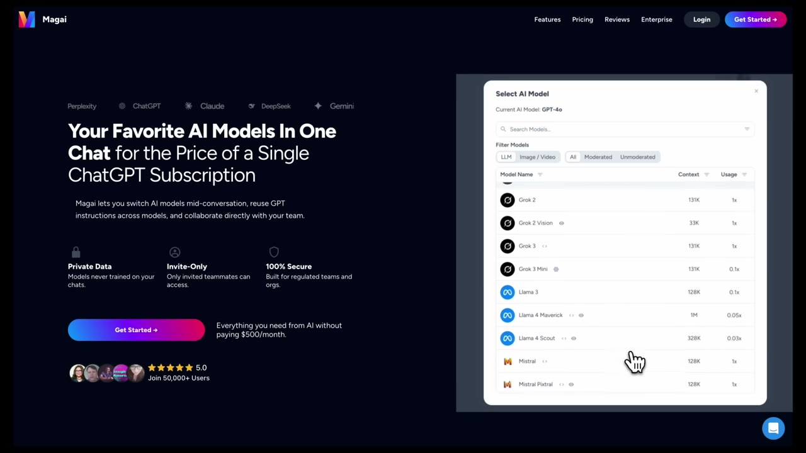
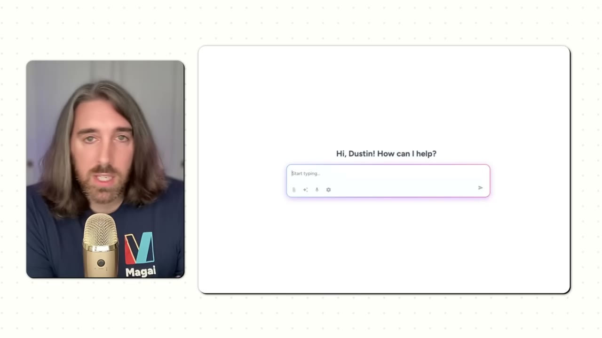

# I built a $100K/month AI app

✅ **Đã phân tích sâu** → [`case.md`](case.md)

| | |
|---|---|
| **Video** | <https://www.youtube.com/watch?v=DV7bBCAABg4> |
| **Đăng** | 11/10/2025 |
| **Thời lượng** | 11:09 |
| **Lượt xem** | 115,037 |
| **Lượt thích** | 3,058 |
| **Video ID** | `DV7bBCAABg4` |

## Trong thư mục này

| File | Nội dung |
|---|---|
| [`case.md`](case.md) | **Phân tích đầy đủ** — ý tưởng, validate, GTM, áp dụng ở VN |
| [`meta.json`](meta.json) | Metadata gốc (chapters, heatmap, mô tả) |
| [`screenshots/`](screenshots/) | 9 ảnh 720p |

## Mô tả gốc

Dustin Stout realized that AI would change the world 3 years ago, and built a $100K/month app on top of the AI opportunity. But the craziest thing is that he did it with no-code.
0:00 - Intro
0:55 - Who is Dustin
1:13 - Dustin’s backstory
2:19 - Idea for Magai
3:27 - Building Magai
4:24 - Magai marketing strategy
6:52 - How Magai works
8:09 - Tech stack
8:55 - Magai monetization model
9:39 - Don’t let your failures define you
10:30 - The final word
This video is an educational case study of one founder’s experience. It is not financial advice and does not guarantee any income or results. Every

## Số liệu bắt được từ transcript

> Các đoạn founder nhắc tới con số, kèm timestamp để tua thẳng tới đó trong video.

_(không bắt được con số nào)_

## Chương

- `00:00` Intro
- `00:55` Who is Dustin
- `01:13` Dustin’s backstory
- `02:19` Idea for Magai
- `03:27` Building Magai
- `04:24` Magai marketing strategy
- `06:52` How Magai works
- `08:09` Tech stack
- `08:55` Magai monetization model
- `09:39` Don’t let your failures define you
- `10:30` The final word

## Ảnh

1. `01_01m07s_usd-100-000.jpg` — 
2. `02_02m24s_usd-100-000.jpg` — 
3. `03_03m39s_ch-building-magai.jpg` — 
4. `04_04m28s_usd-100-000.jpg` — 
5. `05_07m04s_ch-how-magai-works.jpg` — 
6. `06_08m25s_replay.jpg` — 
7. `07_09m13s_usd-20.jpg` — 
8. `08_09m51s_ch-don-t-let-your-failures-define-you.jpg` — 
9. `09_10m42s_ch-the-final-word.jpg` — 

---

← [Quay lại index](../../index.md) · [Toàn bộ video](../README.md)
