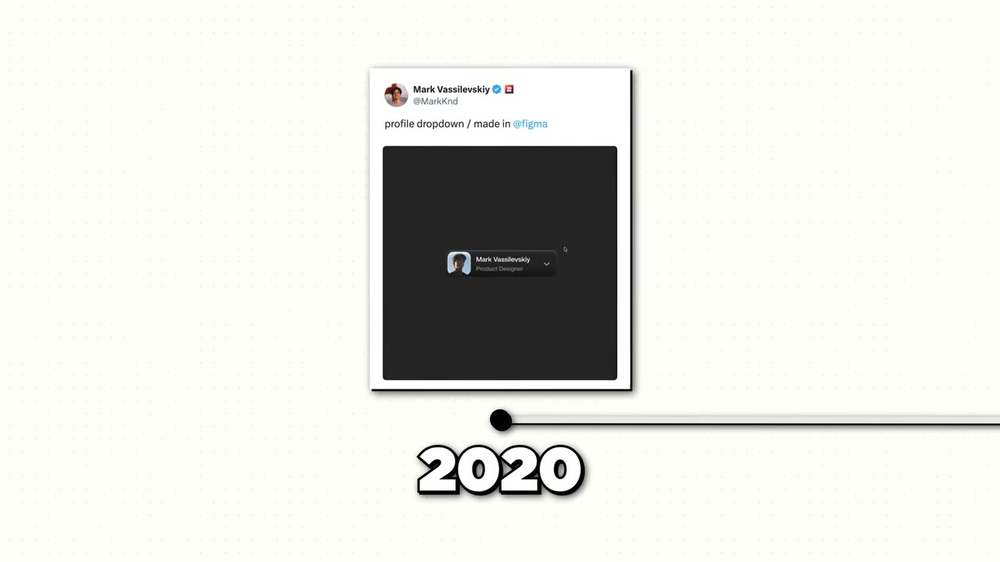
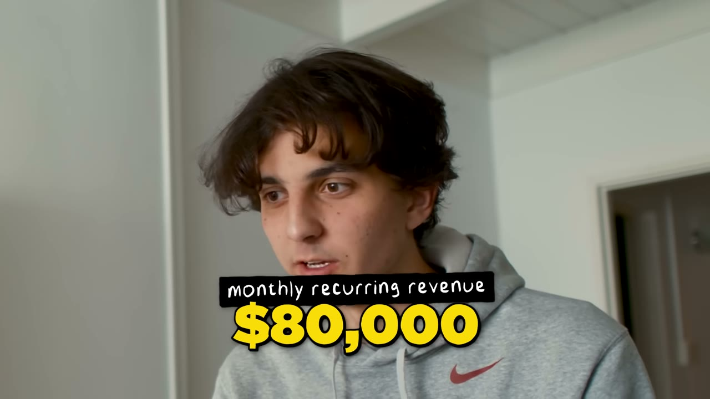

# Teen From Kazakhstan Makes $1M/Year Online

✅ **Đã phân tích sâu** → [`case.md`](case.md)

| | |
|---|---|
| **Video** | <https://www.youtube.com/watch?v=YtyJ4reSQY0> |
| **Đăng** | 14/10/2025 |
| **Thời lượng** | 10:00 |
| **Lượt xem** | 50,663 |
| **Lượt thích** | 1,474 |
| **Video ID** | `YtyJ4reSQY0` |

## Trong thư mục này

| File | Nội dung |
|---|---|
| [`case.md`](case.md) | **Phân tích đầy đủ** — ý tưởng, validate, GTM, áp dụng ở VN |
| [`meta.json`](meta.json) | Metadata gốc (chapters, heatmap, mô tả) |
| [`screenshots/`](screenshots/) | 9 ảnh 720p |

## Mô tả gốc

Mark Vassilevskiy is a 19-year-old from Kazakhstan who built a $1M design agency in just 10 months. He went from zero clients to $80K/month revenue by mastering a strategy nobody else uses: public free redesigns. This video breaks down his "free work” formula and how he turned rejection into a repeatable client acquisition system.
0:00 - Intro
0:54 - Who is Mark
1:09 - What does Skale do?
1:40 - Mark's background
2:33 - Landing the first big client
3:28 - Free work that led to clients
4:08 - How to build an audience
7:06 - Numbers behind Skale
7:37 - $1M Tech stack
8:10 - Tools to get started

## Số liệu bắt được từ transcript

> Các đoạn founder nhắc tới con số, kèm timestamp để tua thẳng tới đó trong video.

_(không bắt được con số nào)_

## Chương

- `00:00` Intro
- `00:54` Who is Mark
- `01:09` What does Skale do?
- `01:40` Mark's background
- `02:33` Landing the first big client
- `03:28` Free work that led to clients
- `04:08` How to build an audience
- `07:06` Numbers behind Skale
- `07:37` 1M Tech stack
- `08:10` Tools to get started
- `08:32` Volume negates luck
- `09:21` The final word

## Ảnh

1. `01_01m10s_usd-80-000.jpg` — 
2. `02_01m52s_ch-mark-s-background.jpg` — 
3. `03_02m45s_ch-landing-the-first-big-client.jpg` — 
4. `04_03m58s_replay.jpg` — 
5. `05_05m22s_replay.jpg` — 
6. `06_07m18s_ch-numbers-behind-skale.jpg` — 
7. `07_08m04s_replay.jpg` — 
8. `08_08m44s_ch-volume-negates-luck.jpg` — 
9. `09_09m33s_ch-the-final-word.jpg` — 

---

← [Quay lại index](../../index.md) · [Toàn bộ video](../README.md)
