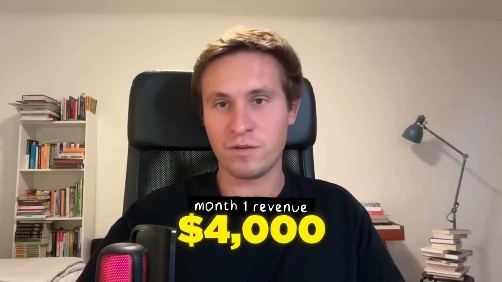
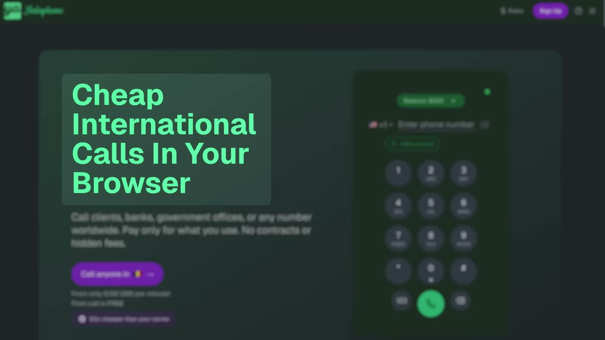
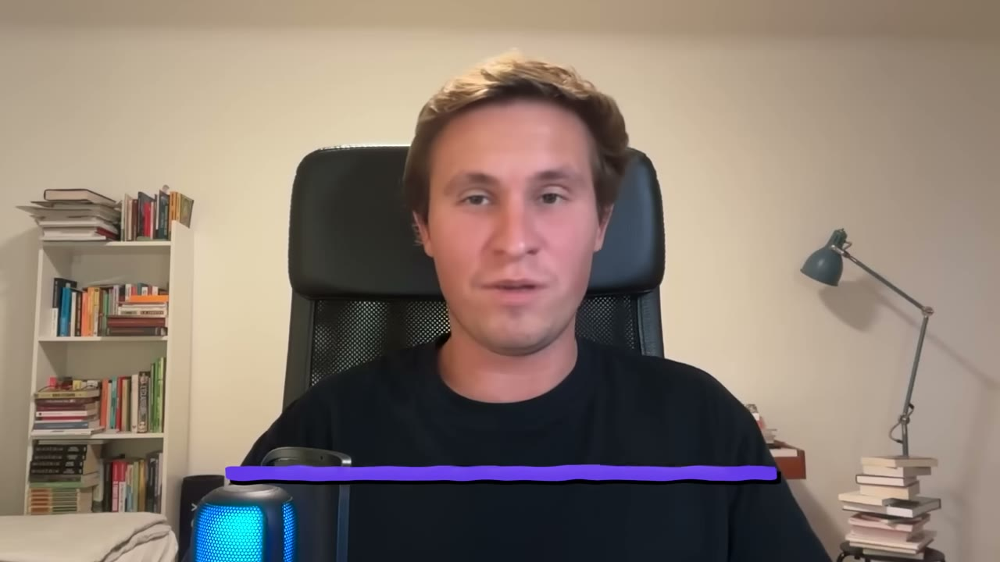
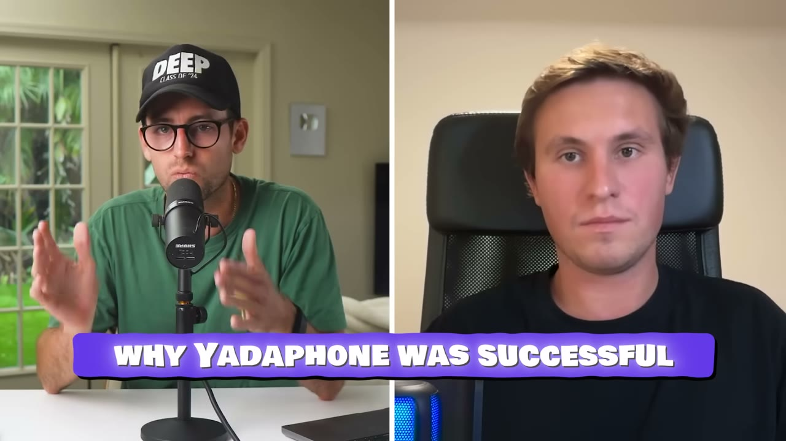
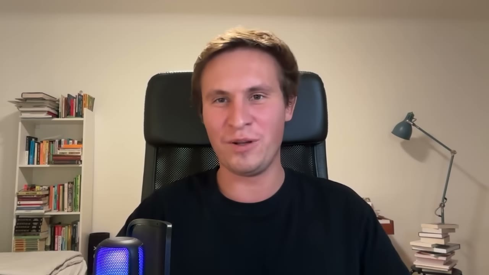
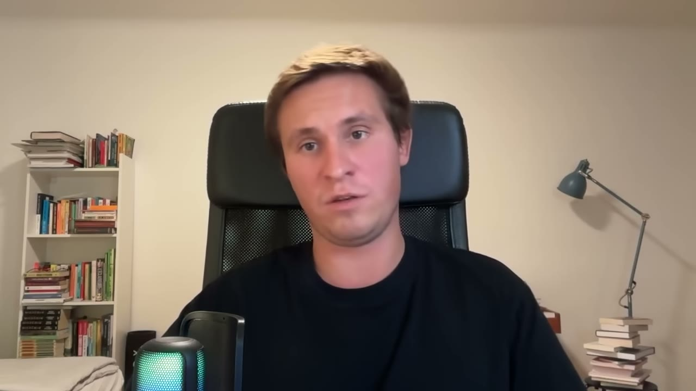

# I rebuilt a $1B app and now make $14K/month

✅ **Đã phân tích sâu** → [`case.md`](case.md)

| | |
|---|---|
| **Video** | <https://www.youtube.com/watch?v=88BbTpbWVpY> |
| **Đăng** | 16/10/2025 |
| **Thời lượng** | 14:24 |
| **Lượt xem** | 92,066 |
| **Lượt thích** | 2,581 |
| **Video ID** | `88BbTpbWVpY` |

## Trong thư mục này

| File | Nội dung |
|---|---|
| [`case.md`](case.md) | **Phân tích đầy đủ** — ý tưởng, validate, GTM, áp dụng ở VN |
| [`meta.json`](meta.json) | Metadata gốc (chapters, heatmap, mô tả) |
| [`screenshots/`](screenshots/) | 10 ảnh 720p |

## Mô tả gốc

Denis Yurchak was scrolling Twitter in March when he saw Pieter Levels tweet about Skype shutting down and how big of a loss it would be. Six months later, he runs a $15K MRR with 10,000 users mini-skype. This video breaks down his weekend MVP sprint, how he automated support to stay solo, and why timing a product launch around a billion-dollar company shutdown created instant demand.
0:00 - Intro
0:54 - Who is Denis
1:13 - Numbers behind Yadaphone
1:59 - What is Yadaphone
3:09 - Non-technical background
4:08 - The $100K tweet
5:08 - Building the app in a weekend
6:30 - How to get users overni

## Số liệu bắt được từ transcript

> Các đoạn founder nhắc tới con số, kèm timestamp để tua thẳng tới đó trong video.

_(không bắt được con số nào)_

## Chương

- `00:00` Intro
- `00:54` Who is Denis
- `01:13` Numbers behind Yadaphone
- `01:59` What is Yadaphone
- `03:09` Non-technical background
- `04:08` The $100K tweet
- `05:08` Building the app in a weekend
- `06:30` How to get users overnight
- `07:51` What made Yadaphone successful
- `08:39` Denis' successful app playbook
- `11:54` Tech stack
- `12:33` Do this from Day 1
- `13:44` The final word

## Ảnh

1. `01_01m23s_usd-4-000.jpg` — 
2. `02_02m11s_usd-50.jpg` — 
3. `03_03m21s_ch-non-technical-background.jpg` — 
4. `04_04m20s_ch-the-100k-tweet.jpg` — 
5. `05_05m20s_ch-building-the-app-in-a-weekend.jpg` — 
6. `06_06m42s_ch-how-to-get-users-overnight.jpg` — 
7. `07_08m03s_ch-what-made-yadaphone-successful.jpg` — 
8. `08_08m51s_ch-denis-successful-app-playbook.jpg` — 
9. `09_11m45s_usd-1-000.jpg` — 
10. `10_12m27s_replay.jpg` — 

---

← [Quay lại index](../../index.md) · [Toàn bộ video](../README.md)
