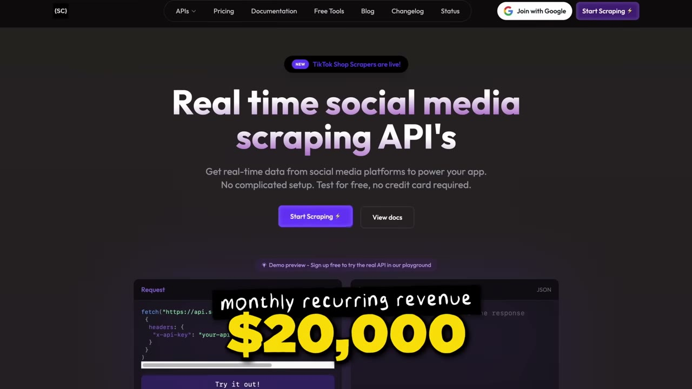
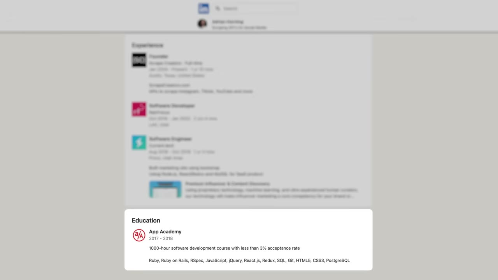
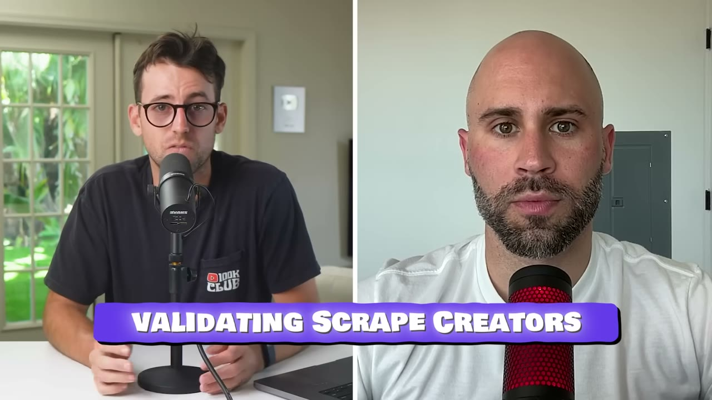
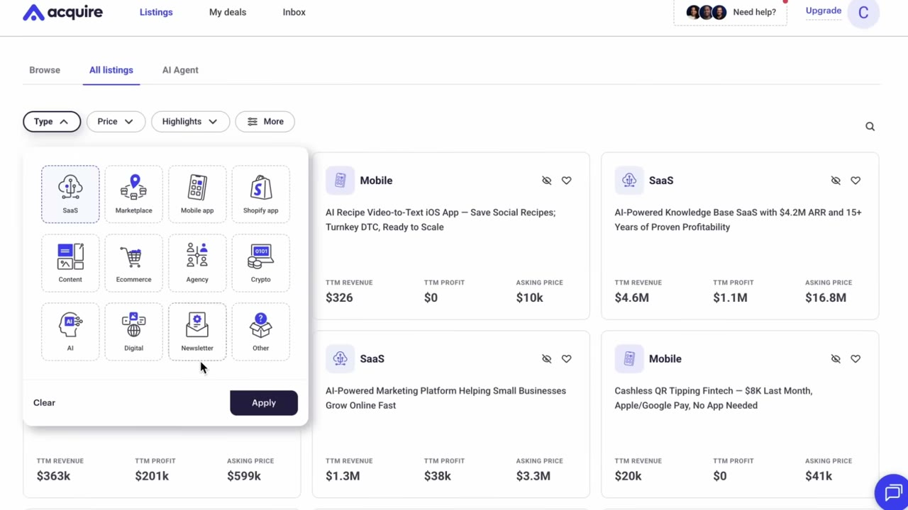
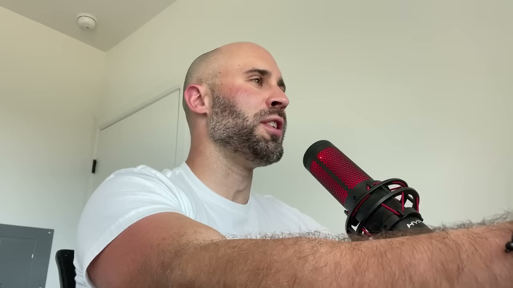
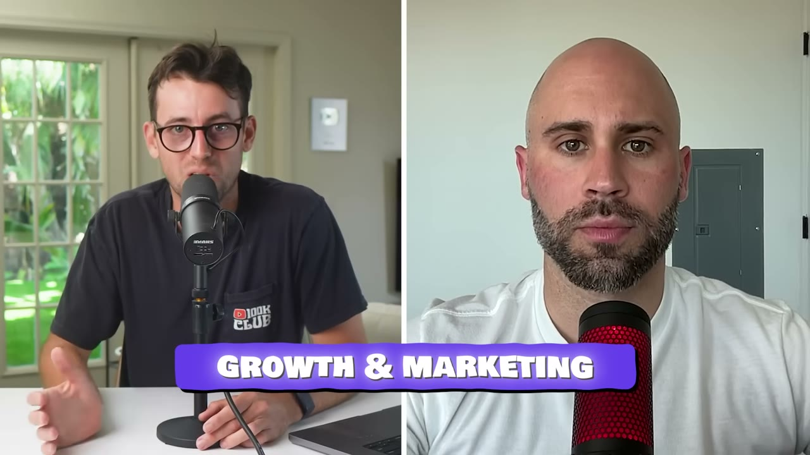
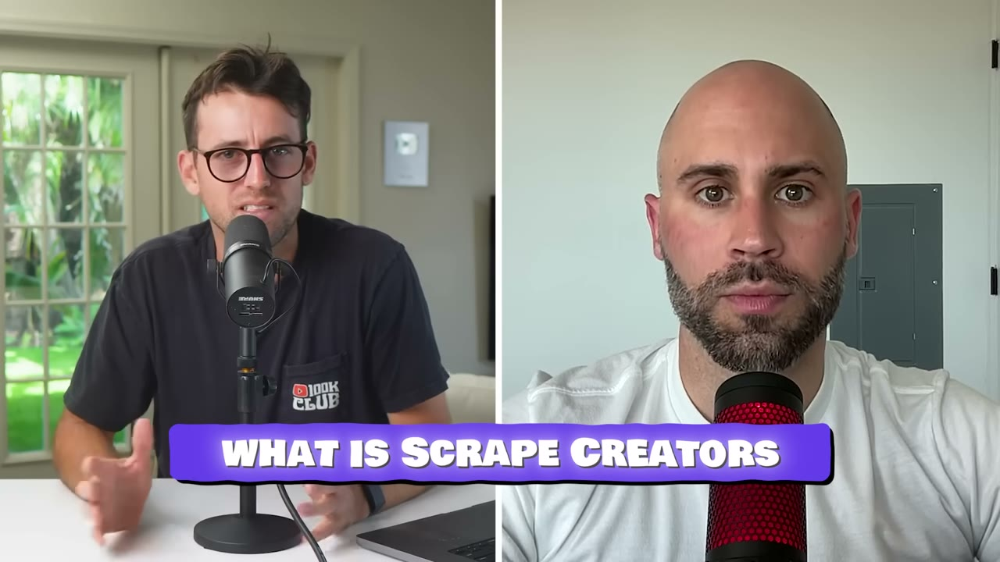
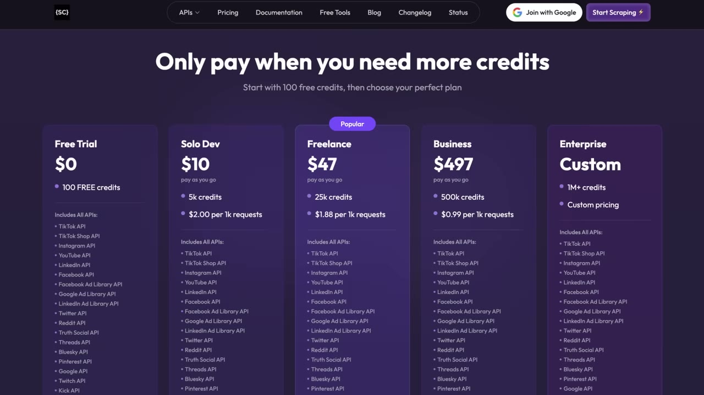
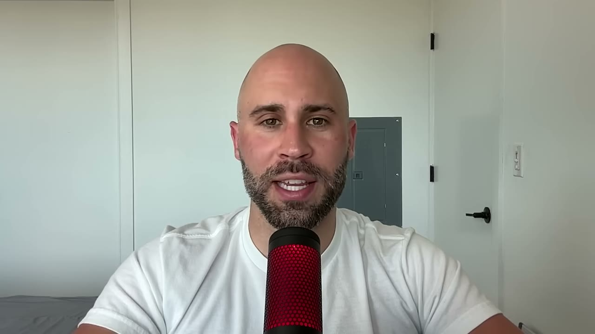

# Scrape Creators — $20K/tháng bằng cách chép một doanh nghiệp đang rao bán

> **Tóm tắt 30 giây:** Adrian Horning, dev solo ở Austin, được một người theo dõi trên Twitter DM cho xem **listing rao bán một API scraping trên Acquire.com**. Anh đọc số liệu và chết lặng: doanh nghiệp đó làm **$30.000/tháng**, tồn tại 3 năm, **dưới 100 khách hàng**, và toàn bộ khách đến từ SEO. Anh **không mua** — anh dựng lại nó trong **2 tuần** (vì đã ngồi nghiên cứu scraping suốt 3 năm), tài liệu để trong một Notion doc, host trên Render. Nay $20K/tháng. Chi tiết đắt nhất: **khoảng 12 khách hàng đóng phần lớn doanh thu đó.**

---

## 1. Con số

| Chỉ số | Giá trị |
|---|---|
| Doanh thu | ~$20.000/tháng |
| Mô hình | **credit trả trước, KHÔNG subscription** |
| Giá | $10 / 5.000 credit · $50 / 25.000 · **$500 / 500.000** |
| Đã từng trả tiền | ~600 người |
| **Tập trung doanh thu** | **~12 khách hàng đóng phần lớn** |
| Lưu lượng API | ~20 triệu request/tháng |
| Chi phí proxy | ~$1.500/tháng |
| Chi phí trực đêm (dev Philippines) | ~$500/tháng |
| Chi phí server | ~$400/tháng |
| Biên lợi nhuận | founder nói ~80% |
| Đội ngũ | 1 + 1 người trực đêm |

**Hai chỗ số không khớp, tôi ghi rõ:**

1. **Biên lợi nhuận.** $20.000 trừ $2.400 chi phí anh liệt kê ra **88%**, không phải 80%. Chênh lệch ~$1.600 nhiều khả năng là phí Stripe, Cursor, tên miền và các khoản anh không kể. Tôi giữ con số **80% của founder** vì nó thận trọng hơn.
2. **Số proxy.** Anh nói *"tôi có bốn cái chính"* rồi chỉ kể tên ba: Evomi, Webshare, Massive. Không rõ cái thứ tư.

**Chú ý cấu trúc giá:** hai gói dưới đều là **500 credit/đô**, gói $500 là **1.000 credit/đô** — tức giảm giá đúng 50% cho khách lớn. Đây không phải ngẫu nhiên: nó được thiết kế để **kéo 12 khách hàng nặng ký kia mua gói to**, và chính họ mới là doanh nghiệp.

---

## 2. Câu chốt của case — và vì sao nó gây tranh cãi

> *"Nếu một thứ đang chạy tốt, **bạn có nghĩa vụ đạo đức phải sao chép nó**."*

Câu này nghe như lời biện hộ, nhưng đọc kỹ hơn nó là một tuyên bố về **rủi ro**, không phải về đạo đức: mỗi lần bạn build một ý tưởng chưa ai chứng minh, bạn đang tự nguyện nhận thêm **rủi ro thị trường** mà không được trả công cho việc đó.

Adrian nói thẳng anh không có sự tự tin đó:

> *"Bản thân tôi **hoàn toàn không tin** rằng một API scraping có thể kiếm được nhiều tiền đến vậy. Cái việc họ chỉ lấy khách qua SEO... Tôi nghĩ, đây rồi, đây là sản phẩm dành cho tôi."*

Đây là điểm quan trọng cho người Việt: **rào cản lớn nhất của indie hacker không phải kỹ năng mà là không dám tin ngách của mình có tiền.** Listing rao bán là **bằng chứng bằng con số** phá vỡ đúng rào cản đó, và nó miễn phí.

---

## 3. Bài toán xác thực — 3 dòng số học quyết định tất cả ⭐⭐⭐

Adrian nhìn listing và làm phép tính trong đầu. Đây là toàn bộ quá trình validate của anh:

| Dữ kiện từ listing | Anh suy ra gì |
|---|---|
| Làm **$30.000/tháng** | Thị trường có tiền thật |
| Tồn tại **3 năm** | Không phải cú ăn may theo trend |
| **Dưới 100 khách hàng** | ARPU khoảng **$300/tháng** → **B2B giá cao, không cần quy mô phân phối** |
| Khách **chỉ đến từ SEO** | Kênh acquisition **đang bỏ trống** — họ chưa động tới bất kỳ kênh nào khác |
| Anh đã học scraping **3 năm** | Chi phí build của anh gần bằng 0 |
| Anh **có mặt trên Twitter** | *"Kể cả chỉ nhắn tin cho người ta trên Twitter thôi, tôi cũng có thể tới đó mà chẳng cần SEO."* |

> **Dòng quan trọng nhất là "dưới 100 khách hàng".** Nó biến bài toán từ *"làm sao có hàng nghìn người dùng"* thành *"làm sao tìm 100 người đúng"* — hai bài toán khác nhau hoàn toàn về độ khó. Với 100 khách, bạn có thể nhắn tin cho từng người. Bạn không cần biết chạy ads, không cần SEO, không cần viral.

Và thực tế của Adrian còn cực đoan hơn: anh làm $20K với **12 khách hàng cốt lõi**.

> *"Điều tuyệt vời ở một API scraping là bạn **không cần nhiều khách hàng** để có doanh thu tử tế. Tôi có khoảng 12 người trả phần lớn số MRR đó."*

**Cơ chế:** khi ARPU đủ cao ($300-1.500/tháng), toàn bộ bài toán marketing sụp xuống thành bài toán bán hàng thủ công. Đây là lý do B2B ngách chán thường dễ hơn B2C đại chúng với người mới — cùng một mức doanh thu, [Packager](../2026-03-15_i-make-60k-month-from-the-most-boring-saas-on-the-in/case.md) và [Hero Analytics](../2026-06-10_i-built-a-1m-saas-in-a-hidden-niche/case.md) chạy trên logic y hệt.

⚠️ **Mặt trái phải nói thẳng:** 12 khách hàng cũng nghĩa là **mất 3 khách là mất 1/4 doanh nghiệp**. Đây là rủi ro tập trung ở mức nghiêm trọng, và video hoàn toàn không nhắc tới nó.

---

## 4. Playbook sao chép 9 bước ⭐⭐⭐

Pat hỏi: nếu phải làm lại từ đầu hôm nay thì làm thế nào? Đây là câu trả lời từng bước.

**Bước 1-3 — Lọc marketplace**
- Vào **MicroAcquire / Acquire.com**
- Lọc theo **SaaS**
- **Lọc giá chào bán từ $300.000 trở lên** (hoặc lọc theo ARR)

> *"Chúng ta không tìm những app không kiếm ra tiền. Cái đó không hay. Chúng ta tìm **những ý tưởng đã được xác thực trước**."*

Ngưỡng $300K là bộ lọc nhiễu: giá đó ngụ ý doanh thu năm khoảng $75-150K, đủ lớn để loại các dự án cuối tuần.

**Bước 4 — Lọc theo NĂNG LỰC của bạn**
> *"Tìm những thứ bạn sẽ giỏi, hoặc một thị trường mà bạn có hiểu biết. Ví dụ tôi biết mình muốn làm sản phẩm liên quan web scraping. Đó là ngách của tôi."*

Đây là bước mà 90% người bỏ qua và cũng là lý do phần lớn nỗ lực sao chép thất bại. Adrian dựng lại được một business $30K trong **2 tuần** không phải vì anh giỏi copy, mà vì anh **đã có sẵn kho scraper viết trong 3 năm nằm trong repo**. Xem mục 6.

**Bước 5 — Truy ngược ra website thật** ⭐⭐

Listing trên Acquire không ghi tên website. Hai cách tìm:

1. **Google chính đoạn text trong listing.** *"Rất nhiều SaaS này dễ tìm vì họ thường dùng luôn title, H1 hoặc description của website làm mô tả trên MicroAcquire."*
2. **Đọc phần đối thủ mà listing liệt kê**, rồi Google `tên đối thủ + alternative`. Các website SaaS gần như luôn viết bài dạng *"X alternative"* để cạnh tranh SEO, nên bạn sẽ lòi ra trang cần tìm.

Rồi so copy để xác nhận đúng site.

**Bước 6 — Truy ngược KÊNH LẤY KHÁCH. Đây mới là bước quyết định** ⭐⭐⭐

> *"Đây có lẽ là **phần quan trọng nhất**. Build sản phẩm không khó lắm — nhưng **họ lấy khách bằng cách nào**? Đọc mọi thứ bạn tìm được trên site, mọi thông tin họ nói về cách họ có khách. Tìm founder trên Twitter, LinkedIn. Tìm podcast, video YouTube — bất kỳ chỗ nào họ nói về sản phẩm hoặc cách phát triển nó."*

**Vì sao đây là bước quyết định:** sản phẩm là phần công khai, ai cũng chép được. Kênh phân phối là phần ẩn, và nó mới là thứ tạo ra tiền. Người chép sản phẩm mà không chép kênh sẽ có một sản phẩm hoàn hảo không ai biết đến.

**Bước 7 — Build đi** (*"actually build the damn thing"*)

**Bước 8 — Đừng chép từng chữ**
> *"Đừng copy mọi thứ y hệt theo nghĩa đen. Bạn chỉ muốn chép **khái niệm, ý tưởng**."*

Đây vừa là lời khuyên sản phẩm vừa là lời khuyên pháp lý. Chép mô hình kinh doanh thì hợp pháp; chép nguyên văn copy, thiết kế, thương hiệu thì không.

**Bước 9 — Đừng phân tâm**
> *"Đừng bị xao nhãng bởi các dự án khác. **Mỗi ngày làm một việc gì đó** để quảng bá hoặc cải thiện sản phẩm. Bạn đã biết ý tưởng này ra tiền rồi. Giờ bạn chỉ cần thực thi."*

Anh nói thẳng đây là lỗi của chính anh: nghỉ việc với $30.000 tiết kiệm, đi freelance, làm khoá học, làm vài sản phẩm — *"không có thành công nào cho tới khi tôi bám chặt một thứ duy nhất"*.

---

## 5. Nghịch lý ở bước 6: anh truy ngược ra SEO rồi... không dùng SEO ⭐⭐

Đây là mâu thuẫn nội tại của case mà video không nêu ra, và nó rất đáng suy nghĩ.

- Doanh nghiệp gốc: **100% khách từ SEO**, đạt **$30K/tháng**.
- Adrian: bỏ SEO, dùng **Twitter**, đạt **$20K/tháng**.

Anh biết kênh đã được chứng minh là gì, nhưng anh chọn kênh mà **anh vốn đã mạnh**. Kết quả thấp hơn bản gốc một phần ba.

**Hai cách đọc, và tôi nghiêng về cách thứ hai:**

1. *Anh sai — lẽ ra nên làm SEO như bản gốc.* Nhưng SEO cần 6-12 tháng mới có kết quả, còn anh có khách đầu tiên **vài tuần sau khi launch**.
2. **Anh đúng với hoàn cảnh của mình.** Bước 6 không phải để bạn *sao chép* kênh — mà để bạn **biết kênh nào đã được chứng minh là hoạt động với nhóm khách hàng này**, rồi tự chọn: hoặc đi đúng kênh đó, hoặc đi kênh bạn mạnh hơn. Adrian có sẵn khán giả dev trên Twitter; đó là lợi thế không chuyển nhượng được của anh.

> **Quy tắc rút ra:** truy ngược kênh của bản gốc để **xác nhận nhóm khách hàng này mua được**; chọn kênh của bạn dựa trên **lợi thế bạn đang có**. Và biết rằng nếu bỏ kênh đã chứng minh, bạn nên **quay lại làm nó** khi có tiền — SEO ở đây là phần $10K/tháng mà Adrian đang bỏ trên bàn.

---

## 6. Sự thật bị làm mờ: 2 tuần build đứng trên 3 năm chuẩn bị ⭐⭐

Câu chuyện được kể là *"tôi dựng lại trong hai tuần"*. Đọc kỹ transcript thì:

> *"Tôi có bộ kỹ năng này vì **tôi đã nghiên cứu scraping suốt 3 năm**. Tôi đã build sẵn những API đang nằm trên website đó. Về mặt kỹ thuật, tôi tự tin mình làm được."*

Và phần build thực sự chỉ là **lắp ráp**:
- Các scraper **đã nằm sẵn trong repo của anh**
- Đưa chúng lên một server Node.js trên **render.com**
- Tài liệu API để trong **một Notion doc**
- Một website cơ bản
- Hết

> *"Nó khá là trần trụi, và chắc chỉ mất **một hai tuần** vì tôi đã có kinh nghiệm và những scraper đó từ 3 năm trước."*

**Bài học ngược đời:** thứ khiến case này khả thi không phải marketplace, không phải playbook 9 bước — mà là **kho tài sản kỹ thuật anh tích luỹ suốt 3 năm mà không kiếm được xu nào**. Playbook chỉ dạy bạn cách **đem tài sản đó đi bán**.

Nếu bạn đang có 3 năm kinh nghiệm sâu về một thứ gì đó — kế toán, logistics, dữ liệu bất động sản, quảng cáo Facebook — thì bước 4 của playbook (*"lọc theo năng lực của bạn"*) chính là chỗ bạn nên đứng, chứ không phải đi học một ngách mới vì thấy nó rao bán $300K.

---

## 7. Cách lấy khách — và cú đầu tiên hoàn toàn tình cờ

**Khách hàng đầu tiên đến bằng may mắn có cấu trúc:**

> *"Khách đầu tiên đến chỉ vì tôi scrape site của một công ty rồi đăng lên, và **CTO của công ty đó vào bình luận** dưới bài. Hoàn toàn tình cờ."*

Đây là kiểu may mắn chỉ xảy ra với người **đăng công khai việc mình đang làm**. Anh không tìm khách — anh khoe kỹ thuật, và khách tự lộ diện.

**Chiến thuật lặp lại được — bình luận tặng credit:**

> *"Bất cứ khi nào có ai đó đăng video launch liên quan tới scraping mạng xã hội, tôi vào bình luận: **Này, tôi tặng bạn 10.000 credit miễn phí nếu bạn thử API của tôi.**"*

Phân tích vì sao chiến thuật này ăn:
- **Đúng thời điểm ý định:** người vừa launch sản phẩm cần dữ liệu mạng xã hội đang ở đúng lúc phải quyết định dùng hạ tầng gì.
- **Chi phí thực gần bằng 0:** 10.000 credit tương đương giá niêm yết $20, nhưng chi phí biên của anh chỉ là proxy.
- **Nó công khai:** hàng trăm người khác đọc bình luận đó và biết đến sản phẩm — mỗi bình luận vừa là bán hàng 1-1 vừa là quảng cáo 1-n.
- **Nó không xin xỏ:** anh cho trước, không hỏi trước.

Đây là biến thể B2B của mô hình bám cộng đồng như [Algrow trên Discord](../2026-01-14_i-built-a-14k-month-saas-using-discord/case.md) và [Gojiberry trên Reddit](../2026-01-25_how-i-used-reddit-to-build-a-34k-month-saas/case.md).

---

## 8. Sản phẩm và hào bảo vệ thật sự ⭐⭐

**Nó làm gì:** scrape **dữ liệu công khai** từ Instagram, YouTube, Twitter, cộng thêm các **thư viện quảng cáo** (Facebook Ad Library, LinkedIn Ad Library). Anh nhấn mạnh chữ *"public data"* — *"phải nói câu đó cho mấy ông luật sư"*.

**Ai dùng:** các công cụ link-in-bio, bất cứ ai theo dõi phân tích nội dung ngắn.

**Giá trị bán ra:** *"scraping là một cực hình. Chúng tôi scrape để bạn không phải làm. Chúng tôi lo toàn bộ hạ tầng, xoay proxy, vân vân."*

**Hào bảo vệ — và đây là phần đắt nhất của mục này:**

> *"Có rất nhiều scraper ngoài kia, nhất là mảng mạng xã hội, **hỏng khá thường xuyên**. Với cái của tôi, tôi nghĩ người ta thích vì nó **đáng tin cậy** — và nếu nó không đáng tin, thì tôi **liên lạc với mọi người rất thường xuyên**, và **rất dễ liên hệ được với tôi**. Trong khi rất nhiều developer làm loại sản phẩm này, bạn thậm chí không có email của họ hay cách nào để liên hệ."*

**Cơ chế:** sản phẩm này **được thiết kế để hỏng liên tục** — Instagram đổi HTML, Twitter đổi API, proxy bị chặn. Trong một thị trường mà **hỏng là mặc định**, giá trị không nằm ở tính năng mà nằm ở **tốc độ sửa và độ dễ liên lạc**. Và đó chính xác là thứ một founder solo làm tốt hơn một công ty lớn.

Đây cũng là lý do anh trả **$500/tháng cho một dev ở Philippines chỉ để trực outage ban đêm** — anh đang mua chính cái hào của mình.

> **Tổng quát hoá cho bạn:** hãy đi tìm những thị trường mà **sản phẩm vốn dĩ dễ hỏng** (scraping, tích hợp API bên thứ ba, tự động hoá nền tảng, đồng bộ dữ liệu). Ở đó, sự chăm sóc thắng tính năng, và người solo có lợi thế cấu trúc.

---

## 9. Mô hình giá credit — vì sao anh bỏ subscription

> *"Đó là mô hình dựa trên credit. Bạn chỉ trả tiền mua credit rồi dùng. **Không có subscription.** Hiện tại có 600 người đã trả tiền nhưng không nhất thiết trả đều đặn."*

| Được | Mất |
|---|---|
| Rào cản vào cực thấp — **$10 là thử được** | **Không có MRR dự đoán được** |
| Không có churn để quản lý (không ai "huỷ") | Doanh thu dao động theo lượng dùng của khách lớn |
| Hợp với cách developer mua hạ tầng | Khó bán lại doanh nghiệp — người mua trả giá thấp cho doanh thu không định kỳ |
| Không phải hoàn tiền, không phải downgrade | Không biết trước tháng sau kiếm bao nhiêu |

**Khi nào mô hình credit đúng:** khi khách hàng của bạn là **developer** và mức sử dụng của họ **biến động lớn**. Ép một dự án dùng 3.000 request/tháng vào gói $99 cố định sẽ làm họ bỏ đi; cho họ mua $10 thì họ ở lại và lớn dần.

**Cần lưu ý cho case này:** con số "600 người đã trả tiền" nghe to nhưng **không phải 600 khách hàng đang hoạt động**. Doanh thu thật nằm ở 12 người. Nếu bạn đọc case này để dự phóng, hãy dùng con số 12.

---

## 10. Tech stack và chi phí

| Hạng mục | Công cụ |
|---|---|
| Ngôn ngữ | **Node.js / JavaScript**, chủ yếu là HTTP request |
| HTTP client | **impit** (`npm install impit`) — thư viện của **Apify** |
| Proxy | **Evomi** core residential (*"residential rẻ nhất ngoài kia"*), **Webshare**, **Massive** |
| Hosting | **Render.com**; một số script chạy trên **AWS Lambda** |
| Database | **Supabase** |
| Frontend | **Astro + React** |
| IDE | **Cursor** ($20/tháng) |
| Tài liệu API | **Notion doc** (bản đầu) |

| Chi phí | Số tiền |
|---|---|
| Proxy | **~$1.500/tháng** (khoản lớn nhất) |
| Dev Philippines trực đêm | ~$500/tháng |
| Server | ~$400/tháng |
| **Tổng** | **~$2.400/tháng** |

Điểm đáng chú ý: **stack này rẻ và tầm thường**. Không Kubernetes, không hàng đợi, không microservice. Chi phí lớn nhất không phải tính toán mà là **proxy** — tức là chi phí *quyền truy cập*, không phải chi phí *công nghệ*.

⚠️ **Cảnh báo tên riêng:** phụ đề đọc `impit` thành *"input"*, `Apify` thành *"ampify"*, `Supabase` thành *"superbase"*. Tên đúng đã được sửa ở bảng trên.

---

## 11. Cảnh báo thiên kiến nguồn

- Video có **hai đoạn tài trợ** (HubSpot for Startups và Starter Story Build) và câu chốt của Pat — *"đừng chờ ý tưởng thiên tài, cứ bắt đầu đi"* — dẫn thẳng vào lời chào bán khoá học. Khung kể chuyện *"ai cũng làm được"* đã **cắt bỏ ba năm anh nghiên cứu scraping và ba năm anh làm kỹ sư phần mềm**.
- Không có ảnh chụp Stripe hay dashboard doanh thu.
- **Rủi ro pháp lý bị lướt qua trong một câu đùa** (*"phải nói public data cho mấy ông luật sư"*). Scraping mạng xã hội là vùng xám thật sự — Meta và LinkedIn đều đã kiện các công ty scraping. Video không nhắc tới điều này lần nào nữa.
- **Rủi ro tập trung khách hàng** (12 người) không được đặt câu hỏi.

---

## 12. Áp dụng cho tôi (indie hacker VN)

### Sao chép được gì

- ✅ **Đọc listing trên Acquire.com / Flippa như đọc báo cáo thị trường miễn phí.** Bạn không cần mua gì. Bạn đang lấy **con số doanh thu thật của các ngách nhỏ** mà không nơi nào khác công bố. Cùng cách [Go Tall](../2026-07-19_this-stupidly-simple-app-makes-100k-month/case.md) tìm được ý tưởng $100K/tháng.
- ✅ **Bộ lọc số học ở mục 3.** Ưu tiên listing có **ARPU cao và ít khách hàng**. Đó là loại doanh nghiệp bạn có thể xây bằng cách nhắn tin cho từng người — kỹ năng duy nhất cần có là kiên trì, không phải ngân sách.
- ✅ **Bước 5 (truy ngược website) và bước 6 (truy ngược kênh).** Hai bước này áp dụng được cho *bất kỳ* đối thủ nào, không chỉ doanh nghiệp đang rao bán.
- ✅ **Đi tìm thị trường mà sản phẩm vốn hay hỏng.** Ở đó, "dễ liên hệ được với founder" là một hào bảo vệ thật, và người Việt có lợi thế chi phí để trực hỗ trợ.
- ✅ **Chiến thuật tặng credit dưới bài launch của người khác.** Rẻ, lặp lại được, không cần vốn.
- ✅ **Mô hình credit trả trước** — đặc biệt hợp nếu bạn bán cho developer quốc tế và muốn tránh bài toán quản lý subscription.
- ✅ **Bắt đầu bằng một Notion doc làm tài liệu API.** Đừng xây docs site trước khi có khách.

### Rào cản thật

- 🔴 **Nhận tiền quốc tế.** Khách của Adrian là developer nước ngoài trả qua Stripe. Người Việt cần pháp nhân nước ngoài (LLC Mỹ hoặc Singapore) để mở Stripe hợp lệ — đây là chi phí và thủ tục thật, phải làm **trước** khi có khách đầu tiên chứ không phải sau.
- 🔴 **Chi phí proxy $1.500/tháng là chi phí cố định trả bằng USD ngay từ đầu.** Bạn phải chi trước khi thu. Với 12 khách hàng, một tháng mất khách là một tháng lỗ thật. Đây **không phải mô hình vốn 0 đồng**.
- 🔴 **Rủi ro pháp lý là thật và video không nói.** Scraping Instagram/LinkedIn có thể vi phạm điều khoản dịch vụ, và các nền tảng đã kiện. Nếu bạn định làm mảng này, hãy giới hạn ở dữ liệu công khai, có pháp nhân nước ngoài, và đừng đặt tài sản cá nhân đằng sau nó.
- 🔴 **Rủi ro nền tảng ở mức cao nhất trong kho này.** Sản phẩm sống nhờ việc HTML/API của nền tảng khác chưa đổi. Một thay đổi lớn có thể làm gãy doanh thu trong một đêm. Coi doanh thu là **tiền thuê**, không phải tài sản.
- 🔴 **Rủi ro tập trung: 12 khách hàng.** Ở quy mô này bạn không có doanh nghiệp, bạn có **12 mối quan hệ**. Hãy đối xử với chúng đúng như vậy — và song song, hãy làm SEO ngay khi có tiền để phá thế phụ thuộc.
- 🔴 **Rào cản tiếng Anh nằm ở support kỹ thuật thời gian thực.** Hào bảo vệ của Adrian là "dễ liên hệ được với tôi". Nếu khách nhắn lúc 2 giờ sáng rằng API gãy, bạn phải trả lời được bằng tiếng Anh, ngay. Đây là dạng tiếng Anh viết kỹ thuật — dễ hơn nói chuyện đàm phán, nhưng đòi hỏi tốc độ.
- 🔴 **Bạn cần một ngách bạn đã đào sâu.** Đừng chọn ngách vì thấy nó rao bán giá cao. Adrian thắng vì anh đã có 3 năm scraper trong repo.

### Khi nào KHÔNG dùng mô hình này

- ❌ **Khi bạn chưa có chuyên môn sâu ở bất kỳ lĩnh vực nào.** Playbook này giả định bạn có sẵn tài sản kỹ thuật để lắp ráp trong 2 tuần. Nếu không, thời gian build thật của bạn là 6 tháng và toàn bộ tính toán về tốc độ sụp đổ. Hãy chọn con đường học-bằng-cách-làm như [CalBuddy](../2026-08-09_i-copied-a-huge-app-now-i-make-80k-month/case.md) hoặc [BulkMockup](../2026-02-11_how-i-built-a-12k-month-micro-saas/case.md).
- ❌ **Khi bạn không chịu được rủi ro nền tảng.** Nếu đây là nguồn thu nhập duy nhất và bạn có gia đình phải nuôi, một business scraping là chỗ sai. Chọn ngách nơi bạn sở hữu dữ liệu và kênh — ví dụ [Savvy Nomad](../2026-05-21_i-make-1-7m-year-in-the-most-boring-niche-imaginable/case.md) hoặc SEO như [AngelMatch](../2026-08-23_i-make-32k-month-from-3-simple-boring-websites/case.md).
- ❌ **Khi bạn muốn xây tài sản để bán.** Doanh thu credit không định kỳ + 12 khách hàng tập trung = hồ sơ bán rất khó. Nếu mục tiêu là exit, hãy đọc [Domenico](../2025-10-21_i-made-1m-flipping-apps/case.md) và thiết kế doanh thu định kỳ ngay từ đầu.
- ❌ **Khi ngách bạn nhắm đã có 5 người bán API y hệt và cạnh tranh bằng giá.** Hào của Adrian là sự chăm sóc, không phải giá. Trong cuộc đua giảm giá, chi phí proxy cố định sẽ giết bạn trước.

---

## Nguồn

- Video: <https://www.youtube.com/watch?v=4BsxnGRbF4k> (12:52, đăng 19/10/2025, 77.337 view)
- [Transcript đầy đủ](transcript.md) · [Ảnh chụp](screenshots/)
