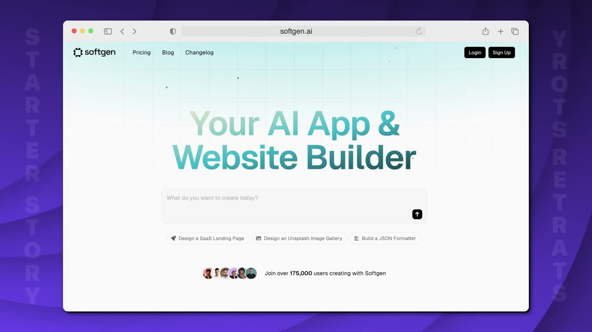
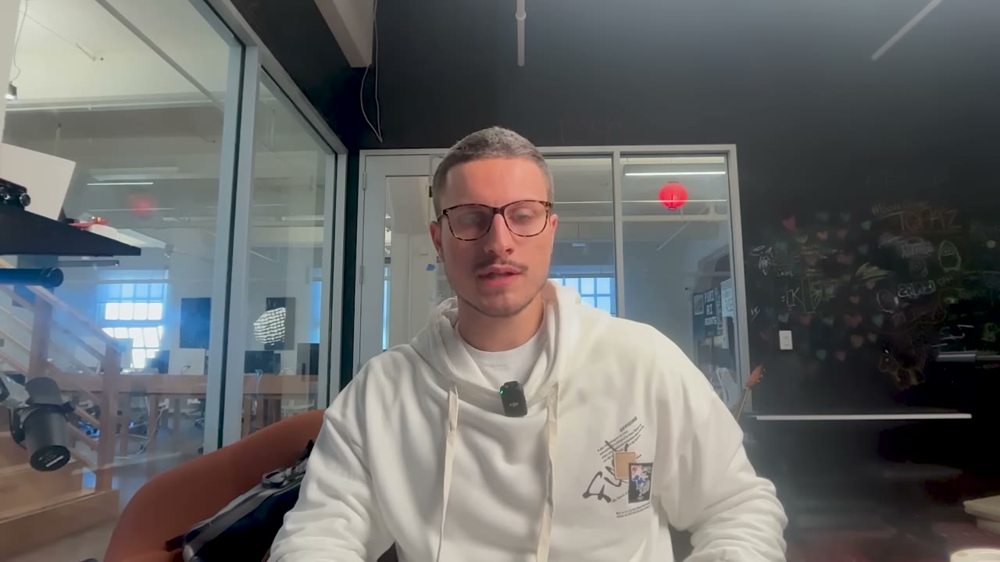
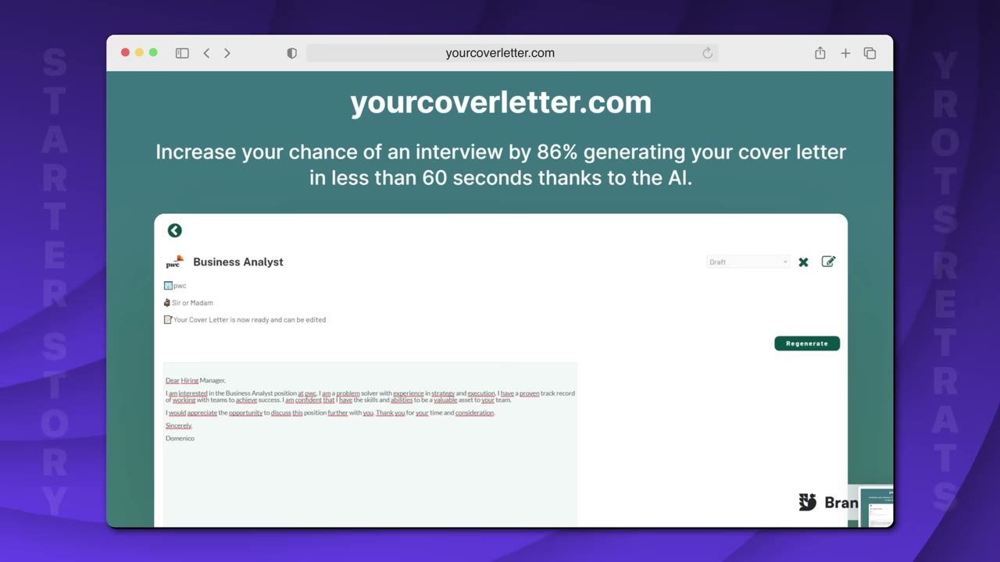
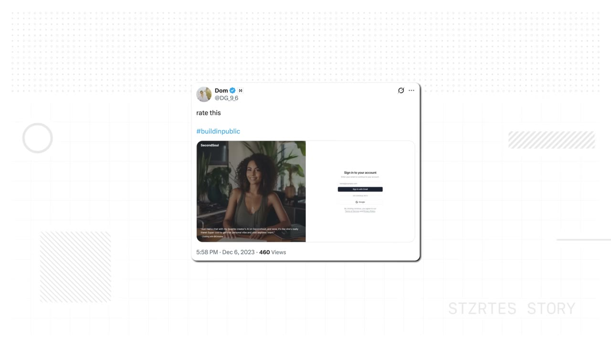
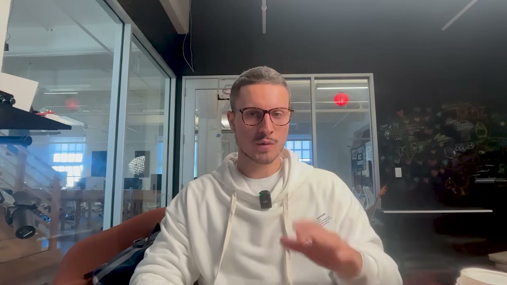
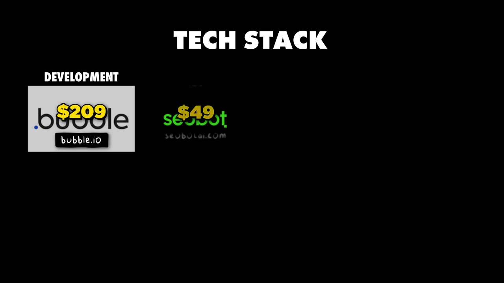
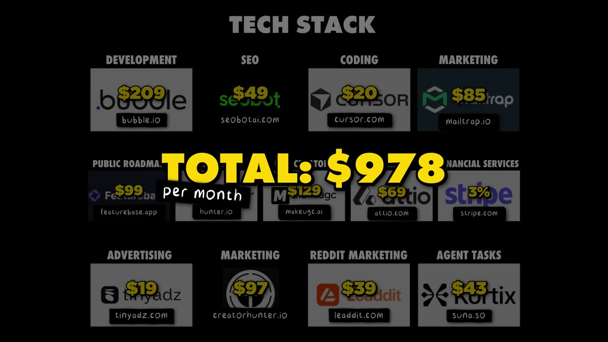
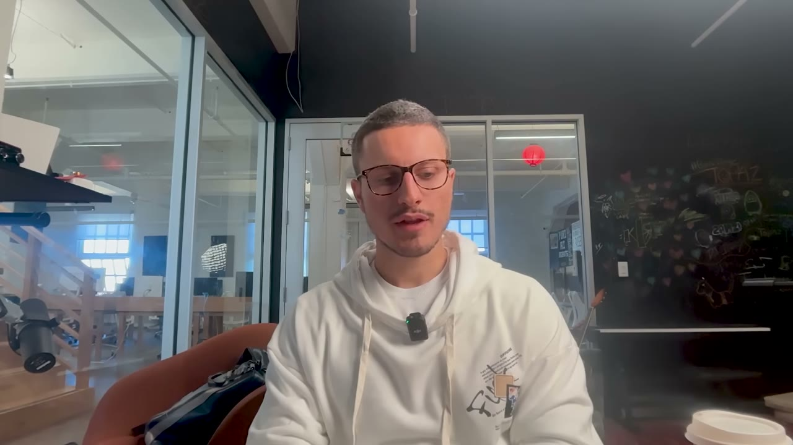
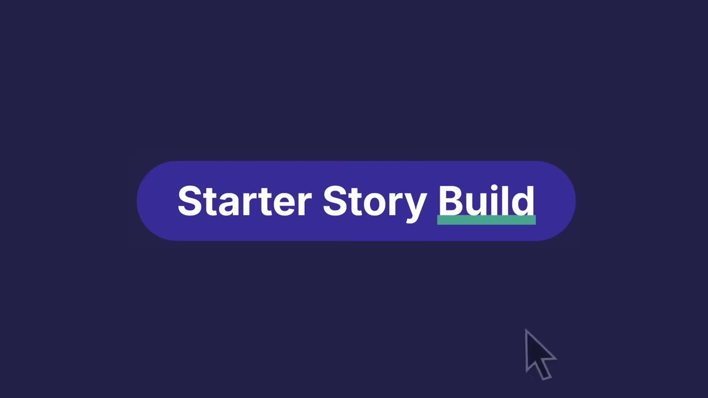

# I made $1M flipping apps

✅ **Đã phân tích sâu** → [`case.md`](case.md)

| | |
|---|---|
| **Video** | <https://www.youtube.com/watch?v=plrni3IBEyI> |
| **Đăng** | 21/10/2025 |
| **Thời lượng** | 11:01 |
| **Lượt xem** | 52,574 |
| **Lượt thích** | 1,636 |
| **Video ID** | `plrni3IBEyI` |

## Trong thư mục này

| File | Nội dung |
|---|---|
| [`case.md`](case.md) | **Phân tích đầy đủ** — ý tưởng, validate, GTM, áp dụng ở VN |
| [`meta.json`](meta.json) | Metadata gốc (chapters, heatmap, mô tả) |
| [`screenshots/`](screenshots/) | 9 ảnh 720p |

## Mô tả gốc

Meet Domenico, a non-technical founder, who set out on a challenge to build and sell a SaaS in 30 days back in January 2022. Since then, Domenico has successfully sold 6 micro-saas projects for $60K, scaled Softgen from $20K to $500K ARR, and sold it for over $1M. In this video, Domenico will share his playbook for building and selling micro-SaaS projects.
0:00 - Intro
0:55 - Who is Domenico
1:17 - Dom's background
2:06 - Build-and-sell challenge
4:12 - Dom's build-and-sell framework
6:39 - What makes apps successful
7:10 - Building while working 9 to 5
7:59 - Tech stack
8:53 - Dom's next step

## Số liệu bắt được từ transcript

> Các đoạn founder nhắc tới con số, kèm timestamp để tua thẳng tới đó trong video.

_(không bắt được con số nào)_

## Chương

- `00:00` Intro
- `00:55` Who is Domenico
- `01:17` Dom's background
- `02:06` Build-and-sell challenge
- `04:12` Dom's build-and-sell framework
- `06:39` What makes apps successful
- `07:10` Building while working 9 to 5
- `07:59` Tech stack
- `08:53` Dom's next step
- `09:16` Dom's advice to entrepreneurs
- `10:20` The final word

## Ảnh

1. `01_01m07s_ch-who-is-domenico.jpg` — 
2. `02_02m26s_usd-300.jpg` — 
3. `03_03m15s_usd-25k.jpg` — 
4. `04_04m48s_replay.jpg` — 
5. `05_06m51s_ch-what-makes-apps-successful.jpg` — 
6. `06_08m11s_ch-tech-stack.jpg` — 
7. `07_08m52s_replay.jpg` — 
8. `08_09m28s_ch-dom-s-advice-to-entrepreneurs.jpg` — 
9. `09_10m32s_ch-the-final-word.jpg` — 

---

← [Quay lại index](../../index.md) · [Toàn bộ video](../README.md)
