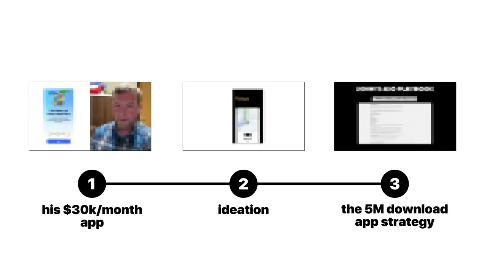
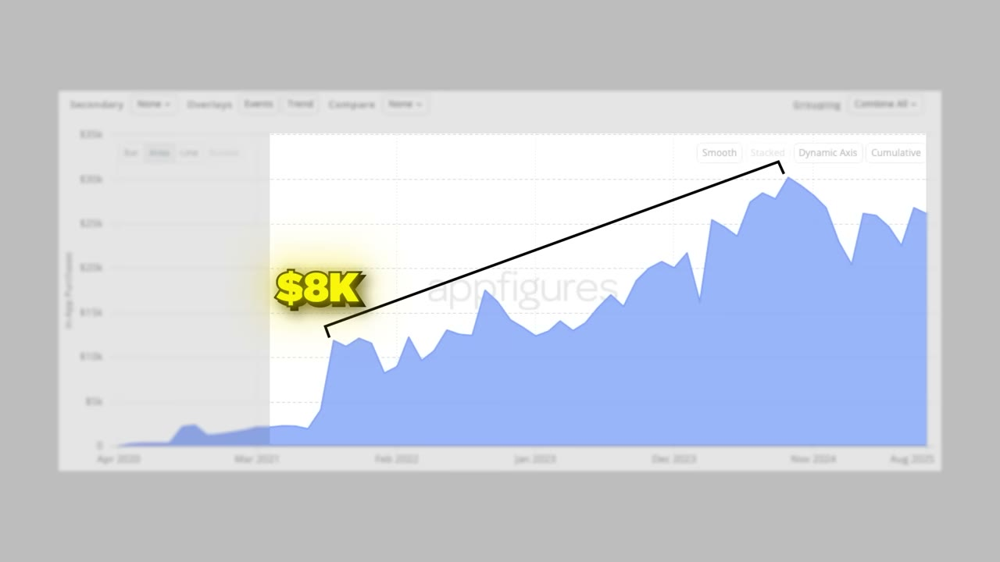
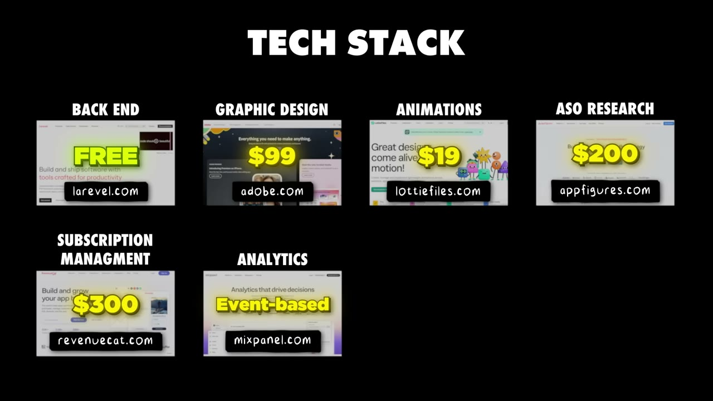

# How I built a $30K/month mobile app

✅ **Đã phân tích sâu** → [`case.md`](case.md)

| | |
|---|---|
| **Video** | <https://www.youtube.com/watch?v=T5zMsTw8GWQ> |
| **Đăng** | 23/10/2025 |
| **Thời lượng** | 14:50 |
| **Lượt xem** | 86,209 |
| **Lượt thích** | 2,314 |
| **Video ID** | `T5zMsTw8GWQ` |

## Trong thư mục này

| File | Nội dung |
|---|---|
| [`case.md`](case.md) | **Phân tích đầy đủ** — ý tưởng, validate, GTM, áp dụng ở VN |
| [`meta.json`](meta.json) | Metadata gốc (chapters, heatmap, mô tả) |
| [`screenshots/`](screenshots/) | 10 ảnh 720p |

## Mô tả gốc

John McEvoy was a graphic designer who taught himself to code. He built Momego and grew it to $30K MRR – all by himself. The biggest unlock? John uses hyper-local app store optimization and SEO. This video breaks down exactly how he built Momego and grew it to 5M downloads, 400K monthly users, and $30K MRR.
0:00 - Intro
0:47 - Who is John
1:07 - Numbers behind Momego
1:34 - Joh's background
2:01 - Idea for Momego
2:52 - How John built the app
4:07 - What grew Momego to $30K/month
4:42 - How to get millions of users for free
8:22 - Growth timeline: from 0 to $30K/month
9:36 - What the app does

## Số liệu bắt được từ transcript

> Các đoạn founder nhắc tới con số, kèm timestamp để tua thẳng tới đó trong video.

_(không bắt được con số nào)_

## Chương

- `00:00` Intro
- `00:47` Who is John
- `01:07` Numbers behind Momego
- `01:34` Joh's background
- `02:01` Idea for Momego
- `02:52` How John built the app
- `04:07` What grew Momego to $30K/month
- `04:42` How to get millions of users for free
- `08:22` Growth timeline: from 0 to $30K/month
- `09:36` What the app does
- `11:44` Tech stack
- `12:34` Costs & margins
- `12:55` Solve your own problem
- `14:11` Episode summary

## Ảnh

1. `01_00m36s_usd-30-000.jpg` — 
2. `02_01m19s_ch-numbers-behind-momego.jpg` — 
3. `03_02m13s_ch-idea-for-momego.jpg` — 
4. `04_03m04s_ch-how-john-built-the-app.jpg` — 
5. `05_04m19s_ch-what-grew-momego-to-30k-month.jpg` — 
6. `06_04m54s_ch-how-to-get-millions-of-users-for-free.jpg` — 
7. `07_08m43s_usd-8-000.jpg` — 
8. `08_09m34s_replay.jpg` — 
9. `09_10m45s_replay.jpg` — 
10. `10_12m23s_usd-90.jpg` — 

---

← [Quay lại index](../../index.md) · [Toàn bộ video](../README.md)
