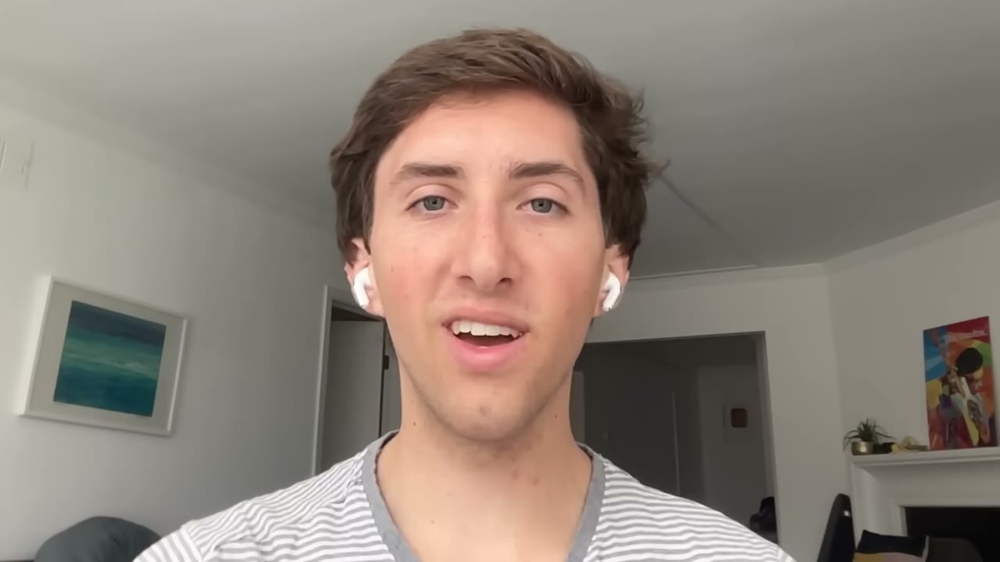
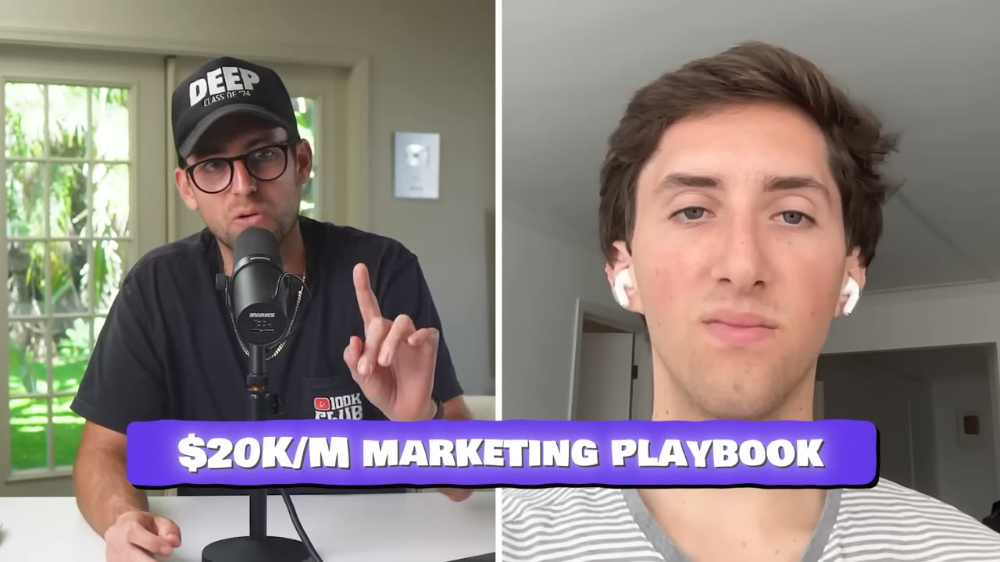
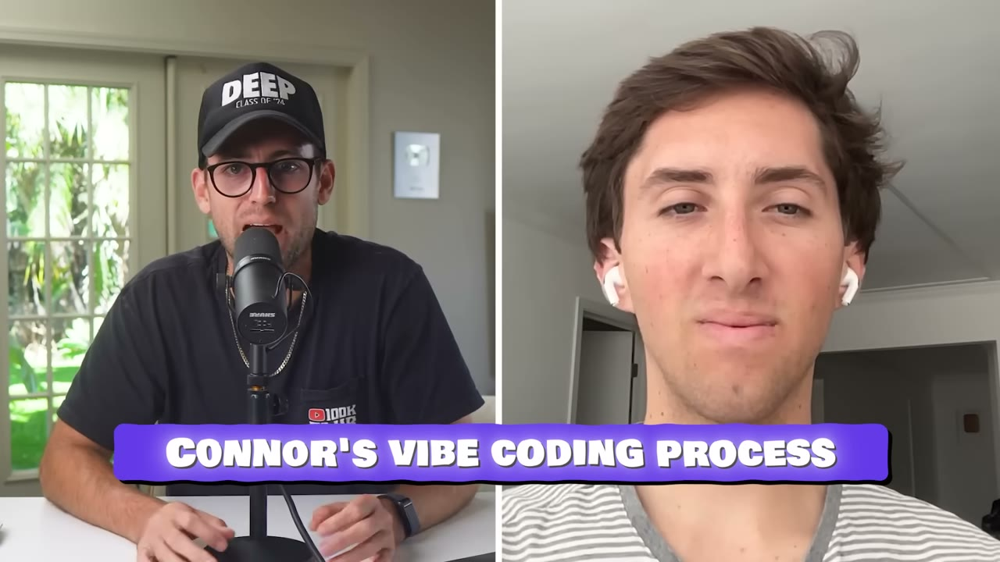
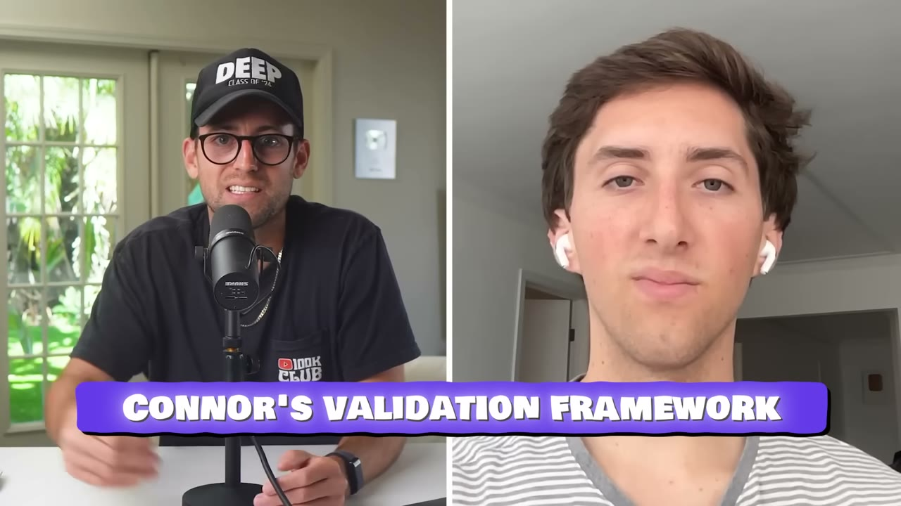
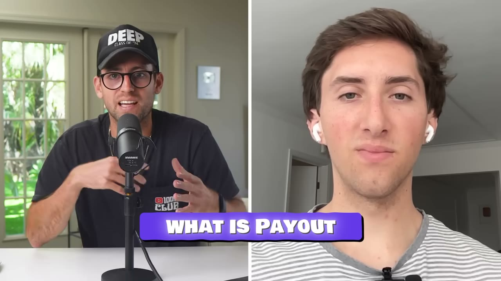
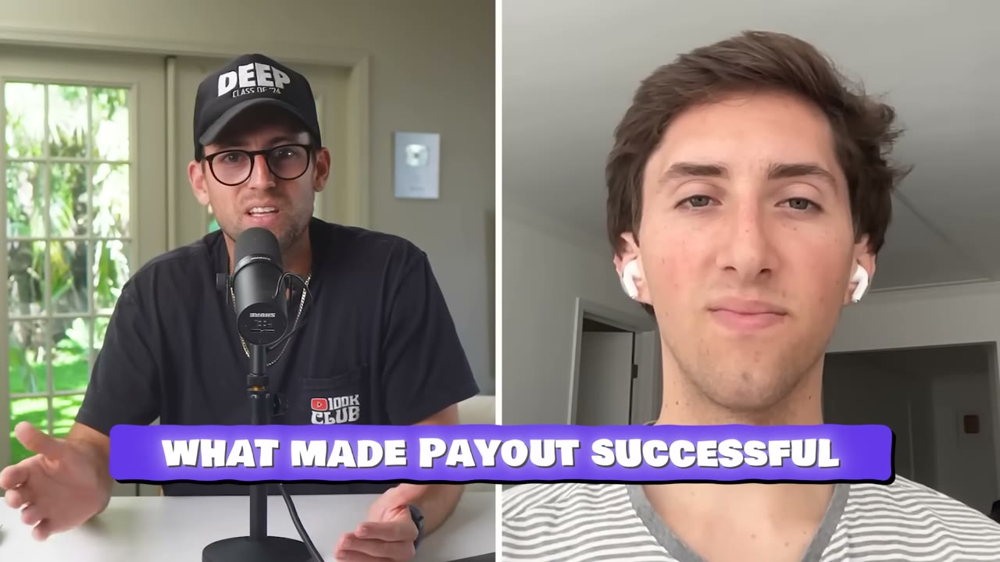
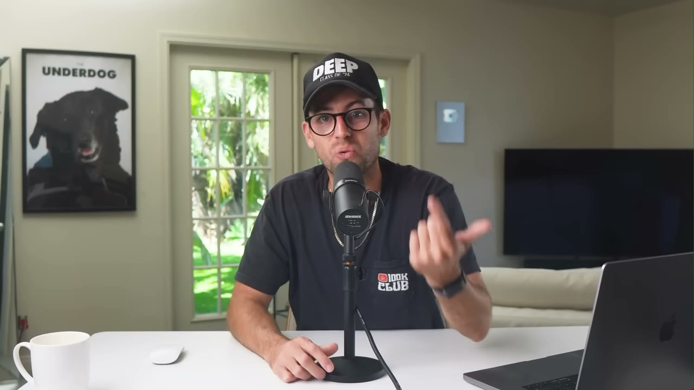

# Payout — $20K/tháng sau 50 ngày, và một quy trình vibe code lấy onboarding làm trung tâm

> **Tóm tắt 30 giây:** Connor Burd, 23 tuổi, không có nền tảng lập trình, từng mất **6-8 tháng** để build app đầu tiên (thất bại). Giờ anh build app trong **dưới 14 ngày, 100% bằng Claude Code**. App mới nhất tên **Payout** — giúp người Mỹ tìm các vụ **kiện tập thể (class action)** mà họ đủ điều kiện nhận tiền bồi thường, rồi điền sẵn đơn thành file PDF để gửi đi. Ra mắt đầu tháng 8, **50 ngày sau đạt $20.000/tháng** và **12.000 lượt tải**, thắng giải nhất hạng mục tăng trưởng của hackathon RevenueCat Shipaton với **hơn 55.000 người dự thi**. Insight trung tâm: anh thiết kế **onboarding trước, tính năng sau** — vì *"90% người dùng có khi chỉ nhìn thấy mỗi onboarding của bạn"*.

## 1. Con số

| Chỉ số | Giá trị |
|---|---|
| Doanh thu Payout | **$20.000/tháng** |
| Thời gian đạt được | **50 ngày** kể từ khi ra mắt (đầu tháng 8) |
| Thời gian build | **dưới 14 ngày**, 100% bằng AI |
| Lượt tải Payout | hơn 12.000 |
| Số subscription mới | *"over ...300 new subscriptions"* — phụ đề bị cắt số, không đọc được |
| Tổng danh mục | ~6 app, hơn **$1 triệu** doanh thu subscription |
| Hackathon | RevenueCat Shipaton, hơn 55.000 người dự thi |
| Giải | Nhất hạng mục **Build and Grow**, tổng giải thưởng $65.000 |
| App đầu tiên | Hotspot Events — 6-8 tháng, thất bại |
| Giá | gói tuần + gói năm, đẩy mạnh gói năm |
| Chi quảng cáo | **KHÔNG NÊU** |

**Ghi chú mâu thuẫn và lỗ hổng số liệu:**

1. **$1M/năm hay $100K/tháng?** Voiceover mở đầu nói *"apps của tôi làm hơn một triệu đô doanh số **mỗi năm**"*; Connor nói *"những app này đã làm hơn một triệu doanh thu **rồi**"* (tích luỹ) và *"tôi đã scale những app này lên hơn một triệu doanh thu subscription"*. Phần mô tả video lại ghi *"several apps that make $100K/month"* (= $1,2M/năm). **Ba cách đọc khác nhau.** Tôi ghi $1 triệu và đánh dấu là mơ hồ.
2. **Số subscription bị cắt.** Phụ đề tự động ghi *"over,300 new subscriptions"* — mất chữ số hàng nghìn. Không suy đoán.
3. **Lỗ hổng lớn nhất: KHÔNG có con số chi phí quảng cáo và KHÔNG có biên lợi nhuận cho Payout.** Đây là điều nghiêm trọng vì Connor nói rõ mục tiêu của anh luôn là *"đưa app tới mức chạy được paid ads"*. $20K doanh thu chạy bằng $18K quảng cáo là một câu chuyện hoàn toàn khác với $20K organic. **Video không cho bạn biết là cái nào.** So sánh: [David/Stoppr](../2025-10-30_i-vibe-coded-a-12k-month-mobile-app-stoppr-breakdown/case.md) khai biên 35% và [Kelechi](../2025-10-28_my-2-apps-made-1-5m/case.md) khai trên 90% — cùng câu hỏi này, hai câu trả lời cách nhau ba lần.
4. **Bối cảnh hackathon bóp méo động cơ.** Giải $65.000 được trao cho app **tăng trưởng mạnh nhất trong 2 tháng**. Với phần thưởng đó, chi mạnh quảng cáo để đẩy tăng trưởng — kể cả lỗ — là **hoàn toàn hợp lý về mặt kinh tế**. $20K/tháng trong 50 ngày cần được đọc dưới ánh sáng này. Không có bằng chứng Connor làm vậy, nhưng cũng không có bằng chứng ngược lại, và đó chính là vấn đề.

## 2. Bối cảnh: 6-8 tháng → 14 ngày ⭐⭐

Trước khi làm app, Connor là *"một đứa trẻ chơi game quá nhiều, thức khuya, không có nền tảng khoa học máy tính"*.

> *"Một đêm giữa khuya tôi tỉnh dậy với một ý tưởng app ngẫu nhiên và tôi viết toàn bộ ý tưởng đó vào ghi chú. Tôi chưa từng code gì cả. Sáng hôm sau tôi dậy và bắt đầu xem video YouTube. Lúc đó tôi **không có MacBook** mà lại muốn làm app iOS, và tôi cũng **không có tiền** — nên tôi bắt đầu làm việc vặt, **bán những món đồ linh tinh trong phòng**, và cuối cùng vớ được một cái MacBook cũ."*

App đầu tiên: **Hotspot Events**, một app mạng xã hội. Mất **6-8 tháng**, thất bại.

> *"Sau app đầu tiên đó tôi nhanh chóng nhận ra rằng **các app mang tính mạng xã hội thì cực kỳ khó scale**. Nên tôi chuyển sang **tiện ích và công cụ** — những thứ này dễ scale hơn nhiều với một người làm một mình."*

**Bài học cơ chế, không phải bài học động viên.** App mạng xã hội cần **hiệu ứng mạng** — nó vô giá trị cho tới khi có đủ người dùng, và bạn không mua được giá trị đó bằng quảng cáo. App tiện ích có giá trị **ngay ở người dùng thứ nhất** — nghĩa là mọi đồng quảng cáo bạn chi đều tạo ra giá trị đo được ngay. Đây là lý do các case app di động trong kho này gần như **không có case mạng xã hội nào thành công** — và đúng lúc, [Kelechi](../2025-10-28_my-2-apps-made-1-5m/case.md) cũng thất bại đúng ở app mạng xã hội (Casp) trước khi thành công với app tiện ích.

Đây cũng là bộ lọc ý tưởng đầu tiên bạn nên chạy: **app của tôi có giá trị với đúng một người dùng không?** Nếu không, đừng làm một mình.

## 3. Quy trình vibe code — onboarding là trung tâm ⭐⭐⭐

Đây là phần đáng giá nhất video và nó dài gần 4 phút. Trình tự chính xác:

### Bước 1 — Tải 20 app về, chụp TOÀN BỘ onboarding

> *"Việc đầu tiên tôi làm là tải về một đống app, có thể **20 app** trong ngách tôi đang nhắm tới, cộng với những app tôi thấy **đẹp** và muốn lấy cảm hứng thiết kế."*

> *"Việc tiếp theo là **chụp màn hình từng trang trong từng onboarding**. Tôi lấy tất cả screenshot đó và **xếp thành một hàng dài trong một file Figma**, để tôi thấy được toàn bộ các onboarding — mọi câu hỏi họ hỏi, mọi biểu đồ họ có. Rồi tôi chọn ra những cái tôi thích, lấy vài cái từ app này, vài cái từ app kia, và thiết kế lại theo tông và thẩm mỹ tôi muốn."*

**Vì sao xếp thành một hàng dài lại quan trọng:** khi bạn đặt 20 luồng onboarding cạnh nhau, bạn không còn nhìn thấy các màn hình — bạn nhìn thấy **mẫu hình chung**. Câu nào ai cũng hỏi? Biểu đồ xuất hiện ở bước thứ mấy? Paywall rơi ở đâu? Đó là **dữ liệu chuyển đổi đã được hàng triệu đô quảng cáo của người khác kiểm chứng**, và nó miễn phí.

Chú ý: đây là **cùng một kỹ thuật** [David/Stoppr](../2025-10-30_i-vibe-coded-a-12k-month-mobile-app-stoppr-breakdown/case.md) dùng, nhưng với một khác biệt quan trọng. David copy **một** app (nguyên vẹn, đổi ngách). Connor lấy **20** app và **trộn** các phần tốt nhất. Cách của Connor tránh được rủi ro bản quyền và rủi ro bị Apple đánh dấu copycat, đổi lại tốn nhiều công thiết kế hơn.

### Bước 2 — Hiểu vì sao onboarding quan trọng hơn tính năng

> *"Tôi nghĩ **cực kỳ quan trọng** là phải có một onboarding dài và kỹ. Thực tế mà nói, **90% người dùng có khi chỉ bao giờ nhìn thấy mỗi onboarding của bạn** nếu bạn có phần bị chặn sau paywall. Nên tôi nghĩ bạn phải dành **rất nhiều** thời gian cho nó — có thể **nhiều bằng thời gian thiết kế chức năng thật của app**."*

Đây là câu quan trọng nhất video. Logic của nó:

Nếu app có paywall đặt cuối onboarding, thì với 100 người tải app:
- **100 người** đi qua onboarding
- Chỉ **5-10 người** trả tiền và nhìn thấy sản phẩm thật

→ **Onboarding chính là sản phẩm** đối với 90% người dùng. Mọi giờ bạn bỏ vào tính năng thứ tư trong khi onboarding còn yếu là giờ bỏ vào thứ mà 9 trên 10 người sẽ không bao giờ thấy.

### Bước 3 — Bốn quy tắc để onboarding chuyển đổi

Connor liệt kê rõ ràng:

| # | Quy tắc | Lý do anh nêu |
|---|---|---|
| 1 | **Khơi gợi cảm xúc** | *"Phần lớn quyết định mua của người tiêu dùng là **cảm tính, không phải lý tính**."* |
| 2 | **Cho thấy lợi ích mạnh nhất** | Người dùng phải hiểu app cải thiện đời họ thế nào, và việc mua phải **rất đơn giản** |
| 3 | **Làm nó thấy như dành riêng cho họ** | *"Thời buổi cạnh tranh này, người ta muốn thứ họ mua **có cảm giác được làm riêng cho mình**, chứ không phải một app chung chung."* |
| 4 | **Có biểu đồ, đồ thị** | *"Người ta thích biết thứ họ dùng **đã được chứng minh là hiệu quả**... thêm biểu đồ sẽ làm app trông rất chính danh."* |

**Cơ chế của quy tắc 3 và 4 kết hợp với nhau:** loạt câu hỏi cá nhân hoá ở đầu onboarding không chỉ để "cá nhân hoá". Nó tạo ra **cam kết đã bỏ công sức** — người dùng vừa trả lời 8 câu hỏi về bản thân, nên họ đã đầu tư vào kết quả. Rồi biểu đồ ở cuối **biến câu trả lời của chính họ thành một lời tiên tri** (*"đây là bạn sau 12 tuần"*). Paywall xuất hiện ngay sau đó, ở đúng đỉnh cảm xúc. Đây là công thức chuẩn của mọi app sức khoẻ/thói quen bán chạy — Connor chỉ nói ra nó một cách hệ thống.

### Bước 4 — Thiết kế CẤU TRÚC DỮ LIỆU trước khi code ⭐⭐⭐

Đây là mẹo kỹ thuật giá trị nhất và ít người nói:

> *"Bước tiếp theo là bạn sẽ muốn **thiết kế cấu trúc dữ liệu**. Cái này **cực kỳ quan trọng riêng cho vibe coding**. Quan trọng là phải biết dữ liệu của bạn trông thế nào, hình dạng ra sao. Vì khi bạn đưa cho AI như Cursor hay Claude, nó sẽ **đơn giản hơn nhiều để AI biết chính xác bạn đang cố xây cái gì, để nó không phải đoán**."*

> *"Tôi khuyên nên làm **một file text có phần giải thích, cộng thêm một ít dữ liệu JSON** mô tả dữ liệu của bạn thực sự trông thế nào, và thông tin về từng thuộc tính bạn sẽ có. **Đưa file text này trước** cho phép tôi code cái này rất nhanh."*

**Vì sao điều này tạo khác biệt lớn:** khi AI phải tự đoán schema, nó sẽ đoán **khác nhau ở mỗi lần prompt**. Màn hình A dùng `user.name`, màn hình B dùng `user.fullName`, màn hình C dùng `profile.displayName`. Bạn không phát hiện ra cho tới khi ghép chúng lại — và lúc đó bạn mất nhiều giờ refactor. **Một file schema cố định đưa trước là thứ biến vibe coding từ "may rủi" thành "lặp lại được".** Đây là chi tiết kỹ thuật đáng áp dụng nhất trong cả ba case cùng đợt này.

### Bước 5 — Build chức năng lõi trước, onboarding sau

> *"Thường tôi bắt đầu bằng việc build **chức năng lõi** của app, **bỏ qua onboarding**, đi thẳng vào tính năng chính."*

Chú ý mâu thuẫn biểu kiến: anh **thiết kế** onboarding trước nhưng **code** nó sau. Điều này hợp lý — thiết kế onboarding buộc bạn phải quyết định app hứa hẹn điều gì, nhưng code nó trước khi có sản phẩm thật thì bạn sẽ phải sửa lại.

> *"Bạn có thể **thả thẳng screenshot vào Claude hoặc Cursor**. Vì giờ nó đọc được ảnh và hiểu được nó đang nhìn cái gì, nó sẽ viết được code cho cả màn hình đó cho bạn."*

> *"Khi làm việc với AI, nó không phải lúc nào cũng đúng ngay lần đầu. Nên đôi khi bạn cần tiếp tục làm với nó rồi cuối cùng nó sẽ ra đúng chi tiết. **Tôi không khuyên bạn quá kén chọn**, vì quan trọng là **đưa được một phiên bản ra ngoài nhanh, hơn là đưa ra một app hoàn hảo**."*

**Công cụ:** *"Về công cụ tôi dùng hiện tại, thật ra tôi **chỉ dùng Claude**. Đó là thứ duy nhất tôi dùng để code bằng AI và nó làm mọi thứ cho tôi."*

## 4. Khung xác thực — hai loại app ⭐⭐

> *"Theo tôi thấy thì có **hai loại app**. Có **đổi mới ý tưởng mới**, và có **sửa đổi phiên bản của ý tưởng đã tồn tại**."*

**Loại 1 — bản sửa đổi của thứ đã có:**
> *"Thì chúc mừng, **app của bạn đã được người khác xác thực rồi**. Giờ việc duy nhất bạn phải làm là sửa đổi vài chỗ và làm cho app có cảm giác là của bạn."*

**Loại 2 — thứ hoàn toàn mới:**
> *"Tôi thường lên TikTok, Instagram, xem có ai đang nói về vấn đề mình định giải không. Bạn muốn chắc chắn rằng **có một con đường dễ để bạn marketing app này** — bằng cách nhìn vào phần bình luận và xem **người ta có đang đặt câu hỏi kiểu làm sao để giải quyết vấn đề này** không."*

Chú ý bước này **giống hệt** cách [David/Stoppr](../2025-10-30_i-vibe-coded-a-12k-month-mobile-app-stoppr-breakdown/case.md) xác thực (TikTok + Google Trends) và cùng logic với [Kelechi](../2025-10-28_my-2-apps-made-1-5m/case.md) (*"ngách này đã có nhiều content chưa?"*). **Ba founder độc lập, cùng một bài test: xác thực không phải là hỏi người ta có muốn không, mà là kiểm tra CÓ SẴN KÊNH PHÂN PHỐI hay không.**

### Và rồi anh bỏ hẳn bước xác thực

> *"Rồi với tốc độ build app hiện nay, tôi thật ra sẽ **bỏ qua các bước waitlist và cứ thế build app luôn**. Tôi thực sự tin rằng **bất kỳ app nào cũng có thể kiếm được vài nghìn đô những ngày này**. Ý tưởng của bạn không cần phải là app điên rồ thay đổi xã hội để kiếm vài nghìn đô. Riêng ở Mỹ có **hàng trăm triệu người**. Nếu bạn nắm được dù chỉ **một hạt cát** trong số đó, bạn kiếm được đủ nhiều để tự nuôi mình."*

**Đây là chỗ mâu thuẫn thẳng với các case khác trong kho — và điều kiện phân định rất rõ ràng:**

| Quan điểm | Ai nói | Điều kiện đúng |
|---|---|---|
| Bỏ waitlist, build luôn | Connor (case này) | **Chi phí build dưới 2 tuần.** Khi build rẻ hơn validate, validate là lãng phí |
| Xác thực trước khi viết dòng code nào | [Once](../2026-05-10_i-built-a-20k-month-app-in-83-days/case.md) | Sản phẩm cần trên 1 tháng, hoặc cần đối tác/vận hành |
| Làm CONTENT trước, viral rồi mới build | [GlowUp](../2025-12-17_my-mobile-app-made-800k-in-365-days/case.md) | Bạn nghi ngờ phân phối nhiều hơn nghi ngờ sản phẩm |

**Quy tắc phân định (tôi rút ra, không phải lời video):** so sánh **chi phí build** với **chi phí sai**.
- Build 14 ngày solo bằng AI → chi phí sai là 14 ngày. **Build luôn.**
- Build 3 tháng, hoặc phải thuê người, hoặc phải đàm phán đối tác → **xác thực trước.**
- Nếu bạn nghi ngờ có ai muốn nó không, hãy build. Nếu bạn nghi ngờ có cách nào tiếp cận họ không, hãy làm content trước (cách GlowUp).

Cần nói thẳng một điều video không nói: Connor có **5 app trước đó** và hơn $1M doanh thu. Với anh, "cứ build luôn" là quyết định **có bảo hiểm**. Với người làm app đầu tiên, cùng lời khuyên đó nghĩa là đánh cược 100% thời gian có được.

## 5. Playbook marketing 0 → $20K trong 50 ngày ⭐⭐

Bốn tầng, theo đúng thứ tự:

### Tầng 1 — Một influencer đã ở sẵn trong ngách
> *"Với app này tôi hợp tác với **một content creator đã ở sẵn trong ngách** của app tôi đang build, và video của anh ta đưa được **hàng nghìn lượt tải** về app."*

Mục tiêu: *"tạo ra content **liên quan được, viral, tự nhiên và không có vẻ dàn dựng**"*.

### Tầng 2 — Nhân bản format đã thắng
> *"Một khi một trong những video này bắt đầu chạy tốt, bạn có thể **làm thêm nhiều video giống vậy với các creator khác**, để người ta lặp lại chính những format đang hiệu quả cho bạn."*

Giống hệt bước 3 của [Kelechi](../2025-10-28_my-2-apps-made-1-5m/case.md).

### Tầng 3 — UGC là nhà máy sản xuất quảng cáo ⭐⭐⭐
Đây là mảnh ghép mà nhiều người bỏ sót:

> *"Một trong những lợi ích lớn của việc chạy các chiến dịch UGC này là khi các creator sản xuất content, **bạn đang xây dựng sẵn một thư viện quảng cáo để chạy trong tương lai**. Và bạn **đã biết trước hiệu suất của quảng cáo sẽ tốt cỡ nào** dựa trên việc nó chạy tốt ra sao khi organic."*

**Cơ chế:** đây là cách xoá bỏ rủi ro đắt nhất của paid ads. Bình thường bạn phải **đốt tiền để tìm ra creative nào hiệu quả**. Nếu bạn chạy organic trước, thị trường đã test creative miễn phí cho bạn — bạn chỉ đổ tiền vào những cái đã thắng. Nói cách khác: **organic không phải là kênh thay thế paid ads, nó là phòng thí nghiệm của paid ads.**

### Tầng 4 — Facebook ads là đích đến
> *"Và mục tiêu của tôi **luôn là đưa app tới điểm có thể chạy paid ads**. Đó là **cách nhất quán nhất** để đẩy tăng trưởng doanh thu cho app."*

Và một quan sát cập nhật về thuật toán:

> *"Gần đây thuật toán quảng cáo đã thay đổi. Facebook đang cố cân bằng hai thứ: họ muốn **nhà quảng cáo hài lòng với kết quả**, đồng thời **giữ người dùng ở lại nền tảng bằng cách đảm bảo video có tính giải trí**. **Video của bạn càng giải trí thì càng rẻ để đưa nó tới trước mặt người ta** — nhưng bạn cũng phải đảm bảo nó tạo ra chuyển đổi. Nên quan trọng là tìm được **điểm cân bằng** giữa một video rất giải trí và có khả năng chuyển đổi."*

**Hệ quả thực tế:** giá CPM của bạn không phải hằng số — nó là **hàm của mức độ giải trí của video**. Điều này giải thích vì sao cùng một ngân sách, người này lấy được gấp ba lần lượt hiển thị so với người kia. Nó cũng nghĩa là: **video quảng cáo trông giống quảng cáo là loại đắt nhất bạn có thể chạy.**

## 6. Sản phẩm Payout — và vì sao nó hoạt động

> *"App của tôi tên là **Payout**. Nó là app **khám phá các vụ kiện tập thể**, cho phép người ta tìm những vụ class action mà họ **vốn đã đủ điều kiện tham gia**. Về cơ bản đây là cách để người ta lấy tiền từ những công ty đã làm sai điều gì đó."*

**Luồng onboarding anh demo:**
1. Xin quyền gửi thông báo
2. **Social proof**
3. **Paywall** — có gói tuần và gói năm. *"Paywall này đang chuyển đổi rất tốt. Mục tiêu là **ưu tiên đẩy người dùng chọn gói năm** vì nó có **lifetime value cao nhất trên mỗi khách**."*

**Tính năng chính:**
- Danh sách các vụ kiện tập thể, tick xem bạn có đủ điều kiện không. Ví dụ anh demo: **NBA Top Shot** — vụ dàn xếp về quyền riêng tư liên quan tới Meta Pixel trên website của họ.
- Mô tả + điều kiện áp dụng cho từng vụ
- Nút "get started and fill form" → điền thông tin → app **chuẩn bị sẵn file PDF** để bạn gửi đi đòi tiền
- Tab **Wallet** — theo dõi các vụ đang nộp
- Tab **Forms** — các đơn đã điền

### Vì sao nó ăn nhanh như vậy

> *"Tôi nghĩ **value proposition của app này quá hiển nhiên**. Có vài thứ cốt lõi mà tất cả mọi người đều muốn: họ muốn **khoẻ mạnh hơn**, họ muốn **kiếm nhiều tiền hơn**, họ muốn **trông hấp dẫn hơn**. Tôi thích làm app chạm vào những **ham muốn cốt lõi của con người** này. Và cái này chơi vào việc người ta muốn kiếm nhiều tiền hơn. Nên **rất dễ để người ta bỏ tiền vào một app mà họ biết sẽ kiếm lại tiền cho họ**."*

**Cơ chế thật sự nằm sâu hơn câu trả lời của anh — và nó đáng học:** Payout bán một sản phẩm mà **giá trị kỳ vọng được người mua tự tính ra trong đầu trong 2 giây**. *"Trả $8 để có thể nhận lại $200"* là phép tính ai cũng làm được ngay. Đây là loại sản phẩm **dễ bán nhất tồn tại**, vì bạn không phải thuyết phục về giá trị — bạn chỉ phải làm cho nó đáng tin.

Nhưng chính đặc điểm đó cũng tạo ra rủi ro giữ chân: nếu người dùng nộp đơn và **không nhận được tiền** (các vụ class action thường trả sau **nhiều tháng đến vài năm**, và thường chỉ vài đô), thì churn và refund sẽ tới. Video không nói gì về retention, refund rate, hay thời gian sống trung bình của subscription. **Với một app mới 50 ngày tuổi, chưa ai biết được — kể cả Connor.**

### Cảnh báo đạo đức và pháp lý (video hoàn toàn không nói)

- Đơn đòi bồi thường class action ở Mỹ **luôn miễn phí để nộp**. Payout tính phí subscription để **tìm và điền hộ** — hợp pháp, nhưng nó là **arbitrage thông tin**, không phải tạo ra giá trị mới.
- Một số bang Mỹ quản lý chặt dịch vụ hỗ trợ đòi bồi thường (claims assistance), và ranh giới với **hành nghề luật không phép** là có thật.
- App thu thập thông tin cá nhân để điền đơn pháp lý — đây là dữ liệu nhạy cảm với yêu cầu bảo mật cao.
- Apple có thể siết Guideline 5.1 về dữ liệu cá nhân và 3.1.1 với các app hứa hẹn lợi ích tài chính.

Đây là loại rủi ro **không xuất hiện trong doanh thu tháng thứ hai nhưng xuất hiện ở tháng thứ mười**.

## 7. Tech stack

| Hạng mục | Công cụ |
|---|---|
| Thiết kế UI, ảnh App Store, icon | **Figma** |
| Analytics | **Mixpanel** |
| Vibe coding | **Claude Code** (công cụ AI duy nhất) |
| Website + backend | **Next.js + TypeScript** |
| Hosting | **Vercel** |
| Version control | **GitHub** |
| Build đa nền tảng | **Expo** |
| Subscription + test giá | **RevenueCat** |

Stack này gần như trùng khớp với [Kelechi](../2025-10-28_my-2-apps-made-1-5m/case.md) và [David](../2025-10-30_i-vibe-coded-a-12k-month-mobile-app-stoppr-breakdown/case.md) ở ba mắt xích: **RevenueCat + Mixpanel + một công cụ AI code duy nhất**. Nếu bạn đang tìm stack mặc định cho app di động subscription năm 2025, ba case độc lập vừa cho bạn cùng một câu trả lời.

Điểm đáng chú ý: **RevenueCat được dùng để test giá**, không chỉ để đọc doanh thu. Đây là đòn bẩy bị bỏ quên nhiều nhất — với cùng lượng traffic, đổi cấu trúc giá thường tạo ra thay đổi lớn hơn đổi tính năng.

## 8. Lời khuyên cuối

> *"Lời khuyên số một của tôi là **build một thứ đơn giản với một onboarding tuyệt vời**. Một app đơn giản có thể kiếm rất nhiều tiền. Bạn thực sự chỉ cần **một tới ba tính năng tốt**, và **onboarding sẽ gánh phần lớn công việc** cho bạn."*

Câu này cộng hưởng thẳng với [Letterly](../2025-11-24_how-he-makes-250k-per-month-from-a-simple-app-letter/case.md) — app làm $250K/tháng bằng thứ ChatGPT làm được miễn phí, với lợi thế duy nhất là **sự đơn giản**.

## 9. Cảnh báo thiên kiến nguồn

- **Không có nhà tài trợ ngoài**, nhưng **Starter Story Build** (khoá học của chính kênh) được đẩy **hai lần dài** — một lần chèn ngay giữa phần quy trình vibe code, một lần ở cuối. Pat còn thêm đoạn *"tôi thấy nhiều người vào vibe coding, thử one-shot rồi lạc lối, không deploy được rồi bỏ cuộc"* — đây là kỹ thuật bán hàng cổ điển: tạo nỗi sợ rồi bán giải pháp.
- **Video 619.584 view** — cao nhất trong ba case cùng đợt. Tiêu đề "$20K/tháng trong 14 ngày" ghép hai con số không liên quan nhau (14 ngày là thời gian **build**; $20K/tháng đạt được sau **50 ngày marketing**). Tiêu đề gợi ý mối quan hệ nhân quả không có thật.
- **Không một con số nào có ảnh dashboard xác nhận.**
- **Không có số liệu chi phí.** Đây là thiếu sót nghiêm trọng nhất — xem mục 1.
- Connor đã có 5 app và $1M+ trước Payout. **Bạn không đang xem một người bắt đầu từ số 0 làm được $20K trong 50 ngày** — bạn đang xem một người có kinh nghiệm, có mạng lưới creator, và có vốn làm điều đó.

## 10. Áp dụng cho tôi (indie hacker VN)

**Sao chép được gì — và ở case này, phần đáng sao chép là QUY TRÌNH, không phải sản phẩm:**

1. **Áp dụng ngay bài tập "20 onboarding trên một hàng".** Chọn ngách bạn định làm, tải 20 app, chụp toàn bộ onboarding (hoặc lấy trên Mobbin), xếp vào một file Figma. Việc này mất một buổi tối và cho bạn nhiều insight chuyển đổi hơn ba tháng đọc blog.
2. **Viết file schema trước khi mở Claude Code.** Một file `data-model.md` gồm: mô tả bằng chữ + JSON mẫu + giải thích từng thuộc tính. Đây là mẹo kỹ thuật rẻ nhất và có tác động lớn nhất trong cả ba case cùng đợt.
3. **Đảo ngược thứ tự làm việc:** thiết kế onboarding → viết schema → code chức năng lõi → code onboarding. Không phải: code chức năng → nghĩ onboarding sau.
4. **Chạy organic TRƯỚC paid ads, và coi organic là phòng thí nghiệm creative.** Đừng đốt tiền quảng cáo để tìm creative — hãy để TikTok test miễn phí, rồi mới đổ tiền vào cái đã thắng.
5. **Test giá bằng RevenueCat từ ngày đầu**, đừng đợi tới khi "có đủ user".

**Rào cản thật, không tô hồng:**

- **Chính sản phẩm Payout KHÔNG chuyển giao được sang Việt Nam.** Việt Nam không có văn hoá class action settlement với quỹ bồi thường chia cho người tiêu dùng như Mỹ. Đừng cố dịch app này. **Hãy lấy quy trình, bỏ sản phẩm.**
- **Nếu bạn nhắm thị trường Mỹ với app pháp lý/tài chính, bạn cần thực thể pháp lý Mỹ.** Điều này kéo theo chi phí (LLC ~$500-1.000/năm + kế toán), và Apple sẽ hỏi giấy tờ với app loại này.
- **Dòng tiền âm 30-45 ngày với Apple**, cộng với việc paid ads phải trả trước hàng ngày. Mô hình của Connor (tiến tới paid ads) đòi hỏi **vốn lưu động thật**. Nếu bạn có dưới $5.000 chịu lỗ được, hãy đi hướng organic của [Kelechi](../2025-10-28_my-2-apps-made-1-5m/case.md) trước.
- **CPM Facebook ở VN rẻ hơn Mỹ nhiều lần, nhưng ARPU cũng thấp tương ứng.** Lợi thế không tự động thuộc về bạn — cái quyết định là tỉ lệ ARPU/CPI, không phải CPI tuyệt đối.
- **Không có số liệu chi phí trong video nghĩa là bạn không thể tự tính được unit economics.** Đừng lập kế hoạch tài chính dựa trên case này. Hãy dùng nó cho phần quy trình build.
- **Rào cản tiếng Anh: trung bình-cao** nếu nhắm thị trường Mỹ với app pháp lý — bạn phải viết nội dung pháp lý chính xác, và sai sót ở đây tốn kém.
- **Rủi ro "bỏ qua xác thực" ở người mới.** Connor bỏ waitlist vì anh đã có 5 app và biết mình đang làm gì. Nếu đây là app đầu tiên của bạn, hãy giữ lại **ít nhất bước kiểm tra TikTok/Instagram** — nó chỉ tốn một buổi tối.

**Khi nào KHÔNG dùng mô hình này:**

- **Khi app của bạn không có paywall sau onboarding.** Toàn bộ triết lý "onboarding gánh mọi thứ" chỉ đúng với mô hình **subscription + hard paywall**. App freemium, app B2B có trial, app bán một lần — cơ chế hoàn toàn khác.
- **Khi app cần hiệu ứng mạng.** Chính Connor mất 6-8 tháng để học bài này. Đừng học lại.
- **Khi giá trị sản phẩm không tính được trong 2 giây.** Payout thắng vì *"trả $8 để nhận $200"*. Nếu sản phẩm của bạn cần một đoạn giải thích để hiểu tại sao đáng tiền, playbook onboarding cảm xúc này sẽ không cứu được bạn.
- **Khi bạn không có vốn để tiến tới paid ads.** Connor coi paid ads là **đích đến bắt buộc**. Nếu bạn không thể tới đó, mô hình của anh chỉ hoàn thành được một nửa, và bạn sẽ kẹt ở đỉnh của làn sóng organic đầu tiên.
- **Khi ngách của bạn có rủi ro pháp lý.** Payout đứng khá gần ranh giới. Đừng chọn ngách nhạy cảm cho sản phẩm đầu tiên — bạn sẽ không có nguồn lực để xử lý khi nền tảng hoặc cơ quan quản lý gõ cửa.

## Nguồn

- Video: <https://www.youtube.com/watch?v=CwHD6Fg-Mjs> (13:26, đăng 26/10/2025, 619.584 view)
- Founder: <https://x.com/busdownbonnor>
- [Transcript đầy đủ](transcript.md) · [Ảnh chụp](screenshots/)
