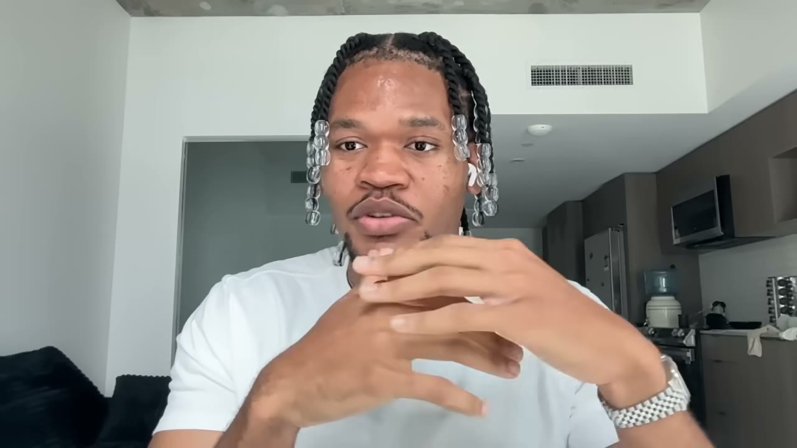
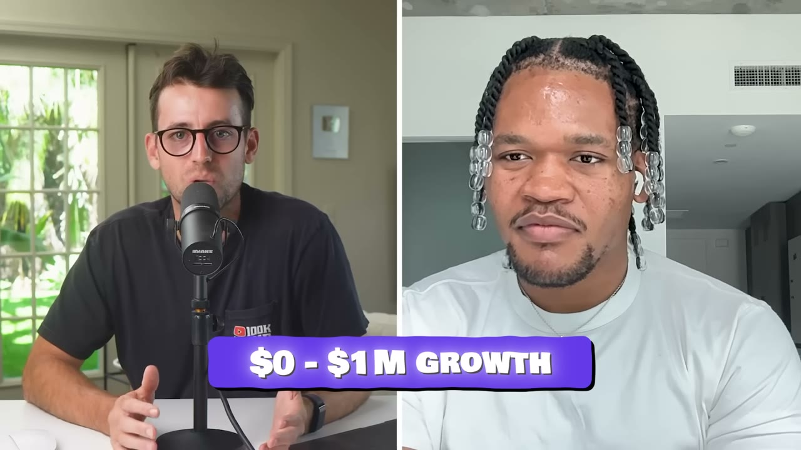
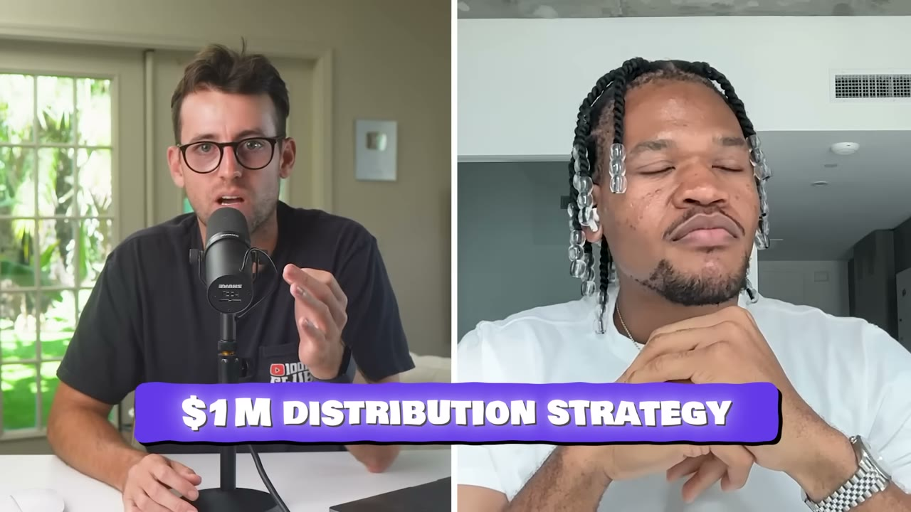
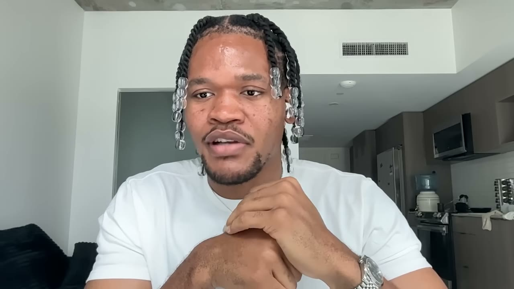
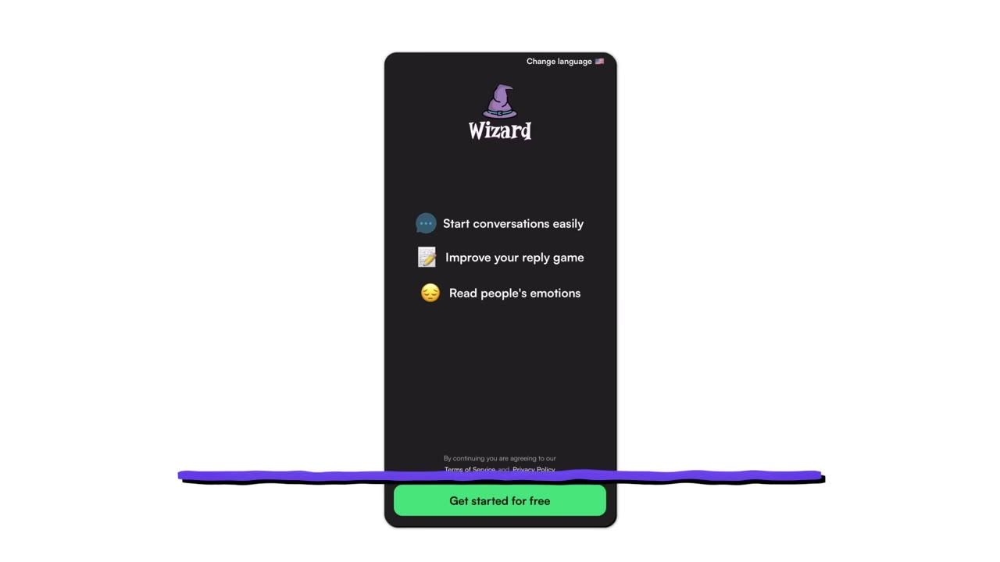
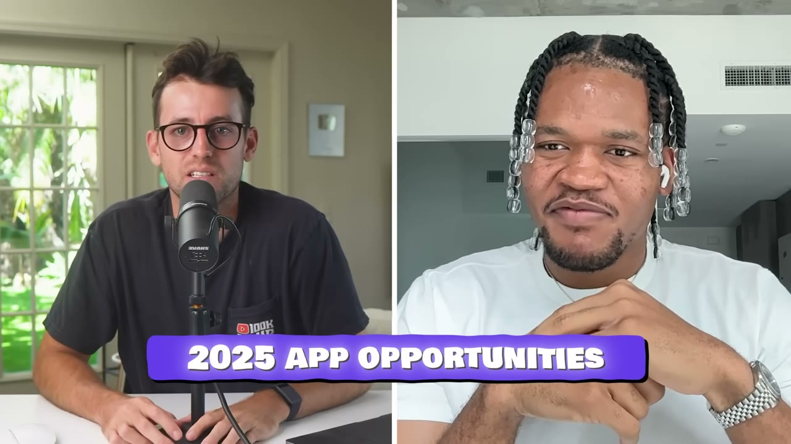
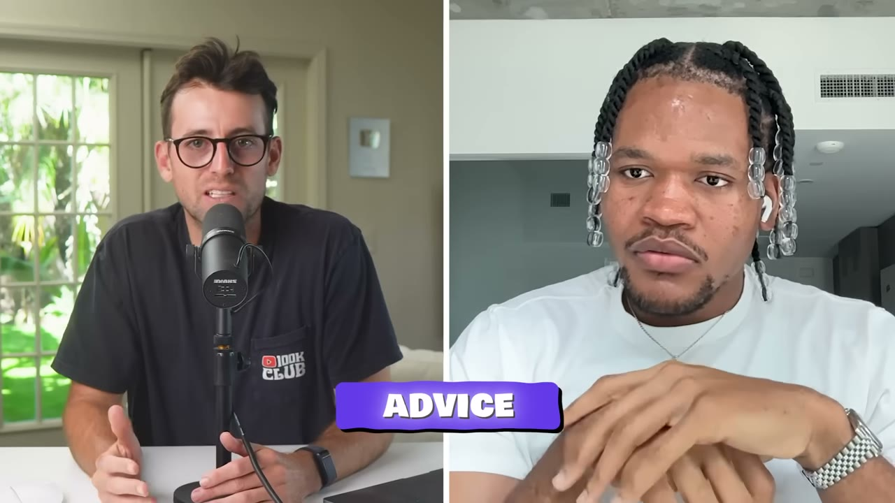

# Social Wizard — $1,5M trong 12 tháng từ hai app, không tốn một đồng quảng cáo

> **Tóm tắt 30 giây:** Kelechi, 22 tuổi, người Nigeria, sang Mỹ với **$100 trong túi**. App đầu của anh (Casp) thất bại — nhưng chính trên app đó anh thích một cô gái, nhắn tin hỏng chuyện, rồi viết một script NestJS gọi OpenAI để nghĩ hộ câu nhắn. Đó thành Social Wizard. Đơn hàng đầu tiên là **$10**; anh mất **4 tuần** mò cách phân phối; hai tuần sau đó là **$3.500 MRR**, một tháng sau là **$25.000 MRR**, hết năm là **~$500.000 tiền mặt thu về**. Vũ khí duy nhất: thuê **streamer siêu nhỏ, chưa từng viral bao giờ**, diễn lại đúng một format. Một video giá **$120** đạt **2 triệu view** và mang về hàng chục nghìn đô. Biên lợi nhuận **trên 90%**.

## 1. Con số

| Chỉ số | Giá trị |
|---|---|
| Tổng doanh thu 12 tháng | **$1,5 triệu** (2 app) |
| Doanh thu app 1 (Social Wizard) | gần $1 triệu |
| Lượt tải | hơn 700.000 (app 1 chiếm hơn 600.000) |
| Đỉnh doanh thu tháng | ~$60.000 |
| Đơn hàng đầu tiên | **$10**, cuối tháng 1 |
| MRR sau 2 tuần kể từ khi phá được phân phối | $3.500 |
| MRR sau 1 tháng | hơn $25.000 |
| Tiền mặt thu về sau 6 tháng | ~$250.000 |
| Tiền mặt thu về hết năm 1 | ~$500.000 |
| Chi quảng cáo trả phí trong năm qua | **$0** |
| Biên lợi nhuận | **trên 90%** sau khi Apple cắt |
| Chi phí hạ tầng | $1.000-2.000/tháng |
| Giá | $10/tuần, $20/tháng, $80/năm |
| App 2 (Clean Eats) | $10K doanh thu trong 2 tuần, bán lại sau ~4 tháng |

**Ghi chú số liệu và tên riêng:**
- **Mâu thuẫn mốc thời gian:** Kelechi nói *"trong 12 tháng qua tôi làm hai app ra $1,5 triệu"* nhưng cũng nói *"chúng tôi ra mắt lần đầu vào đầu 2024"* và *"đơn đầu tiên vào cuối tháng 1"* — tức là hơn 18 tháng tính tới ngày đăng video. Nhiều khả năng "12 tháng qua" là cách nói làm tròn cho vế doanh thu. Tôi giữ nguyên cả hai và không sửa.
- **Tên riêng bị ASR đọc sai:** phụ đề ghi tên founder là *Kletchi / Kishi / Kleti* → **Kelechi** (theo phần mô tả video). App 2 ghi là *Clin / cleans* → **Clean Eats**. Người được trích ở cuối là *Alex Mozi* → **Alex Hormozi**.
- **$1,5M là DOANH THU TÍCH LUỸ, không phải MRR.** Đây là điểm dễ hiểu nhầm nhất của case này. Đỉnh MRR là $60K. Tiêu đề "$1.5M" cộng dồn hai app qua nhiều tháng, và một trong hai app đã được bán đi.

## 2. Ý tưởng đến từ một thất bại và một cô gái ⭐⭐

Đây là chuỗi sự kiện đầy đủ, vì cơ chế nằm ở chi tiết:

1. **App đầu tiên tên Casp** — mạng xã hội chia sẻ ảnh theo nhóm. Lên được vài nghìn user, hơn 20.000 ảnh được đăng, rồi **thất bại**.
2. Trên chính app đó có một cô gái đăng rất nhiều ảnh đời thường — nấu ăn, đi làm, đi học. Kelechi thích cô ấy.
3. Hai người nhắn tin một thời gian, *"nhưng rồi nó không đi theo hướng tôi muốn"*.
4. Anh lên App Store gõ tìm *"advice"*, *"life advice"* — **không có app nào giúp được**.
5. Đúng lúc OpenAI đang bung LLM, anh **viết một script NestJS** tự sinh câu nhắn cho cô ấy. *"Nó thậm chí còn chưa phải sản phẩm, chưa phải app. Chỉ là một cái backend tôi nghịch."*
6. Bạn bè rủ anh đi homecoming. Anh đưa vài người dùng thử.

> *"Đó có lẽ là **lần đầu tiên các bạn cấp ba của tôi quan tâm tới bất cứ thứ gì tôi đang làm**. Đó là lúc tôi nhận ra có thể có gì đó ở đây."*

**Cơ chế của tín hiệu này:** Kelechi không xác thực bằng survey, landing page hay waitlist. Anh xác thực bằng **phản ứng cảm xúc không được mời của người xung quanh**. Sự khác biệt: một waitlist đo *"bạn có nói bạn muốn không"*; nhóm bạn giành lấy điện thoại đo *"bạn có muốn dùng ngay bây giờ không"*. Với sản phẩm B2C cảm xúc, tín hiệu thứ hai mạnh hơn hẳn.

Đây cũng là bài học từ App Store: **anh đi tìm giải pháp cho chính mình trước, không thấy, rồi mới build.** Đối lập thẳng với [David/Stoppr](../2025-10-30_i-vibe-coded-a-12k-month-mobile-app-stoppr-breakdown/case.md), người tìm app đã thắng rồi clone. Xem mục 7 để biết khi nào chọn hướng nào.

## 3. Chiến lược phân phối $1 triệu — micro-streamer ⭐⭐⭐

Đây là phần đắt nhất video và là lý do nên đọc case này.

### Insight nền: Instagram là app hẹn hò

> *"Ai cũng biết **Instagram là một trang hẹn hò**. Tôi nghĩ Instagram là một trang hẹn hò **giả trang thành mạng xã hội**."*

Từ đó ra tính năng cốt lõi: **chụp màn hình story của một cô gái, đưa vào app, app gợi ý câu trả lời.**

### Bước 1 — Anh tự làm content trước, để tìm format

> *"Ban đầu tôi tự làm content để tìm xem cái gì dính. **Khi tôi tìm ra được cái gì tạm ổn**, thì tôi mới đi tới các streamer rất rất nhỏ."*

Đây là thứ tự bị đảo ngược ở hầu hết mọi người: đa số đi thuê creator **trước**, đưa cho họ một brief mơ hồ, rồi kết luận "influencer marketing không hiệu quả". Kelechi tự đốt thời gian của mình để tìm format, rồi mới **mua khả năng nhân bản** của creator.

### Bước 2 — Chọn streamer NHỎ, và cố ý chọn loại "degenerate"

> *"Tôi đi tới những streamer rất rất nhỏ, **những streamer rất degenerate**. Họ chưa từng có khoảnh khắc viral nào. Có thể vài video của họ được 100k, 200k view. Nhưng tôi thấy **lợi thế** ở họ vì họ đang chạm đúng tệp khán giả tôi muốn."*

**Vì sao cách này hiệu quả hơn thuê KOL lớn:**

| | Micro-streamer chưa viral | KOL lớn |
|---|---|---|
| Giá | ~$120/video | hàng nghìn đến hàng chục nghìn |
| Sự sẵn lòng làm theo format bạn đưa | rất cao — họ chưa có công thức riêng | thấp — họ bảo vệ "giọng" của mình |
| Trần view của một video | không giới hạn (thuật toán quyết, không phải follower) | cao nhưng đắt |
| Rủi ro mỗi lần thử | thấp → thử được rất nhiều lần | cao → mỗi lần sai mất nhiều tiền |

Điểm mấu chốt là ô số 3: **trên TikTok, lượt xem không bị giới hạn bởi số follower.** Một streamer 5.000 follower vẫn có thể ăn 2 triệu view nếu format đúng. Nghĩa là bạn **không cần trả tiền cho follower** — bạn chỉ cần trả tiền cho **một người có mặt và diễn**.

### Bước 3 — Format viral: bắt người xem DỪNG lại

Kelechi mổ xẻ video mẫu ngay trong tập:

> *"Nếu muốn viral, bạn cần một chiến lược **khiến người xem dừng lại**. Nếu video của bạn không làm người ta dừng, họ sẽ lướt qua. Và bạn thấy rõ vì sao người ta dừng ở video này: **nó mở đầu bằng một cô gái rất xinh.**"*

Rồi cơ chế bán hàng:

> *"Đây là chỗ chúng tôi lồng Social Wizard vào. **Anh ta không hề nói chuyện bán app.** Người xem đang xem như một video bình thường, và anh ta nói: được rồi, một cô gái xinh. Nói gì với ảnh này? Trả lời story này thế nào? **Mọi người xem video này chắc đang nghĩ đúng câu hỏi đó.**"*

Streamer bật app, chọn tông "flirty", app trả về: *"That pink dress looks like it was made just for you. Planning on stealing any hearts tonight?"*

> *"Xong. Tới đây chúng tôi đã bán được sản phẩm cho tất cả mọi người. **Họ thậm chí không cần xem hết clip.**"*

### Nguyên tắc chi phối: show, don't tell

> *"Phân phối luôn là trò **show don't tell**. Nhiều người nghĩ bạn phải cố bán sản phẩm. Không — hãy **demo nó làm gì**. Cho người ta thấy nó hoạt động thế nào. Nếu họ thấy có giá trị, họ sẽ tải, họ sẽ đưa tiền cho bạn, và app của bạn sẽ scale."*

**Kết quả cụ thể:** *"Với video này, tôi trả cho creator khoảng **$120** và video đạt **2 triệu view**, mang về **hàng chục nghìn đô**, một ROI điên rồ. Bạn không lấy được cái này bằng paid ad. Bạn không lấy được nó bằng UGC."*

Rồi: *"Chúng tôi lấy format đó và nhân nó lên lặp đi lặp lại trên nhiều creator, nhiều video."*

**Vì sao cơ chế này thắng quảng cáo trả phí:** vấn đề mà sản phẩm giải quyết (*"trả lời story của cô ấy thế nào?"*) là câu hỏi mà **người xem đang tự hỏi trong đầu ở đúng khoảnh khắc đó**. Video không cần tạo nhu cầu; nó chỉ cần **xuất hiện đúng lúc nhu cầu đã tồn tại**. Đây là điều kiện tiên quyết mà nhiều người bỏ qua khi copy chiến thuật này: **format chỉ hoạt động nếu sản phẩm của bạn giải một câu hỏi có thể nêu ra trong 3 giây.**

## 4. Playbook 3 bước để làm lại từ đầu ⭐⭐⭐

> *"Tôi nghĩ vào 2025, **phát triển sản phẩm không còn đủ nữa**. Nếu bạn không tìm được cách kể cho người ta biết về sản phẩm, thì bạn cũng chẳng cần build sản phẩm làm gì."*

### Bước 1 — Đọc ngách qua khối lượng content

Câu hỏi đầu tiên: **ngách này đã có nhiều người sản xuất content chưa?**
- **Có** → đi thẳng tới creator cỡ vừa và lớn.
- **Chưa** → **tự làm content**.

> *"Và rất quan trọng: **đừng outsource quá trình này**, vì bạn muốn học được nhiều nhất có thể. Nhiều người có vốn nên họ outsource hết, rồi đốt sạch tiền mà chẳng bao giờ có nghĩa lý gì."*

### Bước 2 — Sản xuất content, và hiểu đây là trò chơi SỐ LƯỢNG

> *"Làm việc với creator cũng là trò số lượng. Nhiều người liên hệ 5 hoặc 10 creator rồi kêu **không hiệu quả, không hiệu quả**. Nhưng thực tế **bạn có thể phải liên hệ 100 creator để tìm ra 1 người chịu làm với bạn**."*

Và có hiệu ứng bánh đà: *"Một khi bạn tìm được creator chịu làm và ra được content với họ, việc kéo thêm creator dễ hơn nhiều — vì giờ bạn **cầm video của creator đó đi làm đòn bẩy** với những người khác."*

Ba chi tiết chiến thuật quan trọng:

1. **Dùng TikTok để tìm format, không dùng Instagram.** *"Dễ viral trên TikTok với tài khoản mới hơn nhiều so với Instagram."*
2. **Nhịp bắt đầu:** 3 video/ngày trên 2 tài khoản (2 video ở tài khoản này, 1 ở tài khoản kia). *"Mục tiêu ở đây là **đều đặn và số lượng**."* Sau 1-2 tuần, đẩy lên 10, rồi 20.
3. **Đừng đợi format viral từ ngày đầu.** *"Nhiều người nghĩ phải tìm ra format viral ngay ngày một. Không. Bạn chỉ cần tìm ra thứ **tạm ổn** thôi."*

Câu tuyên bố đắt nhất video:

> *"Nhiều người tin virality là trò may rủi. Nhưng nếu bạn tung ra 100 video mỗi ngày, tức 700 video một tuần — mà một cái viral — thì tôi không nghĩ bạn gọi đó là may. Bạn sẽ nghĩ bạn **xứng đáng** với nó. Nên khi nói về phân phối, **nó không bao giờ là may. Nó có tính tất định.** Chạy hết công suất, tạo càng nhiều càng tốt. Sẽ có cái dính."*

*(Lưu ý: 100 video/ngày là con số Kelechi dùng để minh hoạ nguyên lý, không phải nhịp anh khuyên bạn bắt đầu — nhịp anh khuyên là 3/ngày rồi tăng dần. Đừng đọc nhầm.)*

### Bước 3 — Scale, và tấn công creator ở ngách LÂN CẬN

Đây là mảnh phản trực giác nhất:

> *"Bạn **không cần** tìm creator trực tiếp trong lĩnh vực của bạn. Họ có thể ở ngách lân cận. Ví dụ với Social Wizard, những micro-streamer chúng tôi làm việc cùng — **không ai trong số họ làm content về kỹ năng xã hội cả**. Họ làm content về Fortnite, về mấy vụ đột nhập McDonald's, mấy thứ điên rồ. Họ react video. Nhưng họ **chạm đúng tệp khán giả của chúng tôi**."*

> *"Nếu bạn làm app về sức khoẻ và thể hình, bạn có thể đi tới **creator nấu ăn**."*

**Cơ chế:** bạn không mua *chủ đề* của creator, bạn mua **nhân khẩu học khán giả** của họ. Streamer Fortnite = nam 16-24 = đúng tệp Social Wizard. Và vì các creator ngách lân cận **không bị các app cùng loại săn đón**, giá của họ rẻ hơn và họ ít bị bão hoà quảng cáo hơn.

## 5. Hai sản phẩm và bài học "bạn thực sự đang bán gì" ⭐⭐

| | Social Wizard | Clean Eats |
|---|---|---|
| Làm gì | AI giúp nam giới cải thiện kỹ năng xã hội, trả lời DM/story | Quét mã vạch thực phẩm, nói nó ảnh hưởng thế nào tới **da** và **cân nặng** |
| Khách | nam 16-24 | nữ 18-28 |
| Kết quả | gần $1 triệu, vẫn đang chạy | $10K trong 2 tuần, bán cho một công ty Anh sau ~4 tháng |
| Giá | $10/tuần, $20/tháng, $80/năm | không nêu |

Bài học anh nhấn mạnh:

> *"Một điều founder app cần làm là khi nhìn sản phẩm của mình, hãy cố **ngoại suy xem bạn thực sự đang bán cái gì**. Với Clean Eats, bạn có thể nói chúng tôi đang bán lựa chọn lành mạnh hơn — nhưng **mục đích của việc lành mạnh là gì? Nó mang lại cho tôi cái gì?** Nếu bạn nói với tôi đừng ăn cái này vì **nó sẽ làm hỏng da tôi** — thì tôi sẽ không đụng vào. Tôi nghĩ với cả hai app, thứ chúng tôi thực sự bán là **sự tự tin**."*

**Đây là quy tắc dịch có thể áp dụng ngay:** thay lợi ích trừu tượng bằng **hậu quả cụ thể, nhìn thấy được, xảy ra sớm**.

| Lợi ích trừu tượng (bán kém) | Hậu quả cụ thể (bán tốt) |
|---|---|
| Ăn uống lành mạnh hơn | Món này làm hỏng da bạn |
| Cải thiện kỹ năng giao tiếp | Trả lời được story của cô ấy |
| Quản lý tài chính tốt hơn | Bạn đang mất bao nhiêu mỗi tháng vì đăng ký quên huỷ |

Cùng logic mà [Connor Burd](../2025-10-26_i-vibe-coded-a-20k-month-mobile-app-in-14-days/case.md) dùng khi anh nói app phải chạm vào **ham muốn cốt lõi của con người** — khoẻ hơn, kiếm nhiều tiền hơn, trông hấp dẫn hơn.

## 6. Ngách anh sẽ làm nếu bắt đầu hôm nay

> *"Tôi nghĩ **ngách giáo dục đang bị bỏ quên nghiêm trọng**. Hiện tại ai cũng làm app sức khoẻ, thể hình và lifestyle — đó là chỗ cơn sốt đang đổ về. Nhưng có quá nhiều thông tin ngoài kia. Bạn có thể làm app dạy **giỏi boxing hơn, giỏi bơi hơn, thậm chí giỏi thuyết phục hơn**. Nếu bạn đóng gói đúng, tôi nghĩ đó là cơ hội rất lớn."*

Lập luận ngầm ở đây: anh đang chỉ vào chỗ **content đã có sẵn đầy trên TikTok nhưng chưa có ai đóng gói thành sản phẩm trả tiền** — đúng điều kiện tiên quyết của playbook ở mục 4.

## 7. Mâu thuẫn với các founder khác — và cách phân định ⭐⭐

**Kelechi vs [David/Stoppr](../2025-10-30_i-vibe-coded-a-12k-month-mobile-app-stoppr-breakdown/case.md) — tự tìm hay clone?**

| | Kelechi | David |
|---|---|---|
| Nguồn ý tưởng | vấn đề của chính mình, chưa ai giải | app đã làm $200K/tháng |
| Thời gian mò phân phối | 4 tuần (không ai đi trước) | gần như bằng 0 (copy luôn) |
| Biên lợi nhuận | **trên 90%** | **35%** |
| Trần | gần $1 triệu, format độc quyền một thời gian | vài chục nghìn/tháng |

**Phân định:** khác biệt then chốt **không phải ở sản phẩm mà ở PHÂN PHỐI**. Kelechi tự phát minh ra format video — nên trong nhiều tháng anh là người duy nhất có nó, và chi phí lấy khách gần như bằng 0 (biên 90%). David copy sản phẩm nhưng **phải mua khách bằng tiền influencer** như mọi người khác — nên biên chỉ 35%.

> **Quy tắc rút ra: clone sản phẩm thì được, nhưng nếu bạn cũng clone luôn cách phân phối, bạn sẽ mua khách với giá thị trường và mãi mãi kẹt ở biên thấp. Lợi thế bền vững nằm ở việc bạn tìm ra format phân phối mà chưa ai chạy.**

**Kelechi vs [Nicole/Glam Up](../2026-05-17_my-two-apps-make-150k-month-each/case.md) — quy mô nào?**
Nicole vận hành 200+ creator cùng lúc, 400-500 triệu view/tháng. Kelechi làm nhỏ hơn nhưng cùng nguyên lý. **Điều kiện chuyển giai đoạn:** bạn chỉ nhân creator lên khi đã có **một format đã chứng minh** — nếu không, bạn đang trả tiền cho 200 người để làm 200 video sai.

**Kelechi vs [Will Baker/Glowly](../2026-08-12_the-lazy-method-how-i-build-10k-month-apps/case.md) — organic hay paid?**
Will cố ý **không** dùng UGC/influencer, chỉ chạy paid ads TikTok, và dừng ở ~$10K/tháng nhưng tốn vài giờ/tuần. Kelechi làm $60K/tháng với $0 quảng cáo nhưng đó là công việc toàn thời gian. **Đây là đánh đổi tiền-đổi-thời-gian rõ ràng nhất trong kho, và cả hai đều đúng — chỉ là hai mục tiêu khác nhau.**

## 8. Tech stack và biên lợi nhuận

| Hạng mục | Công cụ | Lý do anh nêu |
|---|---|---|
| Mobile | **React Native** | *"với các công cụ hôm nay, rất dễ làm một app performant bằng React Native"* |
| Backend | **NestJS** | *"deploy đâu cũng được — Render, Heroku, không quan trọng, miễn server chạy"* |
| Database | **Firebase** | *"đơn giản, scale tốt, rất rẻ"* |
| Analytics | **Mixpanel** | — |

> *"Luôn tối ưu cho một stack **đưa sản phẩm ra ngoài kia nhanh nhất có thể** và có khả năng scale cao."*

**Cấu trúc chi phí:**
- Hạ tầng: **$1.000-2.000/tháng** — *"mấy app này gần như chẳng tốn gì để chạy"*.
- **90% ngân sách đi vào marketing.**
- Biên lợi nhuận **trên 90%** sau khi Apple cắt phí.

Con số $1-2K hạ tầng cho một app AI đáng chú ý: nó bao gồm chi phí gọi LLM cho hàng trăm nghìn người dùng. So sánh: [David/Stoppr](../2025-10-30_i-vibe-coded-a-12k-month-mobile-app-stoppr-breakdown/case.md) chỉ tốn ~$220/tháng công cụ nhưng biên chỉ 35%. **Chi phí hạ tầng gần như không bao giờ là thứ giết biên lợi nhuận của app di động — chi phí lấy khách mới là thứ đó.**

## 9. Lời khuyên cuối

> *"Bạn **không điên** khi bị ám ảnh cực độ với mục tiêu của mình. Bạn **không lập dị** nếu bạn chọn không đi chơi cuối tuần vì xây dựng là thứ duy nhất bạn yêu. Và đây là câu tôi nghe từ Alex Hormozi: **để trở nên ngoại lệ, theo đúng định nghĩa, bạn phải là ngoại lệ.**"*

## 10. Cảnh báo thiên kiến nguồn

- **Emergent** (nền tảng vibe coding) tài trợ video — đoạn quảng cáo dài gần 50 giây và có chỗ ám chỉ Kelechi build theo kiểu đó. Thực tế Kelechi **tự code**: React Native + NestJS, và app đầu tiên của anh là một script anh viết tay. **Anh không phải người dùng Emergent.**
- **Starter Story Build** (khoá học của kênh) được đẩy ở cuối.
- Toàn bộ số liệu là **lời kể**, không có ảnh dashboard nào. Con số "$1,5M" trong tiêu đề là **doanh thu tích luỹ hai app**, dễ bị hiểu thành doanh thu định kỳ.
- Video này có **478.836 view** — cao bất thường. Tiêu đề "$1.5M" là lý do. Hãy đọc nó như một tiêu đề bán view, và bám vào các con số ở mục 1.
- Kênh chỉ phỏng vấn người thành công. Số người thuê 100 micro-streamer và không có video nào viral **không xuất hiện trên kênh này**.

## 11. Áp dụng cho tôi (indie hacker VN)

**Sao chép được gì — đây là case có tỉ lệ giá trị/rào cản tốt nhất trong ba case cùng đợt:**

1. **Kiểm tra sản phẩm của bạn có qua được bài test 3 giây không.** Câu hỏi mà sản phẩm giải, có nêu ra được trong 3 giây đầu một video không? *"Trả lời story này thế nào?"* — qua. *"Quản lý dự án hiệu quả hơn"* — trượt. **Nếu trượt, toàn bộ playbook này không dùng được cho bạn.**
2. **Tự quay 20-30 video trước khi thuê ai.** Bạn đang mua thông tin, không mua view. Mục tiêu duy nhất: tìm ra một format **tạm ổn**.
3. **Lập danh sách 100 TikToker Việt ở ngách LÂN CẬN**, không phải ngách của bạn. Nếu app bạn cho nam 18-24, thì đó là streamer game, kênh review đồ ăn vặt, kênh bóng đá — không phải kênh "phát triển bản thân".
4. **Chuẩn hoá lời chào:** gửi kèm **video mẫu đã chạy tốt** và nói rõ *"chỉ cần diễn lại đúng cái này"*. Kelechi nói chính video đầu tiên là đòn bẩy để tuyển những creator sau.
5. **Ngân sách thử nghiệm:** ở VN, giá một video micro-creator rẻ hơn $120 rất nhiều — thường 500K-2 triệu VNĐ. Với $500 bạn thử được 10-15 lượt. **Đây là rào cản vốn thấp nhất trong tất cả các mô hình app di động.**

**Rào cản thật, không tô hồng:**

- **Điều kiện tiên quyết "câu hỏi 3 giây" loại bỏ đa số ý tưởng.** Đây không phải playbook đa dụng. Nó chỉ hoạt động với sản phẩm có **khoảnh khắc demo trực quan**. Đừng ép nó vào một SaaS công cụ.
- **ARPU Việt Nam.** $10/tuần là giá không tồn tại ở thị trường VN. Nếu bán trong nước bạn phải xuống $1-2/tuần, tức cần **gấp 5-10 lần lượng khách** để ra cùng số tiền. Cách khả thi hơn: **dùng creator Việt/Philippines giá rẻ để làm content tiếng Anh nhắm thị trường Mỹ** — nhưng khi đó bạn mất lợi thế bản địa và phải cạnh tranh trực diện.
- **Dòng tiền âm 30-45 ngày với Apple.** Bạn trả creator trước, Apple trả bạn sau 30-45 ngày. Với nhịp thử 10-15 creator/tháng, bạn cần vốn lưu động chịu được ít nhất 2 chu kỳ.
- **Rủi ro nội dung nghiêm trọng với chính ngách này.** Social Wizard là app giúp nam giới nhắn tin với phụ nữ, khách hàng **16 tuổi**, và format video là *"nhìn cô gái xinh này, nói gì với cô ấy"*. Ở phương Tây điều này đã gây tranh cãi; TikTok Việt Nam và Apple đều có thể coi là vi phạm. **Đừng sao chép ngách này — hãy sao chép cơ chế.**
- **Rủi ro nền tảng ba tầng.** App phụ thuộc Apple, phân phối phụ thuộc TikTok, sản phẩm phụ thuộc OpenAI API. Ba cái cửa, ai đóng cũng chết.
- **Rào cản tiếng Anh:** trung bình. Bạn không cần nói tiếng Anh nếu làm thị trường VN. Nếu nhắm Mỹ, bạn cần đủ tiếng Anh để **viết brief và đàm phán với 100 creator** — không phải để lên hình.
- **Đây là công việc toàn thời gian.** Kelechi kết bài bằng đúng thông điệp đó: không đi chơi cuối tuần. Biên 90% có được vì anh **thay tiền quảng cáo bằng thời gian của chính mình**.

**Khi nào KHÔNG dùng mô hình này:**

- **Khi sản phẩm không demo được trong 3 giây.** Đây là điều kiện loại trừ số một.
- **Khi bạn bán B2B.** Không có streamer nào chạm được tệp giám đốc mua phần mềm. Hãy đọc [Packager](../2026-03-15_i-make-60k-month-from-the-most-boring-saas-on-the-in/case.md) hoặc [Lancer](../2026-03-08_i-built-a-10k-month-saas-using-other-peoples-custome/case.md) thay vì case này.
- **Khi bạn không chịu nổi việc thất bại 90+ lần liên tiếp.** Kelechi nói thẳng: có thể phải liên hệ **100 creator để có 1 người làm**. Nếu bạn bỏ cuộc ở người thứ 10 — như anh mô tả đa số làm — bạn sẽ kết luận sai rằng chiến thuật này không hiệu quả.
- **Khi bạn cần một kênh có thể tắt/mở theo ý muốn.** Format viral có tuổi thọ. Khi TikTok bão hoà format của bạn, doanh thu giảm và bạn phải tìm format mới. Đó là lý do nhiều người trong kho này cuối cùng vẫn chuyển sang **paid ads** — kênh đắt hơn nhưng dự đoán được, giống [Connor Burd](../2025-10-26_i-vibe-coded-a-20k-month-mobile-app-in-14-days/case.md) mô tả.

## Nguồn

- Video: <https://www.youtube.com/watch?v=9WWvLj-NqEE> (14:43, đăng 28/10/2025, 478.836 view)
- Founder: <https://x.com/kelechisp>
- [Transcript đầy đủ](transcript.md) · [Ảnh chụp](screenshots/)
