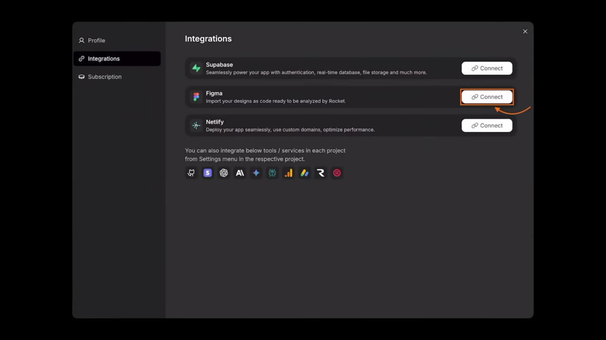
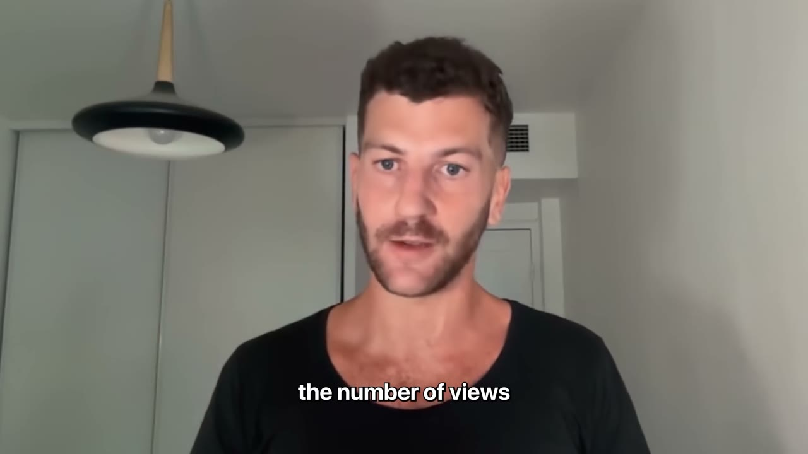

# I vibe coded a $12K/month mobile app (Stoppr Breakdown)

✅ **Đã phân tích sâu** → [`case.md`](case.md)

| | |
|---|---|
| **Video** | <https://www.youtube.com/watch?v=orYTlk_BhW8> |
| **Đăng** | 30/10/2025 |
| **Thời lượng** | 10:05 |
| **Lượt xem** | 54,688 |
| **Lượt thích** | 1,647 |
| **Video ID** | `orYTlk_BhW8` |

## Trong thư mục này

| File | Nội dung |
|---|---|
| [`case.md`](case.md) | **Phân tích đầy đủ** — ý tưởng, validate, GTM, áp dụng ở VN |
| [`meta.json`](meta.json) | Metadata gốc (chapters, heatmap, mô tả) |
| [`screenshots/`](screenshots/) | 10 ảnh 720p |

## Mô tả gốc

David Attias was working in finance when he discovered an app making $200K/month. He thought the app was genius. So he rebuilt it in a different niche, and five months later, STOPPR is generating $12K/month with zero coding background required. This video breaks down David's full app building playbook.
0:00 - Intro
1:25 - What is the app?
1:57 - Numbers behind the app
2:21 - From stockbroker to app builder
3:57 - Building approach
4:38 - Validating the idea
5:13 - How David built his app
5:47 - App cloning playbook
7:05 - Tech stack and costs
8:08 - David's final advice
9:07 - Pat's notes and 

## Số liệu bắt được từ transcript

> Các đoạn founder nhắc tới con số, kèm timestamp để tua thẳng tới đó trong video.

_(không bắt được con số nào)_

## Chương

- `00:00` Intro
- `01:25` What is the app?
- `01:57` Numbers behind the app
- `02:21` From stockbroker to app builder
- `03:57` Building approach
- `04:38` Validating the idea
- `05:13` How David built his app
- `05:47` App cloning playbook
- `07:05` Tech stack and costs
- `08:08` David's final advice
- `09:07` Pat's notes and reflections

## Ảnh

1. `01_01m10s_usd-12-000.jpg` — 
2. `02_01m59s_metric.jpg` — 
3. `03_02m45s_usd-200-000.jpg` — 
4. `04_03m33s_metric.jpg` — 
5. `05_04m09s_ch-building-approach.jpg` — 
6. `06_04m50s_ch-validating-the-idea.jpg` — 
7. `07_05m25s_ch-how-david-built-his-app.jpg` — 
8. `08_06m13s_replay.jpg` — 
9. `09_07m43s_replay.jpg` — 
10. `10_08m20s_ch-david-s-final-advice.jpg` — 

---

← [Quay lại index](../../index.md) · [Toàn bộ video](../README.md)
