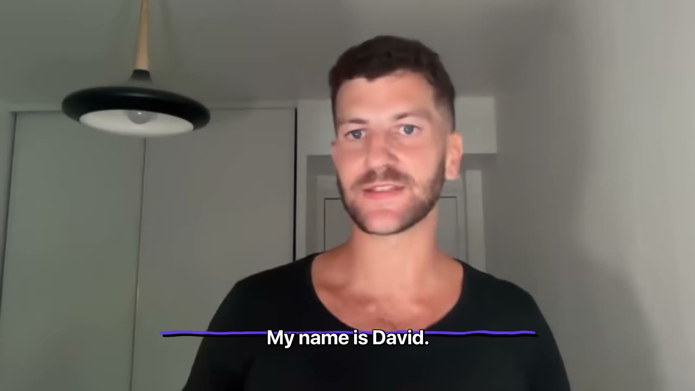
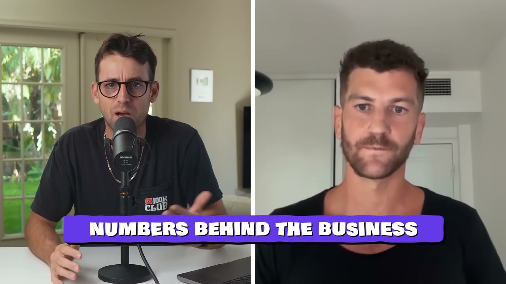
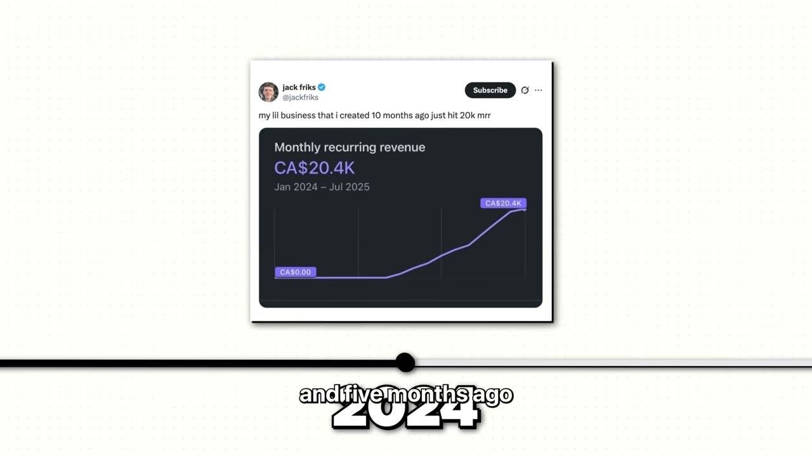
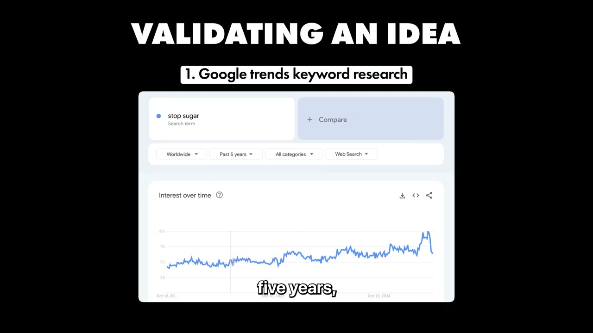
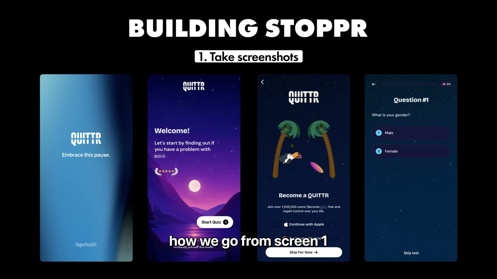
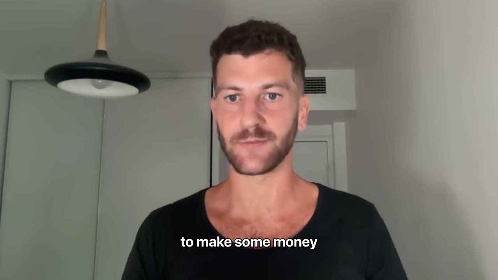
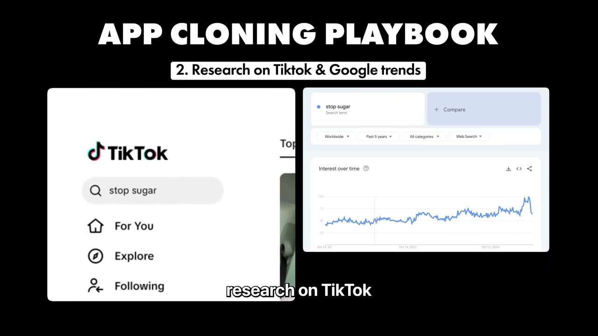

# Stoppr — $12K/tháng bằng cách clone nguyên một app rồi đổi ngách

> **Tóm tắt 30 giây:** David Attias làm quant trader 8 năm ở Pháp, xem podcast thấy ba thiếu niên làm app cai nội dung người lớn kiếm **$200.000/tháng sau 3 tháng**. Anh tải app đó về, **chụp màn hình từng screen**, bảo Cursor dựng lại y hệt trong **2,5 tuần**, rồi chỉ đổi hai thứ: **màu đen thành màu hồng, nội dung người lớn thành đường**. Kết quả là Stoppr — app giúp phụ nữ Gen Z Pháp bỏ đường. Tháng doanh thu đầu tiên đã ra $5.000; sau 5 tháng là **$12.000/tháng với 60.000 lượt tải và ~900 khách trả tiền**. Anh không biết code.

## 1. Con số

| Chỉ số | Giá trị |
|---|---|
| Doanh thu | $12.000/tháng (voiceover mở đầu nói $10.000 — xem ghi chú) |
| Doanh thu tháng đầu | $5.000 |
| Thời gian đạt được | 5 tháng |
| Lượt tải | 60.000 |
| Khách trả tiền | ~900 |
| Biên lợi nhuận | 35% |
| Chi phí công cụ/tháng | ~$220 |
| Thời gian build MVP | 2,5 tuần + 1 tuần Apple duyệt |
| Quy mô đội | 1 người, không biết code |
| Giá | có gói tuần, tháng, năm — gói năm có trial (không nêu giá cụ thể) |

**Ghi chú mâu thuẫn số liệu.** Video tự mâu thuẫn ba chỗ:
1. **$10K vs $12K** — Pat nói *"gone from zero to $10,000 a month"*, David nói *"$12,000 per month"*. Tôi lấy $12K.
2. **5 tháng vs 6 tháng** — intro nói *"up until 6 months ago had a regular job"* và *"just 6 months later"*, David nói *"I built that app 5 months ago"* và *"in 5 months, I got 60,000 downloads"*. Tôi lấy 5 tháng.
3. **Biên 35% không khớp với chi phí liệt kê.** David kể chi phí là Cursor $20 + Mixpanel $100 + Spark Ads $100 = **$220/tháng**. Trên doanh thu $12K, kể cả sau khi Apple cắt 15-30%, biên phải trên 80%. Con số 35% chỉ hợp lý nếu **anh đang chi vài nghìn đô/tháng cho influencer Pháp mà không kể ra**. Đây là chi phí thật của mô hình này — và nó là phần bị giấu trong hầu hết các case app di động.

> **Đọc con số 35% như thế nào:** nó nói với bạn rằng mô hình này **không phải in tiền**. Trên $12K doanh thu, David mang về khoảng $4.2K. Đó vẫn là con số tốt cho một người làm một mình trong 5 tháng, nhưng nó khác xa những case biên 90% như [Social Wizard của Kelechi](../2025-10-28_my-2-apps-made-1-5m/case.md).

## 2. Nguồn gốc ý tưởng — ghen tị, đúng nghĩa đen ⭐⭐

David không có insight thần thánh nào. Anh nói thẳng:

> *"5 tháng trước tôi đang xem một podcast trên YouTube với ba thiếu niên, những người sáng lập Quittr. Sau tháng thứ ba, tôi nghe họ nói họ đang làm $200.000/tháng, và tôi **ghen tị, tôi đố kỵ** — và đó là thứ khiến tôi bắt đầu làm Stoppr."*

*(Ghi chú tên riêng: phụ đề tự động ghi "Quitter". Đây gần như chắc chắn là **Quittr** — app giúp cai nội dung người lớn, do một nhóm thiếu niên sáng lập, từng được nhắc nhiều trên X. Chi tiết trong video khớp hoàn toàn: David nói anh "thay thế nội dung người lớn bằng đường".)*

Trước đó anh làm **quant trader 8 năm** — người phân tích để bảo trader nên mua cổ phiếu nào. Anh biết đến Peter Levels, Thibault (Outrank), Jack (Post Bridge) và bị cuốn vì *"họ tạo ra rất nhiều tiền mặt rất nhanh"*.

**Cơ chế đằng sau chuyện này:** thứ David làm không phải là "tìm ý tưởng". Anh **tìm một cỗ máy đã chạy được rồi mang nó sang một sân khác**. Cỗ máy Quittr chứng minh ba thứ cùng lúc mà bình thường bạn phải tự chứng minh từng cái:

1. **Onboarding này chuyển đổi được** (đã có $200K/tháng chứng minh).
2. **Cơ chế tâm lý "cai một thứ gây nghiện" bán được subscription** (không phải giả thuyết nữa).
3. **Cấu trúc giá tuần/tháng/năm này hoạt động với Gen Z.**

Cái duy nhất David phải tự xác thực là: **ngách mới có nhu cầu không?**

## 3. Xác thực trong 30 phút — Google Trends + TikTok ⭐⭐⭐

Đây là phần ngắn nhất video nhưng đáng giá nhất, vì nó cho bạn một quy trình đơn giản đến mức không có cớ để không làm:

1. **Google Trends** — gõ từ khoá gốc, ở đây là *"stop sugar"*. Xu hướng 5 năm gần nhất **đi lên liên tục**.
2. **TikTok + Instagram** — gõ cùng từ khoá đó, xem có **influencer nào đang nói về nó** không. David thấy *"một tấn influencer nữ đang nói về bỏ đường, cai đường"*.

> *"Tôi xác thực bằng nghiên cứu từ khoá và nghiên cứu nội dung trên TikTok và Instagram, và đó là cách tôi biết làm một app giúp bỏ cơn thèm đường có thể là ý tưởng hay."*

**Vì sao bước 2 quan trọng hơn bước 1:** Google Trends chỉ nói **có nhu cầu**. Việc thấy đầy influencer đang nói về chủ đề đó nói với bạn thứ khác hẳn — **có sẵn một mạng lưới phân phối bạn thuê được**. David không chọn ngách vì anh quan tâm tới đường. Anh chọn nó vì anh nhìn thấy **danh sách người sẽ bán hộ anh**.

Và mảnh ghép cuối là **địa lý**:

> *"Tôi chủ yếu làm việc với các influencer Pháp, vì tôi nhận thấy **ở Pháp chưa có ai làm cái gì giống vậy** để giúp phụ nữ cắt đường."*

Đây chính là **arbitrage địa lý** — cùng logic với [CalBuddy của Tomer](../2026-08-09_i-copied-a-huge-app-now-i-make-80k-month/case.md) (bê app đếm calo Mỹ về thị trường Israel/tiếng Hebrew) và [MonAI ở Colombia](../2026-04-05_how-this-app-makes-35k-month/case.md). Ba case, ba nước, cùng một nước cờ: **app đã thắng ở Mỹ, thị trường bản địa chưa có, influencer bản địa rẻ hơn nhiều lần**.

## 4. Playbook clone app — 5 bước David tự nêu ⭐⭐⭐

Pat hỏi thẳng: *nếu làm lại từ đầu hôm nay, playbook của anh là gì?* David trả lời có cấu trúc:

### Bước 1 — Tìm app thành công, và xác nhận doanh thu thật
- Tìm app rất thành công. Kiểm tra xem nó có **nhắm một ngách cụ thể** không, và nó **marketing cho vùng/quốc gia cụ thể** nào.
- Xác nhận doanh thu bằng **Sensor Tower** để ước lượng MRR. *(Đừng tin con số founder khoe trên X.)*

### Bước 2 — Kiểm tra ngách mới đáng làm không
- **TikTok + Google Trends**, đúng quy trình ở mục 3.

### Bước 3 — Dựng thiết kế bằng screenshot
- Tải toàn bộ screenshot của app gốc. Hai nguồn David nêu: **mobbin.com** và **screensdesign.com** — *"bạn tải toàn bộ screenshot của một app bằng một cú click"*.
- Dùng **plugin Figma** import loạt JPEG đó vào Figma.
- *"Bạn sẽ thấy vài chỗ lệch chỗ này chỗ kia, nhưng với **80% số màn hình thì nó gần như hoàn hảo**."*

### Bước 4 — Backend chỉ khi cần
- *"Với hầu hết app thì không cần, nhưng nếu bạn cần backend thì dễ nhất là **Firebase** — vì Firebase lo luôn kết nối với Google, với email/password, và với Apple sign-in."*

### Bước 5 — Nối Figma MCP vào Cursor
- **Đây là con số đáng chú ý nhất về tốc độ:** *"Trước đây, MVP mất tôi khoảng 1 tháng. Bây giờ với Figma MCP, chắc chỉ mất 2 tuần."*

**Quy trình thực tế anh đã làm với Stoppr:**

> *"Bước đầu tiên là tải Quittr về để chụp screenshot từng màn hình. Thứ tôi muốn thấy là **làm sao đi từ màn 1 sang màn 2 sang màn 3**. Rồi tôi prompt cho Cursor: hãy làm màn hình y hệt, cùng phần tử hình ảnh, cùng màu, cùng ảnh. **Trong 2 tuần rưỡi tôi có một bản copy đầy đủ của Quittr.** Rồi nộp bản đầu lên và chờ Apple duyệt mất 1 tuần."*

Chú ý anh nói *"làm sao đi từ màn 1 sang màn 2"*. Anh không copy từng màn hình rời — anh copy **luồng**. Với app subscription, luồng onboarding chính là chỗ tiền được kiếm, và đó cũng là kết luận độc lập của [Connor Burd với app Payout](../2025-10-26_i-vibe-coded-a-20k-month-mobile-app-in-14-days/case.md), người nói thẳng *"90% người dùng có khi chỉ nhìn thấy mỗi onboarding của bạn"*.

## 5. Câu nói gây tranh cãi nhất video

Khi được hỏi lời khuyên số một:

> *"Cách nhanh nhất để kiếm tiền lúc này là **copy 1-1 một app rất thành công**. Và khi tôi nói copy 1-1, tôi nghĩa là bạn copy từng màn hình, copy từng chữ. **Tôi đổi màu đen thành màu hồng, tôi thay nội dung người lớn bằng đường**, và xong."*

Pat lập tức thêm một điều kiện — và điều kiện này là thứ tách biệt "clone thông minh" khỏi "ăn cắp":

> *"Điều duy nhất tôi nghĩ bạn KHÔNG nên làm là **đừng copy cái ngách**. Bạn không muốn đi lấy khách hàng của họ. Lấy mọi thứ họ đã làm và đặt vào một ngách khác — bạn không cướp khách của họ."*

**Cơ chế:** khi bạn giữ nguyên ngách, bạn bước vào một trận đấu mà đối thủ có 3 tháng lợi thế, đã tối ưu paywall, đã có đánh giá App Store, và đang trả tiền cho cùng nhóm influencer. Bạn thắng bằng gì? Không gì cả. Khi bạn đổi ngách hoặc đổi quốc gia, bạn **giữ toàn bộ phần đã được chứng minh (luồng, tâm lý, cấu trúc giá) và bỏ toàn bộ phần cạnh tranh**.

### Ranh giới pháp lý — video không nói, nhưng bạn phải biết

Video hoàn toàn im lặng về chuyện này. Thực tế:
- **Copy chức năng và luồng UX**: nhìn chung không bị bảo hộ.
- **Copy nguyên văn từng chữ, icon, ảnh minh hoạ, hình vẽ**: đây là **tác phẩm có bản quyền**. Câu *"copy từng chữ"* của David là lời khuyên **rủi ro**.
- **Apple App Review Guideline 4.1 (Copycats)** cấm rõ app "spam" bắt chước app khác. Nếu bạn clone quá sát và cùng ngôn ngữ, khả năng bị reject là thật.

Cách an toàn: **copy cấu trúc, viết lại toàn bộ chữ, tự làm hình.** Đổi ngôn ngữ (như David sang tiếng Pháp, Tomer sang tiếng Hebrew) vô tình giải quyết luôn vấn đề này.

## 6. Tech stack và chi phí

| Hạng mục | Công cụ | Chi phí |
|---|---|---|
| Vibe coding | Cursor | $20/tháng |
| Thiết kế | Figma + Figma MCP | — |
| Backend | Firebase | — |
| Doanh thu trong app | RevenueCat | — |
| Analytics hành vi | Mixpanel | ~$100/tháng |
| Tìm influencer | **topyappers.com** | — |
| Gửi email lạnh cho influencer | công cụ ASR nghe thành "LinkedIn.ai" | — |
| Quảng cáo | Meta ads + **TikTok Spark Ads** | ~$100/tháng |

*(Ghi chú: David nói "gói ultra của Cursor giá $20/tháng". Sai — $20 là gói Pro; Ultra là $200. Không rõ anh nhầm tên gói hay nhầm giá. Và cái tên "LinkedIn.ai" gần như chắc chắn là ASR sai — nhiều khả năng là một công cụ cold email như Instantly.ai hoặc lemlist. Đừng đi tìm domain đó.)*

**Mắt xích đáng học nhất trong stack: topyappers.com.**

> *"Đó là một trang **scrape TikTok, Instagram và YouTube để tìm đúng profile influencer đã từng làm việc với các app khác** trước đây. Tôi lấy email tìm được từ đó, rồi nạp vào công cụ gửi email."*

Nghĩa là David không đi tìm "influencer về chủ đề đường". Anh đi tìm **influencer đã từng nhận tiền quảng cáo app** — nhóm người đã biết cách làm video quảng cáo app, đã có giá, và không cần thuyết phục về mô hình hợp tác. Đây là bộ lọc tiết kiệm hàng chục giờ, và nó đối lập thú vị với [Kelechi](../2025-10-28_my-2-apps-made-1-5m/case.md), người cố ý tìm **streamer chưa từng viral bao giờ** để có giá rẻ.

**TikTok Spark Ads** cũng là cùng chiến thuật mà [Prayer Lock](../2026-01-18_i-built-a-20k-month-mobile-app-heres-my-entire-playb/case.md) dùng: chạy quảng cáo **đè lên chính video organic đã có view sẵn**, thay vì làm video quảng cáo mới từ đầu.

## 7. Mâu thuẫn với các founder khác trong kho — và cách phân định ⭐⭐

| Quan điểm | Ai nói | Đúng khi nào |
|---|---|---|
| Copy 1-1 app đã thắng, chỉ đổi ngách | David (case này), [Tomer/CalBuddy](../2026-08-09_i-copied-a-huge-app-now-i-make-80k-month/case.md) | Bạn muốn tiền trong 3-6 tháng, chấp nhận trần thấp, có sẵn thị trường ngôn ngữ/địa lý chưa ai phục vụ |
| Xây từ vấn đề bạn tự gặp | [Kelechi/Social Wizard](../2025-10-28_my-2-apps-made-1-5m/case.md), [Once](../2026-05-10_i-built-a-20k-month-app-in-83-days/case.md) | Bạn muốn một format phân phối chưa ai có; trần cao hơn nhiều nhưng mất thời gian tìm |
| Chọn từ khoá App Store trước, build app sau | [28 app ASO](../2025-12-11_i-make-10k-month-from-28-apps/case.md) | Bạn có kỹ năng kỹ thuật và muốn $0 marketing |

**Cách phân định:** ba hướng này khác nhau ở chỗ **bạn đang thiếu gì**.
- Thiếu **niềm tin rằng ý tưởng bán được** → clone (David). Nó xoá bỏ rủi ro nhu cầu.
- Thiếu **cách tiếp cận khách** → tự tìm format (Kelechi). Nó xoá bỏ rủi ro phân phối.
- Thiếu **tiền marketing** → ASO. Nó xoá bỏ rủi ro dòng tiền.

Nếu bạn ở Việt Nam, thứ khan hiếm nhất thường là **tiền marketing**, chứ không phải ý tưởng. Đó là lý do playbook của David cần được đọc kèm cảnh báo ở mục 8.

## 8. Cảnh báo thiên kiến nguồn

Video này có mật độ quảng cáo cao bất thường:
- **Rocket (rocket.new)** tài trợ — chiếm gần một phút, chèn ngay giữa phần hay nhất. Điều đáng nói: **David KHÔNG dùng Rocket** (anh dùng Cursor). Đoạn quảng cáo được viết để bạn hiểu nhầm rằng đó là công cụ của anh.
- **Starter Story Build** (khoá học của chính kênh) được đẩy ở cả đầu và cuối.
- Toàn bộ số liệu là **lời kể**, không có ảnh dashboard RevenueCat hay App Store Connect nào xác nhận $12K, 60.000 lượt tải hay 900 khách trả tiền.
- Kênh chỉ phỏng vấn người thành công. Không ai biết có bao nhiêu người đã clone Quittr sang ngách khác và **thất bại** — và đó gần như chắc chắn là đa số.

Đọc case này như một **giả thuyết đã được một người kiểm chứng một lần**, không phải công thức.

## 9. Áp dụng cho tôi (indie hacker VN)

**Sao chép được gì — cụ thể, làm được trong tuần này:**

1. **Lập danh sách 10 app subscription đang thắng ở Mỹ** trong các ngách "cai/bỏ một thói quen" hoặc "theo dõi một chỉ số cơ thể". Dùng **Sensor Tower** (bản free có giới hạn) hoặc bảng xếp hạng Health & Fitness của App Store.
2. **Với mỗi app, chạy bài test 30 phút của David:** Google Trends từ khoá tiếng Việt tương ứng (xu hướng 5 năm đi lên?) + tìm hashtag đó trên TikTok Việt Nam (**có ai đang làm content về nó không?**). Nếu cả hai đều xanh, ghi vào danh sách ngắn.
3. **Tải app đó, chụp toàn bộ onboarding** (hoặc lấy sẵn trên Mobbin). Ghi lại **thứ tự câu hỏi** — đó mới là tài sản, không phải màu sắc.
4. **Viết lại toàn bộ chữ bằng tiếng Việt, tự làm hình.** Giữ luồng, bỏ nội dung.
5. **Trước khi build, làm ngược lại một bước David không làm rõ:** liệt kê 30 TikToker Việt trong ngách đó kèm số follower và giá quảng cáo ước tính. Nếu bạn không tìm ra 30 người, **ngách đó không phân phối được ở VN** — dừng lại.

**Rào cản thật, không tô hồng:**

- **ARPU Việt Nam thấp hơn Pháp 3-5 lần.** Stoppr bán subscription cho phụ nữ Gen Z Pháp. Cùng app đó ở VN, giá tuần $5 sẽ không ai mua. Bạn sẽ phải hoặc bán giá thấp và cần lượng gấp nhiều lần, hoặc **nhắm luôn thị trường nước ngoài** — mà làm vậy thì bạn mất chính lợi thế "chưa ai làm ở nước tôi".
- **Dòng tiền âm 30-45 ngày với Apple.** Apple trả tiền theo chu kỳ khoảng 30-45 ngày sau khi tháng kết thúc. Bạn trả tiền influencer **trước**, nhận tiền **sau**. Với biên 35% như David, để làm $12K doanh thu bạn có thể phải ứng ra $5-7K tiền marketing và chờ hơn một tháng. **Đây là rào cản vốn thật, không phải rào cản kỹ thuật.**
- **Tài khoản Apple Developer:** $99/năm, và cần thông tin định danh. Nếu đăng ký dạng cá nhân, tên bạn hiện công khai trên App Store.
- **Rủi ro bị từ chối duyệt.** David mất 1 tuần chờ Apple. Nếu app của bạn quá giống app gốc (Guideline 4.1 Copycats) hoặc là app sức khoẻ đưa lời khuyên dinh dưỡng (Guideline 1.4.1), thời gian đó có thể thành nhiều vòng và nhiều tuần.
- **App sức khoẻ có rủi ro nội dung.** Ngách "bỏ đường" nằm sát ranh giới lời khuyên y tế và rối loạn ăn uống — nhất là khi khách hàng **13 tuổi**, như David nói. Ở VN chưa siết, nhưng App Store thì siết.
- **Rủi ro nền tảng kép.** Bạn phụ thuộc Apple để phân phối VÀ phụ thuộc TikTok để có khách. Một trong hai đổi luật là doanh thu bốc hơi.
- **Rào cản tiếng Anh gần như bằng không ở case này** — đây là điểm cộng hiếm. Bạn clone app tiếng Anh sang tiếng Việt, làm việc với influencer Việt. Không cần nói tiếng Anh với ai.

**Khi nào KHÔNG dùng mô hình này:**

- **Khi bạn muốn xây tài sản dài hạn.** Clone không có hào bảo vệ. Chính David chứng minh điều đó: nếu anh clone được Quittr trong 2,5 tuần, thì người tiếp theo clone được Stoppr trong 2,5 tuần. Trần của mô hình này là **vài chục nghìn đô/tháng và tuổi thọ vài năm**.
- **Khi ngách không có sẵn influencer.** Toàn bộ mô hình đứng trên giả định *"đã có người đang làm content miễn phí về chủ đề này"*. App B2B, app công cụ kỹ thuật, app cho người trên 50 tuổi — không có lớp influencer đó, và clone sẽ chết vì không phân phối được.
- **Khi bạn không có $3-5K tiền marketing chịu lỗ được.** Biên 35% của David nói thẳng: đây là mô hình **mua khách bằng tiền**, không phải mô hình organic. Nếu bạn không có vốn đó, hãy đọc [case ASO 28 app](../2025-12-11_i-make-10k-month-from-28-apps/case.md) hoặc [case YouTube SEO của FollowBuddy](../2026-03-19_i-make-17k-month-with-one-strategy/case.md) thay vì case này.
- **Khi bạn định giữ nguyên ngách.** Đó không còn là clone, đó là tự sát cạnh tranh — và có thể là vi phạm bản quyền.

## Nguồn

- Video: <https://www.youtube.com/watch?v=orYTlk_BhW8> (10:05, đăng 30/10/2025, 54.688 view)
- App: <https://www.stoppr.app/> · Founder: <https://x.com/david_attisaas>
- [Transcript đầy đủ](transcript.md) · [Ảnh chụp](screenshots/)
