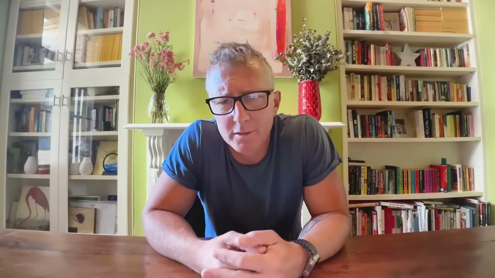
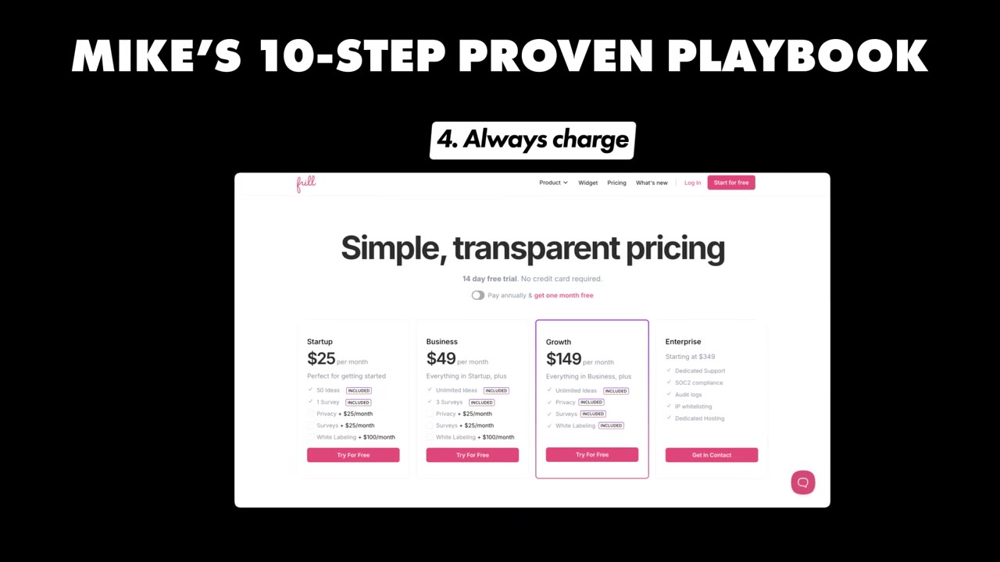
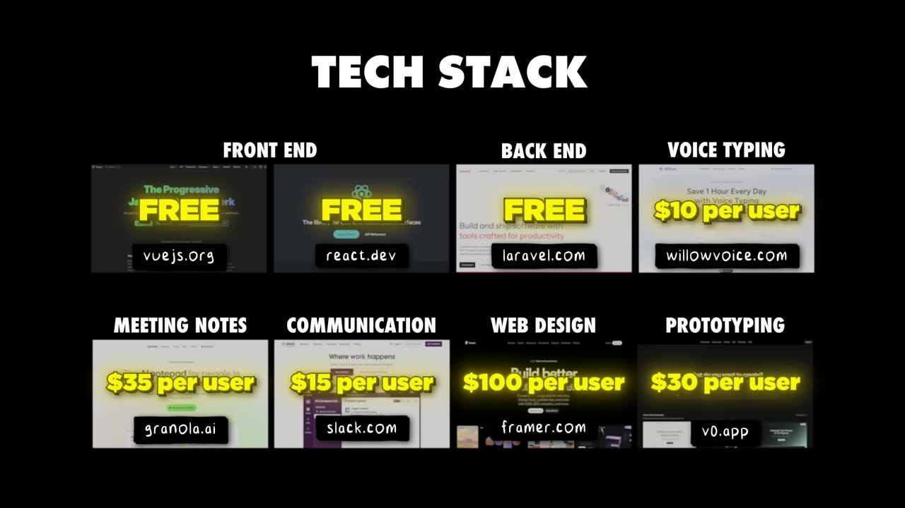

# I Built 3 SaaS Apps to $200K MRR: Here's My Exact Playbook

✅ **Đã phân tích sâu** → [`case.md`](case.md)

| | |
|---|---|
| **Video** | <https://www.youtube.com/watch?v=67zh8_yiPh4> |
| **Đăng** | 02/11/2025 |
| **Thời lượng** | 13:39 |
| **Lượt xem** | 986,266 |
| **Lượt thích** | 27,048 |
| **Video ID** | `67zh8_yiPh4` |

## Trong thư mục này

| File | Nội dung |
|---|---|
| [`case.md`](case.md) | **Phân tích đầy đủ** — ý tưởng, validate, GTM, áp dụng ở VN |
| [`meta.json`](meta.json) | Metadata gốc (chapters, heatmap, mô tả) |
| [`screenshots/`](screenshots/) | 10 ảnh 720p |

## Mô tả gốc

Mike is a founder from Australia who has bootstrapped three SaaS apps to a combined $200K MRR. This video breaks down his 10-step playbook and his portfolio approach to building multiple sustainable SaaS businesses simultaneously.
0:00 - Intro
0:51 - Who is Mike?
1:21 - Apps Breakdown
2:17 - Background
2:50 - Mike's Approach to Building
4:31 - How to Build a Unicorn
5:40 - 10 Step Proven Playbook
9:52 - Good vs Bad Ideas
11:13 - Tech Stack
12:02 - Final Advice
12:52 - Final Word
This video is an educational case study of one founder’s experience. It is not financial advice and does not guarant

## Số liệu bắt được từ transcript

> Các đoạn founder nhắc tới con số, kèm timestamp để tua thẳng tới đó trong video.

_(không bắt được con số nào)_

## Chương

- `00:00` Intro
- `00:51` Who is Mike?
- `01:21` Apps Breakdown
- `02:17` Background
- `02:50` Mike's Approach to Building
- `04:31` How to Build a Unicorn
- `05:40` 10 Step Proven Playbook
- `09:52` Good vs Bad Ideas
- `11:13` Tech Stack
- `12:02` Final Advice
- `12:52` Final Word

## Ảnh

1. `01_00m37s_usd-200-000.jpg` — 
2. `02_01m33s_ch-apps-breakdown.jpg` — 
3. `03_02m29s_ch-background.jpg` — 
4. `04_04m05s_usd-10-000.jpg` — 
5. `05_04m43s_ch-how-to-build-a-unicorn.jpg` — 
6. `06_05m52s_ch-10-step-proven-playbook.jpg` — 
7. `07_06m37s_replay.jpg` — 
8. `08_10m04s_ch-good-vs-bad-ideas.jpg` — 
9. `09_11m56s_replay.jpg` — 
10. `10_13m04s_ch-final-word.jpg` — 

---

← [Quay lại index](../../index.md) · [Toàn bộ video](../README.md)
