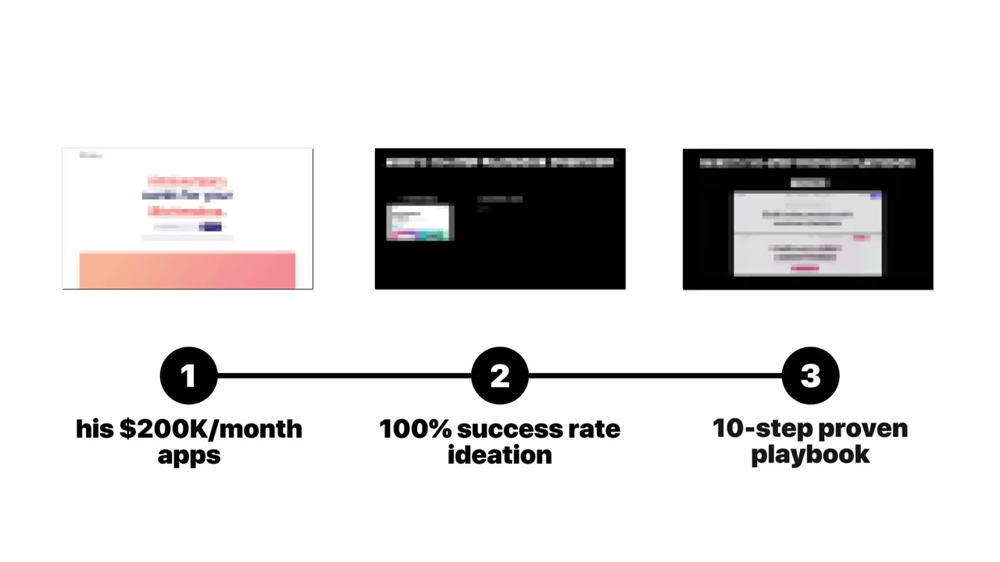
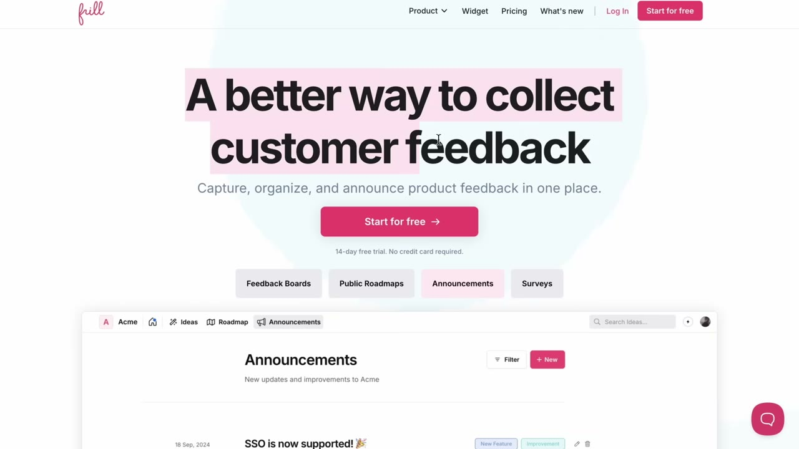
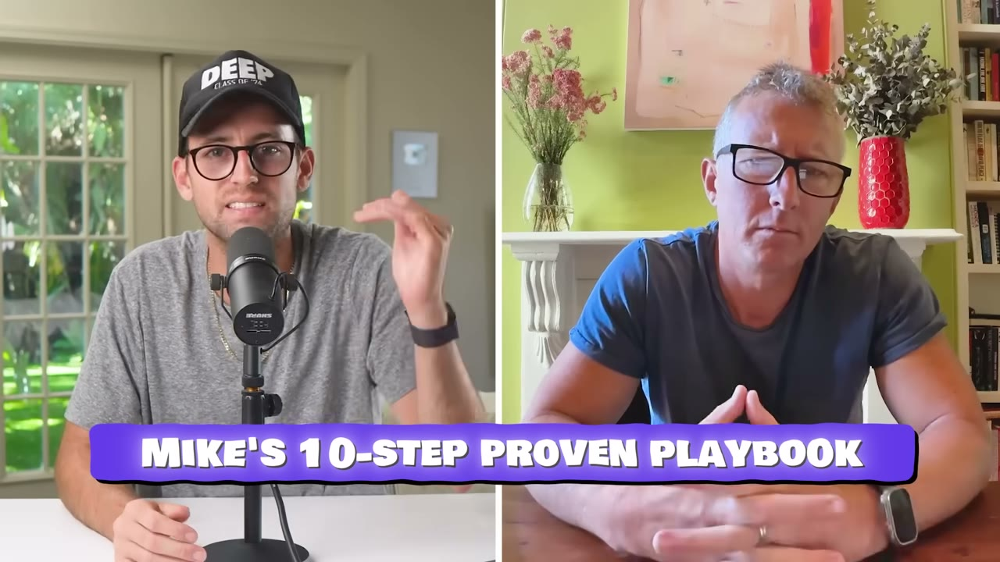
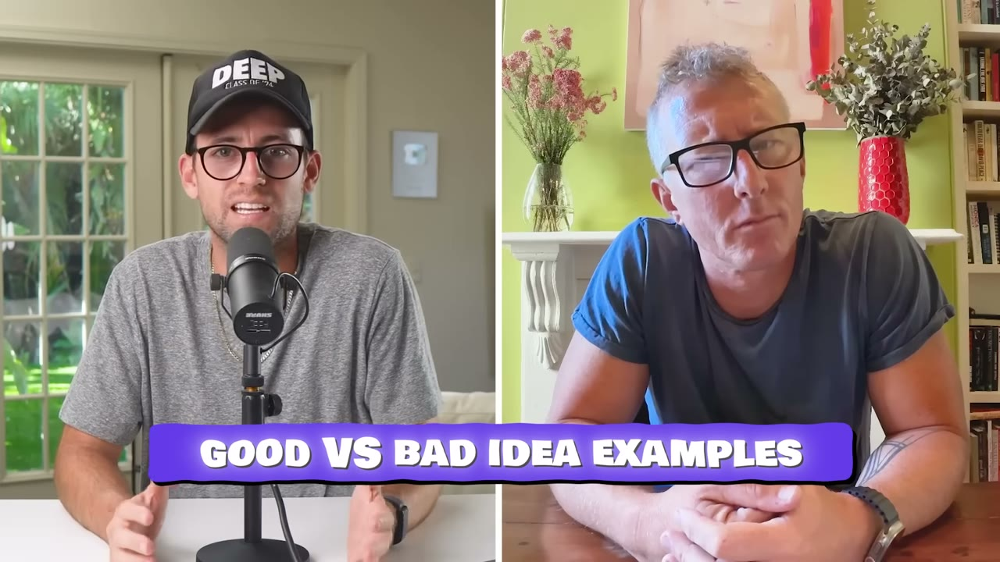
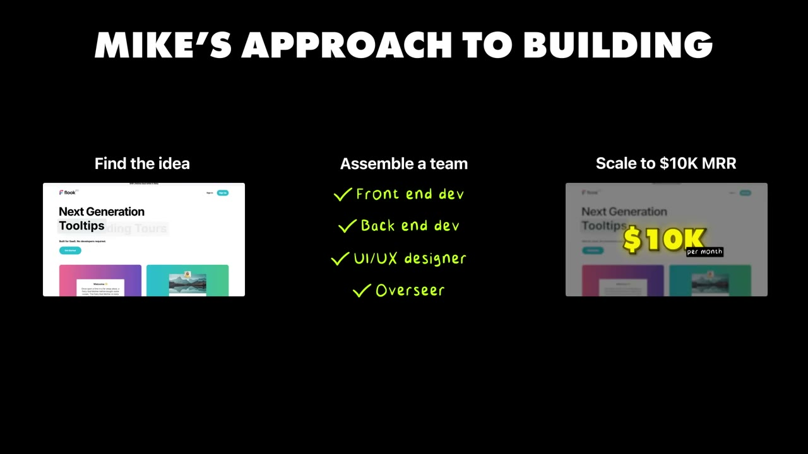
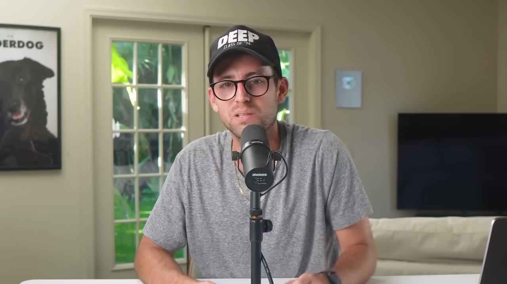

# Mike Hill — $200K MRR từ danh mục SaaS chán, tự cấp vốn bằng lifetime deal

> **Tóm tắt 30 giây:** Mike là người Úc, tự nhận là *"một trong những lập trình viên tệ nhất thế giới"*. Anh có **hơn $200K MRR** từ danh mục SaaS gồm bộ tổng hợp mạng xã hội, công cụ thu thập feedback, biển quảng cáo số cho quán cafe, và nền tảng làm product tour — toàn thứ chán. Anh dùng **đúng một playbook 10 bước cho cả 5 công ty**, và **chưa công ty nào thất bại**. Cơ chế then chốt: **bán lifetime deal để lấy ~$100K tiền mặt trước khi có MRR**, rồi dùng số tiền đó viết content trong 1-2 năm chờ SEO ngấm. Mỗi công ty luôn có **đúng 4 co-founder chia đều 25%** — anh nói thẳng lý do là để **giảm rủi ro founder tan đàn**, nguyên nhân giết doanh nghiệp nhiều nhất. Và quy tắc anh không bao giờ phá: **không bao giờ làm business lấy AI làm lõi.**

## 1. Con số

| Chỉ số | Giá trị |
|---|---|
| MRR gộp | **hơn $200.000/tháng** |
| Số công ty | 3 đang chạy có doanh thu, 1 đang làm dở, 1 sắp ra mắt |
| Mục tiêu 5 năm | **$1M MRR**, đội nhỏ nhất có thể, **không gọi vốn** |
| Cơ cấu sở hữu | luôn 4 co-founder, mỗi người **25%** |
| Điểm hoà vốn | **$10.000 MRR** (đủ trang trải chi phí) |
| Giá lifetime deal | $59-$100 trả một lần |
| Frill thu từ LTD riêng đầu tiên | ~$30.000 |
| Mục tiêu tiền mặt sau vòng LTD | **$100.000** |
| Tỉ lệ thất bại | 0 (theo lời founder) |

**Danh mục sản phẩm:**

| Sản phẩm | Là gì |
|---|---|
| **Curator.io** | tổng hợp nội dung mạng xã hội để nhúng vào website và sự kiện |
| **Frill.co** | thu feedback khách hàng → vẽ lên roadmap → thông báo tính năng mới |
| **Juno.co** | digital signage (biển hiển thị số) cho quán cafe, phòng gym, trường học, cửa hàng |
| **Fluke.co** | nền tảng no-code tạo onboarding tour, tooltip, popup cho SaaS mà không cần làm phiền dev |
| **Smile** | e-card nhóm cho doanh nghiệp B2B (ra mắt sau video 2 tuần) |

**Ghi chú tên riêng:** transcript auto-caption đọc **Frill.co** thành "thrill.co" — tôi đã đối chiếu và xác nhận sản phẩm thật là **Frill.co** (công cụ feedback/roadmap khá nổi, Mike Hill là co-founder). Công cụ prototyping anh gọi là "Vyo" nhiều khả năng là **v0** của Vercel — đây là **suy đoán của tôi**, không chắc chắn.

**Mâu thuẫn cần biết:** đoạn voice-over mở đầu nói *"chúng tôi có năm app và đang làm hơn 200 nghìn MRR"*, còn Mike nói *"tôi hiện có **ba** SaaS làm hơn 200 nghìn một tháng, và hai cái nữa đang trên đường"*. Sau đó anh lại nói *"cả năm app này gộp lại làm hơn 200 nghìn một tháng"*. Cách đọc hợp lý nhất: **3 công ty trưởng thành tạo ra gần như toàn bộ $200K**, Fluke đang giữa playbook và Smile chưa ra mắt. **Không có ảnh dashboard nào trong video.**

## 2. Triết lý: tối thiểu hoá rủi ro, không tối đa hoá kỳ vọng ⭐⭐⭐

Câu định vị toàn bộ case:

> *"**Tôi thích build những ý tưởng không thể thất bại.**"*

Và:

> *"Toàn bộ cách tiếp cận của bọn tôi là **giảm thiểu rủi ro**. Tôi kỳ vọng từng doanh nghiệp của mình đều thành công. Tỉ lệ thành công của bọn tôi cao hơn hẳn. **Bọn tôi chưa từng có cái nào thất bại.**"*

Đây là lời phủ định thẳng thừng với văn hoá "ship nhanh, thất bại nhanh". Và nó có logic riêng: nếu mỗi lần bạn khởi động một công ty là bạn kéo theo 3 người khác bỏ việc cùng bạn, bạn **không được phép** chơi trò xác suất.

**Mô hình vận hành của anh, đúng theo thứ tự:**

1. Đi tìm ý tưởng — cụ thể là **tìm sản phẩm đang ăn nên làm ra bất chấp UX tệ**
2. Ráp đội, **thiên về kỹ thuật**: 1 front-end dev, 1 back-end dev, lý tưởng là có thêm 1 designer, và một người như Mike lo mọi thứ còn lại
3. **Luôn bắt đầu với 4 co-founder**
4. **Chia đều 25% mỗi người**
5. Nuôi công ty tới **$10K MRR** — mức đủ trang trải chi phí
6. Sau $10K MRR, **chia lợi nhuận** cho các founder và bắt đầu tự trả lương

### Vì sao "thành công bất chấp UX tệ" là bộ lọc tốt ⭐⭐⭐

Đây là câu quan trọng nhất mà nhiều người sẽ lướt qua:

> *"Bọn tôi tính xem **họ đang làm tốt tới mức nào bất chấp UX tệ**."*

**Cơ chế:** một sản phẩm khó dùng mà vẫn kiếm ra tiền là bằng chứng nhu cầu **cực mạnh** — người ta chịu đựng đau đớn để dùng nó. Và nó cũng đồng thời chỉ ra **đường thắng của bạn**: bạn không cần một ý tưởng mới, không cần công nghệ hơn, chỉ cần **làm cùng việc đó nhưng dễ chịu hơn**.

Đây là biến thể B2B của đúng thứ [Julian làm với Gravl](../2025-11-13_how-i-built-it-400k-month-mobile-app-gravl/case.md) — anh clone UI của Fitbod nhưng sửa phần engine dở. Mike làm ngược lại: giữ chức năng, sửa phần trải nghiệm. Cùng một nguyên lý: **để đối thủ chứng minh nhu cầu, bạn chỉ sửa phần họ làm ẩu.**

Vì thế anh đầu tư mạnh vào thiết kế:

> *"Bọn tôi ưu tiên thiết kế rất nặng. Bọn tôi tin rằng **thiết kế tốt bán được hàng** — đó là lý do bọn tôi muốn có designer trong đội. Bọn tôi muốn **từng người trong đội đều nghĩ về UX của sản phẩm**."*

### Vì sao luôn 4 co-founder ⭐⭐

> *"Bọn tôi luôn bắt đầu với bốn co-founder. Việc đó **giảm thiểu chuyện founder tan đàn xẻ nghé — một trong những lý do chính khiến hầu hết doanh nghiệp thất bại**."*

Trực giác thông thường nói ngược lại: nhiều founder = nhiều xung đột. Lập luận của Mike là về **khả năng chịu tải**: với 4 người và 25% mỗi người, khi một người rút, công ty còn 3 người và vẫn chạy được. Với 2 co-founder, một người rút là công ty chết. Chia đều 25% cũng loại bỏ toàn bộ tranh cãi về công bằng — nguồn xung đột số một giữa các founder.

**Cái giá phải trả, hãy nhìn thẳng:** bạn chỉ giữ 25% của một công ty $200K MRR chứ không phải 100% của một công ty $50K MRR. Mike chấp nhận đánh đổi đó một cách có ý thức, và anh nói rất rõ vì sao ở mục sau.

### "Lương to, không phải exit to" ⭐⭐

> *"Những doanh nghiệp này là để có **lương lớn hơn, không phải để exit lớn**. Bọn tôi không tái đầu tư nhiều tiền vào quảng cáo. Bọn tôi không tái đầu tư nhiều tiền vào nhân sự. Bọn tôi giữ **siêu, siêu tinh gọn**, để **toàn bộ lợi nhuận chảy về tay founder**."*

Đây là mô hình **annuity** (dòng tiền định kỳ), đối lập hoàn toàn với mô hình flip của [Lotts Ezeike](../2025-11-09_i-flipped-4-apps-and-made-500-000/case.md) — người thà nhận trước 2-3 năm lợi nhuận rồi đi. Hai người, cùng một tuần lên sóng Starter Story, kết luận ngược nhau hoàn toàn. Xem mục 7 để biết cách phân định.

## 3. Playbook 10 bước — dùng nguyên xi cho cả 5 công ty ⭐⭐⭐

> *"Bọn tôi có playbook 10 bước và bọn tôi làm theo **đến từng chữ**, mỗi lần ra mắt một doanh nghiệp."*

### Bước 1 — Chọn ý tưởng ĐÃ CÓ NGƯỜI LÀM

> *"Trước hết và trên hết: chọn một ý tưởng đã có người làm rồi. **Ý tưởng mới thì rủi ro. Ý tưởng mới cần validate. Nếu bạn chọn ý tưởng đã có người làm, bạn biết là người ta muốn nó, bạn biết là nó chạy được.**"*

### Bước 2 — Quyết định thế nào là MVP "đủ tốt"

> *"Bạn cần tìm ra từ đối thủ: **thứ mà khách hàng của họ muốn nhất là gì**. Build MVP, tung ra càng nhanh càng tốt, cho người ta dùng."*

Chú ý cách định nghĩa: MVP không phải "phiên bản nhỏ nhất của tầm nhìn của tôi", mà là **"những tính năng khách hàng của đối thủ khen nhiều nhất"**. Nguồn dữ liệu ở đây là review trên G2/Capterra/App Store của đối thủ — miễn phí và công khai.

### Bước 3 — Bán lifetime deal ⭐⭐⭐

> *"Cốt lõi của cách bọn tôi kiếm tiền sớm là điểm thứ ba: **bán lifetime deal**. Bán đứt sản phẩm của bạn với giá $59, $100, bất kể là bao nhiêu, cho một lần thanh toán duy nhất."*

### Bước 4 — KHÔNG BAO GIỜ cho tài khoản miễn phí

> *"**Không bao giờ cho không một tài khoản. Luôn luôn thu tiền.** Nếu người ta trả tiền cho nó, họ sẽ dùng nó. Đó là điều then chốt bạn muốn ở giai đoạn này. Bạn muốn người ta **dùng** sản phẩm. Bạn muốn người ta nói cho bạn biết **nó dở chỗ nào**. Bạn muốn càng nhiều feedback càng tốt."*

**Đây là mấu chốt kinh tế học của cả playbook, và ít người hiểu đúng.** LTD $59 không phải để kiếm lời — nó là **bộ lọc sự nghiêm túc**. Người trả $59 sẽ dùng sản phẩm và mắng bạn khi nó dở. Người dùng free tier sẽ đăng ký rồi biến mất. Ở giai đoạn 0 khách hàng, **feedback có chất lượng đắt hơn doanh thu**.

### Bước 5 — Đổ hết sức vào bán LTD riêng tư

> *"Làm việc trong các nhóm Reddit. Làm việc trong các nhóm Facebook kín. Lên X. Tìm xem khách hàng của bạn đang sống ở đâu. Làm việc với **các nhóm LTD** — có rất nhiều nhóm như vậy — để sản phẩm của bạn được càng nhiều người mua càng tốt. Với **Frill**, bọn tôi ra một LTD riêng và **gọi được khoảng 30 nghìn đô**."*

"LTD riêng tư" = bán trực tiếp cho cộng đồng săn deal trọn đời (các nhóm Facebook, subreddit, danh sách email chuyên về LTD) **trước khi** lên marketplace lớn. Bạn giữ 100% doanh thu và có nhóm khách đầu tiên có tổ chức.

### Bước 6 — Bắt đầu viết content NGAY, sớm hơn bạn nghĩ ⭐⭐⭐

> *"**Không bao giờ, không bao giờ, không bao giờ là quá sớm để bắt đầu viết content.** Bắt đầu viết landing page. Bắt đầu viết blog post. **Dùng số tiền bạn có từ LTD riêng để trả cho việc viết content.** Viết trang so sánh đối thủ, viết trang alternative-to. Đưa lên mạng càng sớm càng tốt. **Nó nằm trên đó càng lâu thì ChatGPT càng lâu, Google càng lâu bắt đầu index nó và gửi traffic cho bạn.**"*

**Đây là insight đắt nhất của cả video, và nó là insight về THỜI GIAN, không phải về content.**

Cơ chế: SEO có độ trễ 6-18 tháng. Nghĩa là content bạn viết hôm nay không mang lại traffic cho tới sang năm. Hầu hết founder không có tiền để sống qua khoảng trống đó — nên họ chuyển sang paid ads, và bị kẹt vào vòng phải mua traffic mãi mãi. **LTD giải chính xác bài toán đó: nó biến MRR tương lai thành tiền mặt hôm nay, và bạn dùng tiền mặt đó để mua thời gian chờ SEO chín.**

Hai loại trang anh chỉ đích danh — "competitor page" và "alternative to page" — cũng không ngẫu nhiên: đó là những từ khoá **ý định mua cao nhất** trong B2B SaaS. Người gõ "alternative to X" đã quyết định chi tiền, chỉ đang chọn nơi chi.

Và anh nói thêm một điều đáng chú ý cho 2025+: content bây giờ không chỉ để **Google** index, mà để **ChatGPT** index. Khi người ta hỏi AI *"công cụ feedback nào tốt?"*, câu trả lời được lắp ráp từ nội dung đã có sẵn trên web.

### Bước 7 — Lên AppSumo hoặc marketplace tương tự

> *"AppSumo tuyệt vì họ có **độ phủ khổng lồ**. Bạn làm được hai việc trên AppSumo: launch trên marketplace của họ, phí thấp hơn; hoặc làm việc với đội sales của họ, gói **Select**. Cả hai đều được... họ có một **database khổng lồ** để gửi mail."*

Và đây là mục tiêu tài chính rõ ràng của toàn bộ giai đoạn LTD:

> *"Mục tiêu của bạn phải là **kết thúc vòng LTD với 100 nghìn đô trong túi**, dùng để viết content trong một hoặc hai năm."*

### Bước 8 — Một vòng LTD riêng cuối cùng, đóng vĩnh viễn

> *"Nhiều người không muốn bỏ lỡ một deal, nên đây là lúc bạn đóng lifetime deal lại — vĩnh viễn. **Nâng giá lên một chút** và mở một vòng LTD riêng cuối cùng. Gửi cho danh sách email của bạn rồi đóng lại, lý tưởng nhất là đóng mãi mãi."*

Cơ chế: khan hiếm thật (không phải khan hiếm giả). Và việc đóng LTD vĩnh viễn là **bắt buộc** — nếu bạn cứ bán LTD mãi, bạn sẽ không bao giờ xây được MRR, vì mọi khách hàng tiềm năng đều chờ deal tiếp theo.

### Bước 9 — Ép ra review thật ⭐⭐

> *"Giai đoạn chín là then chốt. Đây là **khoảnh khắc sống hoặc chết**. Bạn có 100 nghìn đô trong ngân hàng. Đây là lúc bạn nhờ **chính các khách hàng LTD của mình viết review trung thực** trên Trustpilot, trên G2, bất cứ đâu họ sẵn lòng viết. Nó cực kỳ quan trọng. Nó sẽ đẩy thứ hạng domain của bạn và mang về những review trung thực. Bạn sẽ thấy **cộng đồng LTD sẵn sàng làm việc đó vì họ thật sự muốn bạn thành công. Họ là đại sứ đời đầu của bạn.**"*

**Vì sao nhóm LTD sẵn lòng viết review — cơ chế tâm lý cần hiểu:** họ đã trả tiền trọn đời. Sản phẩm sống thì họ được dùng mãi; sản phẩm chết thì tiền của họ mất. **Lợi ích của họ gắn với sự sống còn của bạn.** Đây là điều một khách hàng trả tiền hàng tháng không bao giờ có.

### Bước 10 — Reddit (thay cho Quora ngày xưa)

> *"Trước đây bọn tôi hay lên Quora trả lời câu hỏi, nhưng ngày càng thấy **Reddit** là nơi quan trọng. Quét Reddit. Xem ai đang hỏi về một trong các đối thủ của bạn. **Trả lời một cách trung thực, chân thành**, trong các post trên Reddit. Tìm các subreddit nơi khách hàng của bạn đang tụ tập."*

Và đây là mô tả trung thực về khoảnh khắc chuyển giao:

> *"Giai đoạn này cực kỳ quan trọng vì giờ bạn đã chuyển sang MRR. **Tiền đang cạn dần**, nhưng hy vọng bạn bắt đầu có MRR, và tới lúc tiền hết thì hy vọng MRR đủ để bạn sống sót."*

**Cần nhìn thẳng vào câu này.** Đây không phải một cỗ máy không thể thất bại. Đây là một **cuộc đua giữa hai đường cong**: tiền LTD đang xuống và MRR đang lên. Playbook chỉ mua cho bạn 1-2 năm để chiến thắng cuộc đua đó. Mike gọi nó là "live or die moment" — và đó là lời trung thực nhất trong video.

## 4. Quy tắc sắt: KHÔNG BAO GIỜ làm business lấy AI làm lõi ⭐⭐⭐

Đây là phần gây tranh cãi nhất, và cũng là phần đáng suy nghĩ nhất trong toàn kho case này.

> *"Một lĩnh vực bọn tôi **sẽ không bao giờ** đụng đến: bọn tôi sẽ không bao giờ theo đuổi một doanh nghiệp lấy AI làm trọng tâm. **Quá nhiều lần bạn có một ý tưởng phụ thuộc vào một thứ, một API mà bạn không kiểm soát, một thứ bạn không nắm quyền — điều đó đặt bạn vào rủi ro cực kỳ, cực kỳ lớn.**"*

Nhưng anh vẫn thấy cơ hội **liền kề** với AI, và cách anh diễn đạt rất sắc:

> *"Bọn tôi rất thích ý tưởng làm một loại công cụ documentation nào đó. Tôi không cảm thấy các công cụ documentation hiện có đang làm tốt, hoặc cái nào làm tốt thì lại đắt kinh khủng. Và **documentation tốt, đặc biệt là ngày nay, sẽ là chìa khoá của thành công — vì AI cần documentation tốt để giới thiệu sản phẩm của bạn cho đúng, để biết về sản phẩm của bạn.** Nhưng bọn tôi sẽ **không dựa vào AI** để build nó hay để nó là phần cốt lõi của business."*

**Đây là một tư duy đầu tư rất tinh: bán cuốc xẻng cho cơn sốt vàng, nhưng không đào vàng.** Nhu cầu về documentation tăng *vì* AI, nhưng sản phẩm documentation **không phụ thuộc vào bất kỳ API AI nào**. Rủi ro nền tảng bằng không, còn tăng trưởng thì cưỡi lên làn sóng.

**Mâu thuẫn trực diện trong kho case:**

| Quan điểm | Ai nói | Kết quả |
|---|---|---|
| **Không bao giờ** lấy AI làm lõi — rủi ro API | Mike Hill (case này) | $200K MRR, 0 thất bại |
| App AI là chính, còn phô ra cho user thấy vì *"AI là bán hàng"* | [Julian / Gravl](../2025-11-13_how-i-built-it-400k-month-mobile-app-gravl/case.md) | $440K/tháng |
| Build hẳn wrapper quanh Suno AI rồi bán đi | [Lotts Ezeike](../2025-11-09_i-flipped-4-apps-and-made-500-000/case.md) | một phần của $500K exit |

**Cách phân định — điều kiện nào bên nào đúng:**

Câu hỏi thật không phải "AI tốt hay xấu", mà là **chân trời thời gian của bạn dài bao nhiêu so với chu kỳ thay đổi của nền tảng**.

- **Mike xây tài sản 10 năm** cho 4 gia đình sống bằng lợi nhuận hàng tháng. Với chân trời đó, một lần OpenAI đổi giá hay đổi điều khoản là thảm hoạ. **Rủi ro nền tảng không thể chấp nhận.**
- **Lotts xây tài sản 12 tháng rồi bán.** Rủi ro nền tảng năm thứ 3 là vấn đề của người mua, không phải của anh. **Rủi ro nền tảng được định giá và chuyển giao.**
- **Julian nằm ở giữa, nhưng có một chi tiết quan trọng:** phần lõi của Gravl **không phải LLM** — đó là **workout engine anh tự viết**, dựa trên kiến thức về progressive overload. AI là lớp marketing và một số tính năng phụ. Anh có thể thay nhà cung cấp AI mà sản phẩm vẫn sống.

> **Quy tắc rút gọn:** nếu bỏ hết API bên thứ ba đi mà sản phẩm của bạn **không còn giá trị gì**, bạn đang ở trong loại rủi ro Mike nói tới. Nếu bỏ đi mà sản phẩm **vẫn dùng được, chỉ kém hơn**, bạn ổn.

## 5. Cấu trúc tài chính: $10K MRR là ngưỡng của mọi thứ ⭐⭐

> *"Bọn tôi nuôi công ty tới khoảng **$10.000 MRR**, mức đó trang trải chi phí, xê xích tuỳ công ty. Rồi sau $10.000 MRR, bọn tôi **chia lợi nhuận giữa các founder**, và đó là lúc bọn tôi bắt đầu tự trả lương."*

**Con số $10K này rất đáng ghi nhớ vì nó lặp lại khắp kho case** — [Lotts](../2025-11-09_i-flipped-4-apps-and-made-500-000/case.md) cũng lấy $10K-$20K MRR làm ngưỡng bán. Có vẻ $10K MRR là **ngưỡng vật lý của một micro-SaaS**: đủ trả hạ tầng, công cụ, và một chút nhân sự; dưới mức đó bạn đang tài trợ cho khách hàng của mình.

Ba lựa chọn khiến mô hình này khác hẳn SaaS gọi vốn:

1. **Không tái đầu tư mạnh vào quảng cáo** → tăng trưởng chậm hơn nhưng không phụ thuộc kênh mua
2. **Không tái đầu tư mạnh vào nhân sự** → biên lợi nhuận cao, ít rủi ro vận hành
3. **Lợi nhuận chảy hết về founder** → không cần exit để có tiền

## 6. Tech stack

| Hạng mục | Công cụ |
|---|---|
| Frontend | Vue hoặc React (tuỳ đội sáng lập thấy thoải mái với cái gì) |
| Backend | **PHP + Laravel** (chủ yếu) |
| Website marketing | **Framer** |
| Prototyping | "Vyo" — nhiều khả năng là **v0** (suy đoán), rồi chuyển sang Figma để thiết kế, rồi mới build |
| Ghi chú họp | Granola |
| Nhập liệu bằng giọng nói | Willow Voice |
| Giao tiếp | Slack |
| Review | Trustpilot, G2 |
| Marketplace | AppSumo |

Hai chi tiết đáng chú ý:

**PHP/Laravel trong năm 2025.** Không React Native, không Next.js, không edge function. Anh chọn stack "chán" đúng như sản phẩm "chán" — nó ổn định, dễ tuyển người, và không bắt bạn viết lại mỗi 18 tháng. Đây là lựa chọn nhất quán với triết lý giảm rủi ro.

**Framer đã lấy website ra khỏi tay đội kỹ thuật.**

> *"Bọn tôi mới chuyển sang Framer. Đột nhiên, **website không còn là việc của đội tech nữa**."*

Với một danh mục 5 sản phẩm và chiến lược content-first, việc marketer tự sửa landing page mà không cần dev là một khác biệt vận hành lớn.

## 7. Mâu thuẫn với các case khác — và cách phân định ⭐⭐

Ba video này lên sóng cách nhau đúng **11 ngày** và đưa ra ba kết luận không tương thích. Đây là bảng phân định:

| Chiều | Mike Hill | [Lotts Ezeike](../2025-11-09_i-flipped-4-apps-and-made-500-000/case.md) | [Julian / Gravl](../2025-11-13_how-i-built-it-400k-month-mobile-app-gravl/case.md) |
|---|---|---|---|
| Mục tiêu | lương lớn, giữ mãi | tiền mặt, bán sau 6-12 tháng | xây một công ty lớn |
| Đội | 4 co-founder, chia đều | solo + thuê ngoài | 3 người sáng lập |
| Vốn khởi động | lifetime deal (~$100K) | tiền từ exit trước | tiền tiết kiệm + startup cũ |
| Kênh | content SEO + Reddit + AppSumo | UGC TikTok → Meta Ads | Reddit (1 lần) → Meta/TikTok Ads |
| Thái độ với AI | **không bao giờ làm lõi** | wrapper cũng được, bán đi là xong | AI là lớp bán hàng, lõi tự viết |
| Khách hàng | B2B | B2C | B2C |

**Ba câu hỏi để biết bạn thuộc nhóm nào:**

1. **Khách hàng của bạn có tự đi tìm giải pháp bằng cách gõ tìm kiếm không?** Có → playbook của Mike (content + SEO + LTD). Không → phải trả tiền mua sự chú ý (Lotts, Julian).
2. **Chi phí biến đổi trên mỗi user của bạn có gần bằng 0 không?** Có → LTD khả thi. Không (app đốt token AI, đốt băng thông video) → **LTD sẽ giết bạn**, vì bạn nhận $59 một lần rồi phục vụ người đó vĩnh viễn.
3. **Bạn có 3 người đủ giỏi và đủ tin cậy để chia 25% mỗi người không?** Có → mô hình Mike cho bạn danh mục nhiều sản phẩm cùng lúc. Không → bạn buộc phải chọn mô hình solo, và phải chấp nhận làm từng sản phẩm một.

**Riêng về lifetime deal:** [Floga](../2026-03-29_my-app-made-120k-in-24-hours/case.md) trong kho làm được $120K trong 24 giờ bằng LTD, chứng minh chiến thuật này vẫn hiệu quả. Nhưng khác biệt then chốt là Mike **đóng LTD vĩnh viễn** để chuyển sang MRR — nếu không làm bước 8 đó, bạn chỉ có một cửa hàng bán một lần, không phải một SaaS.

## 8. Lời khuyên cuối: làm với người bạn muốn đi uống bia cùng

> *"Rất đơn giản: **hãy làm việc với những người bạn thích làm việc cùng**. Làm việc với những người mà bạn hoàn toàn vui vẻ đi làm một ly ở quán rượu với họ. Thật ra đó là lý do chính tôi làm tất cả những việc này. Tôi cảm thấy mỗi ngày tôi đi làm là đi làm với đám bạn của mình. Nó vui kinh khủng."*

> *"**Đừng chỉ tạo ra thứ khách hàng muốn. Hãy tạo ra thứ mà bạn cũng thích build.**"*

Nghe như lời sáo, nhưng trong bối cảnh mô hình của anh thì nó là **một điều kiện vận hành bắt buộc**: nếu bạn định giữ một công ty 10 năm với 4 người chia đều cổ phần và không có exit nào để hướng tới, **thứ duy nhất giữ cấu trúc đó không vỡ là quan hệ giữa 4 người**. Anh không nói về hạnh phúc — anh nói về giảm rủi ro, đúng như mọi thứ khác trong video.

Bối cảnh của chính anh cũng nhất quán: anh tự nhận là *"một trong những lập trình viên tệ nhất thế giới, tôi là Flash developer"*, rồi chạy một agency quảng cáo số và bán nó đi, *"nhận ra tôi rất dở về quảng cáo, và thứ tôi thật sự yêu là làm sản phẩm"*.

## 9. Cảnh báo thiên kiến nguồn

- **Tuyên bố "chưa từng có cái nào thất bại" cần dè chừng.** Nó chỉ đúng nếu định nghĩa thất bại là "đóng cửa". Video **không nêu** doanh thu riêng của từng sản phẩm — hoàn toàn có thể một sản phẩm chiếm 80% của $200K còn ba cái kia lay lắt. Cũng không có thông tin về các dự án anh đã bỏ giữa chừng trước bước 1.
- **Không một ảnh dashboard nào.** Toàn bộ số liệu là lời kể. Đây là điểm yếu về bằng chứng so với các case khác trong kho có ảnh Stripe/RevenueCat.
- **Mâu thuẫn 3 app hay 5 app** tạo ra $200K, chưa được làm rõ (xem mục 1).
- Video có quảng cáo **HubSpot for Startups** ở giữa và **Starter Story Build** ở cuối. Kênh đã được HubSpot mua lại và đang bán khoá học build app bằng AI — trớ trêu là nội dung chính của video lại khuyên **không nên làm business dựa vào AI**. Điểm cộng cho founder về tính trung thực, điểm trừ cho việc kênh đóng gói nó.
- **Con số 986.266 view** khiến đây là một trong những video được xem nhiều nhất trong kho — nghĩa là playbook này đã được rất nhiều người xem. Nếu bạn định dùng nó, hãy giả định các cộng đồng LTD sẽ ngày càng bão hoà.

## 10. Áp dụng cho tôi (indie hacker VN)

**Đây là case dễ áp dụng nhất trong ba case tháng 11/2025 cho người ít vốn.** Không cần tiền quảng cáo, không cần lên hình, không cần thị trường ARPU cao.

**Sao chép được gì — cụ thể:**

1. **Bộ lọc ý tưởng "thành công bất chấp UX tệ".** Vào G2 hoặc Capterra, chọn một category, sắp xếp theo số review. Đọc **review 2-3 sao** của các sản phẩm đang kiếm tiền tốt. Danh sách phàn nàn lặp lại chính là spec MVP của bạn — đúng bước 2 của Mike.
2. **Chuỗi LTD → tiền mặt → content.** Đây là cách tự cấp vốn thực tế nhất cho người Việt: bán 300-500 suất LTD giá $49-79 → có $15K-$40K → dùng để trả cho việc viết content tiếng Anh trong 12-18 tháng trong lúc chờ SEO ngấm. **Không cần vay, không cần gọi vốn, không cần đốt tiền ads.**
3. **Trang "competitor" và "alternative to".** Hai loại trang này chuyển đổi cao nhất trong B2B SaaS và **không đòi hỏi tiếng Anh sáng tạo** — chỉ cần tiếng Anh chính xác, so sánh bảng tính năng và giá. Đây là loại nội dung người Việt viết được, và giờ AI hỗ trợ biên tập rất tốt.
4. **AppSumo là kênh phân phối không phân biệt quốc tịch.** Sản phẩm được duyệt dựa trên chất lượng, không dựa trên bạn ở đâu. Đây là một trong số ít kênh mà rào cản "founder từ Việt Nam" gần như bằng không.
5. **Nhờ khách LTD viết review trên G2/Trustpilot.** Bước 9 — miễn phí, và nó là thứ xây dựng độ tin cậy mà một founder vô danh không mua được bằng tiền.
6. **Đóng LTD vĩnh viễn khi chuyển sang MRR.** Đừng bỏ bước 8.

**Rào cản thật — không tô hồng:**

- **LTD là một khoản nợ, không phải doanh thu.** Bạn nhận $59 một lần và cam kết phục vụ người đó **mãi mãi**. Nếu chi phí biến đổi trên mỗi user không gần bằng 0, mô hình này sẽ ăn thịt bạn. Với sản phẩm có gọi API AI, lưu trữ video, hay gửi email khối lượng lớn — **đừng làm LTD**, hoặc phải đặt giới hạn cứng (quota) trong điều khoản.
- **AppSumo lấy phần rất lớn.** Phí thường nằm ở mức **70% doanh thu** cho gói marketplace tiêu chuẩn (video không nêu con số này — hãy tự kiểm tra điều khoản hiện hành trước khi lập kế hoạch). Mục tiêu "$100K trong túi" của Mike nghĩa là doanh số gộp lớn hơn nhiều lần.
- **Khách LTD là nhóm khách khó tính nhất.** Họ trả một lần và kỳ vọng vĩnh viễn, họ để review công khai, và họ rất giỏi so sánh. Support cho nhóm này bằng tiếng Anh là công việc thật, không tự động hoá được hết.
- **SEO tiếng Anh cho B2B mất 12-18 tháng.** Đây là mô hình cho người **có thể sống 18 tháng không cần doanh thu từ sản phẩm này**. Nếu bạn cần tiền trong 3 tháng, đây không phải mô hình của bạn — hãy xem [Floga](../2026-03-29_my-app-made-120k-in-24-hours/case.md) hoặc mô hình paid ads của [Gravl](../2025-11-13_how-i-built-it-400k-month-mobile-app-gravl/case.md).
- **Mô hình 4 co-founder rất khó nhân bản ở VN.** Nó đòi hỏi 3 người khác cũng đủ khá giả để làm không lương tới mốc $10K MRR. Ở Việt Nam, con số $10K MRR chia 4 vẫn là thu nhập tốt — nhưng khoảng thời gian 12-18 tháng không lương trước đó mới là rào cản thật. Hãy cân nhắc mô hình **2 người + chia doanh thu cho freelancer** thay vì cố ép đủ 4 co-founder.
- **Thanh toán quốc tế và thuế.** Bán qua AppSumo và Stripe cần pháp nhân nhận tiền (thường là công ty Mỹ/Singapore hoặc dùng Paddle/Lemon Squeezy làm merchant of record). Đây là chi phí và công sức có thật ngay ở bước 3.
- **Chi phí compliance nếu lên B2B lớn.** Mike bán cho SMB nên né được. Nếu bạn nhắm khách doanh nghiệp lớn, SOC 2 tốn cỡ **$500/tháng trở lên** cộng thời gian — và điều đó phá vỡ mô hình siêu tinh gọn.

**Khi nào KHÔNG dùng mô hình này:**

- **Khi sản phẩm của bạn có chi phí biến đổi cao.** Đây là lý do loại trừ số một. Không LTD cho AI wrapper, không LTD cho công cụ video.
- **Khi bạn làm B2C.** Người tiêu dùng không đọc trang "alternative to", không ở trong nhóm LTD, và không lên AppSumo. Toàn bộ playbook này được thiết kế cho người mua có ngân sách công việc.
- **Khi ngách của bạn không có đối thủ đang kiếm tiền.** Bước 1 yêu cầu ý tưởng đã được làm. Nếu bạn là người đầu tiên, bạn đang gánh chi phí giáo dục thị trường — và playbook này không có ngân sách cho việc đó.
- **Khi bạn cần tăng trưởng nhanh.** Mô hình này cố ý chậm. Mục tiêu $1M MRR của Mike là **mốc 5 năm**, không phải 5 tháng.
- **Khi bạn muốn exit lớn.** Anh nói thẳng: *"lương to, không phải exit to"*. Nếu mục tiêu của bạn là bán công ty, cấu trúc 4 co-founder chia đều và chiến lược không tái đầu tư sẽ làm giảm giá trị thoát.

## Nguồn

- Video: <https://www.youtube.com/watch?v=67zh8_yiPh4> (13:39, đăng 02/11/2025, 986.266 view)
- [Transcript đầy đủ](transcript.md) · [Ảnh chụp](screenshots/)
