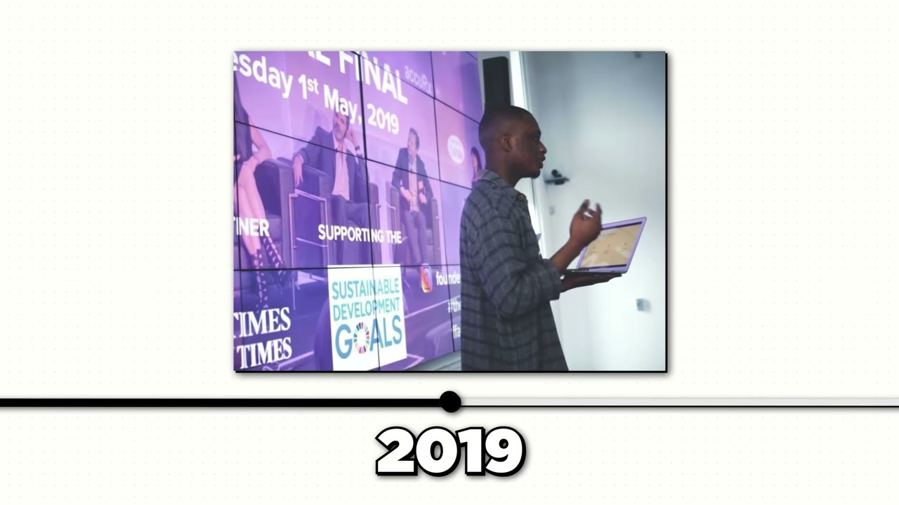
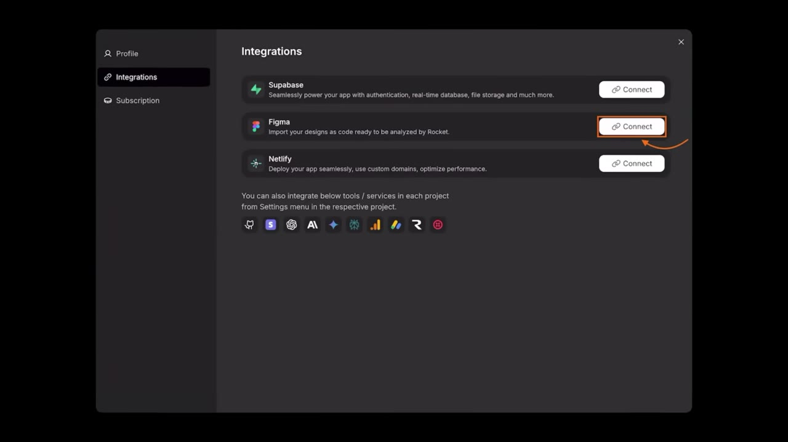
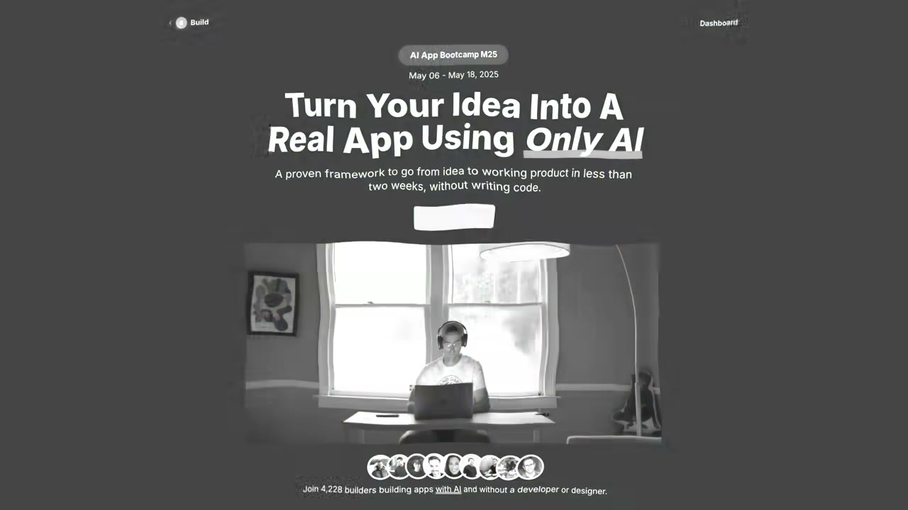

# I flipped 4 apps and made $500,000

✅ **Đã phân tích sâu** → [`case.md`](case.md)

| | |
|---|---|
| **Video** | <https://www.youtube.com/watch?v=PmyXmpkTIdc> |
| **Đăng** | 09/11/2025 |
| **Thời lượng** | 16:41 |
| **Lượt xem** | 113,495 |
| **Lượt thích** | 3,611 |
| **Video ID** | `PmyXmpkTIdc` |

## Trong thư mục này

| File | Nội dung |
|---|---|
| [`case.md`](case.md) | **Phân tích đầy đủ** — ý tưởng, validate, GTM, áp dụng ở VN |
| [`meta.json`](meta.json) | Metadata gốc (chapters, heatmap, mô tả) |
| [`screenshots/`](screenshots/) | 10 ảnh 720p |

## Mô tả gốc

Lotts Ezeike is a London-based founder who's perfected the art of flipping apps. His method: build apps fast, grow them to $10-20K MRR, sell them for all-cash deals, and moves on. He's done this four times and made over $500K.
0:00 - Intro
1:12 - Who is Lotts
1:31 - Sold apps
2:10 - Background
2:41 - The first flip story
3:49 - Why you should build and flip
5:00 - How to come up with app ideas
6:16 - Build fast with Rocket
7:07 - Build & Flip Playbook (Step-by-Step)
11:41 - Profitable app ideas
13:33 - Tech stack
14:26 - Costs & margins
15:00 - Advice
15:57 - Final word

## Số liệu bắt được từ transcript

> Các đoạn founder nhắc tới con số, kèm timestamp để tua thẳng tới đó trong video.

_(không bắt được con số nào)_

## Chương

- `00:00` Intro
- `01:12` Who is Lotts
- `01:31` Sold apps
- `02:10` Background
- `02:41` The first flip story
- `03:49` Why you should build and flip
- `05:00` How to come up with app ideas
- `06:16` Build fast with Rocket
- `07:07` Build & Flip Playbook (Step-by-Step)
- `11:41` Profitable app ideas
- `13:33` Tech stack
- `14:26` Costs & margins
- `15:00` Advice
- `15:57` Final word

## Ảnh

1. `01_01m24s_ch-who-is-lotts.jpg` — 
2. `02_02m22s_ch-background.jpg` — 
3. `03_04m01s_ch-why-you-should-build-and-flip.jpg` — 
4. `04_05m12s_ch-how-to-come-up-with-app-ideas.jpg` — 
5. `05_06m38s_metric.jpg` — 
6. `06_07m34s_replay.jpg` — 
7. `07_11m53s_ch-profitable-app-ideas.jpg` — 
8. `08_14m04s_replay.jpg` — 
9. `09_15m12s_ch-advice.jpg` — 
10. `10_16m09s_ch-final-word.jpg` — 

---

← [Quay lại index](../../index.md) · [Toàn bộ video](../README.md)
