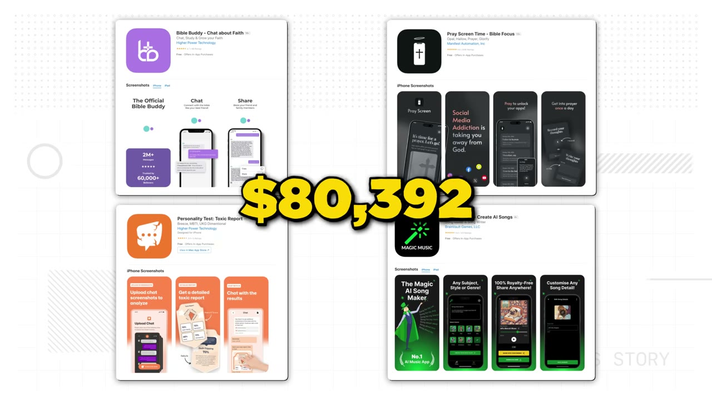
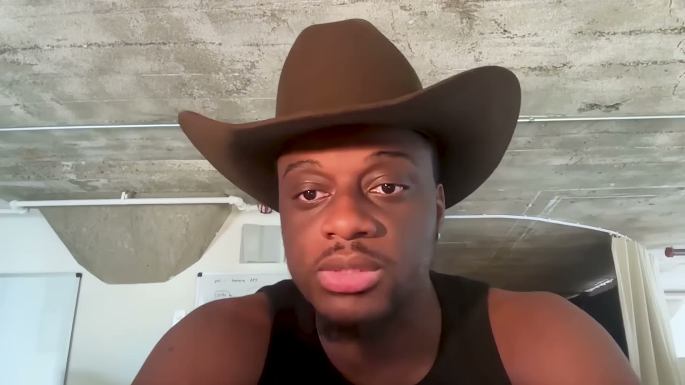
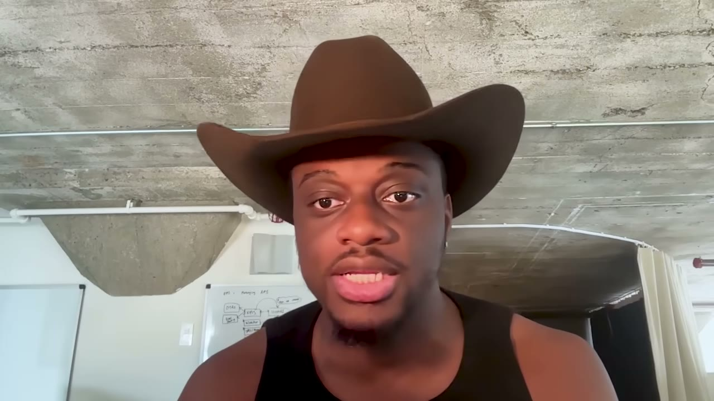
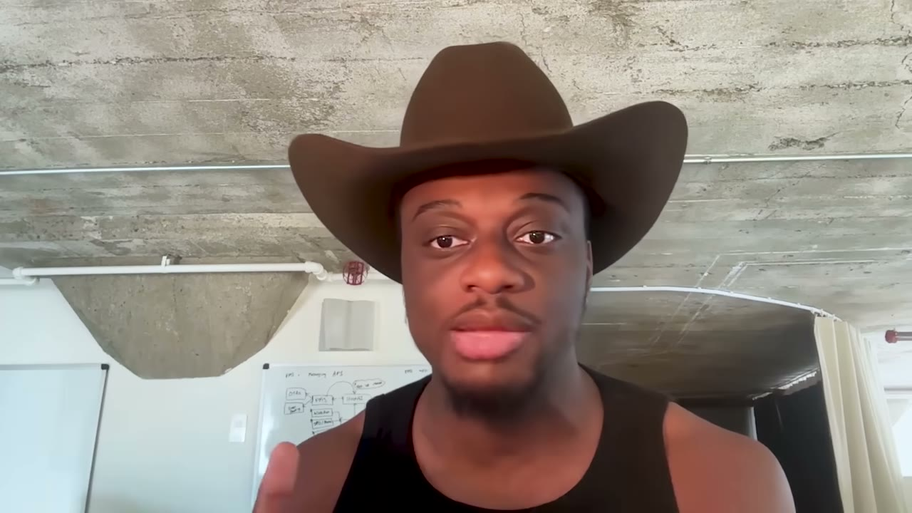
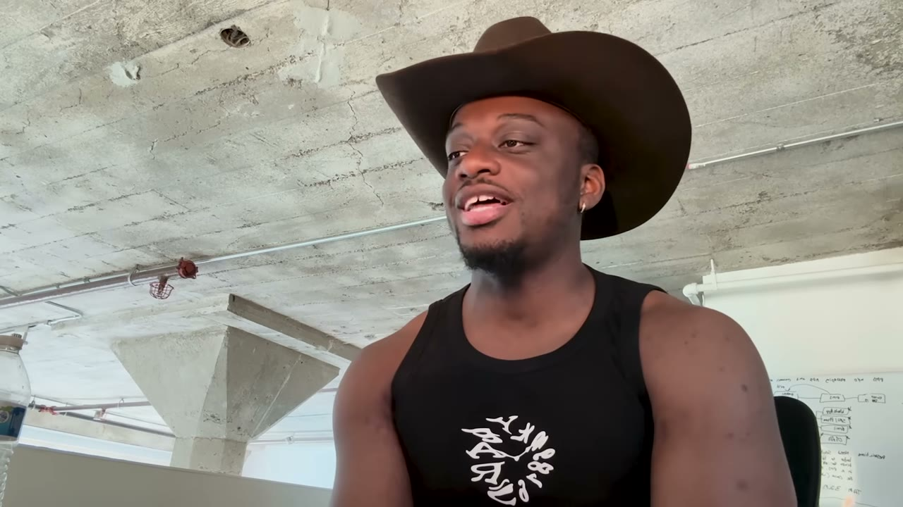
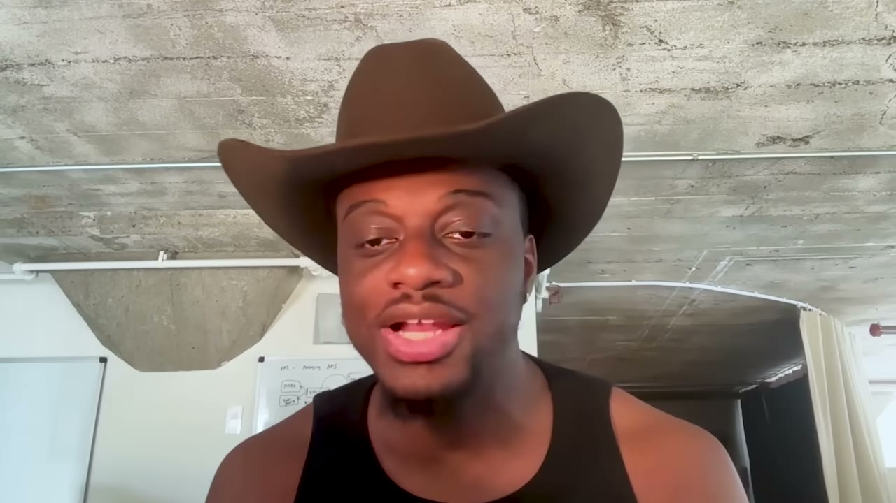

# Lotts Ezeike — bán 4 app, thu về hơn $500.000

> **Tóm tắt 30 giây:** Lotts từng gọi được vốn VC ở London cho startup đầu tiên, chạy 3 năm rưỡi, thất bại — và **vẫn nghèo**. Từ 2022 anh đổi hẳn cách chơi: coi app như bất động sản, build nhanh, nuôi lên **$10-20K MRR rồi bán lấy tiền mặt**. Bốn lần, **hơn $500.000**. Nguyên tắc sốc nhất của anh: **không bao giờ bán cho người trả giá cao nhất — anh bán cho người trả giá cao thứ ba**, và nói thẳng với họ rằng có hai người trả cao hơn, nhưng nếu chốt trong 3-4 ngày thì deal thuộc về họ. Lý do: giá cao nhất mất nhiều thời gian nhất và đổ bể nhiều nhất.

## ⚠️ Đọc trước: đây KHÔNG phải case doanh thu định kỳ

Con số **$500.000** trong tiêu đề là **tổng tiền bán 4 app từ 2022 tới nay**, không phải doanh thu tháng, không phải MRR. Đừng so nó với các case $200K/tháng trong kho. Đây là case về **chiến lược thoát**, không phải case về vận hành.

Cũng lưu ý: video có mâu thuẫn số học. $500K chia cho 4 thương vụ = **trung bình $125K/app**, trong khi Lotts mô tả kỳ vọng exit của mình là *"trong 6-12 tháng exit nó với giá $250K ngon lành"*. Hai con số này chỉ hoà giải được nếu một vài app bán rẻ hơn nhiều so với mức anh nêu. **Tôi lấy $500K tổng làm con số neo** vì đó là con số anh lặp lại nhiều lần và có trong mô tả video.

## 1. Con số

| Chỉ số | Giá trị |
|---|---|
| Tổng tiền bán | **hơn $500.000** (4 app, từ 2022) |
| Ngưỡng bán | $10K-$20K MRR |
| Chu kỳ build → exit | 6-12 tháng |
| Tổng người dùng | hơn 1 triệu trên tất cả app |
| Định giá | 2-4x EBITDA (xem mục 6 về mâu thuẫn) |
| Retention D30 của Pray Screen | **60%** |
| CPI của Pray Screen (Mỹ) | **$0,30-$0,50** |
| Danh sách email tích luỹ | 1,2 triệu người Cơ Đốc giáo |
| Chi phí vận hành ở mức $10K MRR | tối đa $1.000/tháng |
| Chi phí UGC | $5K-$10K/tháng cho 10 creator = 10 video/ngày |
| Biên lợi nhuận mục tiêu | tối thiểu 70% |

**Bốn app đã bán:**

| App | Là gì |
|---|---|
| **Bible Buddy** | AI therapist cho người Cơ Đốc giáo (khởi đầu trên WhatsApp) |
| **Magic Music** | wrapper quanh **Suno AI** (trình tạo nhạc AI) |
| **Toxic Traits** | chụp màn hình đoạn chat với ai đó, app phân tích ra tính cách người đó |
| **Pray Screen** | chặn app trên điện thoại, phải cầu nguyện mới mở khoá được |

**Ghi chú tên riêng (auto-caption sai nhiều):** founder tên đầy đủ là **Lotanna Ezeike**; "Ceno AI" trong transcript là **Suno AI**; "MicroAcquire" nay đã đổi tên thành **Acquire.com**; "Short Term Eyes" gần như chắc chắn là **Shortimize** (công cụ theo dõi lượt xem TikTok theo tài khoản, tôi ghi nhận là suy đoán); "Creator Check" là sản phẩm anh đang làm cùng bạn gái.

## 2. Vì sao anh chuyển sang build-to-flip ⭐⭐⭐

Đây là phần giá trị nhất, vì nó là lời phản biện trực diện với toàn bộ văn hoá startup.

> *"Nó thật ra đến từ một chỗ rất đau. Tôi vốn làm ngân hàng, rồi tự mở startup gọi vốn VC. Ai cũng nghĩ mình sẽ thành Mark Zuckerberg, tôi cũng nghĩ vậy. Chạy khoảng 3 năm rưỡi, cuối cùng thất bại."*

Và câu chốt:

> *"Tôi **đã gọi được VC** cho startup đầu tiên, nhưng cuối ngày **tôi vẫn nghèo**. Người ta bán cho chúng ta một giấc mơ: gọi vốn đi, gọi, gọi, gọi suốt 10 năm nữa, rồi hy vọng có **0,0001% cơ hội** thành tỷ phú. Tôi thà build một thứ rồi trong 6-12 tháng exit nó lấy $250K ngon lành."*

**Luận điểm định lượng của anh:**

> *"Tôi thà lấy **2-3 năm lợi nhuận trả trước** còn hơn cày cuốc cả thập kỷ."*

Đây là cách hiểu đúng về bội số exit: bán ở 2-4x lợi nhuận năm nghĩa là bạn **nhận trước 2-4 năm tiền lãi tương lai** và chuyển toàn bộ rủi ro (platform, cạnh tranh, thay đổi thị hiếu) sang người mua. Với sản phẩm consumer — nơi vòng đời trend thường ngắn hơn 4 năm — đây là một cuộc trao đổi có lợi.

**Vì sao thị trường mua bán app đang thuận:**

> *"Có hai xu hướng tôi đang cưỡi. Một là consumer đang quay trở lại. Thị trường **có tính thanh khoản cao** — nghĩa là **build công nghệ giờ chẳng khó gì cả**, nên có rất nhiều người mua ngoài kia nghĩ rằng: này, tôi chỉ cần lấy sản phẩm này và marketing nó tốt hơn anh, thế là ra nhiều tiền hơn, biên lợi nhuận tốt hơn."*

**Cơ chế then chốt để bạn hiểu:** AI làm chi phí *build* sụp đổ. Điều đó **không** làm giá app sụp theo — nó làm **người mua nhiều lên**, vì giờ ai cũng tin mình marketing giỏi hơn founder. Founder giỏi build nhưng chán marketing → có động cơ bán. Người mua giỏi marketing nhưng lười build → có động cơ mua. Đó là thị trường thanh khoản.

## 3. Câu hỏi lọc ý tưởng: legacy hay cash flow? ⭐⭐⭐

Trước khi bắt tay vào bất cứ thứ gì, anh hỏi đúng một câu:

> *"Trước khi bắt đầu làm bất cứ thứ gì, tôi luôn tự hỏi: **cái này là di sản của mình hay là dòng tiền?** Và câu đó quyết định mọi thứ về sau."*

Nghe như triết lý suông, nhưng nó có hệ quả kỹ thuật rất cụ thể. Nếu là **cash flow**, thì:

- Không xây kiến trúc cho 10 triệu user
- Không tự làm hạ tầng, dùng thứ plug-and-play
- Không xây tính năng cần đội vận hành
- Không xây thứ chỉ mình bạn hiểu

Vì sao? Vì **mọi thứ phức tạp đều giết deal**:

> *"Người ta làm app quá phức tạp. Và khi tôi nói phức tạp, tôi không nói bản thân cái app — mà là **vận hành phía sau hậu trường**. Họ không làm nó đủ sạch để khi muốn bán thì bán được, và điều đó **giết rất nhiều deal**. Nhất là khi người mua hỏi vài câu mà bạn không trả lời được, hoặc trả lời lòng vòng quá — họ sẽ nghĩ: ừ, cái này không dành cho tôi."*

**Quy tắc rút ra:** trong build-to-flip, **độ sạch của vận hành là một tính năng của sản phẩm**, và nó được định giá bằng tiền mặt.

## 4. Playbook 7 bước ⭐⭐⭐

### Bước 1 — Săn trend ngay trên App Store

> *"Bạn vào App Store, xem ai đang đứng số 1 ở từng category. Rồi xem có app nào khác trong top 20 làm **đúng cùng một thứ nhưng cho một ngách hơi khác**."*

Rồi sang **Sensor Tower** để xem doanh thu thật của từng app:

> *"Nếu tôi thấy tất cả bọn nó đều làm trên $100K MRR hay trên $500K MRR, thì tôi biết chắc chắn có gì đó ở đây."*

**Cơ chế:** đây là validation bằng **tiền của đối thủ**. Nhiều app cùng làm một thứ và cùng kiếm được tiền = nhu cầu đủ lớn để nuôi nhiều người chơi = bạn không cần đánh bại ai, chỉ cần lấy một lát cắt ngách. Hoàn toàn cùng logic với [Gravl](../2025-11-13_how-i-built-it-400k-month-mobile-app-gravl/case.md) (clone Fitbod) và [Mike Hill](../2025-11-02_i-built-3-saas-apps-to-200k-mrr-heres-my-exact-playb/case.md) (*"pick an idea that's been done before"*).

### Bước 2 — Tìm edge của riêng bạn

> *"Tôi mê thị trường Cơ Đốc giáo, hiển nhiên vì bản thân tôi là người Cơ Đốc. Nhưng edge còn nằm ở chỗ: **công nghệ đến với đức tin và tôn giáo sau cùng**, và tôi muốn là người tiên phong ở đó."*

**Đây là nhận định chiến lược sắc nhất trong video.** "Công nghệ đến sau cùng" nghĩa là ở những ngách đó, **mức độ cạnh tranh về chất lượng sản phẩm rất thấp trong khi khả năng chi trả và mức độ gắn bó cảm xúc lại rất cao**. Đó là arbitrage — và nó không chỉ đúng với tôn giáo.

Với người Việt, các "ngách công nghệ đến sau" tương đương có thể là: sinh hoạt tôn giáo/tâm linh bản địa, nghề truyền thống, hội nhóm nghề nghiệp lớn tuổi, y tế cơ sở, giáo dục vùng.

### Bước 3 — Bắt buộc single player

> *"Nhiều người cố nhét tính năng xã hội vào, kiểu bạn cần người khác vào thì mới có giá trị. Tôi luôn nói: **hãy làm app single player** — thứ một người tự làm một mình cũng có giá trị ngay, không cần mời ai. Bạn có thể thêm phần xã hội sau, nhưng nó làm mọi thứ phức tạp, và bạn sẽ phải marketing cho hai nhóm người cùng lúc."*

Câu cuối là lý do thật: **app hai chiều nghĩa là hai bài toán acquisition**. Trong 6-12 tháng, bạn không đủ thời gian giải hai bài.

### Bước 4 — Hoặc cực dễ chia sẻ, hoặc cực giữ chân ⭐⭐⭐

Đây là bước đắt nhất, và có hai ví dụ cụ thể.

**Về chia sẻ, quan sát của anh rất tinh:**

> *"**Không ai trên đời này chia sẻ app cả.** Không ai tự dưng bảo: này, tải app này đi. Nhưng cái họ thật sự làm là **chia sẻ một thứ bên trong app** — nên họ thậm chí không biết là mình đang chia sẻ app."*

Cách Magic Music khai thác:

1. Người dùng tạo một bài hát (thường là để chọc bạn mình)
2. Chia sẻ link cho bạn
3. Link mở **web view** — bạn nghe được **không cần tải app**
4. Trên web view có **một nút xanh to: "Create your own song"**
5. Người bạn tải app

> *"Người ta sẽ làm một bài hát chửi xéo bạn mình. Thằng bạn nghe xong nghĩ: à, mình cũng phải làm một cái. Rồi tự tải app. Điều đó làm độ lan truyền cực cao."*

**Cơ chế:** vòng lặp không đòi hỏi hành vi vị tha ("giới thiệu app hay lắm"). Nó ký sinh vào một hành vi vị kỷ đã có sẵn (trêu bạn). Web view là mấu chốt — nó **bỏ đi rào cản cài đặt ở phía người nhận**, đẩy toàn bộ ma sát về sau khi họ đã muốn.

**Về giữ chân — Pray Screen đạt retention D30 60%**, con số mà chính anh gọi là *"gần như chưa từng nghe"*:

> *"Số một, hiển nhiên là bọn tôi **chặn thẳng các app của bạn** — nên bạn buộc phải dùng bọn tôi để mở khoá. Số hai, nó là thứ mang tính tôn giáo, nên có thêm một lực kéo nữa."*

**Cơ chế:** đây là retention **cưỡng bức + tự nguyện chồng lên nhau**. App blocker tạo ràng buộc cơ học (bạn không gỡ được nếu vẫn muốn kỷ luật), còn tôn giáo tạo ràng buộc giá trị (gỡ app = từ bỏ một cam kết đạo đức với bản thân). Ít mô hình nào có cả hai.

> **Đối chiếu trong kho:** [Prayer Lock](../2026-01-18_i-built-a-20k-month-mobile-app-heres-my-entire-playb/case.md) là **đúng cùng một mô hình** — chặn app cho đến khi cầu nguyện — và đang làm $20K/tháng. Hai case độc lập cùng chứng minh mô hình này chạy. Đây chính là loại tín hiệu mà bước 1 của Lotts đi tìm: **nhiều app cùng ý tưởng cùng kiếm được tiền**.

### Bước 5 — Tech stack đơn giản và plug-and-play

> *"Khi bán cho người khác, bạn cần làm nó trông đơn giản nhất có thể, để họ **không cần biết kỹ thuật** vẫn vận hành được."*

Đây là hệ quả trực tiếp của "cash flow, không phải legacy". Bạn không tối ưu cho khả năng mở rộng — bạn tối ưu cho **khả năng bàn giao**.

### Bước 6 — Tăng trưởng: UGC trước, Meta Ads sau ⭐⭐⭐

> *"Tôi có nhiều tài khoản UGC, và tôi thích tạo nội dung kiểu **rage bait** — bạn cho xem một thứ mà người ta phải tua lại xem lần nữa để chắc rằng mình vừa nhìn thấy đúng, hoặc là họ lao vào cãi nhau trong comment. Vì tất cả những gì TikTok nhìn thấy là: à, đây là engagement, đẩy cho nhiều người hơn."*

Rồi mới đến bước hai:

> *"Khi tôi đã có hook đúng, tôi mới launch trên Meta Ads. Và như vậy tôi có **CPI rất thấp**. Với Pray Screen, bọn tôi có CPI **30 tới 50 cent ở thị trường Mỹ**, con số gần như chưa từng nghe."*

**Vì sao thứ tự này quan trọng — và đây là bài học chuyển giao được nhất của cả video:**

TikTok organic là **phòng thí nghiệm miễn phí để tìm hook**. Bạn thử 50 video, tốn $0, và thuật toán nói cho bạn biết cái nào ăn. Chỉ khi đã có hook thắng, bạn mới đổ tiền vào Meta. Kết quả là bạn **mua traffic bằng một creative đã được kiểm chứng** thay vì trả tiền học phí để tìm nó.

So sánh với [Gravl](../2025-11-13_how-i-built-it-400k-month-mobile-app-gravl/case.md): Julian cũng nói *"cái khó không phải làm quảng cáo, cái khó là tạo ra khối lượng"* — nhưng anh tìm creative thắng **bằng tiền ads**. Lotts tìm nó **bằng organic**. Với người ít vốn, cách của Lotts rẻ hơn nhiều lần.

**Điều kiện áp dụng:** cách này chỉ chạy khi sản phẩm của bạn **quay được thành video 15 giây gây phản ứng cảm xúc**. App B2B, dashboard, công cụ chuyên môn — gần như không.

### Bước 7 — Bán: mẹo "người trả giá cao thứ ba" ⭐⭐⭐

Ngưỡng bán và cách chuẩn bị:

> *"Tôi thích đưa nó lên khoảng $10K-$20K MRR rồi mới tìm người mua. Một điều bạn muốn là **ba tháng cuối phải đi lên**. Bạn không muốn nó đang tuột dốc rồi mới đi bán — vì như thế trông như bạn đang đẩy cục nợ sang cho người khác."*

Nơi rao: **Acquire.com** (tên cũ MicroAcquire), và **đăng thẳng lên X** — anh nói cách sau hiệu quả rất tốt.

Còn đây là chiến thuật đắt nhất:

> *"Ai cũng muốn giá cao nhất, nhưng **giá cao nhất thường mất nhiều thời gian nhất và cũng đổ bể nhiều nhất**. Càng kéo dài, khả năng đổ bể càng cao. Nên kể cả khi bán app của mình, tôi **không thích bán cho người trả cao nhất. Tôi thường bán cho người trả cao thứ ba** — và nói với họ rằng có hai người trả cao hơn họ, nhưng nếu họ chốt được trong 3-4 ngày thì tôi chọn họ. Họ thường thấy mình may mắn và kiểu: thôi, chuyển tiền luôn đi, mọi thứ khác tính sau."*

**Vì sao cơ chế này hoạt động:**

1. **Kỳ vọng giảm dần theo thời gian.** Deal càng dài, người mua càng có thời gian tìm ra vấn đề, càng có thời gian đổi ý, càng có cơ hội gặp một deal khác hấp dẫn hơn.
2. **Người trả giá cao nhất thường là người nghiêm túc nhất về due diligence** — nghĩa là chậm nhất, nhiều câu hỏi nhất, nhiều điều kiện nhất.
3. **Anh biến giá thành sự khan hiếm.** Nói "có hai người trả cao hơn bạn" vừa xác nhận giá trị tài sản, vừa tạo áp lực thời gian, vừa khiến người mua cảm thấy **họ được ưu ái** chứ không phải bị ép.
4. **Tiền mặt về sớm = có thể bắt đầu app tiếp theo sớm.** Trong mô hình flip, tốc độ vòng quay quan trọng hơn giá từng thương vụ.

**Cảnh báo đạo đức:** chiêu này chỉ hợp lệ nếu **hai người trả giá cao hơn là có thật**. Bịa ra bid không tồn tại là gian dối và có thể làm đổ deal nếu bị lộ.

## 5. Ba ý tưởng anh sẽ làm nếu bắt đầu lại hôm nay ⭐⭐

Có giá trị vì nó cho thấy **bộ lọc** của anh, không chỉ ý tưởng.

| Ý tưởng | Lý do anh chọn |
|---|---|
| App để bạn trai theo dõi bạn gái đã ăn đủ 3 bữa chưa | *"Có một tệp khán giả rất cụ thể (18-30 tuổi), nên **targeting dễ hơn nhiều**. Và tôi đã thấy các app liền kề làm được — kiểu đếm calo dành riêng cho phụ nữ."* |
| App theo dõi da mặt kiểu Korean glass skin | *"Đã có một trend lớn quanh nó rồi. **Người ta đang chi tiền thật cho các thủ thuật thật** — nên bạn biết chắc năng lực chi tiêu đã có sẵn."* |
| Chill Guy AI — ghi lại mọi thứ bạn gái từng nói, rồi tự nhắc hẹn hò/tặng hoa và đặt luôn bằng một nút | Có mô hình subscription rõ ràng, hành vi lặp lại |

**Bộ lọc rút ra được:** (1) tệp khán giả đủ hẹp để Meta target chính xác; (2) đã có bằng chứng người ta **đang chi tiền thật** cho vấn đề đó ở dạng khác; (3) hành vi lặp lại đủ để nuôi subscription.

## 6. Kinh tế học của mô hình — và một mâu thuẫn cần lưu ý

**Chi phí ở mức $10K/tháng:**

> *"Tính hết cũng chỉ tối đa **$1.000/tháng**. Chi phí phình to đến từ phía UGC, và nó phụ thuộc số creator bạn ký. Bạn có thể có 10 UGC creator, có lẽ trả $5K-$10K/tháng cho họ, và đổi lại bạn có **10 video mỗi ngày**. Về biên lợi nhuận, bạn muốn ít nhất **70%** thì mới gọi là khoẻ."*

Lưu ý: $1.000/tháng là chi phí **hạ tầng**, còn UGC $5-10K/tháng thì lớn hơn cả doanh thu $10K rất nhiều — nghĩa là mức chi UGC đó chỉ áp dụng khi app đã lớn hơn, hoặc coi như chi phí tăng trưởng chứ không phải chi phí vận hành. Video không tách bạch rõ điểm này.

**Mâu thuẫn về định giá:**

> *"Định giá thì khác nhau tuỳ người mua, nhưng tôi thấy khoảng **2 đến 4 lần EBITDA**. EBITDA về cơ bản là lợi nhuận... nhưng bình thường khoảng 2 đến 4 lần EBITDA **cho ARR bạn đang có**."*

Đây là hai công thức **khác nhau về bản chất**, nói liền nhau trong một câu:

- **2-4x EBITDA năm:** $20K MRR × 12 × 70% biên = ~$168K lợi nhuận/năm → giá $336K-$672K
- **2-4x ARR:** $20K MRR × 12 = $240K ARR → giá $480K-$960K

Cả hai đều **cao hơn nhiều** so với trung bình $125K/app tính từ tổng $500K. Kết luận thực dụng: **hãy coi 2-4x EBITDA là trần lý thuyết, không phải kỳ vọng**. Với app consumer nhỏ, mức thực tế trên Acquire.com thường thấp hơn.

Bối cảnh thật của Bible Buddy cho thấy đường đi không hề mượt:

> *"Tôi launch trên WhatsApp vì tôi không có kỹ năng kỹ thuật, nên tôi dùng bên thứ ba. Rồi tôi không biết là **WhatsApp thu tiền cắt cổ theo mỗi cửa sổ hội thoại**. Chi phí phình lên **$15K/tháng**. Tôi kiểu: không đời nào. Tôi phải chuyển sang hạ tầng của mình."*

Anh thuê một kỹ sư trên **Upwork** và chuyển sang iOS/Android. Bài học: **chi phí biến đổi của nền tảng bên thứ ba có thể giết bạn trước khi bạn kịp có doanh thu.**

## 7. Lời khuyên cuối: chỉ chơi ván bạn thắng được ⭐⭐

> *"Điều tôi hay nói bây giờ là: **chỉ chơi những ván bạn có thể thắng, và luôn phải có edge**. Chơi ván bạn thắng được không có nghĩa là bạn luôn thắng — mà là khi thua, bạn biết đó là lỗi của mình."*

Và anh áp dụng nó ngay lên chính ý tưởng anh vừa nghĩ ra:

> *"Nếu tôi build một app nữa, tiếc là nó **sẽ không phải Chill Guy AI**. Tôi chỉ không nghĩ mình có edge ở đó. Tôi sẽ build một app Cơ Đốc giáo khác, cho một ngách khác — vì theo thời gian tôi giờ có **danh sách email 1,2 triệu người Cơ Đốc giáo**. Và Meta có một thứ tuyệt vời gọi là **lookalike audience**. Nó làm việc có CPI thấp dễ hơn rất nhiều mỗi khi tôi muốn build app mới ở đó. Về vận hành cũng dễ hơn: chỉ cần tạo app mới rồi nhét vào **đúng cái funnel sẵn có**. Và bạn còn cross-sell được giữa các app — tôi có thể bán không gian quảng cáo trong app này cho app khác của mình, miễn phí."*

**Đây là điểm đáng nhớ nhất của case, và nó lật ngược tiêu đề video.**

Lotts bán app, nhưng anh **không bán tài sản thật sự của mình**. Tài sản đó là:
1. Danh sách 1,2 triệu email
2. Các lookalike audience trên Meta đã được huấn luyện
3. Mạng lưới tài khoản UGC
4. Funnel acquisition đã được tinh chỉnh
5. Hiểu biết về ngách

Mỗi app là một **sản phẩm dùng một lần** chạy qua cỗ máy đó. Bán app = thu tiền mặt; giữ cỗ máy = giữ khả năng làm lại. Đây là lý do vòng thứ tư dễ hơn vòng đầu rất nhiều — và là lý do **bạn không thể copy kết quả của anh ở vòng đầu tiên của mình**.

## 8. Mâu thuẫn với các founder khác trong kho — và cách phân định ⭐⭐

| Quan điểm | Ai nói | Đúng khi nào |
|---|---|---|
| **Build để bán**, cash out sau 6-12 tháng | Lotts (case này) | Sản phẩm consumer cưỡi trend, vòng đời ngắn, bạn có cỗ máy phân phối tái sử dụng được |
| **Build để giữ**, lấy lương lớn chứ không lấy exit lớn | [Mike Hill](../2025-11-02_i-built-3-saas-apps-to-200k-mrr-heres-my-exact-playb/case.md) | B2B, nhu cầu ổn định qua thập kỷ, tăng trưởng bằng SEO nên chi phí giảm dần theo thời gian |
| **Build một thứ rồi ở lại vận hành nhiều năm** | [Gravl](../2025-11-13_how-i-built-it-400k-month-mobile-app-gravl/case.md) | Bạn có domain knowledge sâu tạo ra moat thật, và sản phẩm còn dư địa tăng trưởng |

**Cách phân định — dùng ba câu hỏi:**

1. **Sản phẩm của bạn có còn tồn tại sau 4 năm không?** Nếu không chắc (AI wrapper, app cưỡi trend TikTok) → bán. Bội số 2-4x nghĩa là bạn được trả trước đúng 2-4 năm — nếu bạn không tin sản phẩm sống nổi ngần ấy, bán là thắng.
2. **Moat của bạn nằm ở sản phẩm hay ở kênh phân phối?** Nếu nằm ở **kênh** (như Lotts: email list + audience Meta), bán sản phẩm chẳng mất gì. Nếu nằm ở **sản phẩm** (như Gravl: workout engine), bán là bán mất chính bạn.
3. **Bạn cần tiền mặt hay cần dòng tiền?** Lotts từng gọi VC mà vẫn nghèo — anh cần tiền mặt. Mike Hill chia lợi nhuận cho 4 co-founder mỗi tháng — anh cần dòng tiền.

## 9. Cảnh báo thiên kiến nguồn

- Video có tài trợ của **Rocket (rocket.new)** — công cụ vibe-code — chèn ngay trước phần playbook, và kết bằng quảng cáo **Starter Story Build**. Thông điệp *"build công nghệ giờ chẳng khó gì cả"* **rất tiện cho cả hai nhà tài trợ**. Hãy đọc phần đó với sự dè dặt.
- **Không có ảnh dashboard nào**. Toàn bộ con số là lời kể: $500K, 60% retention, CPI $0,30-0,50, 1,2 triệu email. Không có bằng chứng độc lập.
- **Mâu thuẫn số học chưa được giải** giữa "$500K/4 app" và "exit $250K" (xem mục đầu).
- **Thiên kiến sống sót gấp đôi:** kênh chỉ phỏng vấn người thành công, và bản thân mô hình flip lại càng che giấu thất bại — các app không đạt $10K MRR thì đơn giản là biến mất, không ai kể về chúng.

## 10. Áp dụng cho tôi (indie hacker VN)

**Sao chép được gì — cụ thể, làm được tuần này:**

1. **Quy trình tìm ý tưởng bằng App Store + Sensor Tower.** Mở App Store, chọn 3 category, ghi lại top 20. Tìm nhóm 3+ app **làm cùng một việc cho ngách hơi khác nhau**. Đó là tín hiệu nhu cầu. (Bản miễn phí: dùng appfigures/Sensor Tower free tier hoặc đếm số review + tần suất update.)
2. **Câu hỏi "legacy hay cash flow" trước mỗi dự án.** Trả lời trước khi viết dòng code đầu tiên, vì nó quyết định kiến trúc.
3. **Bắt buộc single player.** Loại bỏ mọi ý tưởng marketplace/social khỏi danh sách nếu bạn đang solo.
4. **TikTok organic trước, Meta Ads sau.** Đây là phần rẻ nhất và giá trị nhất của case: **dùng organic để tìm hook, dùng paid để nhân hook**. Với ngân sách VN, đây gần như là cách duy nhất chạy paid ads có lý.
5. **Vòng lặp chia sẻ qua web view.** Nếu app tạo ra một *artifact* (bài hát, ảnh, kết quả test, biểu đồ), hãy làm link chia sẻ mở được **không cần cài app**, và đặt một nút to "tự tạo cái của bạn".
6. **Chiến thuật đàm phán "cao thứ ba"** — áp dụng được cho cả việc bán website, tài khoản, kênh, không riêng app.

**Rào cản thật — không tô hồng:**

- **Thị trường mua bán app hầu như là USD và người mua nước ngoài.** Acquire.com yêu cầu tài khoản ngân hàng nhận wire quốc tế, hợp đồng tiếng Anh, và due diligence bằng tiếng Anh qua video call. **Đây là rào cản tiếng Anh thật, ở đúng khâu quyết định tiền.** Lotts thắng một phần vì anh ở London và tình cờ gặp người mua ngoài đời.
- **Chuyển quyền sở hữu app rất phiền.** App Store/Google Play cho transfer nhưng có điều kiện; nếu app dùng tài khoản cá nhân, tài khoản Việt Nam, hoặc có tranh chấp thanh toán, deal có thể đổ. Hãy dựng app trong một **tài khoản developer riêng cho từng app** ngay từ đầu.
- **Thuế và pháp lý khi bán tài sản ra nước ngoài.** Đây là thu nhập từ chuyển nhượng tài sản, không phải doanh thu bán hàng — cần tư vấn thật, không nên tự làm.
- **UGC ở quy mô cần tiền và cần người.** $5-10K/tháng cho 10 creator là ~130-260 triệu VNĐ/tháng. Ở VN bạn có thể làm rẻ hơn nhiều với creator Việt, nhưng nếu bán cho thị trường Mỹ, bạn cần creator nói tiếng Anh bản xứ — và giá không rẻ.
- **Rage bait là con dao hai lưỡi.** Nó lên nhanh nhưng dễ bị TikTok bóp, dễ tạo review 1 sao, và làm tài sản khó bán hơn (người mua sợ tăng trưởng không bền).
- **Rủi ro nền tảng chồng chất.** Bài học WhatsApp $15K/tháng của chính Lotts là ví dụ. Cộng thêm: Meta đổi thuật toán, App Store đổi chính sách, Suno đổi giá API. Trong mô hình flip, rủi ro này **được chuyển sang người mua** — nhưng chỉ nếu bạn bán kịp.
- **Bạn không có 1,2 triệu email ở vòng đầu.** Vòng flip đầu tiên của bạn sẽ khó gấp nhiều lần vòng thứ tư của Lotts. Hãy kỳ vọng đúng.

**Khi nào KHÔNG dùng mô hình này:**

- Khi bạn đang làm **B2B**. Người mua app B2B soi kỹ hơn nhiều (churn cohort, hợp đồng, hoá đơn), quá trình dài hơn hẳn, và không hợp với nhịp 6-12 tháng.
- Khi sản phẩm của bạn **không quay được thành video ngắn**. Toàn bộ động cơ acquisition ở đây là UGC.
- Khi bạn **chưa có kênh phân phối tái sử dụng được**. Nếu mỗi vòng bạn phải xây lại từ đầu, flip chỉ là làm thuê cho chính mình với mức lương thấp.
- Khi bạn **thật sự yêu vấn đề mình đang giải**. Lotts nói rất rõ: câu hỏi đầu tiên là legacy hay cash flow. Nếu là legacy, đừng ép mình vào mô hình này — bạn sẽ bán đúng lúc thứ mình yêu bắt đầu có ý nghĩa.

## Nguồn

- Video: <https://www.youtube.com/watch?v=PmyXmpkTIdc> (16:41, đăng 09/11/2025, 113.495 view)
- [Transcript đầy đủ](transcript.md) · [Ảnh chụp](screenshots/)
