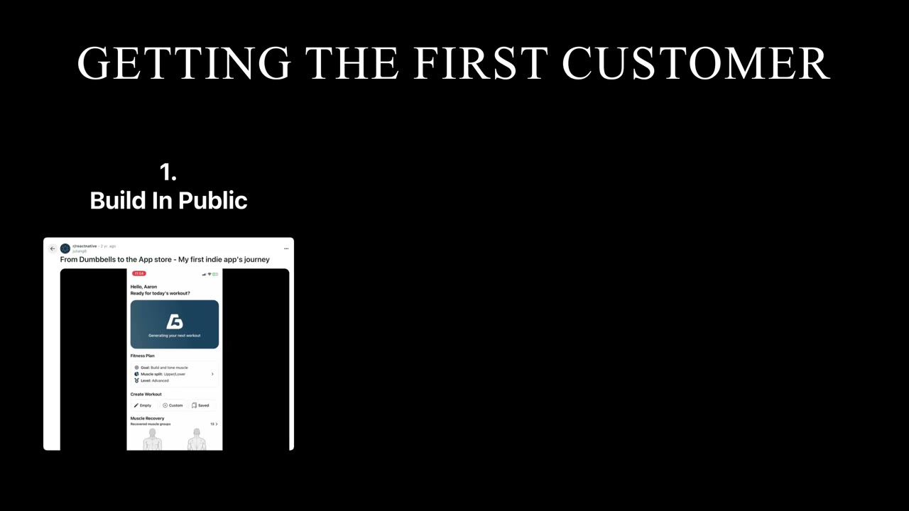
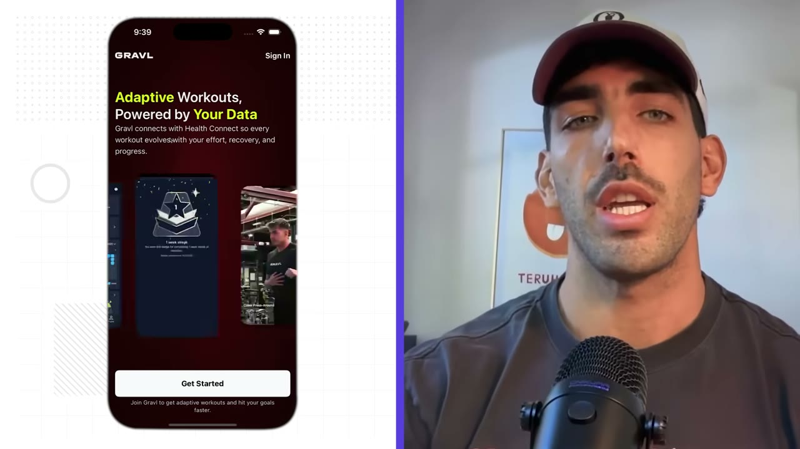
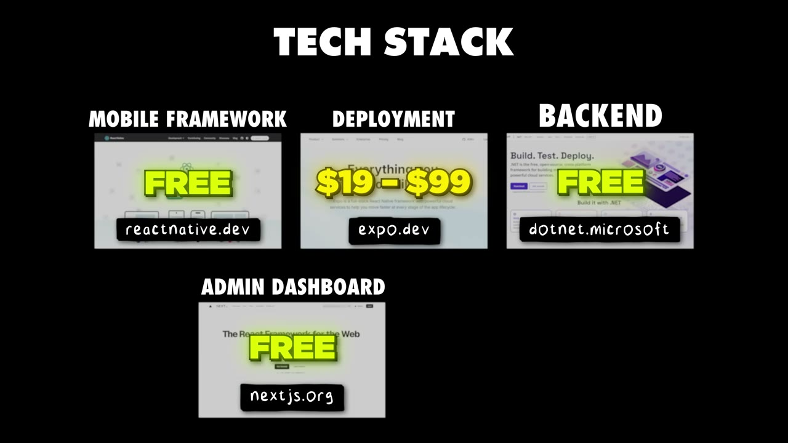

# How I Built It: $400K/Month Mobile App (Gravl)

✅ **Đã phân tích sâu** → [`case.md`](case.md)

| | |
|---|---|
| **Video** | <https://www.youtube.com/watch?v=2dfMUtHlQik> |
| **Đăng** | 13/11/2025 |
| **Thời lượng** | 15:34 |
| **Lượt xem** | 249,456 |
| **Lượt thích** | 6,072 |
| **Video ID** | `2dfMUtHlQik` |

## Trong thư mục này

| File | Nội dung |
|---|---|
| [`case.md`](case.md) | **Phân tích đầy đủ** — ý tưởng, validate, GTM, áp dụng ở VN |
| [`meta.json`](meta.json) | Metadata gốc (chapters, heatmap, mô tả) |
| [`screenshots/`](screenshots/) | 10 ảnh 720p |

## Mô tả gốc

Julian Gargicevich discovered a fitness app that was crushing it, but when he tried it, he thought: " Maybe I can build something better." He built his MVP in 2 months, posted it on Reddit, and his app had almost immediate product-market fit. Now his team is at $400K/month with 70K+ subscribers. 
0:00 - Intro
1:09 - Julian's background
2:51 - How he found the idea
4:01 - Building the MVP
4:48 - His first 1,000 customers
5:45 - Learn about AI from the experts
6:55 - Marketing strategy breakdown
7:46 - 5 tips for building mobile apps
9:31 - How the app works (full walkthrough)
12:11- Mobile app 

## Số liệu bắt được từ transcript

> Các đoạn founder nhắc tới con số, kèm timestamp để tua thẳng tới đó trong video.

_(không bắt được con số nào)_

## Chương

- `00:00` Intro
- `01:09` Julian's background
- `02:51` How he found the idea
- `04:01` Building the MVP
- `04:48` His first 1,000 customers
- `05:45` Learn about AI from the experts
- `06:55` Marketing strategy breakdown
- `07:46` 5 tips for building mobile apps
- `09:31` How the app works (full walkthrough)
- `12:11` Mobile app teck stack
- `12:37` Costs & Margins
- `13:54` Be proud of what you build
- `14:55` Final word

## Ảnh

1. `01_00m50s_usd-400-000.jpg` — 
2. `02_02m57s_usd-400-000.jpg` — 
3. `03_04m13s_ch-building-the-mvp.jpg` — 
4. `04_05m00s_ch-his-first-1-000-customers.jpg` — 
5. `05_05m57s_ch-learn-about-ai-from-the-experts.jpg` — 
6. `06_06m44s_usd-400-000.jpg` — 
7. `07_07m47s_usd-400-000.jpg` — 
8. `08_09m43s_ch-how-the-app-works-full-walkthrough.jpg` — 
9. `09_10m49s_replay.jpg` — 
10. `10_12m22s_replay.jpg` — 

---

← [Quay lại index](../../index.md) · [Toàn bộ video](../README.md)
