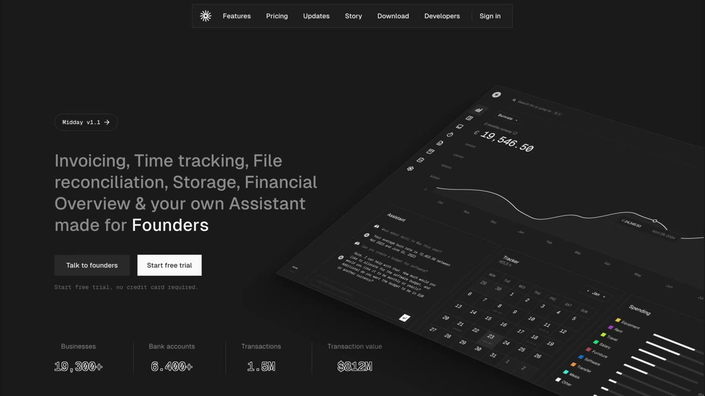

# My website makes $35K/month (built in 3 hours)

✅ **Đã phân tích sâu** → [`case.md`](case.md)

| | |
|---|---|
| **Video** | <https://www.youtube.com/watch?v=LWPN-PAhtLA> |
| **Đăng** | 16/11/2025 |
| **Thời lượng** | 14:26 |
| **Lượt xem** | 91,055 |
| **Lượt thích** | 2,178 |
| **Video ID** | `LWPN-PAhtLA` |

## Trong thư mục này

| File | Nội dung |
|---|---|
| [`case.md`](case.md) | **Phân tích đầy đủ** — ý tưởng, validate, GTM, áp dụng ở VN |
| [`meta.json`](meta.json) | Metadata gốc (chapters, heatmap, mô tả) |
| [`screenshots/`](screenshots/) | 10 ảnh 720p |

## Mô tả gốc

Pontus Abrahamsson had a crazy idea on his flight to France. And as soon as he landed he called his co-founder and said, "we need to build a directory." So they bought the domain, built the app in 3 hours, posted it, and it went super viral. This video breaks down why directories still work in 2025 and how to design beautiful websites with AI.
0:00 - Intro
1:09 - Special Announcement
2:02: Pontus background
2:31 - What is a directory?
3:13 - How Pontus found the idea
3:50 - Building the MVP
4:41 - How he ships fast
5:27 - Pontus' launch strategy
6:33 - Designing with AI
9:04 - Are directories 

## Số liệu bắt được từ transcript

> Các đoạn founder nhắc tới con số, kèm timestamp để tua thẳng tới đó trong video.

_(không bắt được con số nào)_

## Chương

- `00:00` Intro
- `01:09` Special Announcement
- `02:31` What is a directory?
- `03:13` How Pontus found the idea
- `03:50` Building the MVP
- `04:41` How he ships fast
- `05:27` Pontus' launch strategy
- `06:33` Designing with AI
- `08:03` Check out Starter Story Build
- `09:04` Are directories dead in 2025?
- `10:08` Cursor Directory tool
- `11:48` Lean tech stack
- `12:49` start something simple
- `13:36` Final Word

## Ảnh

1. `01_00m53s_usd-34-000.jpg` — 
2. `02_02m13s_replay.jpg` — 
3. `03_03m25s_ch-how-pontus-found-the-idea.jpg` — 
4. `04_04m02s_ch-building-the-mvp.jpg` — 
5. `05_04m53s_ch-how-he-ships-fast.jpg` — 
6. `06_05m39s_ch-pontus-launch-strategy.jpg` — 
7. `07_06m45s_ch-designing-with-ai.jpg` — 
8. `08_08m15s_ch-check-out-starter-story-build.jpg` — 
9. `09_12m37s_replay.jpg` — 
10. `10_13m37s_usd-34-000.jpg` — 

---

← [Quay lại index](../../index.md) · [Toàn bộ video](../README.md)
