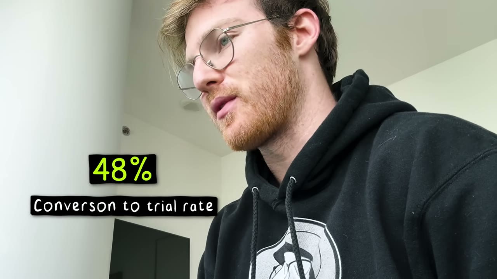
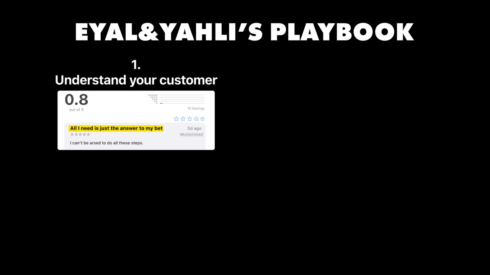
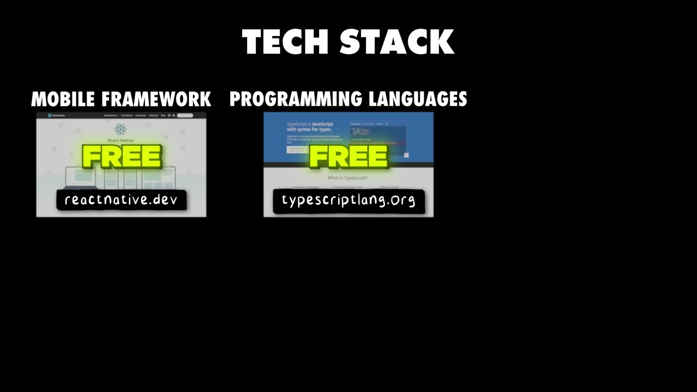
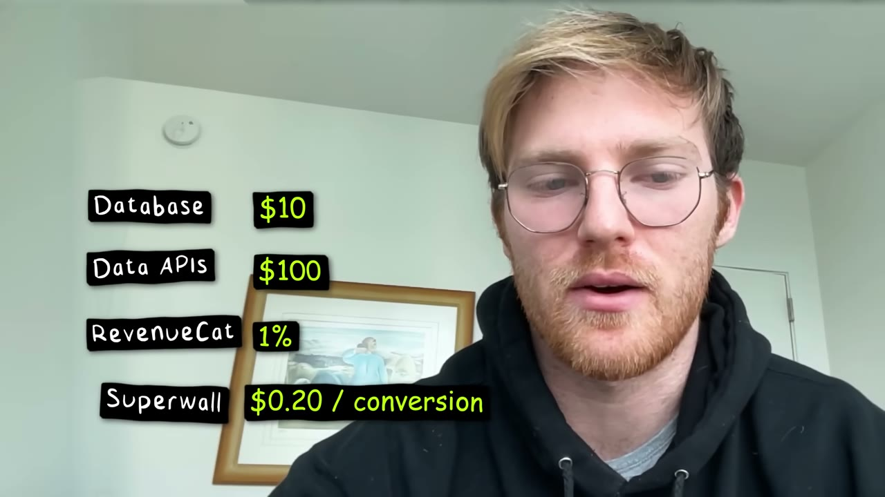
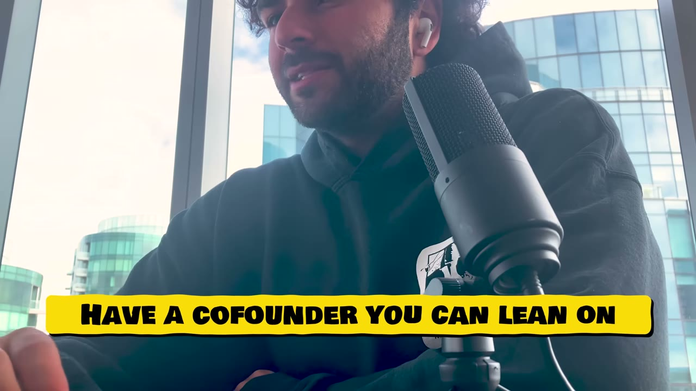

# How We Built It: $30K/month Mobile App

✅ **Đã phân tích sâu** → [`case.md`](case.md)

| | |
|---|---|
| **Video** | <https://www.youtube.com/watch?v=rCV-TVCnF6Q> |
| **Đăng** | 18/11/2025 |
| **Thời lượng** | 10:49 |
| **Lượt xem** | 38,114 |
| **Lượt thích** | 984 |
| **Video ID** | `rCV-TVCnF6Q` |

## Trong thư mục này

| File | Nội dung |
|---|---|
| [`case.md`](case.md) | **Phân tích đầy đủ** — ý tưởng, validate, GTM, áp dụng ở VN |
| [`meta.json`](meta.json) | Metadata gốc (chapters, heatmap, mô tả) |
| [`screenshots/`](screenshots/) | 10 ảnh 720p |

## Mô tả gốc

Eyal and Yahli Hazan built an app that was stuck at $2K MRR for months. The problem? Their app simply wasn't good enough... So they spent 4 months rebuilding it and after relaunching, they hit over $10K MRR in one week. This video breaks down why distribution isn't everything and how to optimize your product based on data. 
0:00 - Intro
1:04 - Founder & app backgrounds
1:59 - Build process
2:19 - Grab the best deal of the year
2:56 - Initial distribution
3:54 - The breakthrough
4:42 - Starter Story Build
5:35 - How to build a great product
6:49 - Great app playbook
8:13 - Tech stack and tools

## Số liệu bắt được từ transcript

> Các đoạn founder nhắc tới con số, kèm timestamp để tua thẳng tới đó trong video.

_(không bắt được con số nào)_

## Chương

- `00:00` Intro
- `01:04` Founder & app backgrounds
- `01:59` Build process
- `02:19` Grab the best deal of the year
- `02:56` Initial distribution
- `03:54` The breakthrough
- `04:42` Starter Story Build
- `05:35` How to build a great product
- `06:49` Great app playbook
- `08:13` Tech stack and tools
- `08:42` Costs & margins
- `09:27` Advice and lessons
- `10:10` Final word

## Ảnh

1. `01_01m09s_usd-30-000.jpg` — 
2. `02_01m57s_usd-3-30.jpg` — 
3. `03_03m08s_ch-initial-distribution.jpg` — 
4. `04_04m20s_usd-1-700-m.jpg` — 
5. `05_05m47s_ch-how-to-build-a-great-product.jpg` — 
6. `06_07m01s_ch-great-app-playbook.jpg` — 
7. `07_08m25s_ch-tech-stack-and-tools.jpg` — 
8. `08_09m01s_usd-100.jpg` — 
9. `09_09m39s_ch-advice-and-lessons.jpg` — 
10. `10_10m22s_ch-final-word.jpg` — 

---

← [Quay lại index](../../index.md) · [Toàn bộ video](../README.md)
