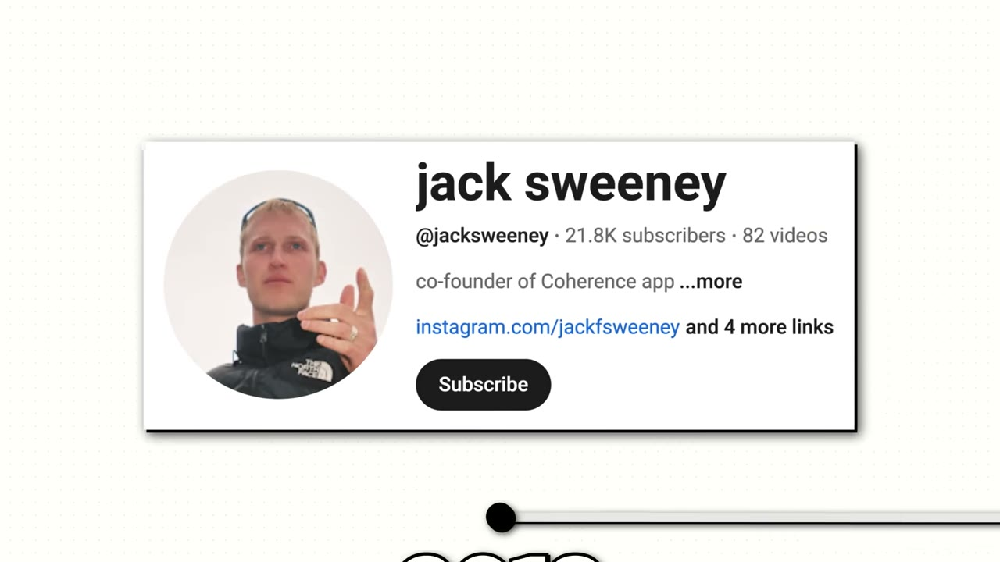
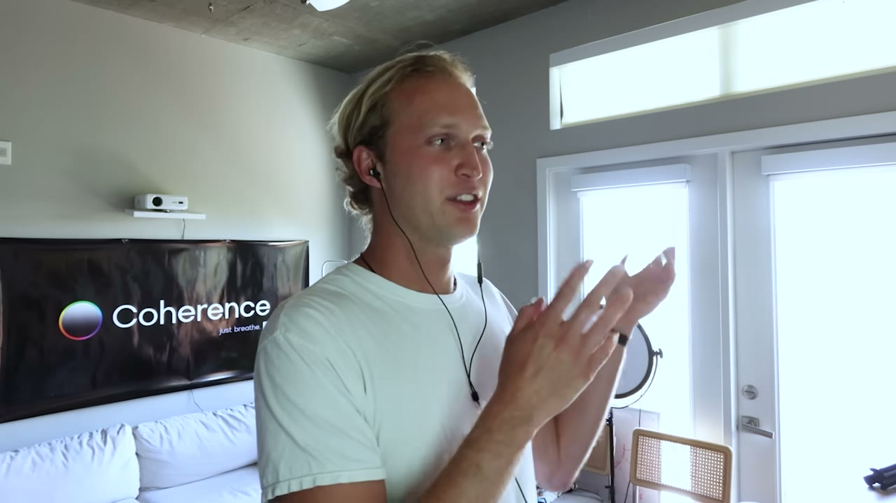

# Our Mobile App Made $85K in 8 months

✅ **Đã phân tích sâu** → [`case.md`](case.md)

| | |
|---|---|
| **Video** | <https://www.youtube.com/watch?v=nsn94Ad47GY> |
| **Đăng** | 20/11/2025 |
| **Thời lượng** | 12:55 |
| **Lượt xem** | 33,531 |
| **Lượt thích** | 966 |
| **Video ID** | `nsn94Ad47GY` |

## Trong thư mục này

| File | Nội dung |
|---|---|
| [`case.md`](case.md) | **Phân tích đầy đủ** — ý tưởng, validate, GTM, áp dụng ở VN |
| [`meta.json`](meta.json) | Metadata gốc (chapters, heatmap, mô tả) |
| [`screenshots/`](screenshots/) | 10 ảnh 720p |

## Mô tả gốc

Jack and Nick are two brothers who turned their obsession with breathwork into a niche mobile app. But here's what they did different: they validated their idea with content before writing a single line of code. 
0:00 - Intro
1:26 - Numbers behind the app
1:50 - Brothers backgrounds
3:33 - Create content first
5:45 - Build fast with Rocket
6:46 - Content before Product Playbook
8:30 - Piece of content example
9:19 - Coherence demo
10:24 - Tech stack
10:55 - Costs & margins
11:40 - Advice to founders
12:14 - Build and launch fast
This video is an educational case study of these founder’s experi

## Số liệu bắt được từ transcript

> Các đoạn founder nhắc tới con số, kèm timestamp để tua thẳng tới đó trong video.

_(không bắt được con số nào)_

## Chương

- `00:00` Intro
- `01:26` Numbers behind the app
- `01:50` Brothers backgrounds
- `03:33` Create content first
- `05:45` Build fast with Rocket
- `06:46` Content before Product Playbook
- `08:30` Piece of content example
- `09:19` Coherence demo
- `10:24` Tech stack
- `10:55` Costs & margins
- `11:40` Advice to founders
- `12:14` Build and launch fast

## Ảnh

1. `01_01m25s_usd-85-000.jpg` — 
2. `02_02m02s_ch-brothers-backgrounds.jpg` — 
3. `03_03m45s_ch-create-content-first.jpg` — 
4. `04_05m57s_ch-build-fast-with-rocket.jpg` — 
5. `05_06m58s_ch-content-before-product-playbook.jpg` — 
6. `06_08m42s_ch-piece-of-content-example.jpg` — 
7. `07_09m31s_ch-coherence-demo.jpg` — 
8. `08_10m16s_usd-40.jpg` — 
9. `09_11m20s_usd-800.jpg` — 
10. `10_12m26s_ch-build-and-launch-fast.jpg` — 

---

← [Quay lại index](../../index.md) · [Toàn bộ video](../README.md)
