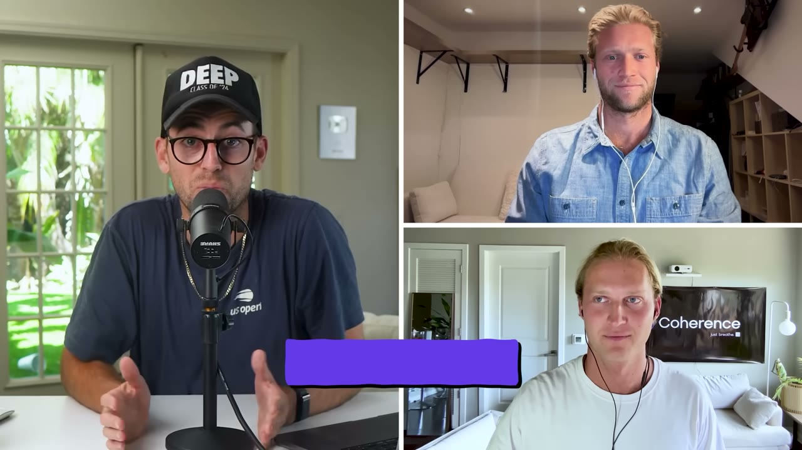
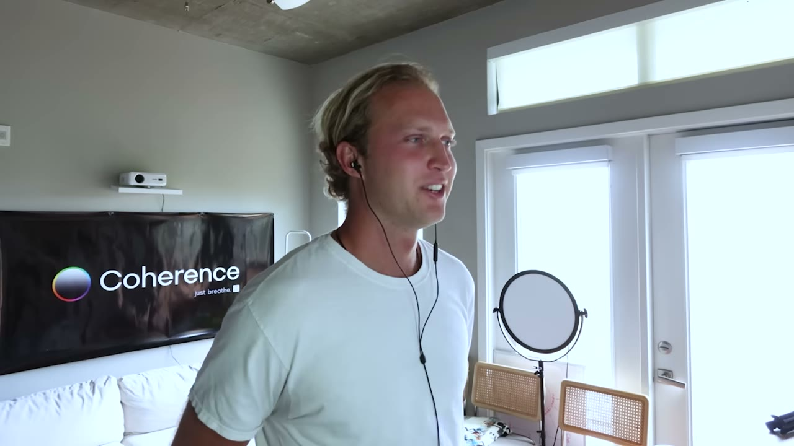
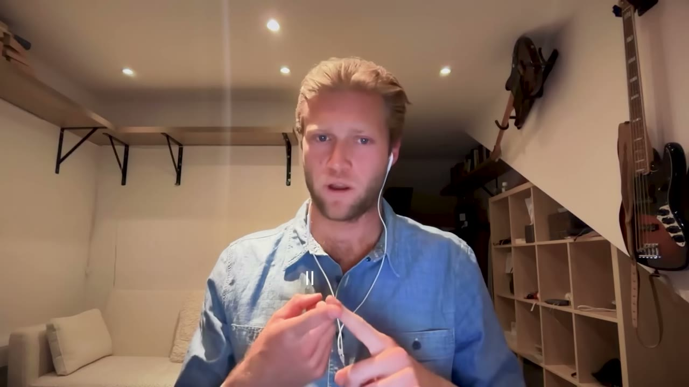
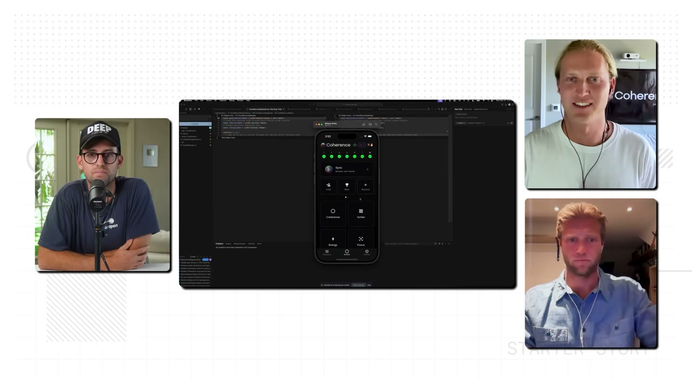
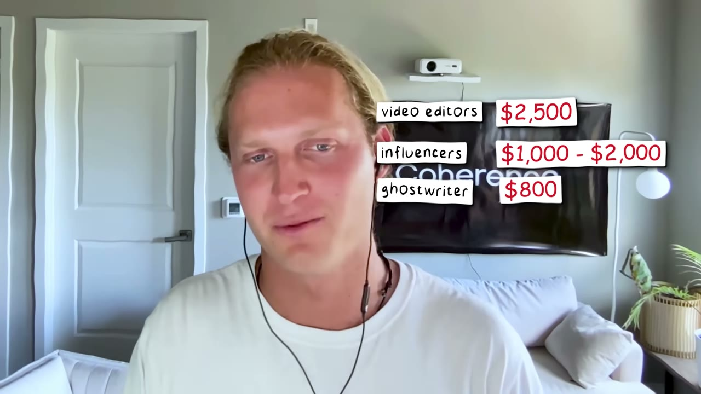

# Coherence — $85K trong 8 tháng nhờ làm content trước khi viết dòng code đầu tiên

> **Tóm tắt 30 giây:** Hai anh em Jack và Nick Sweeney không build app rồi đi marketing. Họ làm **ngược lại**: đăng nội dung về breath work suốt nhiều tháng, dùng X như một **sàn đấu ý tưởng**, chỉ những bài thắng mới được viết lại thành script Reels/TikTok, và chỉ những Reels thắng mới được nâng cấp thành video YouTube. Khi bài về *vortex breath* nổ, họ mới bắt đầu code — MVP xong tháng 2/2025, và Jack **không tự viết một dòng code nào** (dùng Cursor). 8 tháng sau: 15.000 lượt tải, 2.000+ người dùng, **$85.000 doanh thu**, trung bình $11K/tháng, tháng đỉnh $22K. Nhưng chi phí vận hành 5-6K/tháng cho thấy content organic ở đây **không hề miễn phí**.

## 1. Con số

| Chỉ số | Giá trị |
|---|---|
| Tổng doanh thu | ~$85.000 trong 8 tháng |
| Trung bình/tháng | ~$11.000 |
| Tháng cao nhất | $22.000 |
| Lượt tải | 15.000+ |
| Người dùng | 2.000+ |
| Doanh thu / lượt tải | ~$5,7 |
| Giá | $40/năm (trial 3 ngày) hoặc $10/tháng |
| Chi phí vận hành | $5.000-6.000/tháng |
| Biên lợi nhuận | ~50% |
| Nội dung đỉnh | ~8 triệu view trên tất cả nền tảng |

**Ba lưu ý về số liệu — đọc trước khi phấn khích:**

1. **$85K là số cộng dồn, không phải run-rate.** Tiêu đề video bán con số tổng. Con số vận hành thật là ~$11K/tháng.
2. **$22K tháng đỉnh so với $11K trung bình** nghĩa là doanh thu **giật cục theo nhịp viral**, không phải đường thẳng đi lên. Đây là đặc trưng của mô hình content-driven và là rủi ro lớn nhất của case này (xem mục 8).
3. Founder nói *"we've just surpassed 2,000 users"* — không rõ là người dùng hay người trả tiền. Nhưng $85.000 ÷ 2.000 = $42,5, gần khít giá gói năm $40 → **nhiều khả năng 2.000 là số người TRẢ TIỀN**. Nếu vậy tỉ lệ tải → trả tiền là ~13%, một con số rất tốt cho app di động.

## 2. Nguồn gốc: một chấn thương và một tài khoản YouTube 20K subs ⭐⭐

Đây là kiểu case mà "ý tưởng" không đến từ nghiên cứu thị trường mà đến từ **nỗi đau đã sống qua**:

- **Nick** từng là vận động viên trượt tuyết băng đồng hạng Division 1. Anh chấn thương, bác sĩ tuyên bố sự nghiệp chấm dứt, **không đi lại được trong 10 tháng** và được báo là sẽ không bao giờ đi lại bình thường. Trong tuyệt vọng anh tập breath work nghiêm túc → **đi lại được sau 3 tháng**, 6 tháng sau tập luyện toàn thời gian trở lại. Sau đó anh đi coach người khác.
- **Jack** có nền content: thời đại học xây kênh YouTube 20.000 subs, bỏ giữa chừng vì Covid để làm khởi nghiệp, build vài web app bằng no-code — *"the first couple apps that I built totally flopped"*.

Ghép lại: một người có **câu chuyện gốc không thể copy**, một người biết **cách phân phối nội dung**. Đây là cặp co-founder lý tưởng cho mô hình content-first — và cũng là điều kiện tiên quyết mà bạn phải trung thực tự đánh giá xem mình có hay không.

## 3. Cơ chế trung tâm — thang leo nội dung như một phễu validate ⭐⭐⭐

Đây là phần đáng giá nhất của cả video, và nó là một **cơ chế**, không phải một mẹo.

> *"So we would use X as sort of this idea battleground."*

Quy trình:

1. **X (Twitter)** — Nick viết thread về breath work, Jack viết về chủ đề tâm linh/esoteric. Chi phí sản xuất: gần bằng 0, mất vài phút.
2. Bài nào **có traction trên X** → coi là *validated piece of content*.
3. Viết lại bài X đó thành **script short-form**, dựng thành Instagram Reels và TikTok.
4. Reels/TikTok nào **thắng tiếp** → nâng cấp thành **video YouTube** (định dạng dài, tốn công nhất).

> *"So we were kind of moving upstream to longer, more impactful formats of content."*

**Vì sao cơ chế này hiệu quả:**

- Mỗi bậc thang **tốn công gấp bội bậc dưới**, nhưng bạn chỉ trả cái giá đó cho ý tưởng **đã có bằng chứng**. Chi phí của một lần thất bại ở bậc thấp nhất gần bằng 0.
- Tín hiệu bạn nhận được đến từ **đúng nhóm người bạn sẽ bán hàng cho** — không phải từ bạn bè, không phải từ khảo sát.
- Nó đảo ngược thứ tự rủi ro. Cách thông thường: bỏ 3-5 tháng build → tín hiệu đầu tiên đến sau 5 tháng. Cách này: tín hiệu đầu tiên đến sau 5 phút.

> *"If we weren't just making that content for fun, we never would have discovered what was going viral and what content was going to work, which ideas actually resonated with people... So we basically reverse engineered the content into the app."*

**Khoảnh khắc quyết định:** Nick đăng một tweet về *vortex breath*. Sáng hôm sau Jack nhắn: *"Yo, your Vortex breath tweet is going super viral."* Đó là lúc họ bắt đầu code. Và *vortex energy* về sau trở thành **một trong sáu kỹ thuật chính trong app** — nội dung không chỉ validate ý tưởng, nó **quyết định luôn feature list**.

**Khi nào cơ chế này KHÔNG chạy:** nó chỉ chạy với những vấn đề **có hình dạng nội dung** — tức là người ta chịu lướt xem nội dung về nó. Sức khoẻ, thể hình, làm đẹp, tâm linh, tiền bạc, hẹn hò: có. Công cụ đối soát hoá đơn cho kế toán B2B: không. Không ai lướt TikTok về đối soát hoá đơn. Với B2B, cơ chế tương đương là [YouTube Search của FollowBuddy](../2026-03-19_i-make-17k-month-with-one-strategy/case.md) — bắt **ý định tìm kiếm** thay vì bắt sự chú ý.

## 4. Playbook 5 bước của Nick ⭐⭐⭐

Nguyên văn từ video, kèm giải thích của tôi:

| Bước | Nick nói | Cơ chế thật đằng sau |
|---|---|---|
| 1 | **Pick a painful niche** — chọn một ngách có nỗi đau, làm thật nhiều content về nó, và tốt nhất tìm một co-founder kỹ thuật | Bạn cần nỗi đau đủ lớn để người ta chịu xem hết video, và đủ hẹp để bạn nói được điều người khác không nói được |
| 2 | **Batch your ideas weekly** — gom ý tưởng nội dung theo tuần | Tách công đoạn *nghĩ* khỏi công đoạn *quay*. Nghĩ và quay cùng lúc là lý do người ta bỏ cuộc sau 2 tuần |
| 3 | **Film in bulk** — quay liền 30-60 video, *hook, film, done, another one* | Có sẵn 2 tháng nội dung trong kho → thuật toán có dữ liệu để test, và bạn không bao giờ bị áp lực deadline hằng ngày |
| 4 | **Amplify your winners** — bài nào thắng thì bơm tiền Spark Ads / Meta ads vào | Đây là bước biến organic thành trả phí **sau khi đã biết cái gì hoạt động**. Bạn không đoán creative, thị trường đã chọn giúp bạn |
| 5 | **Outmarket everyone** — làm nhiều reels nhất có thể, thuê clipper | Trong content, phân phối là trò chơi số lượng nhân với tỉ lệ trúng. Bạn không kiểm soát được tỉ lệ trúng, chỉ kiểm soát được số lượng |

> *"For us, we're fully bootstrapped. So I'm just like, I'm the face. I will post like a madman every single day."*

**Bước 4 là bước ít người để ý nhưng quan trọng nhất về mặt tài chính.** Đa số người làm content organic dừng ở đó và cầu nguyện. Nick coi organic là **phòng thí nghiệm creative miễn phí**: bài nào chứng minh được sức hút mới đáng bỏ tiền quảng cáo. Đây chính xác là cách các đội performance marketing chuyên nghiệp test creative — chỉ khác là họ phải trả tiền cho vòng test đầu tiên, còn Nick thì không.

## 5. Bài content đổi đời — và bài học chua chát về khả năng dự đoán ⭐⭐⭐

Bài đăng tháng 7, đạt **~8 triệu view** trên tất cả nền tảng.

> *"I thought that this was gonna flop. After I videoed this, I filmed it like three more times because I thought it was bad. The next day, it had a million views."*

Đọc lại câu đó một lần nữa. **Người tạo ra nó nghĩ nó tệ, quay lại ba lần vì không hài lòng, và nó thành thứ đổi đời cả doanh nghiệp.**

Đây là lập luận thực nghiệm mạnh nhất cho bước 3 và bước 5 của playbook: nếu **chính bạn không dự đoán được video nào sẽ nổ**, thì chiến lược duy nhất còn lại là **tăng số lần thử** rồi nhân đôi vào cái thắng. Mọi giờ bạn bỏ ra để "làm cho hoàn hảo" một video là giờ bị đánh cắp khỏi việc quay video thứ 31.

**Công thức hook mà Nick dùng:** *"Do you want to know something that they don't want you to know?"*

Nick giải thích thẳng là anh đóng khung theo kiểu **gây chia rẽ (polarizing)**, và **"they" cố tình mơ hồ** — trong bối cảnh sức khoẻ thì "họ" là *các thế lực đen tối đang giữ cho bạn bệnh*. Cơ chế: tạo **khoảng trống tò mò** cộng với **ranh giới trong nhóm / ngoài nhóm**. Người xem lập tức được xếp vào phe "người biết sự thật".

Sau đó anh biến nó thành **một series**. Đây là chi tiết dễ bỏ qua: khi một format thắng, đừng đăng bài tiếp theo về chủ đề khác — hãy **khai thác cạn cái format đó**.

**Cảnh báo trung thực:** công thức "thứ mà *họ* không muốn bạn biết" trong ngách sức khoẻ nằm sát ranh giới thuyết âm mưu và quảng cáo y tế sai sự thật. Nó hiệu quả về mặt phân phối, nhưng nếu bạn định làm ở VN thì phải đọc kỹ quy định quảng cáo sản phẩm liên quan sức khoẻ, và cả chính sách của App Store về health claims. Đây là rủi ro thật, không phải cẩn thận quá mức.

## 6. Sản phẩm — đơn giản đến mức gần như không có gì

Demo trong video cho thấy Coherence gần như là **app đơn giản nhất có thể tưởng tượng**:

- Trang chủ có **streak counter** (gamification tối thiểu)
- **Sáu kỹ thuật thở**: coherence breathing, vortex energy, focus, stress relief, sleep (và một kỹ thuật nữa)
- Vào một kỹ thuật: màn hình cực tối giản, đặt timer, chỉnh âm lượng, bấm start
- Phát một âm khi hít vào, một âm khi thở ra. Hết.

Đây là điểm nên khắc vào đầu: **giá trị nằm ở nội dung đã đưa người dùng đến đây, không nằm ở độ phức tạp của app.** Một cái đồng hồ đếm nhịp thở kèm âm thanh đang thu $40/năm, bởi vì người dùng đến từ một video mà họ tin.

Mô hình giá: **$40/năm** (trial 3 ngày) hoặc **$10/tháng**. Gói năm chỉ bằng 4 tháng gói tháng — chiết khấu rất mạnh, kiểu điển hình của app di động: đổi ARPU lấy **tiền mặt trả trước** và **loại bỏ churn hằng tháng**.

## 7. Cấu trúc chi phí — mục quan trọng nhất mà ít ai đọc kỹ ⭐⭐⭐

| Hạng mục | Chi phí/tháng |
|---|---|
| Editor video | ~$2.500 |
| Influencer / partnership | $1.000-2.000 |
| Ghostwriter viết thread | $800 |
| Virtual assistant | $500 |
| Coding agents (Claude Code, Codex) | ~$300 |
| RevenueCat | ~$100 |
| Công cụ còn lại | ~$100 |
| **Tổng** | **$5.000-6.000** |
| Biên lợi nhuận | ~50% |

**Đây là con số phá vỡ ảo tưởng lớn nhất về "organic content".** Ở doanh thu ~$11K/tháng, họ đốt $2.500 chỉ riêng cho editor video và $800 cho người viết thread hộ. Nói cách khác: **cái mà video gọi là organic thực chất là một đội sản xuất truyền thông trả lương**, chỉ khác là chi phí nằm ở nhân công chứ không nằm ở tiền mua quảng cáo.

Hệ quả cho bạn: nếu bạn định copy mô hình này ở giai đoạn 0 đồng, bạn phải **tự làm hết** — tự viết, tự quay, tự dựng. Điều đó khả thi (và ở VN thì chi phí editor rẻ hơn Mỹ rất nhiều, đây là lợi thế thật của bạn), nhưng đừng nhầm rằng mô hình này miễn phí.

## 8. Mâu thuẫn với các case khác trong kho — và cách phân định ⭐⭐⭐

### 8.1. Content-first hay code-first?

| Quan điểm | Ai | Đúng khi nào |
|---|---|---|
| Làm content trước, viral rồi mới build | Coherence (case này) và [GlowUp](../2025-12-17_my-mobile-app-made-800k-in-365-days/case.md) | Ngách có hình dạng nội dung; founder chịu lên hình; sản phẩm build được dưới 1 tháng |
| Build trước rồi tìm phân phối | Đa số case app trong kho | Sản phẩm giải vấn đề người ta **chủ động đi tìm** — SEO/search bắt được |
| Validate kỹ trước khi viết code | [Once](../2026-05-10_i-built-a-20k-month-app-in-83-days/case.md) | Chi phí build cao, trên 1 tháng công |

**Phân định bằng hai câu hỏi:** (a) Người ta có lướt xem nội dung về vấn đề này không? (b) Bạn build MVP mất bao lâu? Coherence trả lời *có* và *vài tuần* → content-first là đúng. Nếu bạn trả lời *không* và *vài tuần* → ship kèm nút mua ngay. Nếu *không* và *vài tháng* → phải validate bằng bán hàng trước.

### 8.2. Cảnh báo lớn nhất — mô hình này có thể phân rã

Case gần nhất với Coherence trong kho là [GlowUp](../2025-12-17_my-mobile-app-made-800k-in-365-days/case.md): cũng làm content trước, cũng viral, và làm **$800K trong một năm** — nhưng **hiện chỉ còn $15K/tháng**. Đó là chân dung của mô hình content-driven B2C sau khi làn sóng viral đi qua.

Coherence mới 8 tháng tuổi. $22K tháng đỉnh so với $11K trung bình là dấu hiệu đúng của cùng một hình dạng đường cong. **Bạn nên đọc case này như bằng chứng về một cách VALIDATE, không phải bằng chứng về một doanh nghiệp bền vững.** Chưa ai chứng minh được điều đó ở đây.

Điều họ có mà GlowUp có thể không có: **retention có lý do**. Breath work là thói quen hằng ngày, có streak, có lý do quay lại. App thử makeup thì dùng vài lần rồi thôi. Đây là lý do tôi vẫn đánh giá case này cao hơn một app viral thuần tuý — nhưng cần thêm 12 tháng dữ liệu mới kết luận được.

## 9. Tech stack

| Hạng mục | Công cụ |
|---|---|
| App | **React Native Expo** |
| Backend / database | **Supabase** |
| Coding agents | **Claude Code** và **Codex** (ASR nghe thành *cloud code* và *codeex*) |
| IDE | **Cursor** |
| Analytics | **Mixpanel** |
| Thanh toán / subscription | **RevenueCat** |
| Marketing site | **Next.js** trên **Vercel** |
| Thiết kế | **Figma** |
| Thiết kế 3D | ASR nghe thành *rot* — không xác nhận được tên thật, nhiều khả năng là một công cụ 3D dạng Spline hoặc Rodin |
| Instagram DM tự động | **ManyChat** |

> *"I didn't actually write a single line of code in this entire codebase."* — Jack Sweeney

**ManyChat cho Instagram DM** là chi tiết nhỏ nhưng đáng chú ý: đây là cách bạn biến một Reel viral thành lead. Người xem comment một từ khoá → bot nhắn tin riêng kèm link tải app. Nó là cầu nối giữa *view* và *download* mà đa số người làm content bỏ qua.

## 10. Cảnh báo thiên kiến nguồn

Video này có **hai đoạn quảng cáo** trong 13 phút:

- **Rocket (rocket.new)** là nhà tài trợ trả tiền cho video này. Đoạn ~5:45-6:45 hoàn toàn là quảng cáo, không phải công cụ mà Jack và Nick thực sự dùng — họ dùng **Cursor**. Đừng nhầm.
- **Starter Story Build** là khoá học của chính kênh, được đẩy ở cuối video.

Ngoài ra kênh Starter Story chỉ phỏng vấn người thành công, và đã được HubSpot mua lại. Không có case nào trong kho này kể chuyện 30 người làm y hệt playbook trên mà thất bại — nhưng họ tồn tại.

## 11. Áp dụng cho tôi (indie hacker VN)

### Sao chép được gì

1. **Thang leo nội dung là thứ copy được nguyên xi, và gần như miễn phí.** Chọn một ngách bạn thật sự quan tâm. Viết 20 post ngắn trên X hoặc Threads trong 2 tuần. Cái nào có tương tác vượt trội → viết lại thành script 30 giây → quay Reels/TikTok. Cái nào thắng tiếp → làm video dài. **Đừng viết code cho tới khi có ít nhất một bài vượt trội rõ ràng.**
2. **Chi phí thử nghiệm ở VN thấp hơn Mỹ rất nhiều.** Editor video ở VN rẻ hơn $2.500/tháng nhiều lần. Đây là lợi thế cấu trúc thật của bạn trong mô hình này — có thể là lợi thế lớn nhất bạn có.
3. **Kỹ thuật batch + film in bulk giải quyết đúng vấn đề khiến người Việt bỏ cuộc**: không phải thiếu ý tưởng, mà là mệt mỏi vì phải nghĩ và quay mỗi ngày. Gom 30 video vào một buổi chiều Chủ nhật.
4. **App có thể đơn giản đến mức thô sơ.** Coherence là timer + âm thanh. Nếu nội dung của bạn thắng, người ta sẽ tải thứ bạn làm ra kể cả khi nó chỉ có một màn hình.
5. **Bước amplify (bơm ads vào bài thắng) là cách dùng tiền quảng cáo ít rủi ro nhất** mà tôi thấy trong kho này. Bạn chỉ trả tiền cho creative đã được thị trường chứng minh.

### Rào cản thật

- **Bạn phải chịu lên hình và nói tiếng Anh.** Nick nói thẳng: *"I'm the face. I will post like a madman every single day."* Mô hình này **không có phiên bản ẩn danh**. Nếu bạn ngại lên hình hoặc phát âm chưa tốt, hãy chọn mô hình dựa trên search intent thay vì attention — ví dụ [FollowBuddy](../2026-03-19_i-make-17k-month-with-one-strategy/case.md).
- **Câu chuyện gốc là thứ không thuê được.** Nick bán được vì anh thật sự không đi lại được 10 tháng. Nếu bạn không có câu chuyện, tỉ lệ chuyển đổi của bạn sẽ thấp hơn nhiều với cùng lượng view.
- **ARPU $40/năm là thấp, và bạn phải bán ra nước ngoài.** Ở giá tương đương cho thị trường VN, con số phải giảm mạnh nữa và bạn cần lượng người dùng gấp nhiều lần. Hãy nhắm thị trường nói tiếng Anh ngay từ đầu — nghĩa là toàn bộ nội dung phải bằng tiếng Anh.
- **Dòng tiền âm 30-45 ngày với Apple.** App Store trả tiền theo chu kỳ tháng sau. Nếu bạn định chạy ads amplify, bạn phải có vốn đệm đủ cho ít nhất 45 ngày chi phí.
- **Vốn cần có nếu muốn chạy giống họ:** $5-6K/tháng. Nếu tự làm hết thì gần bằng 0, đổi lại bằng thời gian của bạn — hãy tính thật: 30-60 video/tháng là công việc toàn thời gian.
- **Rủi ro nền tảng kép.** Bạn phụ thuộc cả thuật toán (TikTok/IG có thể bóp reach bất cứ lúc nào) lẫn App Store (chính sách health claims rất khắt khe với ngách sức khoẻ).
- **Rủi ro nội dung.** Hook kiểu *"thứ họ không muốn bạn biết"* trong lĩnh vực sức khoẻ có thể dẫn tới bị gỡ bài, khoá tài khoản, hoặc vi phạm quy định quảng cáo của VN.
- **Doanh thu giật cục.** $11K trung bình nhưng $22K tháng đỉnh nghĩa là có tháng thấp hơn nhiều. Đừng bỏ việc dựa trên tháng đỉnh.

### Khi nào KHÔNG dùng mô hình này

- **Khi vấn đề của bạn không có hình dạng nội dung.** Nếu không ai lướt xem video về vấn đề đó, không có gì để validate. B2B ngách hẹp, công cụ nội bộ, tích hợp kỹ thuật — dùng SEO hoặc bán hàng trực tiếp.
- **Khi bạn cần doanh thu ổn định theo tháng.** Mô hình này cho bạn những tháng $22K và những tháng $5K. Nếu bạn cần trả tiền nhà đều đặn, đây là mô hình sai.
- **Khi bạn không sẵn sàng trở thành người sản xuất nội dung toàn thời gian.** Sản phẩm ở đây là phần dễ. Việc thật là đăng bài mỗi ngày trong nhiều tháng trước khi có đồng doanh thu đầu tiên.
- **Khi bạn định thuê người khác làm mặt tiền.** Có thể được, nhưng bạn vừa mất đi thứ duy nhất không copy được — sự thật cá nhân — và vừa thêm một điểm phụ thuộc chí mạng.

## Nguồn

- Video: <https://www.youtube.com/watch?v=nsn94Ad47GY> (12:55, đăng 20/11/2025, 33.531 view)
- Sản phẩm: <https://www.coherencebreath.com/>
- [Transcript đầy đủ](transcript.md) · [Ảnh chụp](screenshots/)
