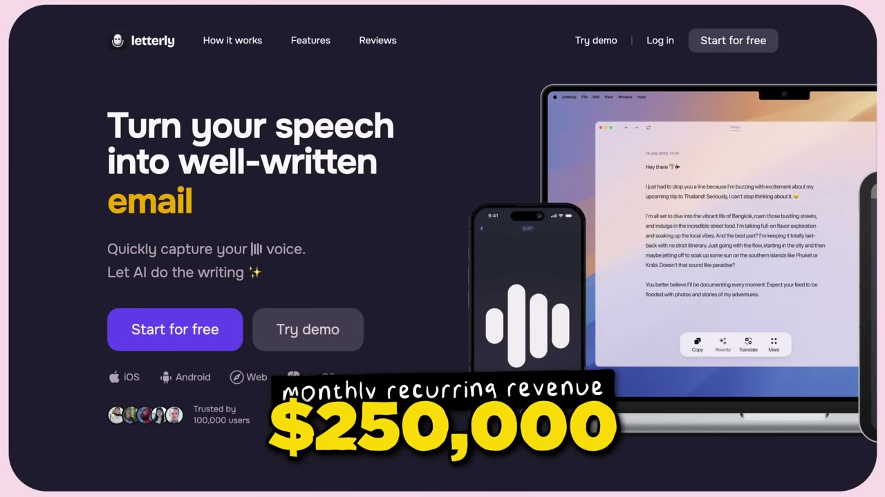
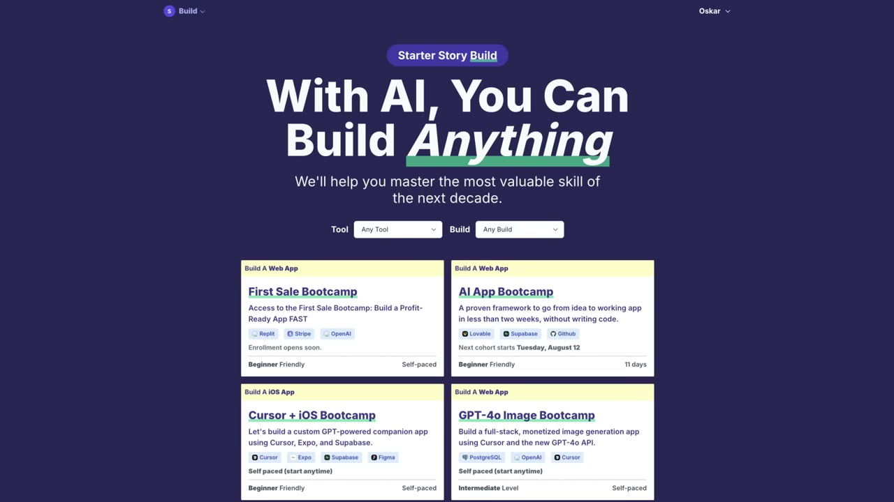

# How he makes $250K per month from a simple app (Letterly Breakdown)

✅ **Đã phân tích sâu** → [`case.md`](case.md)

| | |
|---|---|
| **Video** | <https://www.youtube.com/watch?v=wvYej-2KWDg> |
| **Đăng** | 24/11/2025 |
| **Thời lượng** | 13:49 |
| **Lượt xem** | 90,282 |
| **Lượt thích** | 2,149 |
| **Video ID** | `wvYej-2KWDg` |

## Trong thư mục này

| File | Nội dung |
|---|---|
| [`case.md`](case.md) | **Phân tích đầy đủ** — ý tưởng, validate, GTM, áp dụng ở VN |
| [`meta.json`](meta.json) | Metadata gốc (chapters, heatmap, mô tả) |
| [`screenshots/`](screenshots/) | 10 ảnh 720p |

## Mô tả gốc

Anton built a note-taking app that is designed to be simple and easy to use. This video breaks down his simple product philosophy and how focusing on design and UX created a product users love.
0:00 - Intro
0:51 - Black Friday deal!
1:25 - Who is Anton?
1:49 - Numbers behind the business
2:26 - Idea for the app
3:20 - What makes his app different?
4:20 - Build your own simple app
5:00 - Why user experience matters
7:01 - Simple app playbook
8:38 - How Letterly works
10:50 - Tech stack and costs
11:51 - Final advice
13:04 - Your turn to build
This video is an educational case study of this foun

## Số liệu bắt được từ transcript

> Các đoạn founder nhắc tới con số, kèm timestamp để tua thẳng tới đó trong video.

_(không bắt được con số nào)_

## Chương

- `00:00` Intro
- `00:51` Black Friday deal!
- `01:25` Who is Anton?
- `01:49` Numbers behind the business
- `02:26` Idea for the app
- `03:20` What makes his app different?
- `04:20` Build your own simple app
- `05:00` Why user experience matters
- `07:01` Simple app playbook
- `08:38` How Letterly works
- `10:50` Tech stack and costs
- `11:51` Final advice
- `13:04` Your turn to build

## Ảnh

1. `01_01m35s_replay.jpg` — 
2. `02_02m13s_metric.jpg` — 
3. `03_03m18s_usd-200-000.jpg` — 
4. `04_04m32s_ch-build-your-own-simple-app.jpg` — 
5. `05_05m12s_ch-why-user-experience-matters.jpg` — 
6. `06_07m13s_ch-simple-app-playbook.jpg` — 
7. `07_08m50s_ch-how-letterly-works.jpg` — 
8. `08_11m07s_replay.jpg` — 
9. `09_12m03s_ch-final-advice.jpg` — 
10. `10_13m26s_usd-250-000.jpg` — 

---

← [Quay lại index](../../index.md) · [Toàn bộ video](../README.md)
