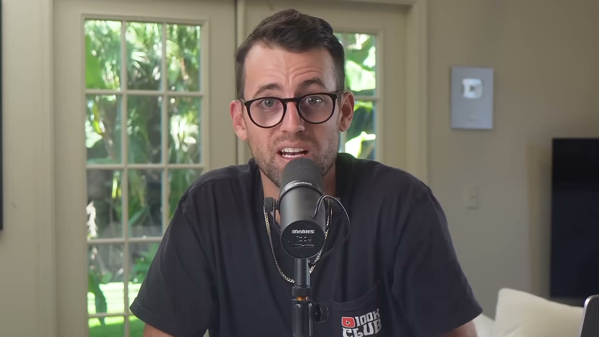
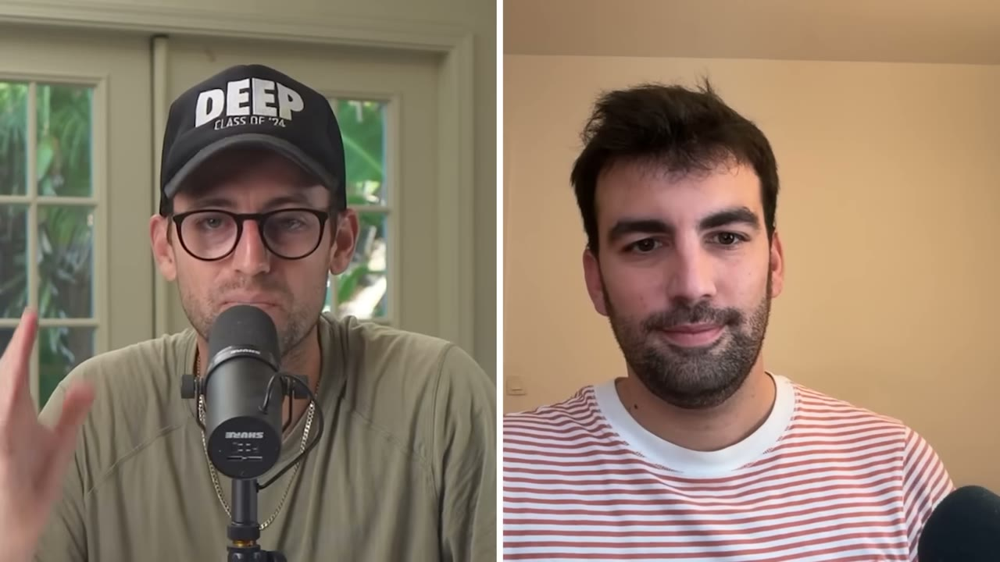
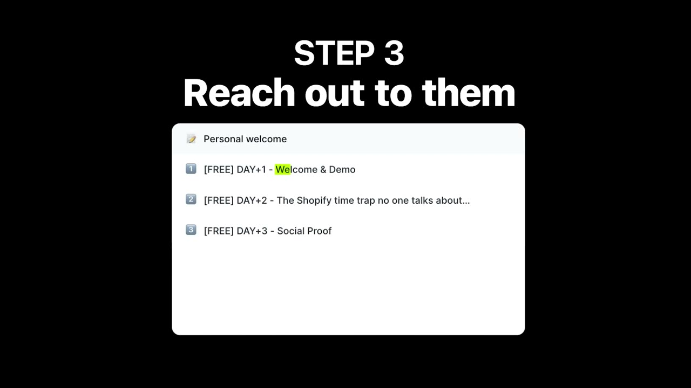
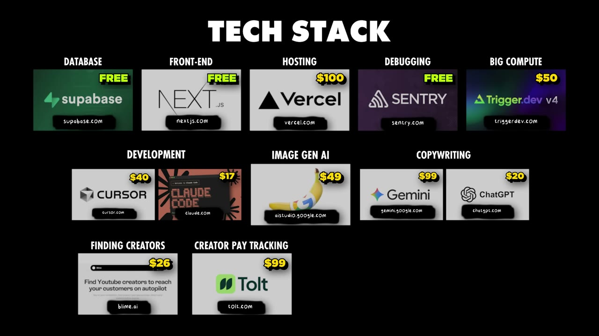
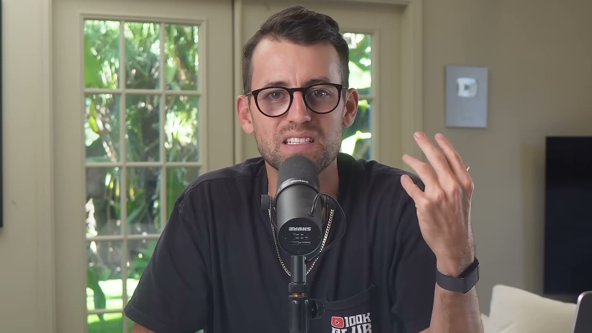

# My Apps Failed Until I Discovered This Playbook ($35K/month apps)

✅ **Đã phân tích sâu** → [`case.md`](case.md)

| | |
|---|---|
| **Video** | <https://www.youtube.com/watch?v=-OPKa8DIzKU> |
| **Đăng** | 30/11/2025 |
| **Thời lượng** | 14:08 |
| **Lượt xem** | 63,052 |
| **Lượt thích** | 1,805 |
| **Video ID** | `-OPKa8DIzKU` |

## Trong thư mục này

| File | Nội dung |
|---|---|
| [`case.md`](case.md) | **Phân tích đầy đủ** — ý tưởng, validate, GTM, áp dụng ở VN |
| [`meta.json`](meta.json) | Metadata gốc (chapters, heatmap, mô tả) |
| [`screenshots/`](screenshots/) | 10 ảnh 720p |

## Mô tả gốc

Loïc Berthelot has co-founded 3 success SaaS apps using the same playbook. This video breaks down what that playbook is and how he used to to grow his apps to over $35K MRR each. 
0:00 - Intro
1:00 - Who is Loic?
1:33 - Loic's Apps
2:38 - Background
3:45 - Main Growth Channel
5:39 - Starter Story Build
6:40 - Builder-Creator Playbook
9:07 - Creator as Co-Founder
11:02 - Tech stack & Costs
12:24 - Advice
13:13 - Pat's final thoughts
This video is an educational case study of this founder’s experience. It is not financial advice and does not guarantee any income or results. Every business is dif

## Số liệu bắt được từ transcript

> Các đoạn founder nhắc tới con số, kèm timestamp để tua thẳng tới đó trong video.

_(không bắt được con số nào)_

## Chương

- `00:00` Intro
- `01:00` Who is Loic?
- `01:33` Loic's Apps
- `02:38` Background
- `03:45` Main Growth Channel
- `05:39` Starter Story Build
- `06:40` Builder-Creator Playbook
- `09:07` Creator as Co-Founder
- `11:02` Tech stack & Costs
- `12:24` Advice
- `13:13` Pat's final thoughts

## Ảnh

1. `01_01m39s_usd-35-000-m.jpg` — 
2. `02_02m50s_ch-background.jpg` — 
3. `03_03m57s_ch-main-growth-channel.jpg` — 
4. `04_05m51s_ch-starter-story-build.jpg` — 
5. `05_06m52s_ch-builder-creator-playbook.jpg` — 
6. `06_08m07s_replay.jpg` — 
7. `07_09m19s_ch-creator-as-co-founder.jpg` — 
8. `08_11m39s_replay.jpg` — 
9. `09_12m36s_ch-advice.jpg` — 
10. `10_13m25s_ch-pat-s-final-thoughts.jpg` — 

---

← [Quay lại index](../../index.md) · [Toàn bộ video](../README.md)
