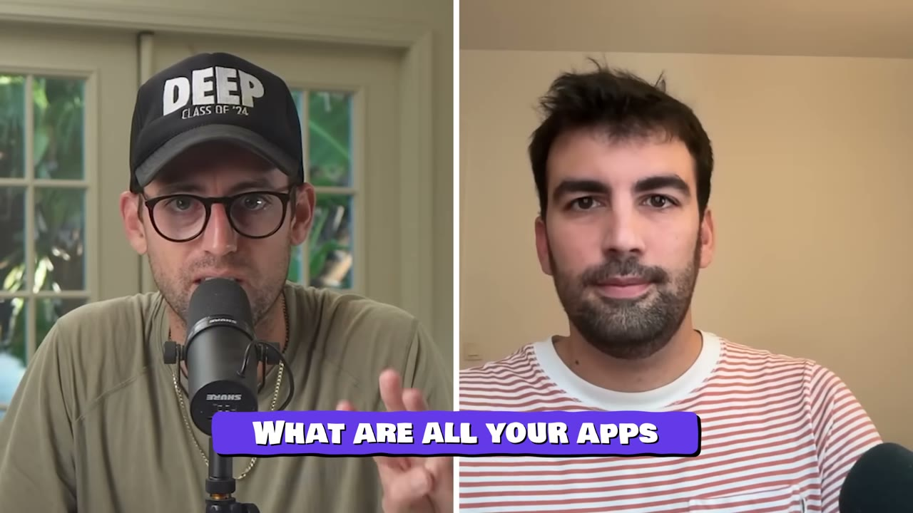
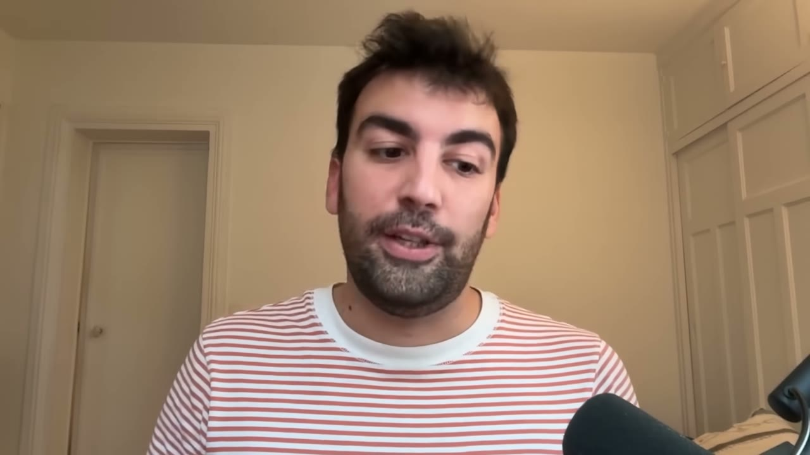
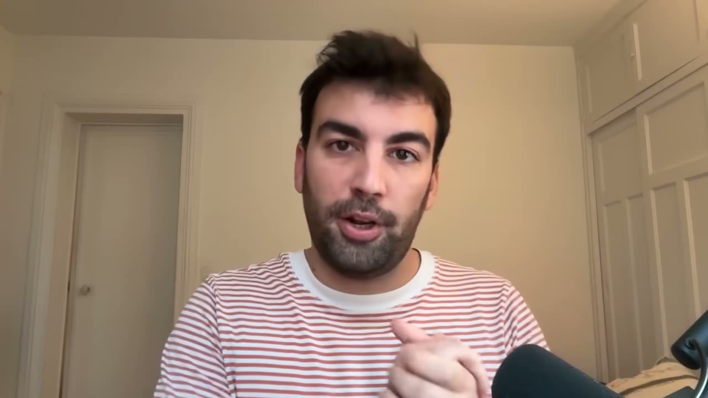
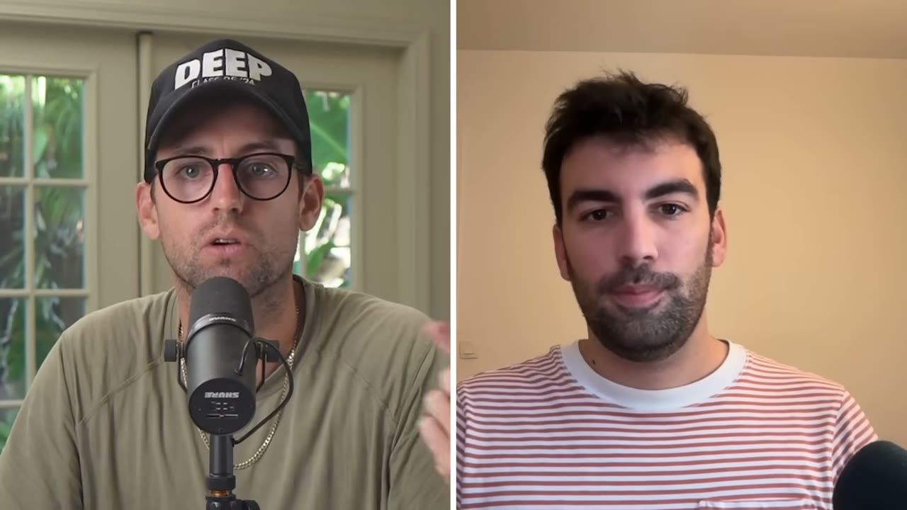
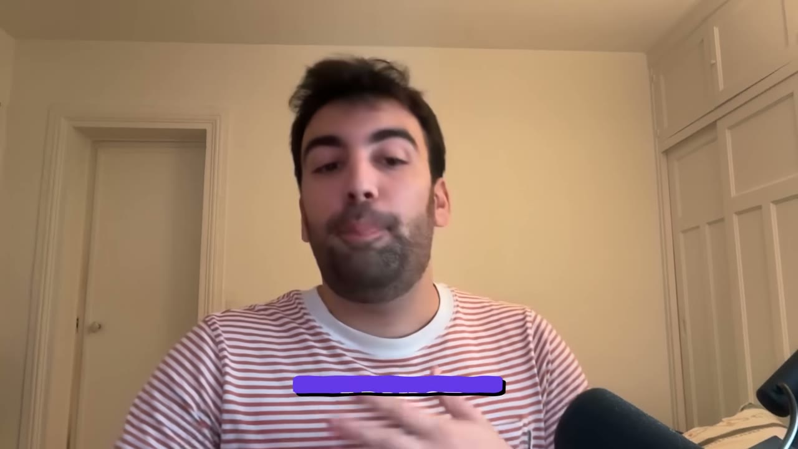

# Loïc — biến YouTube creator thành kênh phân phối (và thành co-founder)

> **Tóm tắt 30 giây:** Loïc dành **5 năm đầu đời nghề nghiệp xây một app không một ai dùng** — ship vô số tính năng, 0 khách hàng, 0 doanh thu. Rồi một chủ shop thương mại điện tử mang tới cho anh một vấn đề, và hoá ra người đó không đơn độc. Từ đó anh có một playbook và lặp lại nó: **ra hơn 10 SaaS, 3 cái thành công**, mỗi cái đạt ít nhất **$35K MRR trong tháng hoạt động đầu tiên**, 100% bootstrap. Cơ chế: **YouTube creator làm kênh phân phối** — hơn 500 người đã hợp tác, mang về **hơn 60% khách hàng mới**.

> ⚠️ **Ghi chú số liệu:** phụ đề tự động đọc con số đỉnh của Minea là "750K MMR" nhưng không rõ là MRR hay ARR, và các con số khác trong video cũng bị đọc lệch (50K/35K). Tôi lấy **$45K MRR của Drop Magic** làm con số chính vì nó được nêu nhất quán và là sản phẩm anh đang tập trung.

## 1. Con số

| Sản phẩm | Kết quả |
|---|---|
| **Influspy** | $20K MRR trong 2 tháng (đã ngừng hoạt động) |
| **Minea** | Công cụ tìm sản phẩm cho dropshipper — đạt đỉnh rất cao trong 2 năm |
| **Drop Magic** | Tạo shop online bằng AI — hơn **$45K MRR trong 4 tháng đầu** |
| Tổng số SaaS đã ra mắt | **Hơn 10** — hầu hết thất bại |
| Creator đã hợp tác | **Hơn 500** |
| Tỉ trọng khách từ YouTube | **Hơn 60%** |
| Biên lợi nhuận | 70-80% |

## 2. Bước ngoặt: từ "người xây" sang "người giải quyết vấn đề" ⭐⭐

> *"Tôi đã dành 5 năm đầu của đời nghề nghiệp để phát triển một SaaS mà **đúng nghĩa là không một ai từng dùng**. Tôi ship cả tấn tính năng, vẫn 0 khách hàng, 0 MRR trong suốt 5 năm, và về cơ bản đã đưa ra mọi quyết định tồi có thể."*

Rồi:
> *"Một chủ shop thương mại điện tử tìm đến tôi với một vấn đề, và hoá ra **anh ta không phải người duy nhất có vấn đề đó**. Từ đó, chúng tôi chỉ đi theo con đường đơn giản nhất có thể, với ít rủi ro nhất có thể."*

**Trình tự ba tầng anh dùng — đáng sao chép nguyên si:**
1. **Newsletter** → xác thực traction ban đầu
2. **App no-code** → xác thực product-market fit
3. **App thật do anh tự phát triển** → để scale

> Đây là thang leo rủi ro thấp nhất trong kho. So với [pre-sale của Gil](../2025-12-02_how-i-built-it-30k-month-micro-saas-subscribr-breakd/case.md) (thu tiền trước khi xây) — cả hai đều tránh cái bẫy "xây 3 tháng rồi mới biết".

## 3. Vì sao YouTube — bốn lý do cụ thể ⭐⭐⭐

> *"Rất nhiều vấn đề của các doanh nhân hiện nay là họ **luôn tập trung vào sản phẩm nhưng không biết làm phân phối**. Và đoán xem ai biết làm phân phối? **Creator.**"*

**Bốn lý do anh chọn YouTube thay vì TikTok:**

1. **Kết quả dự đoán được.** *"Video YouTube có ít nhất một số lượng view tối thiểu mà bạn có thể đảm bảo. Bạn không chỉ chờ TikTok viral."*
2. **Video dài cho creator thời gian THỰC SỰ trình bày cách dùng app** — *"đó là khác biệt lớn nhất ở đây"*.
3. **Nó tồn tại theo thời gian.** *"Chúng tôi vẫn nhận chuyển đổi từ những video 3 năm tuổi, và nó cũng giúp cho traffic organic."*
4. **Tái sử dụng được.** Video dài cắt thành short form và quảng cáo.

Và nhận định phân định TikTok vs YouTube:
> *"Tôi thấy nhiều doanh nghiệp làm rất nhiều short form và thử với creator trên TikTok, nhưng... **TikTok rất tốt cho nhận biết thương hiệu nhưng nó không chuyển đổi**, trong khi **YouTube là cỗ máy chuyển đổi**. Với chúng tôi, hơn 60% khách hàng mới đến từ YouTube."*

> **Đối chiếu quan trọng:** [DuckMath](../2026-03-01_i-make-15k-month-from-one-website/case.md) thành công rực rỡ với TikTok — nhưng mô hình đó là **quảng cáo hiển thị** (chỉ cần view). Loïc bán **subscription B2B** (cần chuyển đổi). Đây chính là điều kiện phân định: **TikTok cho mô hình cần lưu lượng; YouTube cho mô hình cần niềm tin trước khi mua.**

## 4. Hệ thống 4 bước tìm và chốt creator ⭐⭐⭐

**Bước 1 — Tìm creator.**
Lên YouTube, gõ từ khoá, xem toàn bộ video trong ngách, xem ai đang nói về cái gì. **Xem đối thủ đang làm gì**: họ đẩy với micro-influencer hay influencer lớn? Họ làm video review dài hay video tích hợp?

**Bước 2 — Lọc bằng hai chỉ số cứng.** ⭐
- **Tỉ lệ tương tác** = view ÷ follower, **phải trên 10%**
- **Tối thiểu 100 bình luận mỗi video**

Và một bộ lọc thông minh hơn nhiều:
> *"Điều thứ hai tôi xem là **họ đã làm việc với các brand bao lâu rồi**. Thường nếu chỉ là một thương vụ một lần, nghĩa là **brand đó không có lãi**, nên bạn không nên đi với họ. Cái tôi tìm là **creator đã làm với cùng một brand ít nhất 3 lần**."*

> **Đây là mẹo hay nhất trong video.** Bạn đang để các nhà quảng cáo khác trả tiền cho việc nghiên cứu thay bạn: nếu một brand quay lại lần thứ ba, nghĩa là creator đó **thật sự bán được hàng**. Miễn phí, công khai, và đáng tin hơn mọi media kit.

**Bước 3 — Tiếp cận.**
Anh có **chiến dịch 7 email**, mỗi email một góc marketing khác nhau. Đồng thời nhắn trên Instagram và Twitter.

**Bước 4 — Chốt deal.**
- Thường là **phí cố định + hoa hồng**
- ***"Luôn hạ đề nghị ban đầu của họ 30%"***
- **Đưa hai gói** với mức rủi ro khác nhau:
  - Gói A: **trả trước nhiều hơn, hoa hồng thấp hơn** (rủi ro của bạn cao hơn)
  - Gói B: **trả trước ít, hoa hồng cao hơn** (rủi ro của bạn thấp hơn)
- **Luôn bắt đầu bằng deal MỘT video** làm phép thử: xem audience có phản ứng không, có tương tác không, **có hoà vốn sau một tháng không**
- Nếu mọi chỉ số xanh → deal gói 3-4 video, giảm giá theo số lượng, đi sâu hơn vào quan hệ đối tác

> **Việc đưa hai gói là kỹ thuật đàm phán tốt:** nó chuyển cuộc trò chuyện từ "có/không" sang "cái nào", và **để creator tự chọn mức tin tưởng của họ vào sản phẩm** — người tin sản phẩm sẽ chọn hoa hồng cao. Đó cũng là một tín hiệu miễn phí cho bạn.

## 5. Creator làm CO-FOUNDER — ba lý do ⭐⭐⭐

**Lý do 1 — Khử rủi ro phân phối.**
> *"Khi bạn ra mắt một SaaS, bạn có hai rủi ro lớn: **rủi ro sản phẩm** và **rủi ro phân phối**. Rất khó làm tốt cả hai. Với Baptiste, co-founder của Drop Magic, **chúng tôi biết chắc sẽ có được $10K MRR** vì anh ấy có sức ảnh hưởng đó. Và với $10K MRR, bạn có thể mở rộng ra creator khác, chạy quảng cáo, phát triển hoạt động."*

**Lý do 2 — Hiểu biết sản phẩm (anh nói đây là quan trọng nhất hiện nay).**
> *"Bạn muốn có một creator là **power user của giải pháp mình**. Anh ấy là người đang bán nó, giải thích tính năng, nói về nó trên nền tảng. Nên anh ấy có **ghế hàng đầu** để mang phản hồi từ cộng đồng về cho bạn."*

**Lý do 3 — Hiểu biết marketing.**
> *"Một thứ bị đánh giá thấp là với creator trong đội sáng lập, bạn có thể **lặp cực nhanh trên kịch bản, phễu, giá, góc marketing**, và ship rất nhiều video — tất nhiên là miễn phí vì anh ấy là co-founder. Rồi bạn sẽ có **công thức bí mật** của mình. Từ đó bạn có kinh tế đơn vị và **có thể nhân bản với các creator khác bằng một hệ thống đã được chứng minh** — bạn biết mình có thể chi bao nhiêu cho một creator."*

> **Đây là logic chặt chẽ nhất:** creator co-founder không chỉ mang khách, mà mang **dữ liệu để định giá cho 500 creator tiếp theo**. Bạn dùng một quan hệ đối tác miễn phí để tìm ra công thức, rồi mua lại công thức đó ở quy mô lớn.

Pat gọi tên đúng bản chất: *"là builder mà có người cầm cổ phần chỉ tập trung vào phân phối, biết cách tạo nội dung và **hiểu khách hàng** — đó là điều rất thông minh."*

## 6. Tech stack và chi phí

| Hạng mục | Công cụ |
|---|---|
| Database | Supabase |
| Frontend & hosting | Next.js + Vercel |
| Debug | Sentry |
| Compute nặng | **Trigger.dev** |
| Code | Cursor + Claude Code |
| Sinh ảnh AI | **Nano Banana** |
| Copywriting | Gemini + OpenAI |
| Tìm creator | công cụ phát hiện creator |
| Email marketing | Loops |

**Chi phí:** server và compute ~$100/tháng; **AI ~$1.500/tháng** (*"chúng tôi tặng 5 ảnh AI cho mỗi người dùng miễn phí, nên nó scale khá nhanh"*). Biên: Minea từng đạt **80%**; Drop Magic hiện thấp hơn vì đang thử nghiệm nhiều — điểm ngọt kỳ vọng **70-80%**.

> Chi tiết đáng học: **tặng AI miễn phí cho user free là chi phí biến đổi thật**. $1.500/tháng chỉ để nuôi người chưa trả tiền. Nếu bạn làm sản phẩm AI, hãy tính con số này trước khi thiết kế gói miễn phí.

## 7. Lời khuyên cuối ⭐⭐

> *"Cá nhân tôi vật lộn với điều này, nhưng: **đừng gắn bó cảm xúc với một dự án**. Hãy dùng **deadline và cột mốc đơn giản làm nguồn sự thật duy nhất** để quyết định tiếp tục hay không. **Tôi đã lãng phí rất nhiều năm chỉ vì tin vào thứ không có traction nào — chỉ vì tôi gắn bó cảm xúc với cái logo, với dự án, hay với các thành viên trong đội.** Bạn đang lãng phí thời gian và nó sẽ đau."*

Đây là câu nói từ người đã mất 5 năm theo đúng cách đó.

## 8. Áp dụng cho tôi (indie hacker VN)

**Vì sao chiến thuật này hợp với người Việt:**

- **Bạn mượn khán giả và uy tín của creator** — giải đúng vấn đề lớn nhất của tôi khi bán ra quốc tế. Đây cùng bản chất với [chiến lược connector của Lancer](../2026-03-08_i-built-a-10k-month-saas-using-other-peoples-custome/case.md), nhưng áp cho kênh video.
- **Hai bộ lọc creator (tương tác >10%, đã làm với brand ≥3 lần) hoàn toàn miễn phí và làm được ngay** — chỉ cần YouTube và một bảng tính.
- **Deal thử một video** giới hạn rủi ro tài chính ở mức nhỏ. Với chi phí sinh hoạt VN, tôi có thể thử vài creator micro với số tiền một founder Mỹ dùng cho một creator.
- **Thị trường creator tiếng Việt gần như chưa được khai thác** cho phần mềm B2B. Nếu tôi làm sản phẩm cho thị trường VN, tỉ lệ chi phí trên hiệu quả sẽ tốt hơn nhiều.

**Rào cản thật:**

- **Cần tiền mặt trả trước.** Deal creator hầu như luôn có phí cố định. Đây không phải kênh $0 như [YouTube SEO tự làm của Ben](../2026-03-19_i-make-17k-month-with-one-strategy/case.md) hay [content flywheel của Vikash](../2026-02-11_how-i-built-a-12k-month-micro-saas/case.md). Nếu tôi chưa có dòng tiền, hãy bắt đầu bằng hai kênh kia trước.
- **Trả cho creator ở nước ngoài** cần hạ tầng thanh toán và hợp đồng — thật sự phiền với người ở VN.
- **Creator co-founder nghĩa là chia cổ phần thật.** Đây là quyết định không đảo ngược được. Loïc làm điều này sau khi đã có 3 SaaS thành công và biết chính xác mình đổi gì lấy gì. Với người mới, hãy bắt đầu bằng affiliate, và chỉ nâng lên co-founder khi đã có dữ liệu.
- **Ngách của anh (dropshipping/e-commerce) có sẵn hệ sinh thái creator dày đặc.** Không phải ngách nào cũng vậy. Trước khi cược vào chiến lược này, hãy kiểm tra: **ngách của tôi có bao nhiêu creator đạt hai bộ lọc trên?** Nếu dưới 10, chiến lược này không đủ để nuôi tăng trưởng.

**Khi nào KHÔNG dùng mô hình này:** khi sản phẩm của bạn **khó demo trên video**. Toàn bộ cơ chế dựa vào việc creator ngồi trước màn hình và cho người xem thấy sản phẩm giải quyết vấn đề. Nếu giá trị của bạn vô hình (API backend, hạ tầng), video dài không giúp gì — dùng SEO hoặc bán trực tiếp.

## Nguồn

- Video: <https://www.youtube.com/watch?v=-OPKa8DIzKU> (14:08, đăng 30/11/2025, 63.052 view)
- [Transcript đầy đủ](transcript.md) · [Ảnh chụp](screenshots/)
