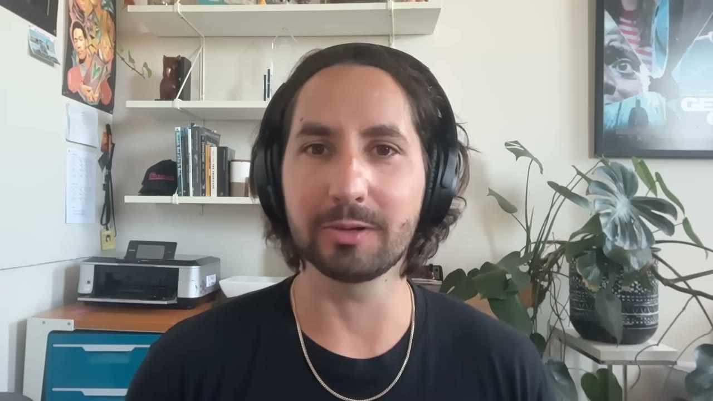
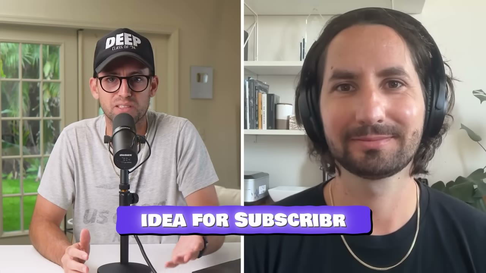
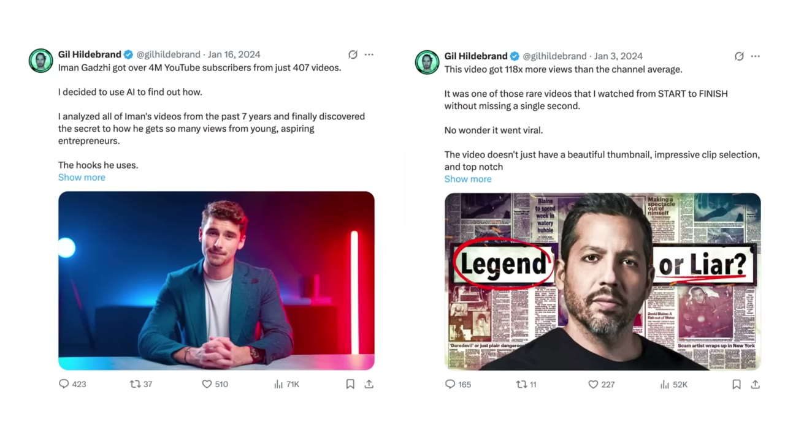
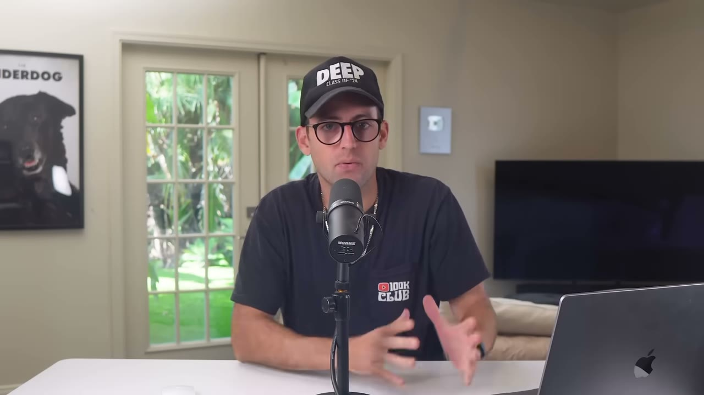
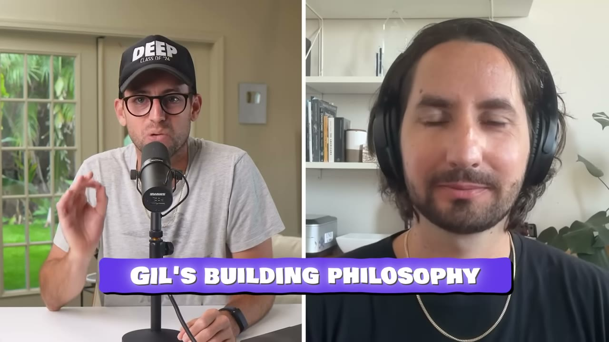
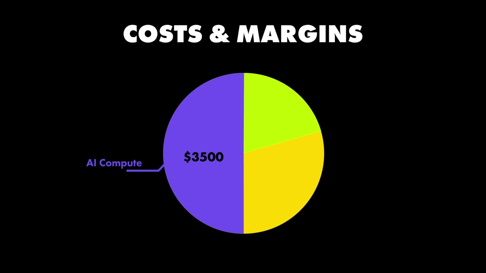
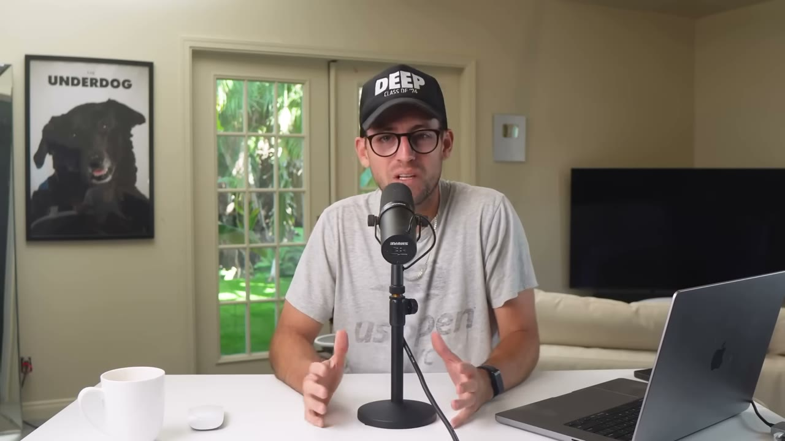

# How I Built It: $30K/month Micro-SaaS (Subscribr Breakdown)

✅ **Đã phân tích sâu** → [`case.md`](case.md)

| | |
|---|---|
| **Video** | <https://www.youtube.com/watch?v=7KqlwjBM_tM> |
| **Đăng** | 02/12/2025 |
| **Thời lượng** | 16:29 |
| **Lượt xem** | 94,099 |
| **Lượt thích** | 2,171 |
| **Video ID** | `7KqlwjBM_tM` |

## Trong thư mục này

| File | Nội dung |
|---|---|
| [`case.md`](case.md) | **Phân tích đầy đủ** — ý tưởng, validate, GTM, áp dụng ở VN |
| [`meta.json`](meta.json) | Metadata gốc (chapters, heatmap, mô tả) |
| [`screenshots/`](screenshots/) | 10 ảnh 720p |

## Mô tả gốc

Gil is a developer who left the VC-backed world to bootstrap his own app. He has a simple playbook for building apps: pre-sell first and THEN build. In this video, we break down how he bootstrapped his app to over $30K/month
0:00 - Intro
0:50 - Subscribr Overview
1:15 - Numbers behind Subscribr
1:46 - Gil's Background
2:50 - Idea for Subscribr
3:52 - 4-part validation strategy
6:01 - Starter Story Build
7:06 - Gil's building philosophy
8:42 - The Pre-Sale Playbook
13:03 - Tech Stack and Costs
14:10 - Advice to younger self
15:28 - Pat's takeaways
This video is an educational case study of this

## Số liệu bắt được từ transcript

> Các đoạn founder nhắc tới con số, kèm timestamp để tua thẳng tới đó trong video.

_(không bắt được con số nào)_

## Chương

- `00:00` Intro
- `00:50` Subscribr Overview
- `01:15` Numbers behind Subscribr
- `01:46` Gil's Background
- `02:50` Idea for Subscribr
- `03:52` 4-part validation strategy
- `06:01` Starter Story Build
- `07:06` Gil's building philosophy
- `08:42` The Pre-Sale Playbook
- `13:03` Tech Stack and Costs
- `14:10` Advice to younger self
- `15:28` Pat's takeaways

## Ảnh

1. `01_01m25s_usd-30-000.jpg` — 
2. `02_02m12s_usd-10.jpg` — 
3. `03_02m59s_usd-30-000.jpg` — 
4. `04_04m31s_replay.jpg` — 
5. `05_06m13s_ch-starter-story-build.jpg` — 
6. `06_07m18s_ch-gil-s-building-philosophy.jpg` — 
7. `07_08m54s_ch-the-pre-sale-playbook.jpg` — 
8. `08_13m15s_ch-tech-stack-and-costs.jpg` — 
9. `09_13m58s_usd-2-000.jpg` — 
10. `10_15m40s_ch-pat-s-takeaways.jpg` — 

---

← [Quay lại index](../../index.md) · [Toàn bộ video](../README.md)
