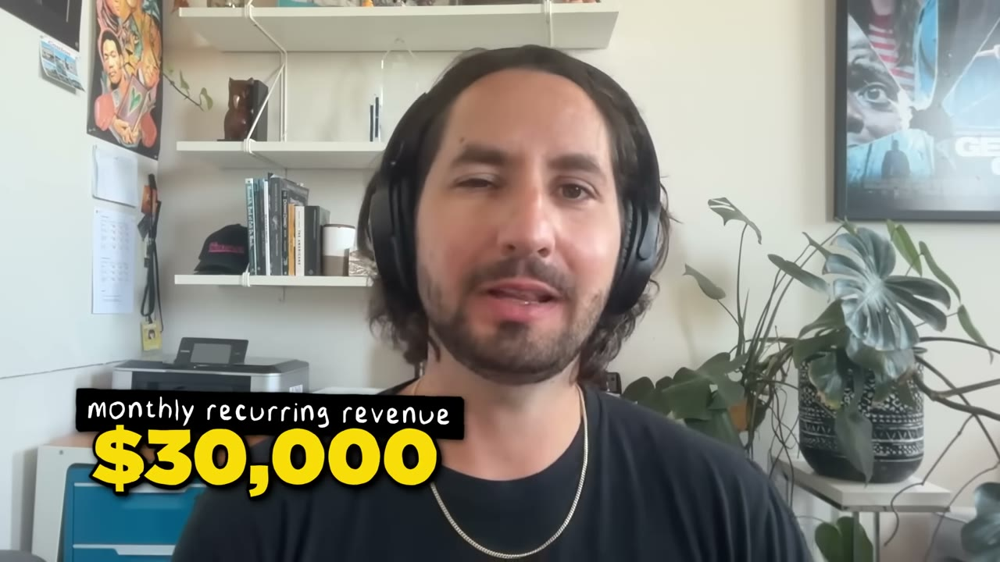
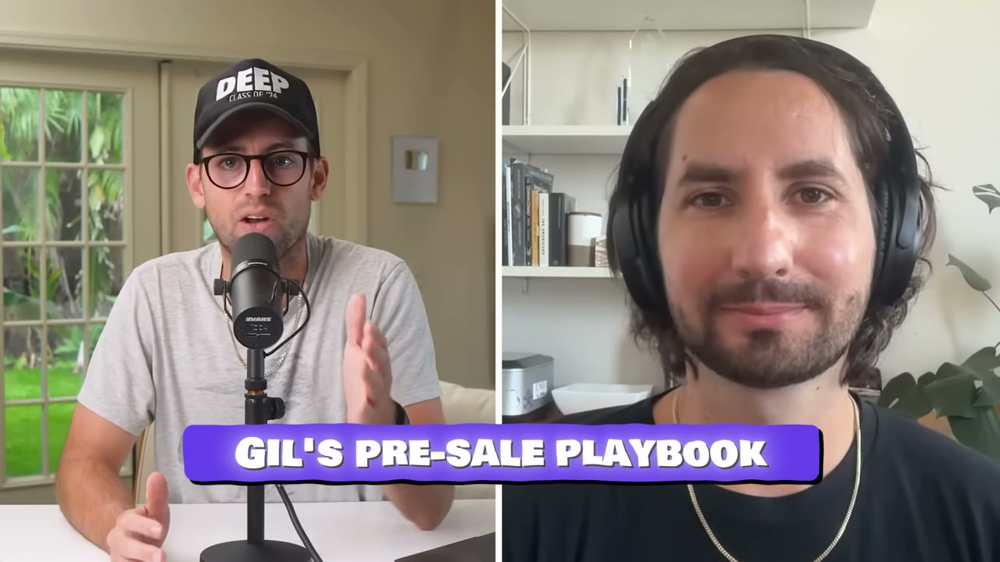
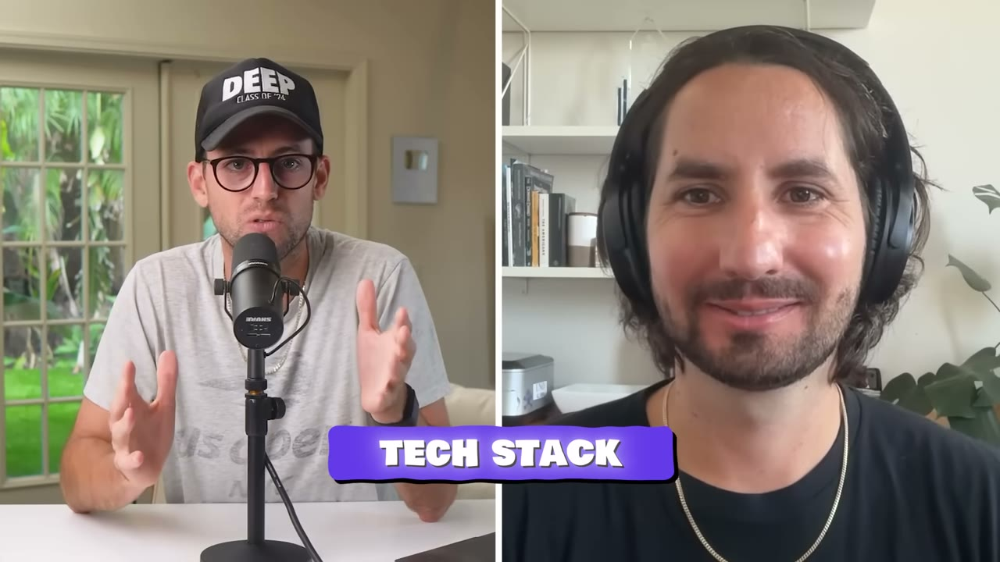

# Subscribr — $20.000 doanh thu trước khi sản phẩm tồn tại

> **Tóm tắt 30 giây:** Gil từng đồng sáng lập Squidoo (hơn $10 triệu doanh thu), rồi một công ty kế toán crypto gọi được vài triệu đô VC và cũng bán đi. Lần này anh chọn bootstrap, và chọn một ngành anh **không biết gì**: viết kịch bản YouTube. Anh mở tài khoản X với **0 follower**, xây danh sách email hơn 1.000 người, rồi **bán trước 50 license trọn đời** cho một phần mềm chưa tồn tại. Bán hết trong **2-3 ngày, thu $20.000** — kèm cam kết **hoàn tiền vô điều kiện** và lời hứa giao hàng trong 60 ngày. 18 tháng sau: **hơn 4.000 khách, ~$30.000/tháng, hơn $700.000 doanh số năm.**

## 1. Con số

| Chỉ số | Giá trị |
|---|---|
| Doanh thu | ~$30.000/tháng |
| Tổng doanh số năm qua | Hơn **$700.000** |
| Khách hàng | Hơn 4.000 |
| Giá | **$49 → $300/tháng** |
| Doanh thu pre-sale | **$20.000** trước khi xây |
| Traffic SEO | Hơn 30.000 view/tháng từ Google (programmatic SEO) |

**Chi phí vận hành hằng tháng:**

| Khoản | Chi phí |
|---|---|
| AI compute (nhiều nhà cung cấp model) | **$3.500** |
| Quảng cáo | $2.000 |
| Khác (scraping, hosting, email) | $1.500 |
| **Tổng** | **~$7.000** |

→ Biên lợi nhuận thực khoảng 75%. **AI compute là khoản lớn nhất** — con số cần nhớ với mọi sản phẩm dùng LLM.

## 2. Vì sao "hỏi ý kiến" là cách validate tồi ⭐⭐⭐

Đây là lập luận sắc nhất trong video:

> *"**Lời nguyền của việc là developer là quá dễ để yêu một ý tưởng.** Tôi đã làm thế nhiều lần rồi. Chúng ta hay hào hứng với phát minh mà không chắc chắn rằng nó thật sự là **thuốc giảm đau**. Là doanh nhân, ta luôn muốn bán thuốc giảm đau, không phải vitamin. Vitamin là thứ có thì tốt. Thuốc giảm đau là thứ **buộc phải có**."*

Và phần quan trọng hơn:

> *"Lời khuyên truyền thống là đi hỏi bạn bè: 'Cậu nghĩ sao về ý tưởng này?' Cấp độ cao hơn có thể là: 'Cậu sẽ trả bao nhiêu cho công cụ này nếu nó tồn tại?' **Tôi cho rằng phản hồi đó không đủ tốt. Thật ra nó khá nguy hiểm, vì nó khiến bạn tưởng mình đã có validation.**"*

> *"Rồi bạn chui xuống hố 3 tháng hoặc lâu hơn để xây, ngoi lên và nói: 'Xong rồi các bạn ơi.' Và vấn đề là họ nói: 'Tôi sẵn sàng trả $20/tháng **nếu tôi không có cái subscription kia**', hoặc 'Tôi sẽ trả **khi nào nhận được khoản tiền từ công ty cũ**.' Tôi đã thấy chuyện này xảy ra quá nhiều lần."*

> ***"Cách duy nhất để thật sự có validation là THU TIỀN từ người ta. Và bạn càng tới đó nhanh, startup của bạn càng có khả năng thành công."***

**Đặt vào bối cảnh kho này:** đây là phiên bản mạnh nhất của luận điểm validate. So sánh:

| Cách validate | Ai | Sức mạnh bằng chứng |
|---|---|---|
| Hỏi ý kiến / khảo sát | (bị Gil bác bỏ) | Yếu — Gil gọi là "nguy hiểm" |
| Phỏng vấn 100+ người trong ngành | [SuperDemo](../2026-03-11_how-this-250k-month-saas-got-its-first-100-users-ste/case.md) | Trung bình |
| Ship kèm nút mua | [Marc Lou](../2026-04-26_how-i-work-77k-month-solopreneur/case.md) | Mạnh — nhưng phải xây trước |
| Dùng nội bộ, người thử chốt được khách thật | [Lancer](../2026-03-08_i-built-a-10k-month-saas-using-other-peoples-custome/case.md) | Rất mạnh |
| **Pre-sale trước khi xây** | **Gil (case này)** | **Mạnh nhất — và rẻ nhất** |

## 3. Playbook pre-sale — 4 bước ⭐⭐⭐

**Bước 1 — Xây audience trước.**
> *"Nếu bạn không có audience, bạn không có ai để bán cho. Người ta mua vì họ **tin bạn**. Nhất là hôm nay khi tạo sản phẩm quá dễ và có cả triệu sản phẩm ngoài kia — người ta mua dựa trên việc **tin vào một thương hiệu hoặc một con người**."*

Cách anh làm, cụ thể:
- Mở tài khoản X **hoàn toàn mới, 0 follower**
- Follow tất cả mọi người trong không gian YouTube
- Dùng kỹ năng lập trình để **tạo ra thứ có giá trị miễn phí** cho không gian đó
- Đăng nội dung + chạy **viral giveaway** trên X
- → Xây được danh sách email **hơn 1.000 người**

**Bước 2 — Danh sách email, giao tiếp ít nhất mỗi tuần một lần.**
> *"Mạng xã hội tuyệt vời để tương tác với người mới, nhưng **danh sách email mới là nơi bạn xây niềm tin**. Điều hay là khi bạn bắt đầu email, họ sẽ email lại và bạn bắt đầu một cuộc đối thoại... Hãy xuất hiện hằng tuần, vì **khi đến lúc dùng danh sách đó để mở pre-sale, bạn sẽ cần mức độ tương tác đó**."*

Trong hậu trường, anh **liên hệ riêng từng người** để nói về ý tưởng.

**Bước 3 — Làm TOÁN xem validation nghĩa là gì với bạn.** ⭐⭐
Đây là bước ít người làm và nó biến việc validate thành bài toán:
1. *"Tôi biết tôi cần khoảng **$20.000 để nuôi 3 tháng cuộc đời mình** làm việc này."*
2. Chia cho mức giá mục tiêu mà loại khách này sẵn sàng trả → ra **50 người cần mua**.
3. Tính ngược: **danh sách email cần lớn bao nhiêu** để có 50 người mua, dựa trên tỉ lệ chuyển đổi ước tính.

> *"Nó cho bạn một cách rất khoa học để hiểu bạn cần xây audience lớn cỡ nào trước khi sẵn sàng mở pre-sale."*

**Bước 4 — Chạy pre-sale, và phải quyết liệt.**
> *"Không ai hào hứng với sản phẩm của bạn trừ khi **bạn làm họ hào hứng**."*

Cấu trúc chiến dịch:
- **Chuỗi email 7 ngày liên tục**, mỗi ngày một góc
- Nói về **lợi ích** trước tính năng: *"hãy thật sự chạm vào cảm xúc, nói về việc lợi ích này sẽ tác động tới cuộc sống họ ra sao"*
- Những ngày cuối: nhấn mạnh pre-sale sắp mở, **không tiết lộ chi tiết, chỉ đưa ngày**
- Ngày mở bán: nhiều email đã lên lịch sẵn, có nhắc khi sắp đóng
- **Xuất hiện dày đặc trên mọi kênh mạng xã hội** trong thời gian đó

## 4. Cấu trúc offer — hai chi tiết quyết định ⭐⭐⭐

**Chi tiết 1 — Giá bậc thang tạo FOMO:**
> *"50 license phần mềm, về cơ bản là subscription trọn đời, với mức giá **thấp một cách vô lý**. **10 license đầu siêu rẻ, và mỗi 10 cái sau đó lại tăng giá.** Nên có một chút FOMO cho những người mua sớm."*

Bán hết trong **2-3 ngày**.

> *"Với 10 khách đầu tiên, có thể tôi còn không có lãi, nhưng tôi biết đó là thứ người ta sẽ nói có."*

**Chi tiết 2 — Cam kết hoàn tiền, và đây mới là điểm then chốt:**
> *"Có một điều kiện: tôi nói với mọi người rằng **bất cứ lúc nào bạn cũng có thể đòi lại tiền**. Tôi sẽ giao sản phẩm này trong 60 ngày, và sau đó bạn có 2 tuần nữa để tiếp tục thử và đòi lại tiền."*

> *"Nên **nếu tôi làm không đúng, toàn bộ số tiền tôi kiếm được sẽ mất**, và tôi có 60 ngày để cắm đầu làm cho bằng được."*

**Vì sao cam kết hoàn tiền lại làm pre-sale MẠNH hơn chứ không yếu đi:**
- Nó loại bỏ rủi ro cho người mua → người mới trong ngành vẫn dám mua
- Nó **giữ nguyên chất lượng tín hiệu**: người ta vẫn phải móc ví thật, chỉ là có đường lui
- Nó đặt áp lực lên đúng chỗ — lên **bạn**, người phải giao hàng

Anh dẫn Alex Hormozi (*$100M Offers*): **tạo một offer tốt đến mức người ta không thể không nói có.**

## 5. Nguồn gốc ý tưởng — trong ngành anh không biết gì

1. Sau khi bán công ty crypto, anh bắt đầu **đăng video YouTube nói về ý tưởng** cho công ty tiếp theo.
2. Anh quan tâm tới **kênh YouTube "faceless"** và bắt đầu lập một đội.
3. Anh nhanh chóng nhận ra: **viết kịch bản là nút thắt cổ chai khổng lồ.** *"Thật sự rất khó tìm người viết kịch bản giỏi, dù chúng ta biết một kịch bản YouTube tốt trông như thế nào."*
4. Anh thử ChatGPT → *"nó còn xa mới đủ tốt"*.
5. Anh đặt cược rằng với kinh nghiệm doanh nhân + lập trình, anh xây được giải pháp thật sự chạy.

> **Điểm đáng chú ý:** anh **không** phải chuyên gia trong ngành. Anh bước vào, tự làm, gặp nút thắt, rồi giải nó. Đây là phiên bản nhanh của "xây cho chính mình" — và pre-sale chính là cơ chế bù cho việc anh thiếu hiểu biết ngành.

## 6. Tech stack — đơn giản đến mức đáng ngạc nhiên

| Hạng mục | Công cụ |
|---|---|
| Code | **Claude Code** — *"khoảng 90% code của tôi được viết bằng Claude Code"* |
| Framework | **Laravel** (PHP) |
| Hosting | DigitalOcean |
| Còn lại | *"tôi không dựa vào nhiều dịch vụ ngoài, ngoài các nhà cung cấp model AI"* |

> *"Một setup khá thư thái mà tôi rất thích."*

Đây là phản ví dụ hữu ích cho việc chạy theo stack thời thượng: một SaaS $700K/năm chạy trên **PHP + Laravel + một VPS**.

## 7. Lời khuyên cuối — lợi nhuận hơn tăng trưởng ⭐⭐

> *"Thứ nhất, **bạn không được yêu ý tưởng của mình mà chưa validate nó** bằng một dạng pre-sale nào đó, xác nhận rằng người ta sẵn sàng trả tiền."*

> *"Thứ hai, là người bootstrap, **điều số một bạn phải theo đuổi là LỢI NHUẬN**. Có rất nhiều quyết định bạn có thể đưa ra khi tiền bắt đầu về, và chúng có thể ăn mòn lợi nhuận — dù là thuê agency đắt tiền hứa hẹn cả thế giới, hay lao sang một hướng sản phẩm hoàn toàn khác. Hãy tập trung tạo ra lợi nhuận, rồi mọi thứ khác sẽ ổn. **Có lợi nhuận tốt hơn có tăng trưởng, nếu bạn ở trong cuộc chơi bootstrap.**"*

Và câu trả lời một từ khi Pat hỏi VC hay bootstrap vui hơn:
> *"**Bootstrap, chắc chắn.**"*

Lời này đến từ người đã làm cả hai — bán một công ty $10 triệu doanh thu và một công ty gọi vốn VC. Đây là thẩm quyền hiếm có.

## 8. Áp dụng cho tôi (indie hacker VN)

**Đây là case tôi nên áp dụng TRƯỚC KHI xây bất cứ thứ gì:**

- **Pre-sale là cách validate rẻ nhất và mạnh nhất.** Không cần vốn, không cần sản phẩm. Nó biến câu hỏi "ý tưởng này có tốt không?" thành một thí nghiệm có kết quả nhị phân trong vài ngày.
- **Bước 3 (làm toán) là thứ tôi có thể làm ngay tối nay** — không cần audience, chỉ cần máy tính: tôi cần bao nhiêu tiền để sống 3 tháng? Chia cho giá dự kiến → số người cần. Con số đó cho tôi biết audience cần lớn cỡ nào **trước khi** tôi bắt đầu.
- **Cam kết hoàn tiền loại bỏ rào cản uy tín** — đây chính xác là vấn đề của người Việt bán ra quốc tế. Người mua không biết tôi là ai, nhưng nếu họ lấy lại được tiền, rào cản đó biến mất.
- **Laravel + DigitalOcean + Claude Code** là stack rẻ và tôi dùng được ngay.

**Rào cản thật:**

- **Bước 1 (xây audience) là phần khó nhất và anh nói lướt qua.** Anh mất bao lâu để đi từ 0 follower tới 1.000 email? Video không nói. Với người Việt viết tiếng Anh, hãy tính bằng **tháng**, không phải tuần.
- **Pre-sale tạo NGHĨA VỤ PHÁP LÝ VÀ ĐẠO ĐỨC.** Bạn cầm tiền của người ta và hứa giao hàng trong 60 ngày. Nếu bạn không giao được, bạn phải hoàn tiền — nghĩa là **không được tiêu số tiền đó** cho tới khi giao xong. Gil dùng nó để nuôi 3 tháng, nhưng anh có 20 năm kinh nghiệm và đã bán hai công ty. Với người mới, hãy giữ tiền đó nguyên vẹn.
- **Thanh toán quốc tế:** nhận $20.000 pre-sale từ khách nước ngoài về VN cần Stripe/Paddle và cấu trúc pháp lý phù hợp. Đây là việc phải giải quyết **trước** khi mở bán, không phải sau.
- **AI compute $3.500/tháng** cho thấy chi phí biến đổi của sản phẩm LLM là thật và lớn. Đừng định giá trọn đời cho sản phẩm loại này ở quy mô lớn — Gil chỉ bán 50 license trọn đời rồi dừng, và đó là quyết định đúng.

**Khi nào KHÔNG dùng pre-sale:** khi bạn **không chắc mình xây được trong 60 ngày**. Pre-sale chuyển rủi ro từ thị trường sang năng lực thực thi của bạn. Nếu bạn chưa từng ship một sản phẩm hoàn chỉnh, hãy ship một cái miễn phí trước để biết tốc độ thật của mình, rồi mới cầm tiền của người khác.

## Nguồn

- Video: <https://www.youtube.com/watch?v=7KqlwjBM_tM> (16:29, đăng 02/12/2025, 94.099 view)
- [Transcript đầy đủ](transcript.md) · [Ảnh chụp](screenshots/)
