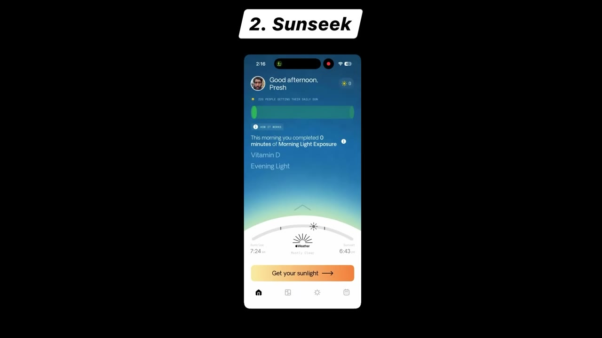
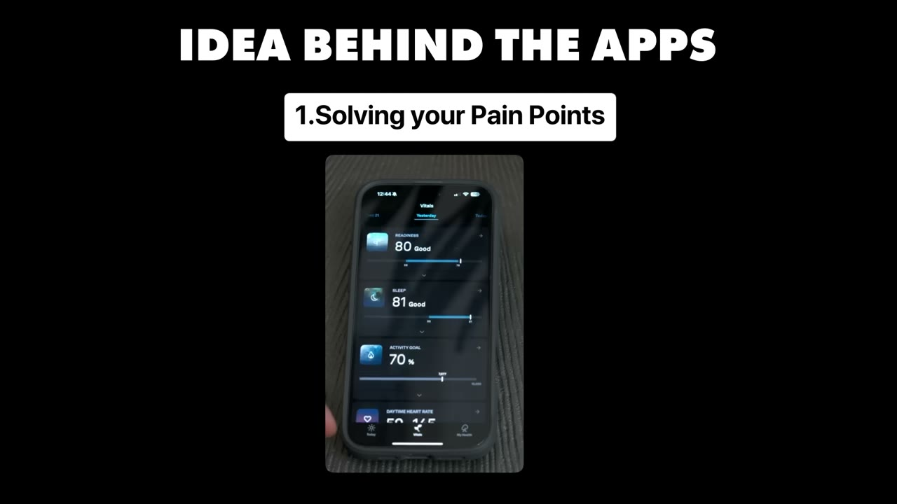
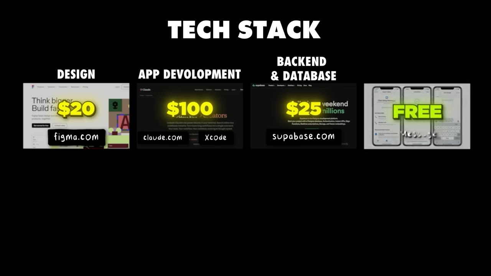

# I make $120K/year from 3 mobile apps

✅ **Đã phân tích sâu** → [`case.md`](case.md)

| | |
|---|---|
| **Video** | <https://www.youtube.com/watch?v=SJOFUBNHYqU> |
| **Đăng** | 04/12/2025 |
| **Thời lượng** | 14:05 |
| **Lượt xem** | 36,789 |
| **Lượt thích** | 986 |
| **Video ID** | `SJOFUBNHYqU` |

## Trong thư mục này

| File | Nội dung |
|---|---|
| [`case.md`](case.md) | **Phân tích đầy đủ** — ý tưởng, validate, GTM, áp dụng ở VN |
| [`meta.json`](meta.json) | Metadata gốc (chapters, heatmap, mô tả) |
| [`screenshots/`](screenshots/) | 10 ảnh 720p |

## Mô tả gốc

Presh has built 3 niche health tracking apps. This video breaks down his philosophy of building for problems you personally experience and why health and wellness niches create sustainable app businesses.
0:00 - Intro
1:28 - Numbers behind the business
2:05 - App breakdowns
3:36 - Presh's background
4:51 - First app idea
5:30 - How he finds great app ideas
6:01 - Stay sales tax compliant
7:33 - How to build apps like Presh
9:54 - App demos
11:37 - Tech stack and costs
12:30 - Final advice
13:06 - Pat's notes
This video is an educational case study of this founder’s experience. It is not financ

## Số liệu bắt được từ transcript

> Các đoạn founder nhắc tới con số, kèm timestamp để tua thẳng tới đó trong video.

_(không bắt được con số nào)_

## Chương

- `00:00` Intro
- `01:28` Numbers behind the business
- `02:05` App breakdowns
- `03:36` Presh's background
- `04:51` First app idea
- `05:30` How he finds great app ideas
- `06:01` Stay sales tax compliant
- `07:33` How to build apps like Presh
- `09:54` App demos
- `11:37` Tech stack and costs
- `12:30` Final advice
- `13:06` Pat's notes

## Ảnh

1. `01_01m40s_ch-numbers-behind-the-business.jpg` — 
2. `02_02m17s_ch-app-breakdowns.jpg` — 
3. `03_03m48s_ch-presh-s-background.jpg` — 
4. `04_05m03s_ch-first-app-idea.jpg` — 
5. `05_05m42s_ch-how-he-finds-great-app-ideas.jpg` — 
6. `06_07m45s_ch-how-to-build-apps-like-presh.jpg` — 
7. `07_10m06s_ch-app-demos.jpg` — 
8. `08_11m49s_ch-tech-stack-and-costs.jpg` — 
9. `09_12m42s_ch-final-advice.jpg` — 
10. `10_13m18s_ch-pat-s-notes.jpg` — 

---

← [Quay lại index](../../index.md) · [Toàn bộ video](../README.md)
