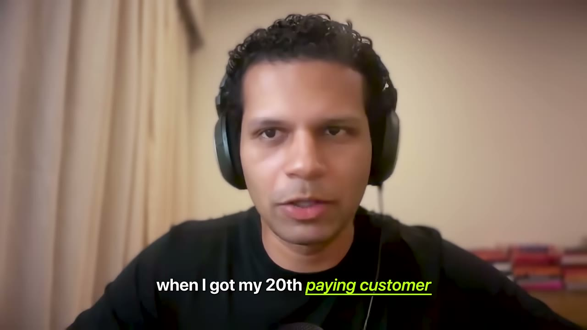
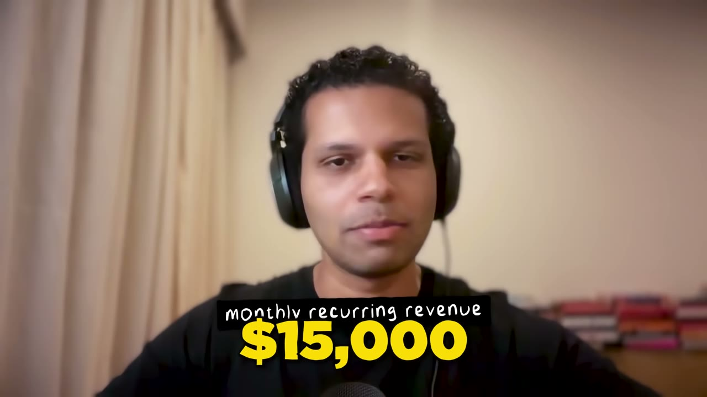
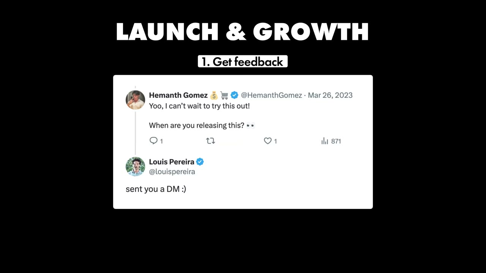
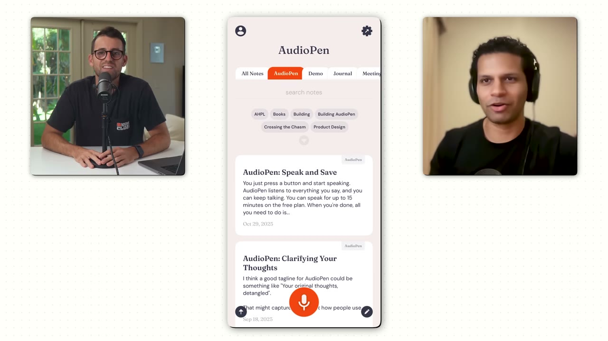
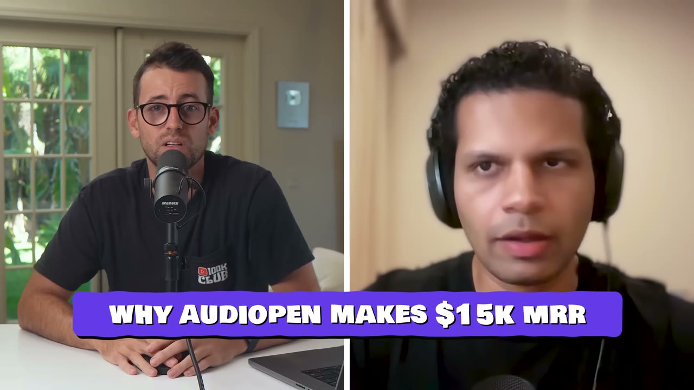
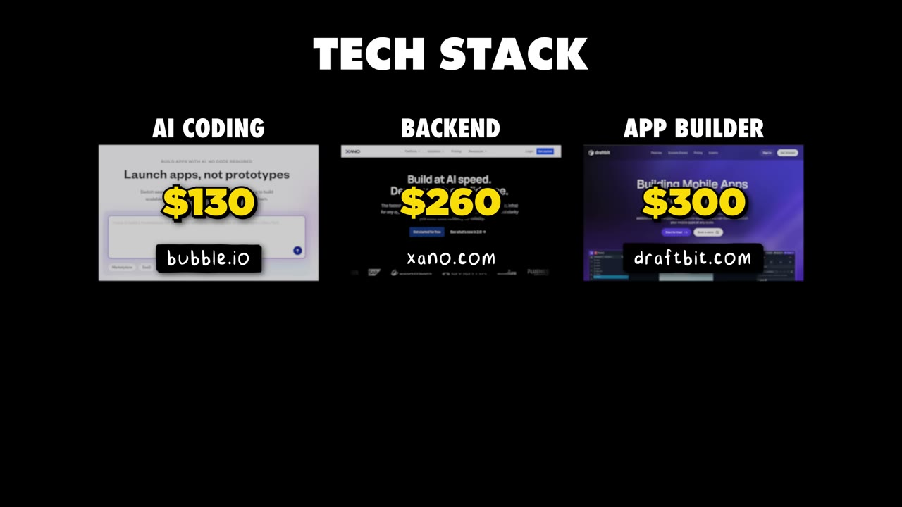

# I shipped my app in 12 hours and now it makes $15K/month

✅ **Đã phân tích sâu** → [`case.md`](case.md)

| | |
|---|---|
| **Video** | <https://www.youtube.com/watch?v=k2jecxFu2as> |
| **Đăng** | 09/12/2025 |
| **Thời lượng** | 13:01 |
| **Lượt xem** | 129,798 |
| **Lượt thích** | 3,255 |
| **Video ID** | `k2jecxFu2as` |

## Trong thư mục này

| File | Nội dung |
|---|---|
| [`case.md`](case.md) | **Phân tích đầy đủ** — ý tưởng, validate, GTM, áp dụng ở VN |
| [`meta.json`](meta.json) | Metadata gốc (chapters, heatmap, mô tả) |
| [`screenshots/`](screenshots/) | 10 ảnh 720p |

## Mô tả gốc

Louis Pereira shipped the MVP of his  app in just 12 hours. He got traction and customers on the first day. And today, he’s making over $15K/month from that same app. This is the story of how a regular dude from India changed his life by building and shipping fast. 
0:00 - Intro
1:40 - What is Audiopen?
2:45 - Louis background
3:25 - How he built this in 12 hours
4:55 - Figure out the business side of things (Xero Sponsor)
6:04 - Launch and Growth
7:31 - Building Fast Playbook
9:15 - How Audiopen works
10:16 - Why Audiopen is successful
11:24 - Tech Stack and Costs
11:59 - Final advice
12:40 -

## Số liệu bắt được từ transcript

> Các đoạn founder nhắc tới con số, kèm timestamp để tua thẳng tới đó trong video.

_(không bắt được con số nào)_

## Chương

- `00:00` Intro
- `01:40` What is Audiopen?
- `02:45` Louis background
- `03:25` How he built this in 12 hours
- `04:55` Figure out the business side of things (Xero Sponsor)
- `06:04` Launch and Growth
- `07:31` Building Fast Playbook
- `09:15` How Audiopen works
- `10:16` Why Audiopen is successful
- `11:24` Tech Stack and Costs
- `11:59` Final advice
- `12:40` READY2BUILD

## Ảnh

1. `01_00m35s_usd-15-000.jpg` — 
2. `02_01m52s_ch-what-is-audiopen.jpg` — 
3. `03_02m28s_usd-99.jpg` — 
4. `04_03m33s_usd-15-000.jpg` — 
5. `05_04m51s_usd-15-000.jpg` — 
6. `06_06m16s_ch-launch-and-growth.jpg` — 
7. `07_07m43s_ch-building-fast-playbook.jpg` — 
8. `08_09m27s_ch-how-audiopen-works.jpg` — 
9. `09_10m28s_ch-why-audiopen-is-successful.jpg` — 
10. `10_11m40s_usd-260.jpg` — 

---

← [Quay lại index](../../index.md) · [Toàn bộ video](../README.md)
