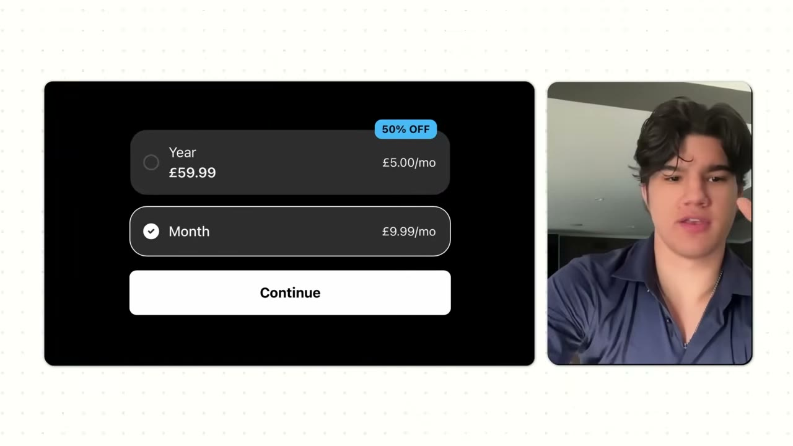
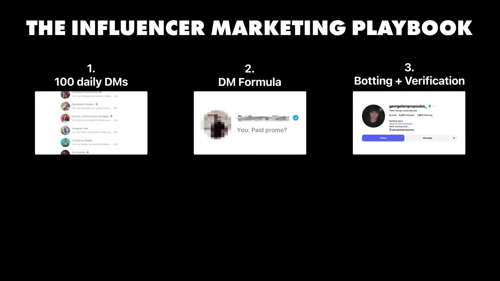
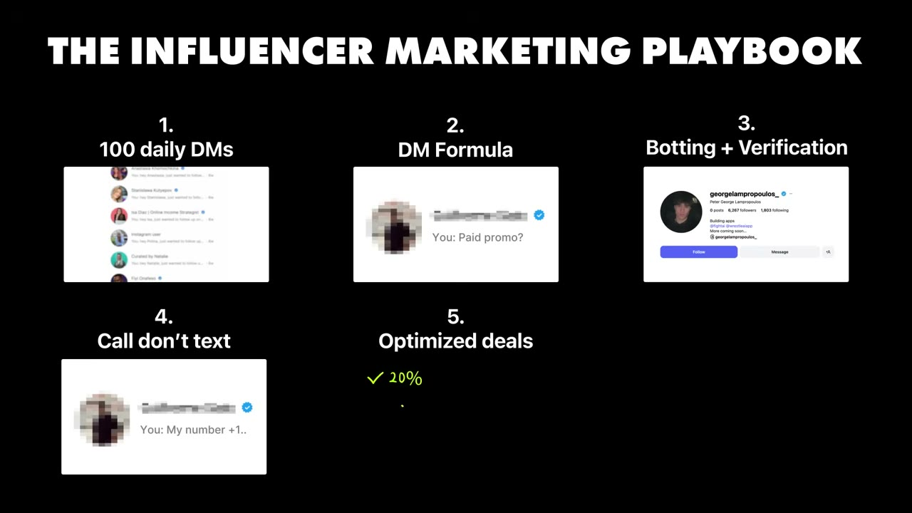

# How I grew my mobile app to $17K per month

✅ **Đã phân tích sâu** → [`case.md`](case.md)

| | |
|---|---|
| **Video** | <https://www.youtube.com/watch?v=8kM-JcKpcDs> |
| **Đăng** | 14/12/2025 |
| **Thời lượng** | 20:57 |
| **Lượt xem** | 120,540 |
| **Lượt thích** | 3,751 |
| **Video ID** | `8kM-JcKpcDs` |

## Trong thư mục này

| File | Nội dung |
|---|---|
| [`case.md`](case.md) | **Phân tích đầy đủ** — ý tưởng, validate, GTM, áp dụng ở VN |
| [`meta.json`](meta.json) | Metadata gốc (chapters, heatmap, mô tả) |
| [`screenshots/`](screenshots/) | 5 ảnh 720p |

## Mô tả gốc

George built a mobile app without writing a single line of code. This video breaks down how he vibe coded his app, his influencer partnership playbook, and how non-coders can build profitable mobile apps using AI tools.
This video is an educational case study of this founder’s experience. It is not financial advice and does not guarantee any income or results. Every business is different and your results may vary.

## Số liệu bắt được từ transcript

> Các đoạn founder nhắc tới con số, kèm timestamp để tua thẳng tới đó trong video.

_(không bắt được con số nào)_

## Chương

_(không có chapter)_

## Ảnh

1. `01_00m35s_usd-17-000.jpg` — 
2. `02_01m54s_usd-9-99.jpg` — 
3. `03_13m03s_replay.jpg` — 
4. `04_13m54s_replay.jpg` — 
5. `05_16m57s_usd-25.jpg` — 

---

← [Quay lại index](../../index.md) · [Toàn bộ video](../README.md)
