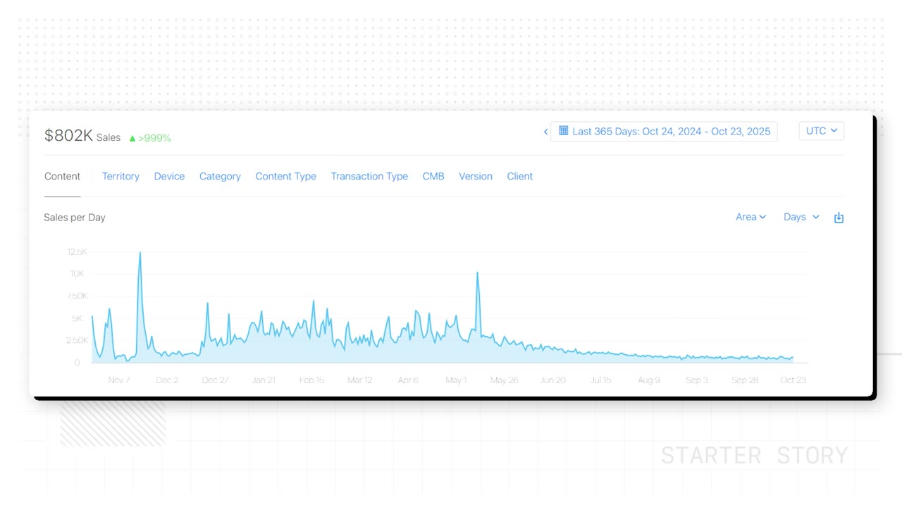
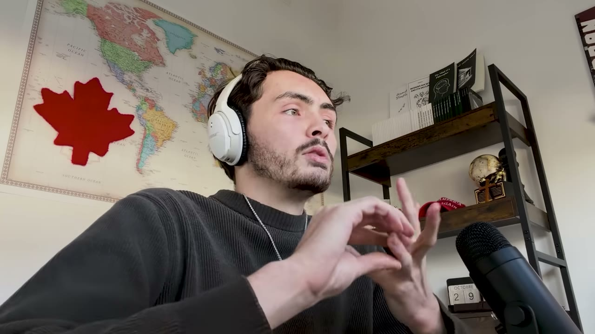
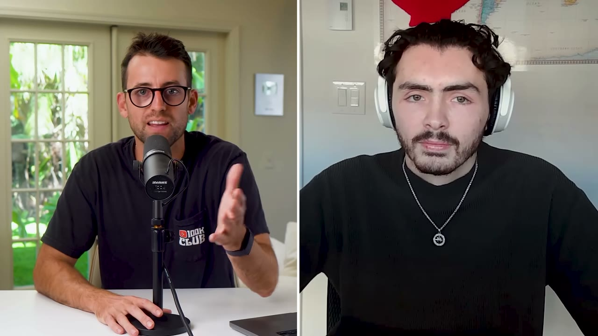
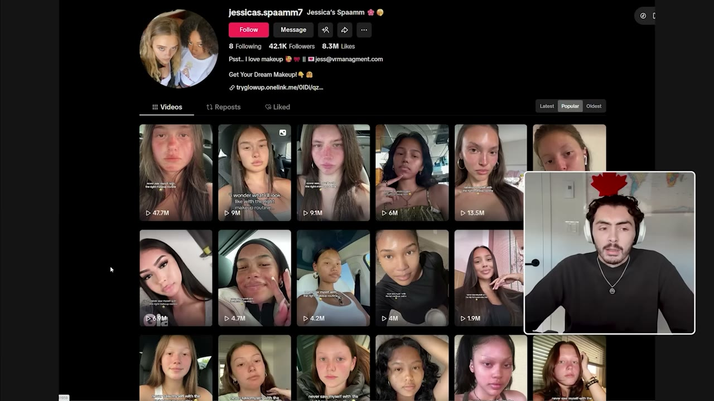
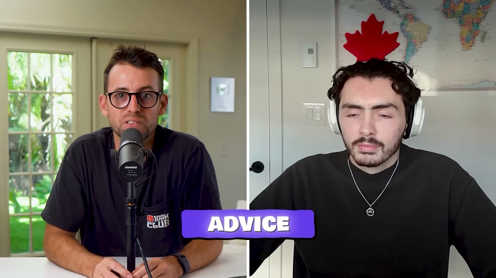

# GlowUp — $800K trong 365 ngày, và câu chuyện thật sau con số đó

> **Tóm tắt 30 giây:** Louis build 10 app thất bại liên tiếp vì lần nào cũng **build trước, marketing sau**. Với GlowUp anh đảo ngược hoàn toàn: đọc comment dưới video makeup trên TikTok để tìm nỗi đau, **làm content về ý tưởng đó trước khi viết một dòng code**, thấy content viral thì mới build MVP — 3 ngày sau có 100.000 user, app leo số 1 hạng Lifestyle. Một năm thu $800.000 với **$0 quảng cáo**. Nhưng con số anh nói giữa video mới là bài học đắt nhất: hiện tại app chỉ còn **~$15.000/tháng** dù đã có 70.000 khách từng trả tiền. Đây là case về sức mạnh và **hạn sử dụng** của một cú viral.

## 1. Con số

| Chỉ số | Giá trị |
|---|---|
| Tổng doanh thu 12 tháng | **$800.000** |
| Doanh thu hiện tại | **~$15.000/tháng** |
| Người dùng | 2 triệu |
| Khách từng trả tiền | 70.000 |
| Giá | $9,99/tuần hoặc $39,99/năm |
| Thứ hạng App Store | **số 1 Lifestyle**, số 4 toàn bộ app miễn phí |
| Video mạnh nhất | 48 triệu view, 2 triệu like → 60.000 tải, **$12.500 trong 1 ngày** |
| Chi quảng cáo | **$0** |
| Biên lợi nhuận | ~90% |
| Chi phí vận hành | backend ~$1.000/tháng, AI ~$500/tháng |

## 2. Mâu thuẫn số liệu — và vì sao nó là phần giá trị nhất ⭐⭐⭐

Tiêu đề video: *"My mobile app made $800K in 365 days"*. Nhưng ở phút 1:18 chính Louis nói:

> *"It makes around **15K per month** right now, and it grew from zero to 100K user in around 3 days and generated a total of 800K in revenue."*

Hai con số này không mâu thuẫn — chúng mô tả hai thứ khác nhau: **$800K là tích luỹ cả năm, $15K là tốc độ hiện tại**. Nhưng đặt cạnh nhau thì lộ ra hình dạng thật của doanh nghiệp này.

Làm phép tính:

- 70.000 khách từng trả tiền, giá $9,99/tuần. Nếu chỉ 10% còn hoạt động thì đã là $280.000/tháng.
- Thực tế: **$15.000/tháng**. Nghĩa là số người còn trả tiền chỉ còn vài trăm tới hơn nghìn.
- Trung bình cả năm: $800K / 12 ≈ $67.000/tháng. Hiện tại $15K. **Doanh thu đã rơi khoảng 4-5 lần so với mức trung bình.**

**Cơ chế đằng sau:** đây là mô hình **spike**, không phải mô hình **compound**.

1. Cú viral 48 triệu view đẩy hàng chục nghìn người vào paywall $9,99/tuần cùng một lúc.
2. Gói tuần thu tiền rất nhanh — đó là lý do $800K đến sớm và đến dày.
3. Nhưng app trả lời đúng **một câu hỏi dùng một lần**: makeup look nào hợp với tôi. Trả lời xong thì không còn lý do trả $9,99 tuần sau.
4. Khi làn sóng viral tắt, không có gì kéo doanh thu lại. Còn $15K là phần đuôi.

> **Bài học cho bạn:** khi thấy tiêu đề *"$800K in 365 days"*, hãy luôn hỏi **doanh thu tháng này là bao nhiêu**. Một business kiếm $800K rồi rơi về $15K và một business kiếm $200K rồi ổn định ở $17K là hai loại tài sản hoàn toàn khác nhau — cái sau đáng giá hơn nhiều khi bán lại.

So sánh trong kho: [Flame](../2026-06-21_i-built-a-10k-month-app-with-this-one-system/case.md) cũng chạy TikTok organic công nghiệp nhưng sản phẩm là **nghi thức hằng ngày cho cặp đôi** — người dùng có lý do mở app mỗi ngày, nên MRR đi lên đều từ $3K tới $10K. GlowUp có view gấp nhiều lần Flame nhưng doanh thu đang đi xuống. **Khác biệt không nằm ở marketing, nằm ở việc sản phẩm có lý do tồn tại vào ngày thứ 8 hay không.**

## 3. Nguồn gốc ý tưởng — content trước, code sau ⭐⭐⭐

Louis nói thẳng về 10 app trước:

> *"My apps before were more for me. I just had an idea and was building them and then once it was finished building I would start marketing but then I would get no views or no users. So we just go to the next idea and it would be my kind of cycle."*

Quy trình mới, đúng thứ tự:

1. **Chọn ngách theo hashtag, không theo đam mê.** Anh và co-founder xem hashtag nào lớn nhất TikTok — makeup là một trong những cái to nhất.
2. **Đọc comment, không đọc video.** Vào phần bình luận dưới các video makeup để xem người ta đang hỏi gì, thiếu gì.
3. **Làm content về ý tưởng đó — trước khi có app.** Nội dung xoay quanh chính điều người ta hỏi: tìm makeup look của bạn và những sản phẩm cần mua.
4. **Content viral → xác nhận có nhu cầu.** *"It kind of just went viral. So we kind of knew that we had an idea that would work."*
5. **Rồi mới build**, kiểu MVP, cực nhanh.
6. 3 ngày sau launch: 100.000 người dùng.

> *"By looking at the comment section, you really just feel what people are wanting and you just try to come in and solve whatever they're asking for."*

**Vì sao cơ chế này hiệu quả:** phần rủi ro nhất của một app tiêu dùng không phải code, mà là **liệu có ai chịu dừng ngón tay lại vì nó không**. Content-first chuyển toàn bộ rủi ro đó ra trước, và trả lời bằng một thứ đo được (view) chỉ tốn vài buổi tối. Nếu content không ăn, bạn mất vài ngày. Nếu build trước, bạn mất vài tháng — đúng như 10 lần trước của Louis.

## 4. Playbook TikTok organic — 4 bước, có chi tiết ai cũng bỏ qua ⭐⭐⭐

### Bước 1 — Warm up tài khoản (phần quan trọng nhất với người Việt)

> *"Step one is you're just warming up a TikTok account in the USA with a new iPhone. You just buy a USA SIM card. If you're in the US you're okay, but if you're outside the US, you just put it in and then you buy a VPN that is in the US 24/7. And then you download TikTok. You create your account and you start watching videos in your niche. Scroll and like some videos, comment on things for **15 to 30 minutes per day**... it sets up your algorithm to think you're not a bot. You do that for around **3 days**."*

Đây là đoạn giá trị nhất của video với một indie hacker Việt Nam, và nó thường bị bỏ qua.

**Cơ chế:** TikTok quyết định phân phối video của bạn cho ai dựa trên tín hiệu địa lý (SIM, IP, ngôn ngữ thiết bị) và **hồ sơ hành vi ban đầu** của tài khoản. Một tài khoản mới tinh đăng ngay 10 video sẽ bị coi là bot. Một tài khoản đã lướt, like, comment đúng ngách trong 3 ngày thì thuật toán đã có sẵn "bản đồ" để biết đẩy video của bạn cho ai.

**Vì sao quan trọng với người Việt:** nếu bạn đăng từ IP Việt Nam, TikTok sẽ đẩy video cho người Việt. ARPU của app subscription ở VN thấp hơn Mỹ nhiều lần, và Apple/Google trả tiền theo nơi người dùng ở. Bước "SIM Mỹ + VPN Mỹ 24/7" chính là **geo arbitrage** — cùng một công sức làm content, nhưng doanh thu trên mỗi view khác nhau cả chục lần. Đây là chi phí bắt buộc, không phải tuỳ chọn.

**Rủi ro phải nói ra:** đây là vùng xám. TikTok có thể coi VPN + SIM nước ngoài là hành vi né tránh và khoá tài khoản. Nếu làm, hãy chấp nhận rằng bạn sẽ mất tài khoản định kỳ — đó cũng chính là lý do playbook này yêu cầu **nhiều tài khoản** ở bước 4.

### Bước 2 — Bắt đầu đăng, theo nhịp tăng dần

- **Sao chép một trend đang chạy tốt**, gắn ý tưởng app của bạn vào.
- Ban đầu chỉ **1 video/ngày**, chờ tín hiệu.
- Thấy có traction sau vài ngày → tăng lên **4-6 video/ngày**.
- Tiêu chí chọn format: trend **dễ tái tạo**, **faceless** nếu bạn không muốn lên hình, và **nhân bản được nhiều lần**.

> Faceless là điểm mấu chốt cho người ngại tiếng Anh và ngại lên hình. Bạn không cần personality — bạn cần một format lặp được.

### Bước 3 — Anchor link, và thời điểm gắn nó ⭐⭐

Đây là chi tiết kỹ thuật đắt nhất trong video:

> *"When a video starts getting good views, let's say a couple of thousand or 100K, you can add an anchor link to the video, which is a download now button... **Most of our downloads came from our anchor link.** But mostly when the video is going viral, **if you put it under a thousand views, it will just kill the video.**"*

**Cơ chế:** TikTok phạt các video có link thoát ra ngoài nền tảng trong giai đoạn thử nghiệm phân phối đầu tiên. Nếu bạn gắn anchor ngay khi đăng, video bị bóp trước khi kịp có cơ hội. Nhưng khi video đã vượt ngưỡng và thuật toán đã "cam kết" đẩy nó, gắn anchor vào lại **không giết video mà chuyển đổi được lưu lượng đang chảy**.

Thực hành: đăng sạch → theo dõi → chỉ khi vượt vài nghìn view (Louis gắn quanh mốc 500K ở video viral nhất) mới gắn nút Download.

### Bước 4 — Nhân tài khoản

- 2-3 tài khoản trên cùng một điện thoại. Muốn thêm thì mua thêm máy.
- Đỉnh điểm: **7 tài khoản, mỗi tài khoản đăng 8-12 lần/ngày** — tức 56-84 video mỗi ngày.

> *"The more videos you post, the more money will come in."*

Đối chiếu: [Flame](../2026-06-21_i-built-a-10k-month-app-with-this-one-system/case.md) chạy 15-20 tài khoản trên 5 điện thoại. [DuckMath](../2026-03-01_i-make-15k-month-from-one-website/case.md) cũng là TikTok organic khối lượng lớn. **Đây là mô hình đã lặp lại đủ nhiều lần trên kênh này để coi là một playbook có thật, không phải may mắn.**

Louis nói thêm về đường tắt bằng tiền: *"I've seen that now UGC and influencer works very well. It's just it costs a lot. If you have a bunch of money, try UGC, try influencer. **If you have no money, start content by yourself.**"* — đây là cách phân định rõ ràng giữa case này và [Locked](../2026-04-01_im-14-and-i-built-a-14k-month-app/case.md) hay [Erly](../2026-07-05_this-insanely-simple-app-makes-50k-month/case.md), vốn mua view bằng hợp đồng influencer có bảo đảm lượt xem.

## 5. Video 48 triệu view — mổ xẻ cơ chế viral ⭐⭐⭐

Con số: **48 triệu view, 2 triệu like → 60.000 lượt tải, $12.500 doanh thu trong 1 ngày.**

Vì sao nó viral, theo chính Louis — và đây là phần thông minh nhất của cả case:

Trong app có cơ chế: **mời 3 bạn thì được 1 makeup look miễn phí**. Kết quả là:

1. Người xem thấy video → tải app.
2. Trong app phát hiện có thể chia sẻ mã giới thiệu.
3. **Họ quay lại chính video đó, xem lại, rồi dán mã của mình vào phần comment.**
4. Phần comment bùng nổ vì đầy người xin mã và cho mã.
5. TikTok đọc tín hiệu comment + rewatch cực cao → đẩy video mạnh hơn nữa.
6. Ở mốc ~500K view, Louis gắn anchor link → biến toàn bộ lưu lượng còn lại thành lượt tải.

> *"That really exploded the engagement... The flow was just perfect for user to download the app, try it out, pay for it. **If they don't pay, they come back and they engage again with the post which boosted.**"*

**Đây là điều đáng học nhất về mặt thiết kế:** cơ chế referral trong app được thiết kế sao cho **hành vi đổi thưởng diễn ra ngay trên nền tảng phân phối**, chứ không phải trong app hay qua email. Người dùng không trả tiền vẫn tạo ra giá trị — họ quay lại nuôi thuật toán. Referral thông thường tạo ra người dùng mới; referral này tạo ra **tín hiệu thuật toán**, mà tín hiệu thuật toán thì tạo ra hàng chục triệu view.

**Nhưng hãy nhìn kỹ đơn vị kinh tế:**

| Phép tính | Kết quả |
|---|---|
| 48 triệu view → $12.500 | **$0,00026 doanh thu/view** |
| 48 triệu view → 60.000 tải | tỉ lệ view→tải **0,125%** |
| 60.000 tải → $12.500 | **~$0,21 doanh thu/lượt tải** |

Một video viral cỡ *thế giới* — 48 triệu view, 2 triệu like — chỉ ra **$12.500**. Đây là con số nên khắc vào đầu trước khi bạn mơ về organic TikTok: **organic không đắt, nhưng cũng không giàu nhanh**. Muốn ra $15K/tháng đều đặn, bạn cần hàng chục triệu view mỗi tháng — đó chính là lý do playbook yêu cầu 7 tài khoản đăng 8-12 lần/ngày.

## 6. Sản phẩm và onboarding

- Onboarding **cố ý dài**: hỏi về da nhạy cảm, nếp nhăn, kiểu makeup thích, tông da. Mục đích là làm người dùng cảm thấy được cá nhân hoá.
- **Xin đánh giá ngay trong onboarding** — *"usually they leave a five-star review"*, kéo rating App Store lên cao, mà rating cao lại là đầu vào của thuật toán xếp hạng App Store.
- Kết quả: ảnh bạn với lớp makeup + danh sách sản phẩm để mua + hướng dẫn cách trang điểm.
- Kiếm tiền **duy nhất bằng subscription**: $9,99/tuần hoặc $39,99/năm.

Chú ý: có sẵn danh sách sản phẩm để mua nhưng Louis nói rõ subscription là nguồn thu duy nhất — **anh đã bỏ qua toàn bộ doanh thu affiliate mỹ phẩm**, thứ có thể là lớp doanh thu thứ hai không phụ thuộc vào viral.

## 7. Tech stack và chi phí

| Hạng mục | Công cụ | Chi phí |
|---|---|---|
| Build app | **FlutterFlow** (kéo thả, kiểu Webflow cho Flutter) | — |
| Backend | Firebase + Google Cloud Functions | ~$1.000/tháng |
| AI | API bên ngoài | ~$500/tháng |
| Thanh toán / paywall | **Superwall** | — |
| Analytics | Mixpanel | — |
| Marketing | tự đăng TikTok | **$0** |

Biên lợi nhuận ~90%. Louis giải thích logic chi phí rất gọn: *"It always depends on user usage, but **if a user used the app, it means they paid**"* — chi phí AI chỉ phát sinh sau paywall, nên không có rủi ro đốt tiền vì người dùng miễn phí.

## 8. Lời khuyên cuối

> *"Move first and adjust later. Never wait for the perfect time because there's no perfect time."*

Và câu đáng suy nghĩ nhất, đi ngược hoàn toàn với lời khuyên "làm thứ bạn đam mê":

> *"You can have your capitalistic endeavor in whatever niche, **you don't have to be an expert**. You don't have to know everything. You don't have to love the idea and you still have to come back to your passion. **Makeup is not my passion. I don't know anything about it, but it's my capitalistic endeavor** and it's lovely to make money out of it."*

Louis là nam giới, không biết gì về makeup, và xây app makeup đứng số 1 App Store. Phương pháp của anh thay thế hoàn toàn cho chuyên môn ngành: **đọc comment của người trong ngách sẽ cho bạn biết nhiều hơn là tự nghĩ**.

## 9. Cảnh báo thiên kiến nguồn ⚠️

- Video có **quảng cáo Xero** chèn giữa (chương 5:53 ghi rõ là ad) và kết thúc bằng **upsell khoá học TikTok Playbook miễn phí của Starter Story Build**. Toàn bộ cấu trúc video được thiết kế để dẫn tới cái phễu đó — playbook được kể đủ hấp dẫn để bạn muốn học thêm.
- **Tiêu đề dùng con số tích luỹ ($800K) thay vì con số đang chạy ($15K).** Đây là inflate tiêu đề. Case đáng học, nhưng đừng nhớ nhầm số.
- Kênh chỉ phỏng vấn người thành công. Không ai lên kênh kể về 7 tài khoản TikTok bị khoá và 0 doanh thu.

## 10. Áp dụng cho tôi (indie hacker VN)

### Sao chép được gì

1. **Đảo ngược thứ tự — làm content trước.** Chọn một ngách có hashtag lớn, làm 10-20 video về đúng vấn đề bạn định giải, **trước khi mở editor**. Nếu không video nào vượt được vài nghìn view, ý tưởng đó chết ở đây và bạn mất một tuần chứ không phải ba tháng.
2. **Đọc comment như một kênh nghiên cứu chính thức.** Không hỏi bạn bè, không survey. Vào phần comment của 20 video top ngách, chép ra mọi câu hỏi lặp lại. Đó là danh sách feature.
3. **Quy tắc anchor link.** Đăng sạch, chỉ gắn link sau khi video đã vượt vài nghìn view. Nguyên tắc này áp dụng cho mọi nền tảng short-form, không riêng TikTok.
4. **Thiết kế referral để hành vi đổi thưởng xảy ra TRÊN nền tảng phân phối.** Đây là mẹo có thể áp dụng vào bất kỳ app nào, và gần như chưa ai ở VN làm.
5. **FlutterFlow là lựa chọn hợp lý nếu bạn không phải dev iOS.** Một app kiếm $800K/năm được build bằng công cụ kéo thả.

### Rào cản thật

- **Geo arbitrage là chi phí bắt buộc, không phải tuỳ chọn.** Muốn ARPU Mỹ thì cần SIM Mỹ + VPN Mỹ chạy 24/7 + ít nhất một iPhone riêng cho việc này. Cộng thêm rủi ro bị TikTok khoá tài khoản. Nếu bạn nhắm thị trường Việt, hãy chuẩn bị tinh thần ARPU thấp hơn nhiều lần và mô hình $9,99/tuần gần như không chạy được.
- **Đây là công việc chân tay ở quy mô công nghiệp.** 7 tài khoản × 8-12 video/ngày là **56-84 video mỗi ngày**. Đó là một dây chuyền sản xuất, không phải side project buổi tối. Muốn bền thì phải thuê người hoặc dựng quy trình.
- **Đơn vị kinh tế organic rất mỏng: $0,00026/view.** Đừng lập kế hoạch tài chính dựa trên một cú viral.
- **Dòng tiền Apple trễ 30-45 ngày.** Cú viral tháng này thành tiền vào tài khoản tháng sau. Nếu bạn định tái đầu tư, tính trước khoảng trống này.
- **Rủi ro nền tảng chồng hai lớp:** TikTok (khoá tài khoản, đổi thuật toán, chính sách anchor link) và App Store (Apple đang siết app AI beauty/filter). Doanh thu này là **tiền thuê**, không phải tài sản.
- **Rủi ro giữ chân là rủi ro lớn nhất.** Con số $800K → $15K trong case này chính là hình dạng của việc không có retention. Nếu bạn build app trả lời một câu hỏi dùng một lần, hãy lên kế hoạch bán lại hoặc xây tiếp lớp doanh thu thứ hai ngay từ đầu.

### Khi nào KHÔNG dùng mô hình này

- **Khi sản phẩm của bạn là B2B hoặc bán cho người không sống trên TikTok.** Không có lượng nào bù được việc sai khán giả — xem [Late](../2026-03-04_zero-to-40k-month-with-one-marketing-channel-no-soci/case.md) hoặc [Packager](../2026-03-15_i-make-60k-month-from-the-most-boring-saas-on-the-in/case.md) để thấy đường đi hoàn toàn khác.
- **Khi bạn cần doanh thu ổn định để sống.** Mô hình này cho doanh thu hình răng cưa. Nếu cần dòng tiền dự đoán được, [ASO của Max](../2025-12-11_i-make-10k-month-from-28-apps/case.md) hoặc SEO search-intent cho đường doanh thu phẳng hơn nhiều.
- **Khi bạn không chịu nổi việc mất tài khoản.** Toàn bộ playbook giả định tài khoản là thứ dùng rồi bỏ. Nếu bạn định xây thương hiệu cá nhân trên cùng tài khoản đó, hai mục tiêu này xung đột.
- **Khi sản phẩm không có "khoảnh khắc quay được".** Xem [Wrestle AI](../2025-12-14_how-i-grew-my-mobile-app-to-17k-per-month/case.md) — cùng đợt phát hành với case này, và founder ở đó chứng minh bằng một thí nghiệm tự nhiên rằng nếu app không có gotcha moment thì **1,8 triệu view chỉ ra 100 lượt tải**.

## Nguồn

- Video: <https://www.youtube.com/watch?v=LYdJ3dfNCVs> (13:18, đăng 17/12/2025, 60.161 view)
- [Transcript đầy đủ](transcript.md) · [Ảnh chụp](screenshots/)
