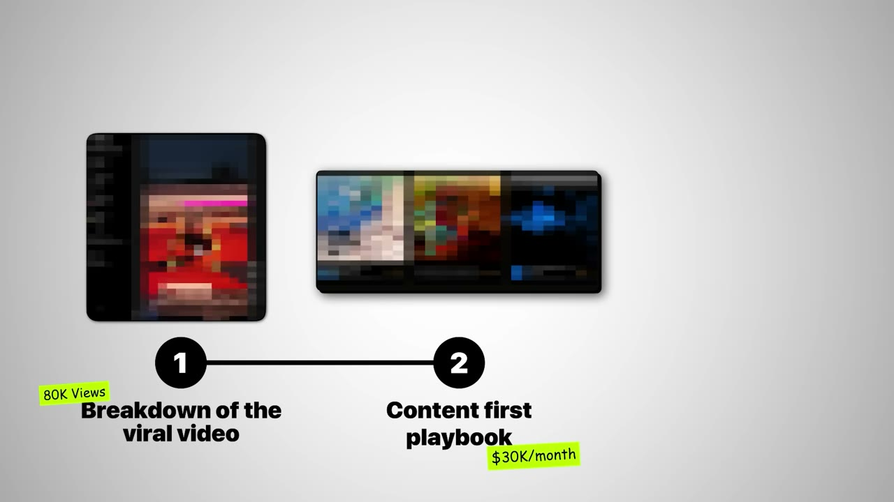
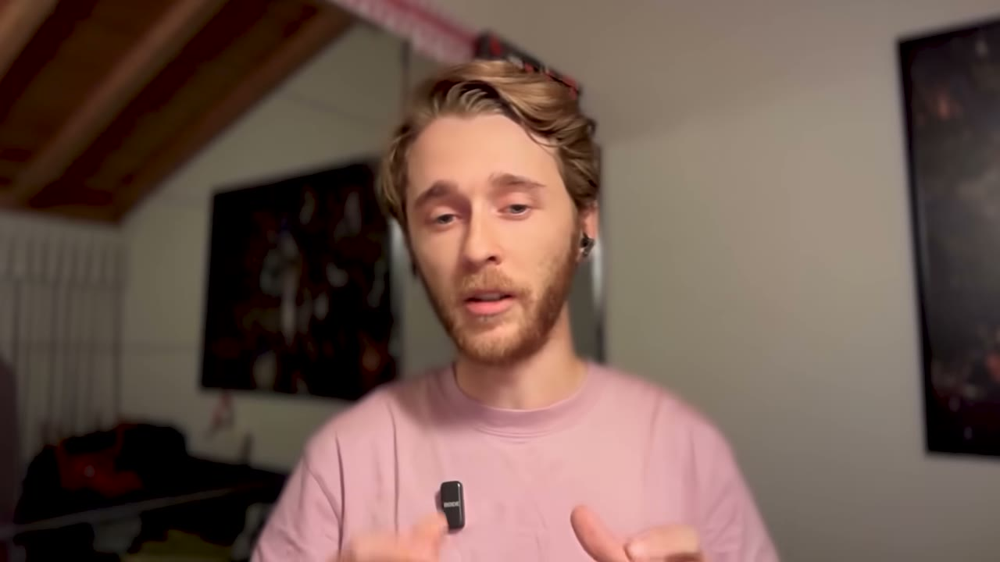
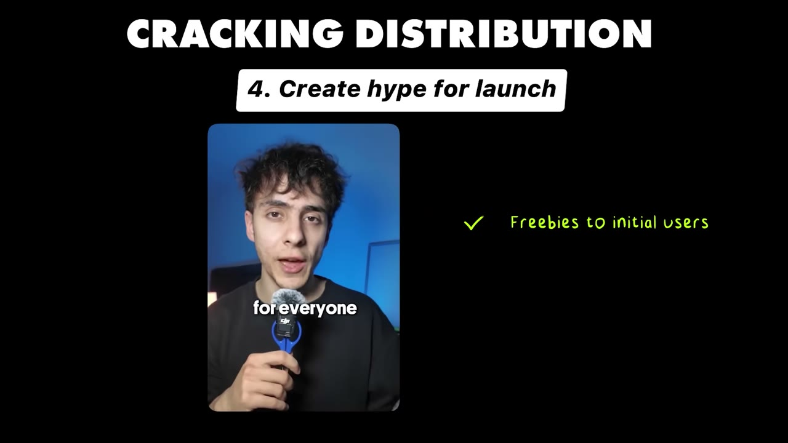
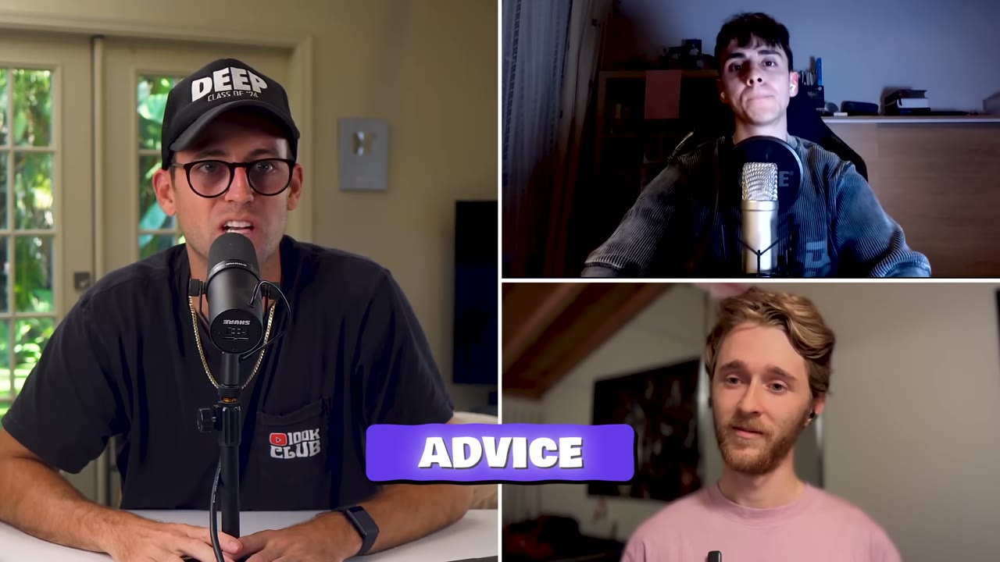

# Pushscroll — $30K/tháng, và MVP đầu tiên là một video giả

> **Tóm tắt 30 giây:** Alejandro và Mario làm một app bắt bạn hít đất trước khi được mở TikTok. Nhưng thứ họ làm **trước tiên không phải app** — họ dựng một video demo giả bằng footage AI đếm hít đất **lấy từ YouTube của người khác**, đăng lên TikTok, được **80.000 view và khoảng 500 comment van nài họ build**. Chỉ khi đó họ mới viết dòng code đầu tiên. MVP là **3 màn hình trong 2 tuần** với bộ đếm hít đất "hỏng một nửa". Bốn tháng sau: **300.000 lượt tải, 4.000 khách trả tiền, hơn $30.000/tháng**, 100% organic. Câu nguyên tắc của họ: *nếu bạn không giải thích được app trong ba chữ, nó quá phức tạp với TikTok.*

## 1. Con số

| Chỉ số | Giá trị |
|---|---|
| Doanh thu | **hơn $30.000/tháng** sau 4 tháng |
| Lượt tải | ~300.000 (App Store + Play Store) |
| Khách trả tiền | ~4.000 |
| Tỷ lệ tải → trả tiền | **~1,3%** |
| Giá | ~$30/năm, **hard paywall**, không có bản free |
| Video xác thực ý tưởng | 80.000 view, ~500 comment |
| Thời gian build MVP | ~2 tuần, 3 màn hình |
| Lượt tải từ video launch | 20.000-30.000 |
| Video tốt nhất | 6 triệu view → ~$10.000 doanh thu/tháng |

### Con số này thực chất là gì — phần cần đọc kỹ ⭐⭐⭐

Video gọi đây là *"$30,000 a month in revenue"*, và Pat nhiều lần gọi là app "$30K/tháng". Nhưng hãy làm phép tính:

**4.000 khách × $30/năm = $120.000 tổng tiền đã thu.** Chia cho khoảng 4 tháng hoạt động = **$30.000/tháng.**

Nghĩa là con số $30K/tháng là **tiền mặt thu về trung bình mỗi tháng từ các gói năm trả trước**, chứ **không phải MRR** theo nghĩa doanh thu định kỳ ổn định. Đây là khác biệt sống còn và không ai trong video nói ra:

- Với gói năm trả trước, doanh thu tháng này = **số subscriber MỚI tháng này × $30**. Nếu tháng sau họ không kiếm thêm 1.000 khách mới, doanh thu tháng sau về gần 0.
- Toàn bộ 4.000 khách này sẽ tới hạn gia hạn **cùng nhau vào năm sau**. Tỷ lệ gia hạn của app digital wellbeing thường rất thấp — người ta mua vì một khoảnh khắc quyết tâm rồi quên. Chưa ai biết con số đó là bao nhiêu.
- Apple và Google cắt **15-30%**. Con số $30K là gross; net thực tế khoảng $21.000-25.500 trước mọi chi phí khác.

**Không phải họ nói dối** — họ nói "revenue" chứ không nói "MRR". Nhưng nếu bạn đọc case này để lập kế hoạch, hãy hiểu đúng: đây là mô hình **doanh thu chạy theo lưu lượng video**, không phải mô hình subscription tích luỹ. Ngừng viral là ngừng tiền. Đây cũng là lý do họ đang gấp rút chuyển sang paid ads.

Một chi tiết củng cố cách đọc này, do chính họ nói: *"với một video, bạn có thể chạm tới $5-10K MRR. Chuyện đó đã xảy ra với chúng tôi. **Một video được 6 triệu view và nó quy đổi ra khoảng $10K MRR**."* Doanh thu gắn trực tiếp vào từng video — đó là dấu hiệu rõ nhất của mô hình chạy theo lưu lượng.

### Lỗi tên riêng trong transcript

ASR đọc tên sản phẩm thành "Push School", "Pushcroll", "Push scroll". **Tên đúng theo mô tả video là Pushscroll.** Tên hai founder: Alejandro (X: @skyirezumi) và Mario (X: @null_deref). Transcript không gán rõ ai nói câu nào; tôi suy ra Alejandro là người làm video viral (vì anh nói *"rồi tôi gặp Mario qua YC co-founder match"*) và Mario là software engineer từng có app 5 triệu lượt tải. Nếu bạn cần chính xác tuyệt đối về ai làm gì, hãy xem lại video.

## 2. Insight trung tâm — MVP của bạn là một video, không phải code ⭐⭐⭐

Đây là toàn bộ giá trị của case này, và nó lật ngược thứ tự mặc định của mọi indie hacker.

> *"Sai lầm lớn nhất mà đa số founder mắc phải là **build trước rồi mới đi marketing sau**. Hai người này lật ngược hoàn toàn. **Nội dung trước, sản phẩm sau.**"* — Pat

Cách Alejandro làm, từng bước:

1. Anh không hỏi *"tôi nên build gì?"* mà hỏi **"ý tưởng app nào có tiềm năng viral cao nhất?"**
   > *"Với app tiêu dùng, cực kỳ quan trọng là phải **xác thực ý tưởng bằng tính viral trước**. Về cơ bản bạn muốn có được một video TikTok viral. Nên tôi nghĩ ra ý tưởng app **trực quan nhất và mới lạ nhất** — và Pushscroll là thứ tôi nghĩ ra."*
2. Anh dựng video **không có app**:
   - Dùng một **video AI phát hiện hít đất tìm được trên YouTube** (của người khác).
   - Quay cảnh đặt điện thoại dựa vào tường.
   - Quay cảnh lướt mạng xã hội.
   - Ghép ba hình ảnh đó lại.
3. Kết video là một CTA thẳng: **"tôi có nên build cái này không?"**
4. Kết quả: 80.000 view, khoảng 500 comment **van nài** họ làm.

> *"Điều bạn phải hiểu là **người ta không thực sự quan tâm bạn giải vấn đề bằng cách nào**. Chỉ cần bạn giải được nó. Nên nếu bạn **hình ảnh hoá được giá trị mà app sẽ mang lại**, thế là đủ."*

**Cơ chế — vì sao cách này rẻ hơn mọi cách validate khác:**

| Cách xác thực | Chi phí | Chất lượng tín hiệu |
|---|---|---|
| Hỏi bạn bè / khảo sát | vài giờ | Rất kém — người ta nói dối để làm bạn vui |
| Landing page + waitlist | 1-2 ngày + tiền ads để có traffic | Trung bình — chỉ đo được sự tò mò |
| **Video giả trên TikTok** | **vài giờ, $0 tiền ads** | **Cao — đo trực tiếp khả năng phân phối** |
| Build MVP rồi launch | 2 tuần đến 3 tháng | Cao nhưng quá đắt để sai |

Điểm ăn tiền: video giả không chỉ đo **nhu cầu**, nó đo đồng thời **khả năng phân phối** — thứ thật sự giết chết app tiêu dùng. Một ý tưởng có thể có nhu cầu thật nhưng không kể được thành video 15 giây, và app đó sẽ chết dù sản phẩm tốt. **Test này loại luôn cả hai loại rủi ro cùng lúc.**

Và có một cảnh báo quan trọng đi kèm:

> *"Trước hết, nếu bạn làm video kiểu này, **bạn phải làm một video tốt**. Nếu không, bạn sẽ không biết là **ý tưởng app của bạn dở hay video của bạn dở**."*

Đây là chỗ đa số người sao chép sẽ vấp. Một video dở tạo ra tín hiệu âm giả và bạn sẽ giết một ý tưởng tốt.

## 3. Công thức video xác thực ⭐⭐⭐

Ba yêu cầu về **hook** (câu mở đầu):

1. **Rõ tới mức đứa trẻ 5 tuổi hiểu được.** Hook của họ: *"Nếu bạn có thể chấm dứt cơn nghiện doom scrolling bằng cách hít đất 20 cái thì sao?"*
2. **Có khoảng trống tò mò (curiosity gap).** *"Hít đất thì liên quan gì tới việc bỏ doom scrolling?"* — người xem buộc phải ở lại để biết.
3. **Mới lạ và nguyên bản.** Nếu đã thấy ở đâu đó thì không có lý do dừng lại.

Và ba yêu cầu về **ý tưởng app** để nó viral được:

1. **Phải có ít nhất một yếu tố nặng về hình ảnh.** Làm app trực quan nhất có thể — nếu không quay được thì không viral được.
2. **Phải giải thích được trong ba chữ.** *"Nếu bạn không giải thích được app của mình trong ba chữ thì nó quá phức tạp với sự chú ý ngắn ngủi của người dùng TikTok."*
3. **Phải chạm vào một khao khát hoặc vấn đề cơ bản của con người.**

Pat chỉ ra chính xác vì sao video của họ hiệu quả:

> *"Điều tôi thấy hay ở video launch của các bạn là **nó không phải kiểu ai đó khoe demo app trên màn hình**. Nó thực sự khoe **lợi ích bạn sẽ nhận được nếu app này tồn tại**. Nó không nói tính năng này hoạt động thế nào, tính năng kia ra sao. Nó cho thấy một người đang hít đất, đang khoẻ lên, và không doom scroll nữa."*

**Vì sao ý tưởng này cộng hưởng, theo lời họ:** doom scrolling là vấn đề đang lớn dần và rất nhiều người **đang chủ động tìm cách giải quyết** vì nó gây nghiện nặng. Và điểm chốt: *"nó không chỉ gỡ cơn nghiện của bạn, nó còn làm bạn khoẻ lên cùng lúc."* Một hành động, hai lợi ích — đó là cấu trúc dễ kể lại nhất.

## 4. MVP xấu tới mức xấu hổ ⭐⭐

Sau video viral:

> *"Có người **van nài chúng tôi trong comment** hãy build app này. Nên chúng tôi phải build càng nhanh càng tốt."*

- Thời gian: **~2 tuần**.
- MVP có **đúng 3 màn hình**:
  1. Một **bộ phát hiện hít đất hỏng một nửa**.
  2. Màn hình chọn app muốn chặn.
  3. Màn hình chặn các app đó cho tới khi bạn tập xong.
- *"Toàn bộ chỗ này về sau đều bị viết lại."*

> *"MVP nên đơn giản tới mức **đáng xấu hổ** — đặc biệt vì thủ tục hành chính để đưa app lên store mất vài tuần, và bạn có thể dùng khoảng thời gian đó để chạy private beta hoặc chỉ đơn giản là chờ. **Nếu nó xấu thì cũng không sao. Nó không cần phải scale.**"*

Chi tiết rất thực dụng nhưng ít ai để ý: **thời gian duyệt app store là thời gian miễn phí để test.** Đừng ngồi chờ — dùng nó để chạy beta.

**Cách launch:** một video TikTok thứ hai thông báo **miễn phí cho tất cả ai tải trong tuần đầu**. Kết quả: **20.000-30.000 lượt tải**.

> *"Chúng tôi tặng miễn phí cho những người dùng đầu tiên, còn tất cả những người khác thì thấy **hard paywall**. Đó là sự xác thực tối thượng mà bạn muốn — rằng **người ta chịu trả tiền cho app của bạn**."*

Chú ý cấu trúc kép ở đây: nhóm miễn phí tạo **số lượng người dùng ban đầu, review 5 sao và tín hiệu cho thuật toán store**; nhóm trả tiền ngay sau đó tạo **bằng chứng kinh tế**. Đây là cách dùng một lần ưu đãi để mua cả hai thứ.

## 5. Playbook 6 bước nếu làm lại từ đầu ⭐⭐⭐

**Bước 1 — Tạo và "làm ấm" một tài khoản TikTok mới.** Xem hết video trong ngách, tương tác thật: comment, lưu, chia sẻ, repost, follow càng nhiều creator càng tốt.

> *"Buồn cười ở chỗ chúng tôi muốn bỏ doom scrolling, nhưng cuối cùng lại tự biến mình thành con nghiện nội dung self-improvement — mà **đó chính xác là thứ bạn cần**."*

Hai mục đích, đừng bỏ qua cái thứ hai: (a) bạn học được **vì sao** các video đó viral, thậm chí tìm ra app có thể sao chép và cải tiến an toàn; (b) nó **báo cho TikTok biết bạn không phải bot**, tránh bị shadowban về sau.

**Bước 2 — Nghĩ ý tưởng viral** theo ba tiêu chí ở mục 3 (trực quan, ba chữ, khao khát cơ bản).

**Bước 3 — Post video hằng ngày để xác thực từng ý tưởng cho tới khi một cái bùng nổ.** Đó là tín hiệu mạnh rằng ý tưởng của bạn **có thể viral lại lần nữa** sau này với UGC hoặc influencer collab. Điểm này rất quan trọng: viral một lần chứng minh **định dạng** hoạt động, và định dạng đó chính là tài sản để scale sau này.

**Bước 4 — Có video rồi thì lập waitlist, và bí quyết ít người biết: lập một cộng đồng Discord.** Vì bạn chưa có app, bạn cần chỗ để giữ liên lạc và chuyển họ thành người dùng. *"Lượng traction này sẽ cực kỳ quan trọng cho lúc launch."*

**Bước 5 — Tự post organic cho tới khi đạt $5-10K/tháng TRƯỚC KHI hợp tác với influencer.** Đây là bước phản trực giác nhất trong playbook:

> *"Lý do bạn nên làm việc này là **nó cho bạn nhiều thông tin hơn hẳn để làm việc với influencer sau này** — để biết chính xác **video nào bán được hàng**. Cứ thử nghiệm các định dạng khác nhau mỗi ngày cho tới khi tìm được thứ viral đi viral lại."*

**Cơ chế:** nếu bạn thuê influencer khi chưa biết định dạng nào chuyển đổi, bạn đang trả tiền để họ đoán hộ bạn — và họ đoán theo tiêu chí view, không phải tiêu chí doanh thu. Khi bạn đã tự tìm ra định dạng thắng, bạn đưa cho họ một brief cụ thể và tỷ lệ trúng tăng vọt. So sánh với [Evan 14 tuổi làm app Locked](../2026-04-01_im-14-and-i-built-a-14k-month-app/case.md) — cậu đàm phán hợp đồng influencer có bảo đảm lượt xem, tức là quản trị rủi ro ở đầu vào; Alejandro và Mario quản trị rủi ro bằng cách **biết trước cái gì hiệu quả**. Cách thứ hai rẻ hơn.

**Bước 6 — Scale.** Mở rộng organic qua UGC, influencer, hoặc paid ads. Và trong lúc đó, **sửa phễu**:

> *"Từ khoảnh khắc ai đó xem video của bạn cho tới khi họ trả tiền — hãy **tập trung sửa những thứ đang hỏng thay vì tối ưu những thứ đã chạy tốt**."*

## 6. Sản phẩm hoạt động thế nào

- Chặn các app như TikTok hoặc Instagram.
- Mỗi cái hít đất đổi được **1 phút screen time**.
- Dùng số phút đó để mở khoá app tạm thời.
- Có các mức độ khó và nhiều bài tập khác: squat, plank.
- Có một tab **journey theo phong cách Duolingo** để giữ chân, và các buổi workout đòi bạn hoàn thành một chuỗi bài tập để kiếm screen time.

Cơ chế tâm lý mà họ tự mô tả: *"về cơ bản chúng tôi **cướp lấy dopamine** bạn nhận từ mạng xã hội và **huấn luyện lại não bạn để thèm vận động**."* Đây là lý do sản phẩm dễ kể — nó có một cơ chế nghe hợp lý ngay lập tức mà không cần giải thích khoa học.

## 7. Tech stack

| Hạng mục | Công cụ |
|---|---|
| App đa nền tảng | **Compose Multiplatform** |
| Backend, database, auth | **Supabase** |
| Hiển thị và A/B test paywall | **Superwall** (ASR đọc thành "super world") |
| Analytics | **Amplitude** |
| Báo lỗi crash | **Sentry** |
| Coding | **Claude Code Max** |

Lưu ý: đây là stack **Kotlin/Compose Multiplatform** chứ không phải React Native hay Flutter — hiếm gặp trong các case app indie. Nó cho phép một codebase chạy cả iOS và Android, và với app này thì Android quan trọng vì tính năng chặn app trên Android dễ triển khai hơn iOS nhiều.

**Superwall là mảnh ghép dễ bị bỏ qua nhất.** Với tỷ lệ chuyển đổi 1,3%, mỗi phần trăm cải thiện ở paywall đáng giá hàng nghìn đô. Công cụ A/B test paywall là hạ tầng bắt buộc, không phải thứ xa xỉ.

## 8. Mâu thuẫn với các case khác trong kho ⭐⭐

**"Validate trước khi code" đấu với "ship ngay rồi tính":**

| Quan điểm | Ai | Đúng khi nào |
|---|---|---|
| **Nội dung trước, sản phẩm sau** — dựng video giả, đo phản hồi, chỉ build khi có tín hiệu | Alejandro và Mario (case này) | App B2C, có yếu tố hình ảnh, chi phí build từ 2 tuần trở lên, và bạn **không** có audience sẵn |
| **Ship kèm nút mua ngay, thị trường sẽ nói** | [Marc Lou](../2026-04-26_how-i-work-77k-month-solopreneur/case.md) — 35 startup, tỷ lệ trúng 5% | Chi phí build dưới một tuần; khi đó việc validate còn tốn hơn việc build |
| **Mượn tệp khách của người khác, bỏ qua khâu validate** | Hassam — LaunchFast (case cùng đợt) | B2B ngách, có một tổ chức nắm sẵn ICP, và bạn có domain knowledge để pitch |
| **Xây audience trước, sản phẩm bán cho chính audience đó** | [Rob Hallam — SuperX](../2026-08-20_how-i-work-22k-month-solopreneur/case.md) | Bạn chịu được 1-2 năm không thu nhập và bạn chính là ICP |

**Phân định bằng hai câu hỏi:**

1. **App của bạn có quay được thành video 15 giây không?** Nếu có → cách của Pushscroll là rẻ nhất và nhanh nhất. Nếu không (công cụ B2B, dashboard, API) → cách này vô dụng, hãy đi đường Hassam hoặc SEO.
2. **Build MVP mất bao lâu?** Dưới một tuần → cứ ship, việc dựng video validate còn lâu hơn. Trên hai tuần → bắt buộc validate trước.

**Đối chiếu với các case app viral khác trong kho:** [Flame chạy TikTok organic ở quy mô công nghiệp](../2026-06-21_i-built-a-10k-month-app-with-this-one-system/case.md) với 15-20 tài khoản trên 5 điện thoại, còn [Snag chuyển creative thắng từ UGC sang Meta Ads](../2026-05-31_i-built-a-30k-month-app-heres-my-exact-process/case.md). Cả ba đều hội tụ về **cùng một nguyên tắc: tìm định dạng video thắng trước, rồi mới nhân nó lên bằng tiền hoặc bằng số lượng tài khoản.** Điều khác biệt của Pushscroll là họ làm bước "tìm định dạng thắng" **trước khi có sản phẩm**.

## 9. Áp dụng cho tôi (indie hacker VN)

### Sao chép được gì

**Đây là case dễ áp dụng cho người Việt bất ngờ, vì rào cản ngôn ngữ gần như biến mất.**

- **Video validate không cần nói.** Video gốc của họ là hình ảnh + text overlay + nhạc. Bạn không cần giọng, không cần lên hình, không cần tiếng Anh trôi chảy. Text overlay tiếng Anh vài chữ là đủ.
- **Chi phí thử nghiệm gần bằng 0.** Một buổi tối để dựng video, một tài khoản TikTok mới. Nếu thất bại, bạn mất một buổi tối. Đây là tỷ lệ rủi ro trên phần thưởng tốt nhất trong cả kho case này.
- **Bạn có thể test 10 ý tưởng trong 10 ngày** trước khi viết một dòng code. Bước 3 của playbook chính là điều này và đa số bỏ qua.
- **Footage đi mượn là hợp lệ ở giai đoạn validate.** Họ dùng thẳng video AI đếm hít đất tìm trên YouTube. Ở bước validate, mục tiêu là đo phản ứng, không phải xây thương hiệu. (Khi launch thật thì phải tự quay — xem rào cản bên dưới.)
- **Compose Multiplatform + Supabase + Superwall là stack rẻ**, và Claude Code làm phần lớn việc code.

**Kế hoạch 10 ngày cụ thể:**
1. Ngày 1-2: lập tài khoản TikTok mới, xem và tương tác 2 tiếng/ngày trong một ngách (self-improvement, fitness, productivity, học tiếng Anh...).
2. Ngày 3: liệt kê 10 ý tưởng app **quay được thành hình** và **giải thích được trong ba chữ**.
3. Ngày 4-9: mỗi ngày dựng và đăng một video demo giả cho một ý tưởng, kết bằng CTA "có nên build cái này không?".
4. Ngày 10: cái nào vượt 50.000 view và có comment đòi sản phẩm thì build. Không có cái nào thì đổi ngách, không đổi cách làm.

### Rào cản thật

- **Con số $30K/tháng là gross, không phải MRR, và Apple/Google giữ lại 15-30%.** Net thật khoảng $21-25K. Ngoài ra **Apple trả tiền chậm 30-45 ngày** — nếu bạn chạy paid ads để scale, bạn phải ứng vốn cho khoảng cách dòng tiền này. Đây là chỗ nhiều app VN chết dù đang tăng trưởng.
- **Tài khoản Apple Developer cần $99/năm và cần thẻ tín dụng quốc tế**; Google Play cần $25 một lần. Việc nhận tiền về Việt Nam cần tài khoản ngân hàng hỗ trợ và có thủ tục thuế. Không phải rào cản lớn nhưng phải chuẩn bị trước, không phải chuyện làm trong một buổi tối.
- **Doanh thu bám vào lưu lượng video, không tích luỹ.** Nếu bạn không ra được video viral trong một tháng, doanh thu tháng đó gần như bằng 0. Đây **không** phải mô hình thu nhập ổn định — nó gần với nghề làm content hơn là nghề làm SaaS.
- **Tỷ lệ gia hạn năm sau là một dấu hỏi lớn chưa ai trả lời.** App digital wellbeing bán theo quyết tâm nhất thời. Khi 4.000 khách đến hạn cùng lúc, nếu chỉ 20% gia hạn thì mô hình phải chạy lại từ đầu.
- **Người dùng Việt gần như không trả tiền cho app dạng này**, và giá $30/năm là quá cao với thị trường nội địa. Bạn phải nhắm thị trường Mỹ/EU ngay từ video đầu tiên — nghĩa là **thuật toán TikTok phải nhận diện tài khoản của bạn là tài khoản tiếng Anh**, đây là phần kỹ thuật thật sự khó (khu vực tài khoản, ngôn ngữ, giờ đăng, đối tượng tương tác).
- **Dùng footage của người khác chỉ chấp nhận được ở bước validate.** Khi đã có app và chạy thương mại, việc này thành rủi ro bản quyền và rủi ro bị gỡ tài khoản. Hãy tính chi phí tự sản xuất từ ngày launch.
- **Rủi ro nền tảng kép:** TikTok có thể shadowban tài khoản (đó là lý do bước 1 tồn tại), và Apple/Google có thể từ chối app chặn ứng dụng khác vì lý do quyền riêng tư — đây là hạng mục mà chính sách store thay đổi thường xuyên.

### Khi nào KHÔNG dùng mô hình này

- **Khi sản phẩm của bạn không quay được thành hình.** Công cụ B2B, dashboard, API, plugin — không có gì để cho người ta nhìn trong 15 giây. Toàn bộ phương pháp này sụp.
- **Khi khách hàng của bạn không ở trên TikTok.** Kế toán trưởng, chủ nhà máy, bác sĩ không mua phần mềm qua TikTok.
- **Khi MVP của bạn build dưới một tuần.** Lúc đó việc dựng video validate tốn tương đương việc build. Cứ ship như Marc Lou.
- **Khi bạn cần doanh thu ổn định để sống.** Mô hình này cho những tháng $30K và những tháng $3K. Nếu bạn cần trả tiền nhà đều đặn, hãy chọn mô hình subscription B2B có churn thấp.
- **Khi bạn không chịu được việc ý tưởng bị lộ.** Đăng video demo trước khi có sản phẩm nghĩa là bạn công bố ý tưởng cho toàn bộ đối thủ. Họ tự nói ra ở bước 1: *"bạn thậm chí có thể tìm ra những app mà bạn có thể sao chép và cải tiến một cách an toàn."* Người khác cũng đang làm điều đó với bạn. Cách phòng thủ duy nhất là **tốc độ** — họ build MVP trong 2 tuần là có lý do.

### Cảnh báo thiên kiến nguồn

Video này có mật độ bán hàng cao: một đoạn quảng cáo dài ở phút 6:30-7:20 để lấy email đổi lấy "Content-First Playbook", cộng phần kết bán Starter Story Build. Cấu trúc video được thiết kế để **video này là nửa đầu, còn nửa sau nằm sau bức tường email** — nghĩa là những chi tiết cụ thể nhất về quy trình nghiên cứu nội dung đã bị cố tình giữ lại. Ngoài ra, đây là app mới 4 tháng tuổi, chưa qua một chu kỳ gia hạn nào; mọi kết luận về độ bền của mô hình đều là suy đoán.

## Nguồn

- Video: <https://www.youtube.com/watch?v=ST2ROUFbdvU> (12:47, đăng 20/12/2025, 48.053 view, 1.358 like)
- [Transcript đầy đủ](transcript.md) · [Ảnh chụp](screenshots/)
