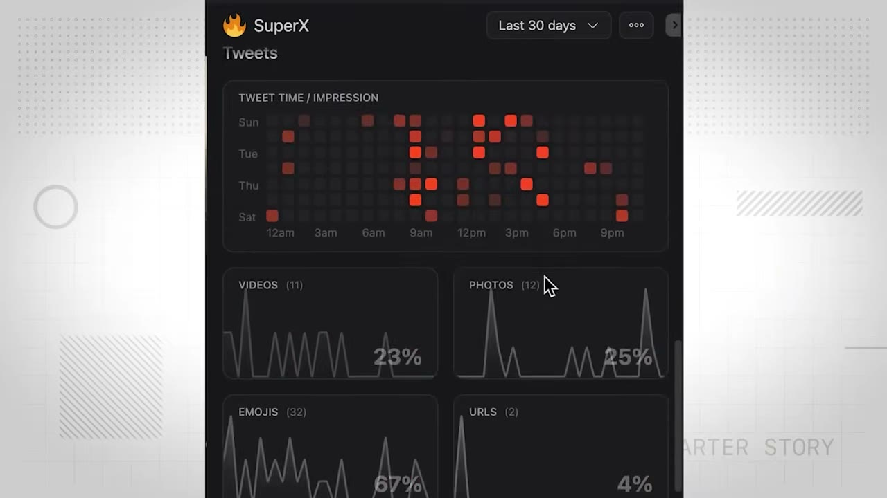
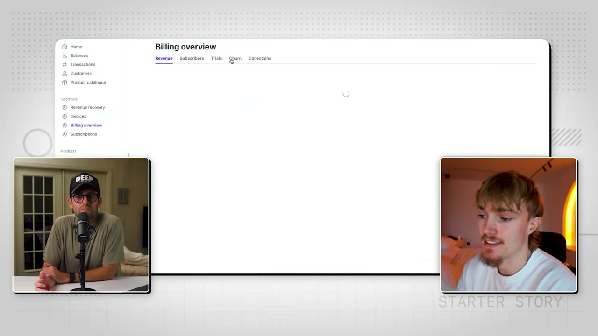

# How I Used Twitter to Hit $10K/Month

✅ **Đã phân tích sâu** → [`case.md`](case.md)

| | |
|---|---|
| **Video** | <https://www.youtube.com/watch?v=VYT-ip21P08> |
| **Đăng** | 28/12/2025 |
| **Thời lượng** | 20:09 |
| **Lượt xem** | 45,703 |
| **Lượt thích** | 1,531 |
| **Video ID** | `VYT-ip21P08` |

## Trong thư mục này

| File | Nội dung |
|---|---|
| [`case.md`](case.md) | **Phân tích đầy đủ** — ý tưởng, validate, GTM, áp dụng ở VN |
| [`meta.json`](meta.json) | Metadata gốc (chapters, heatmap, mô tả) |
| [`screenshots/`](screenshots/) | 10 ảnh 720p |

## Mô tả gốc

Over the past year, Rob Hallam has been furiously building in public on X/Twitter. He posts every day and has grown his app to over $10K/month. In this video, Rob breaks down his build in public playbook and how anyone can use the power of the internet to build their own successful saas.  
0:00 - Intro
1:19 - Who is Rob Hallam
2:00 - Overview of the app
2:30 - App analytics
3:33 - Rob’s background
4:34 - Breakthrough story
6:19 - How building in public changed Rob’s life
9:08 - The Build in Public Playbook (free download)
10:16 - Step-by-Step process for building an audience
15:49 - How SuperX

## Số liệu bắt được từ transcript

> Các đoạn founder nhắc tới con số, kèm timestamp để tua thẳng tới đó trong video.

_(không bắt được con số nào)_

## Chương

- `00:00` Intro
- `01:19` Who is Rob Hallam
- `02:00` Overview of the app
- `02:30` App analytics
- `03:33` Rob’s background
- `04:34` Breakthrough story
- `06:19` How building in public changed Rob’s life
- `09:08` The Build in Public Playbook (free download)
- `10:16` Step-by-Step process for building an audience
- `15:49` How SuperX works
- `17:16` Tech stack
- `18:17` Final advice
- `19:04` Pat’s notes and reflections

## Ảnh

1. `01_01m25s_usd-13-000.jpg` — 
2. `02_02m11s_usd-13-000.jpg` — 
3. `03_02m57s_metric.jpg` — 
4. `04_03m45s_ch-rob-s-background.jpg` — 
5. `05_04m46s_ch-breakthrough-story.jpg` — 
6. `06_06m31s_ch-how-building-in-public-changed-rob-s-life.jpg` — 
7. `07_08m34s_usd-1-000.jpg` — 
8. `08_09m20s_ch-the-build-in-public-playbook-free-download.jpg` — 
9. `09_10m28s_ch-step-by-step-process-for-building-an-audie.jpg` — 
10. `10_18m02s_usd-200.jpg` — 

---

← [Quay lại index](../../index.md) · [Toàn bộ video](../README.md)
