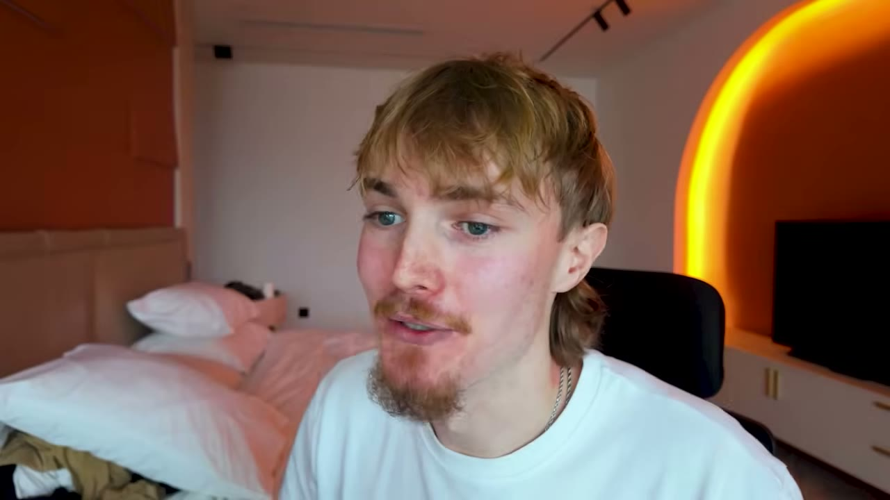
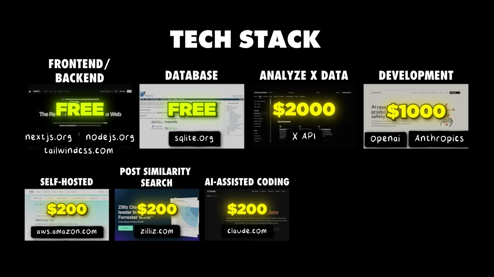
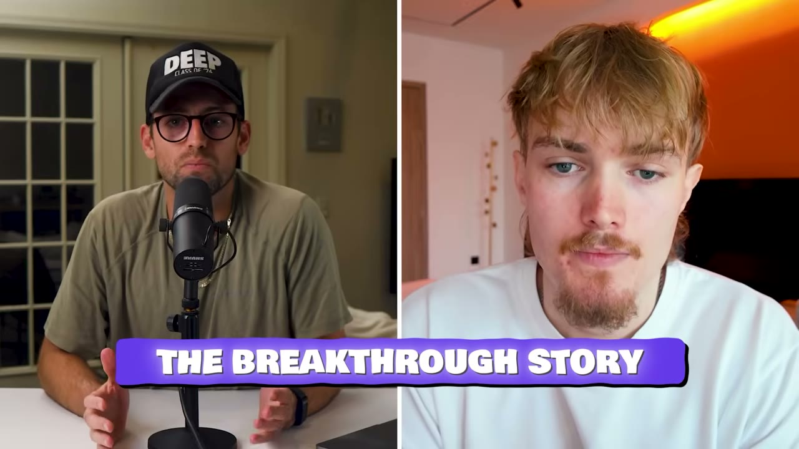
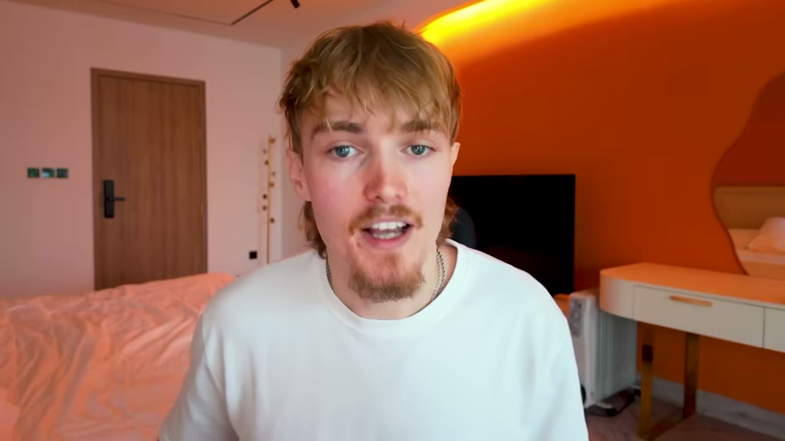

# SuperX — $13K MRR sau 4 tháng, 95% khách đến từ một tài khoản X

> **Tóm tắt 30 giây:** Rob Hallam có bằng khoa học máy tính, làm software engineer, rồi bị sa thải. Trong **2,5 năm tiếp theo anh ra mắt 5 sản phẩm và kiếm được tổng cộng $0**. Khi hết sạch tiền, anh viết một bài post trên X kể lại toàn bộ thất bại của mình — bài đó được 150.000 view và một comment gợi ý anh mở agency. Từ bài post ấy anh có khách hàng $3.000 đầu tiên. Hai năm sau, anh dùng chính vòng lặp nội dung đó để đưa SuperX từ $1.000 lên **$13.000 MRR trong 4 tháng**, với **95% traffic đến từ X** và $0 quảng cáo. Điểm ít ai để ý: churn của anh **~30%/tháng** và chi phí hạ tầng ngốn khoảng một phần ba doanh thu.

## 1. Con số

| Chỉ số | Giá trị |
|---|---|
| MRR | **$13.000** (từ $1.000 cách đó 4 tháng) |
| Tăng trưởng | 25% tháng trên tháng |
| Người trả tiền | ~450 |
| Giá | $29/tháng, một mức duy nhất |
| Trial đang chạy | ~60 |
| Tỷ lệ chuyển đổi trial | ~30% |
| **Churn** | **~30%** — founder nói đang cố kéo xuống |
| Follower trên X | 34.000 sau hơn 1 năm |
| Impression | ~100.000/ngày |
| Traffic từ X | **95%** |
| Chi phí hạ tầng | ~$3.600–4.600/tháng |
| Sản phẩm thất bại trước đó | 5, tổng doanh thu $0, trong 2,5 năm |

**Về con số doanh thu:** tiêu đề ghi $10K, Pat trong intro nói "$12,000 a month", còn Rob đọc rõ **"over $13,000 in monthly recurring revenue"** và giải thích cấu thành: *"entirely through $29 a month subscriptions and we have about 450 active subscribers"*. Phép nhân khớp ($29 × 450 = $13.050) và có ảnh dashboard Stripe, nên tôi lấy **13.000**.

**Một điểm mơ hồ trong transcript:** Rob nói *"This is our Stripe dashboard... The rest is over on Lemon Squeezy. We recently migrated"* rồi sau đó lại nói *"Stripe for payments"* trong phần tech stack. Không rõ anh chuyển **từ** Stripe **sang** Lemon Squeezy hay ngược lại. Tôi để cả hai trong tech stack.

## 2. Kinh tế học thật của case này — phần video không nói ⭐⭐⭐

Đây là mục tôi cho là giá trị nhất, và nó **không** nằm trong phần được kể như một bài học.

**Chi phí vận hành hàng tháng, do chính Rob liệt kê:**

| Khoản | Chi phí/tháng |
|---|---|
| X API | **$2.000 – $3.000** |
| OpenAI + Anthropic Claude Sonnet API | ~$1.000 |
| AWS (server) | ~$200 |
| Zilliz Cloud (vector embedding, semantic search trên tweet) | ~$200 |
| Claude Code (coding cá nhân) | ~$200 |
| Screen Studio | ~$10 |
| Framer (landing page) | ~$10 |
| **Tổng** | **~$3.620 – $4.620** |

**Ghép lại với doanh thu $13.000:** chi phí hạ tầng chiếm **28-36% doanh thu**. Đây là mức COGS kinh khủng với một SaaS — SaaS lành mạnh thường ở 10-20%. Nguyên nhân: X API là khoản không thể thương lượng và không giảm theo quy mô, và AI API tăng tuyến tính theo số người dùng.

**Ghép tiếp với churn 30%/tháng:** vòng đời khách trung bình chỉ khoảng **3,3 tháng**, nghĩa là LTV ≈ $29 × 3,3 ≈ **$96/khách**. Với LTV $96, biên gộp sau chi phí hạ tầng còn khoảng $60-70. Con số đó nói lên hai điều:

1. **Không thể chạy quảng cáo trả phí.** CAC cho một công cụ social media tool ở thị trường Mỹ dễ dàng vượt $60. Câu *"nếu bạn làm được những điều này, bạn sẽ không cần paid ads"* của Rob nghe như một triết lý, nhưng thực chất đây là **ràng buộc kinh tế**, không phải lựa chọn. Kênh organic không phải là ưu tiên — nó là kênh duy nhất khả thi.
2. **Tăng trưởng 25%/tháng đang che giấu một cái thùng rò.** Với churn 30%, mỗi tháng anh mất ~135 khách và phải kiếm hơn 200 khách mới chỉ để tăng được 25%. Chừng nào bài post còn viral thì máy còn chạy; ngày nào Rob ngừng post, doanh thu tụt rất nhanh.

**Vì sao churn cao đến vậy?** Video không nói, nhưng cơ chế khá rõ: đây là công cụ **tăng trưởng cá nhân trên mạng xã hội**. Người mua vào với kỳ vọng viral; đa số không viral sau 4-8 tuần rồi bỏ. Đây là bệnh chung của toàn bộ hạng mục "growth tool cho creator". Nếu bạn định copy mô hình này, hãy giả định churn 25-35%/tháng ngay từ khi lập mô hình tài chính — đừng dùng con số 5% của SaaS B2B.

**Bối cảnh về sau:** trong kho có một case SuperX muộn hơn — [SuperX ở mức $22K/tháng](../2026-08-20_how-i-work-22k-month-solopreneur/case.md), khoảng 8 tháng sau video này. Nghĩa là từ $13K lên $22K mất 8 tháng, tức khoảng **6%/tháng**, chứ không phải 25%/tháng như lúc quay. Đây là ví dụ rất tốt cho việc: **tốc độ tăng trưởng ở tháng thứ 4 không suy ra được tốc độ ở tháng thứ 12.**

## 3. Bài post đổi đời — và cơ chế đằng sau nó ⭐⭐⭐

Bối cảnh: sau 5 sản phẩm thất bại, Rob mô tả *"tiền lúc đó trở thành thứ cực kỳ khan hiếm và tôi thì cực kỳ lo lắng. Tôi đã không kiếm được đồng nào trong hơn một năm."*

Rồi:

> *"Tôi viết một bài post kể lại **tất cả những thất bại của mình** và nó bùng nổ. Được khoảng **150.000 view** trên X. Và cùng với đó là **một comment** nói rằng tôi nên mở một development agency với kỹ năng của mình. Thế là ngay với đà của bài post đó, tôi lập tức thông báo mình đang mở agency — và tôi có **khách hàng $3.000 đầu tiên từ chính bài viral đó**."*

Sau đó, tháng 1/2025, anh quyết tâm bắt đầu vlog. Bài post anh viết ở sân bay Amsterdam trên đường bay đi Rio de Janeiro — khi hạ cánh, bài đó đã hơn **1 triệu view**.

Bảy tháng tiếp theo, anh gọi thẳng là *"tàn khốc"*: nhập viện ở Guatemala vì ngộ độc thực phẩm, vài tháng sau lại nhập viện ở Colombia, và X liên tục đổi API khiến SuperX sập — *"mỗi ngày mở inbox lại thấy hàng chục tin nhắn báo SuperX đang down"*. Anh vẫn tiếp tục build và tiếp tục post.

> *"Nhìn lại, tôi nhận ra tôi đã **tổn thương một cách trần trụi đến khó chịu** rất nhiều lần. Nhưng đồng thời, **nếu tôi không trần trụi như vậy, tôi không nghĩ mình đã xây được audience.** Tôi không nghĩ mình đã đưa SaaS lên được con số hiện tại."*

**Cơ chế — vì sao kể thất bại lại tạo ra doanh thu:**

Lời giải thích thông thường là "chân thành thì được yêu quý", nhưng cơ chế thật cụ thể hơn:

1. **Nội dung thất bại có tỷ lệ chia sẻ cao** vì nó là thứ hiếm trên một nền tảng đầy người khoe thành công. Độ hiếm tạo reach.
2. **Nó lọc ra đúng đối tượng.** Người tương tác với bài về thất bại là người **đang ở trong cùng hoàn cảnh** — tức là chính ICP của một công cụ dành cho indie hacker.
3. **Nó biến audience thành người kể chuyện cho bạn.** Cái comment "hãy mở agency" là ví dụ hoàn hảo: audience đã tự tìm ra mô hình kinh doanh và trao nó cho anh. Đây là điều một bài post khoe thành công không bao giờ tạo ra được.
4. **Nó tạo ra chi phí chuyển đổi cảm xúc.** Người theo dõi hành trình của bạn nhiều tháng sẽ mua sản phẩm của bạn dù có lựa chọn tốt hơn.

Nhưng **hãy nhìn cả cái giá**: Rob đốt 2,5 năm và toàn bộ tiền tiết kiệm trước khi vòng lặp này chạy. Kênh này có độ trễ rất lớn và không có gì bảo đảm.

## 4. Bài học từ 5 lần thất bại ⭐⭐

Rob rút ra đúng ba điều, và cả ba đều đáng ghi lại:

1. **Distribution matters** — phân phối quan trọng hơn sản phẩm.
2. **Monetization matters from day one** — phải thu tiền từ ngày đầu.
3. **Build painkillers, not vitamins** — làm thuốc giảm đau, không làm vitamin.

Điều thứ hai đáng nhấn mạnh vì nó đi ngược với thói quen phổ biến "cứ làm free trước rồi tính". Với 5 sản phẩm miễn phí, anh không bao giờ biết được cái nào thật sự có giá trị — không có tín hiệu nào để đọc. Nguyên tắc chung xuất hiện đi xuất hiện lại trong kho này: **tiền là tín hiệu duy nhất không nói dối**. Xem thêm cách [Snag](../2026-05-31_i-built-a-30k-month-app-heres-my-exact-process/case.md) và các app mobile khác dựng paywall ngay từ phiên bản đầu.

## 5. Bài launch không phải là bài bán hàng tốt nhất ⭐⭐⭐

Đây là chi tiết nhỏ nhưng phản trực giác nhất trong cả video:

| Bài post | View | Kết quả |
|---|---|---|
| **Bài launch chuẩn mực** — có screen recording, giải thích sản phẩm làm gì | 32.000 | 26 signup |
| **Bài selfie** — Rob ngồi trước laptop, tự chụp một tấm, đăng lên. Không quảng cáo SuperX là gì | 46.000 | *"nhiều signup hơn hẳn bài launch"*, **+$1.000 MRR trong 24 giờ** |

> *"Điều buồn cười nhất là **mặc dù bài đó không hề quảng cáo SuperX là gì**, nó lại kéo về nhiều signup hơn hẳn bài launch ban đầu."*

**Cơ chế:** trên X, bài mô tả sản phẩm cạnh tranh với hàng nghìn bài mô tả sản phẩm khác và bị người dùng lọc ra như quảng cáo. Bài về **con người** thì kích hoạt tò mò → người ta nhấp vào profile → và ở đó **pinned post + bio** làm nốt việc bán hàng. Đó chính là lý do bước 1 trong playbook của anh là dựng profile trước khi post bất cứ thứ gì. **Bài post không bán hàng; profile mới bán hàng.**

## 6. Playbook 7 bước xây audience từ số 0 ⭐⭐⭐

**Bước 1 — Dựng nền móng TRƯỚC khi post bất cứ thứ gì.** Ba thứ:
- **Ảnh đại diện**: mặt thật, cười, thân thiện, và **đừng đổi thường xuyên** vì đó là thứ người ta gắn với bạn.
- **Bio**: một câu rõ ràng nói bạn đang làm gì.
- **Pinned post** (phần đa số bỏ qua): mục tiêu hoặc elevator pitch. Của Rob là *"bỏ việc, rời nhà, sống bằng tiền tiết kiệm để build SaaS trong mơ lên 10K/tháng"*.

> *"Khi người ta thấy nội dung của bạn trong feed, họ bấm vào và vào profile, họ cần **hiểu ngay lập tức** bạn đang làm gì, câu chuyện của bạn là gì — thì họ mới muốn theo dõi."*

**Bước 2 — Chọn một mục tiêu và cam kết với nó.** Sai lầm phổ biến là post mà không có chủ đích. Chọn **một** mục tiêu cụ thể rồi ghi lại quá trình đi tới nó hằng ngày. Điều này cho bạn ba thứ: **tính nhất quán** (internet quên bạn rất nhanh), **một cốt truyện** (người ta theo dõi hành trình, không theo dõi tips), và **tính xác thực** (bạn có cớ để kể cả lúc lên lẫn lúc xuống).

**Bước 3 — Vòng lặp nội dung.** Bốn loại nội dung: giải trí, giáo dục, truyền cảm hứng, và thuyết phục (bán hàng). Điểm mấu chốt là **không post ngẫu nhiên mà theo vòng**:

1. **Giải trí** — bài viral: hài hước, dễ đồng cảm, hoặc trần trụi. Mục tiêu là lấy engagement, làm nóng thuật toán, lấy sự chú ý.
2. **Giáo dục hoặc bán hàng** — giờ đã có chú ý, hãy dạy một thứ gì đó, cho giá trị miễn phí, hoặc pitch sản phẩm **từ thiện chí**, ví dụ *"đây là cách bạn tăng trưởng trên X với SuperX"*.
3. **Truyền cảm hứng** — chụp màn hình kết quả vừa đạt được (view, sale, follower) và **nói nó có ý nghĩa gì với bạn**. *"Đây là lý do tôi bỏ việc. Những khoảnh khắc thế này khiến mọi thứ đáng giá."* Viết từ tim.
4. Quay lại bước 1.

Vòng lặp này làm ba việc cùng lúc: xây niềm tin, dạy audience thấy giá trị của bạn, và **bán mà không gây khó chịu**.

**Bước 4 — Hệ thống hoá thứ hiệu quả (anh gọi đây là bí quyết riêng).** Đừng đoán. Dùng dữ liệu: vào các profile thành công trong ngách, phân tích bài top. Rồi — điểm then chốt — **lấy CONCEPT, không lấy nguyên văn**, và làm lại theo phong cách của bạn.

Ví dụ thật của anh: dùng SuperX phân tích thấy "cursed tweets" và "algorithm simulator" đang viral trong ngách. Anh **build luôn hai tính năng đó vào SuperX**, quay demo có nhảy nhót, post lên — ăn ngay. *Kết hợp concept đã được chứng minh viral với cá tính của mình.*

**Bước 5 — Nhân đôi cái hiệu quả, GIẾT cái không hiệu quả — kể cả khi nó đã viral.** Theo dõi hiệu suất từng bài, tìm pattern: định dạng nào hợp bạn (với anh là video), phong cách nào cộng hưởng, chủ đề nào kéo tương tác (với anh là feature release và khoảnh khắc thật).

> *"Và phần rất nhiều người quên: **hãy giết cái không hiệu quả, kể cả khi nó đã viral.** Trường hợp của tôi, algorithm simulator viral, nhưng tôi **xoá nó khỏi SuperX** vì đó là tính năng mà hầu hết người dùng không hề dùng."*

Đây là chi tiết đắt: **viral không đồng nghĩa với giá trị sản phẩm**. Một tính năng viral nhưng không được dùng chỉ làm tăng chi phí bảo trì và làm loãng sản phẩm.

**Bước 6 — Xây quan hệ thật.** Đây là chỗ anh nhấn mạnh nhất:

> *"Cái mà đa số làm sai là họ tập trung vào **số lượng**. Họ dùng AI spam reply dưới hàng trăm bài — đó là một vấn đề khổng lồ trên X. Họ để lại những comment chung chung kiểu 'Ôi hay quá', 'Wow, bài viết tuyệt vời'. Và cuối cùng **họ chẳng xây được mối quan hệ thật nào**."*

Cách đúng: tìm những người trong ngách mà bạn **thật sự muốn kết bạn**, reply bằng giá trị thật (chia sẻ trải nghiệm, kể chuyện, hỏi câu hỏi có suy nghĩ), và **kiên trì với cùng những người đó** như xây tình bạn ngoài đời. Anh nói nhiều follower của anh là bạn thật, đã gặp mặt khi đi du lịch.

**Bước 7 — Tận dụng thứ nền tảng đang muốn đẩy.** Hiện tại X đang đẩy video vì nó giữ người ở lại lâu hơn. *"Khi tôi chuyển từ text sang video, tôi được reach gấp 10 lần bài text."* Nhưng điều này **thay đổi theo thời gian** — phải theo dõi và thích nghi.

> *"Điểm mấu chốt của tất cả những điều này là: **khác với những gì tôi từng nghĩ, nó không phải chuyện may mắn.** Nó là xây dựng niềm tin qua kể chuyện nhất quán, hệ thống hoá tính viral bằng dữ liệu và phân tích, và tập trung vào những tình bạn thật, có chủ đích."*

## 7. Sản phẩm hoạt động thế nào

- **Trang inspiration**: mỗi ngày sinh ra các bài gợi ý chưa từng tồn tại — lấy thứ đang viral ngay lúc đó, ghép với ngữ cảnh của bạn và các concept viral, rồi tạo bài sẽ viral cho bạn.
- **Chrome extension** (phần lõi, do Tibo mua lại trước đó): mở bất kỳ profile nào trên X và xem ngay top post, sắp xếp theo impression/like, ước tính thu nhập từ X của người đó. Bạn lấy concept viral từ đó đưa vào SuperX để viết và lên lịch.
- **SuperX Engage** (tính năng anh hào hứng nhất, mới ra): hướng dẫn từng bước cách reply bài của người trong cộng đồng bạn quan tâm — chính là công cụ hoá bước 6 của playbook. Reply được ngay trong SuperX và theo dõi toàn bộ reply ở một chỗ.

Chú ý cấu trúc: **sản phẩm chính là playbook được đóng gói thành phần mềm.** Rob dùng SuperX để tăng trưởng SuperX, và mỗi bài post viral vừa là marketing vừa là bằng chứng sản phẩm hoạt động. Đây là dạng flywheel mạnh nhất mà cũng khó sao chép nhất — nó chỉ chạy được khi founder chính là ICP.

## 8. Tech stack

> *"Triết lý của tôi là **chọn một stack, học thật sâu, và bỏ qua mọi tiếng ồn** — vì quá nhiều người ngày nay tốn quá nhiều thời gian chạy theo công nghệ mới thay vì ship."*

| Hạng mục | Công cụ | Chi phí/tháng |
|---|---|---|
| Frontend/backend | Next.js, Node.js, Tailwind | — |
| Database | SQLite | — |
| Dữ liệu nền tảng | **X API** | **$2.000–3.000** |
| AI | OpenAI + Anthropic Claude Sonnet API | ~$1.000 |
| Server | AWS | ~$200 |
| Vector search trên tweet | Zilliz Cloud | ~$200 |
| Coding cá nhân | Claude Code | ~$200 |
| Quay demo | Screen Studio | ~$10 |
| Landing page | Framer | ~$10 |
| Thanh toán | Stripe (và Lemon Squeezy) | phí giao dịch |
| Analytics | PostHog | miễn phí |

Đáng chú ý: **Screen Studio $10/tháng chính là công cụ tạo ra những video demo viral** đem về hầu hết doanh thu. Tỷ lệ chi phí trên hiệu quả của khoản này là cao nhất trong toàn bộ stack.

## 9. Rủi ro nền tảng — nói thẳng

SuperX phụ thuộc vào X ở **cả ba tầng cùng lúc**, đây là mức phơi nhiễm hiếm thấy:

1. **Sản phẩm** chạy trên X API — X đổi API là sản phẩm sập, và điều này **đã xảy ra nhiều lần** trong 7 tháng đầu.
2. **Phân phối** là 95% từ X — X đổi thuật toán hoặc khoá tài khoản Rob là doanh thu về gần 0.
3. **Chi phí lớn nhất** là do X định giá — X tăng giá API là biên lợi nhuận bốc hơi, và Rob không có quyền thương lượng.

Nói cách khác: **X vừa là nhà cung cấp, vừa là kênh bán, vừa là đối thủ tiềm năng.** Nếu X ra tính năng analytics tương tự (họ đã có X Premium analytics), sản phẩm này mất lý do tồn tại. Đây là rủi ro nặng hơn nhiều so với [FollowBuddy phụ thuộc Instagram](../2026-03-19_i-make-17k-month-with-one-strategy/case.md), nơi ít nhất kênh phân phối (YouTube) độc lập với nền tảng sản phẩm (Instagram).

## 10. Áp dụng cho tôi (indie hacker VN)

### Sao chép được gì

- **Bộ khung profile ở bước 1 sao chép được ngay trong 30 phút**, và nó áp dụng cho mọi nền tảng, kể cả tiếng Việt trên Threads/Facebook/LinkedIn. Ảnh mặt thật, một câu bio rõ ràng, pinned post nêu mục tiêu công khai. Rất nhiều người Việt post đều đặn nhưng profile không nói được họ đang làm gì — mất toàn bộ chuyển đổi ở bước cuối.
- **Vòng lặp 4 loại nội dung (bước 3) là thứ hữu dụng nhất để mang về.** Nó giải quyết đúng bệnh của người mới: hoặc chỉ bán hàng (bị unfollow), hoặc chỉ chia sẻ (không ra tiền). Vòng lặp cho bạn quyền bán, vì bạn đã trả trước bằng giải trí và giá trị.
- **Bước 4 — lấy concept, không lấy nguyên văn — có thể làm bằng tay, miễn phí.** Không cần SuperX. Mở 10 profile trong ngách, chép lại 20 bài top của họ vào một file, tìm ra **cấu trúc** chung (mở đầu bằng số? bằng thất bại? bằng before/after?), rồi viết lại bằng câu chuyện của bạn.
- **Nguyên tắc "giết cái viral nhưng không ai dùng"** đáng dán lên tường. Rất nhiều người Việt build tính năng theo lượt like chứ không theo mức sử dụng.
- **Screen Studio (hoặc bản thay thế rẻ hơn) + demo video** là đòn bẩy rẻ nhất trong toàn bộ case.

### Rào cản thật

- **Đây là case khó sao chép nhất trong ba case cùng đợt, và tôi cho `replicability_vn: 2` là có lý do.** Toàn bộ mô hình đứng trên **cá tính và câu chuyện cá nhân của Rob viết bằng tiếng Anh**. Bạn không thể outsource, không thể tự động hoá, không thể ẩn danh. Nếu tiếng Anh của bạn chưa đủ để viết một bài kể chuyện có cảm xúc thì kênh này gần như đóng.
- **Chi phí cơ hội 2,5 năm không thu nhập.** Rob làm được vì anh độc thân, đã bị sa thải, và chấp nhận sống bằng tiết kiệm rồi đi du lịch giá rẻ. Đa số người Việt có nghĩa vụ tài chính gia đình sẽ không chịu được đường cong này.
- **X là nền tảng gần như không có người Việt trả tiền.** Nếu bạn xây audience tiếng Việt trên X, bạn xây trên sa mạc. Còn nếu xây bằng tiếng Anh thì bạn cạnh tranh trực tiếp với hàng nghìn indie hacker bản xứ.
- **Chi phí hạ tầng $3.600-4.600/tháng phải trả TRƯỚC khi có doanh thu** nếu bạn làm công cụ tương tự. X API là khoản mà bạn không thể bắt đầu nhỏ — riêng nó đã là 50-75 triệu VNĐ/tháng.
- **Churn 30% nghĩa là bạn không bao giờ được nghỉ.** Đây không phải tài sản thụ động. Ngừng post 3 tuần là thấy ngay trên dashboard.
- **Chi phí tâm lý là thật và video có nói tới.** Rob mô tả bảy tháng "tàn khốc", hai lần nhập viện, và sự trần trụi "đến khó chịu". Việc công khai thất bại trong văn hoá Việt Nam có cái giá xã hội cao hơn ở phương Tây — hãy tính vào.

### Khi nào KHÔNG dùng mô hình này

- **Khi bạn không muốn hoặc không thể là gương mặt của sản phẩm.** Build in public không có phiên bản ẩn danh. Nếu bạn thuộc dạng này, mô hình YouTube SEO của [FollowBuddy](../2026-03-19_i-make-17k-month-with-one-strategy/case.md) hay hợp tác phân phối kiểu Hassam mới là đường của bạn.
- **Khi bạn cần doanh thu trong 90 ngày.** Vòng lặp này mất 1-2 năm để đủ nhiệt. So sánh: Hassam có 10K MRR trong 30 ngày nhờ mượn audience người khác.
- **Khi sản phẩm của bạn bán cho doanh nghiệp truyền thống.** Kế toán, phòng khám, nhà máy không ở trên X. Audience bạn xây sẽ không bao giờ giao nhau với người trả tiền.
- **Khi bạn định xây trên API của nền tảng mà bạn cũng dùng làm kênh bán.** Chồng ba tầng rủi ro lên cùng một công ty là một quyết định cần cân nhắc rất kỹ, không phải một chi tiết kỹ thuật.

### Cảnh báo thiên kiến nguồn

Video có hai đoạn bán hàng (phút 9:08 và phần kết), mô tả video đặt hai link tới sản phẩm trả phí của Starter Story, và toàn bộ khung "17 kênh phân phối" được dùng làm mồi thu email. Ngoài ra, Rob là **người bán công cụ build in public** — anh có lợi ích trực tiếp trong việc thuyết phục bạn rằng build in public hiệu quả. Điều đó không làm playbook sai, nhưng hãy nhớ rằng bạn đang nghe người bán xẻng nói về cơn sốt vàng. Con số churn 30% mà anh tự nêu ra là điểm cộng cho độ minh bạch — hãy chú ý là chính con số đó, chứ không phải con số 25% tăng trưởng, mới nói lên sức khoẻ thật của doanh nghiệp.

## Nguồn

- Video: <https://www.youtube.com/watch?v=VYT-ip21P08> (20:09, đăng 28/12/2025, 45.703 view, 1.531 like)
- [Transcript đầy đủ](transcript.md) · [Ảnh chụp](screenshots/)
