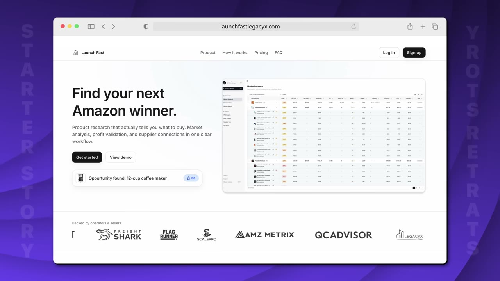
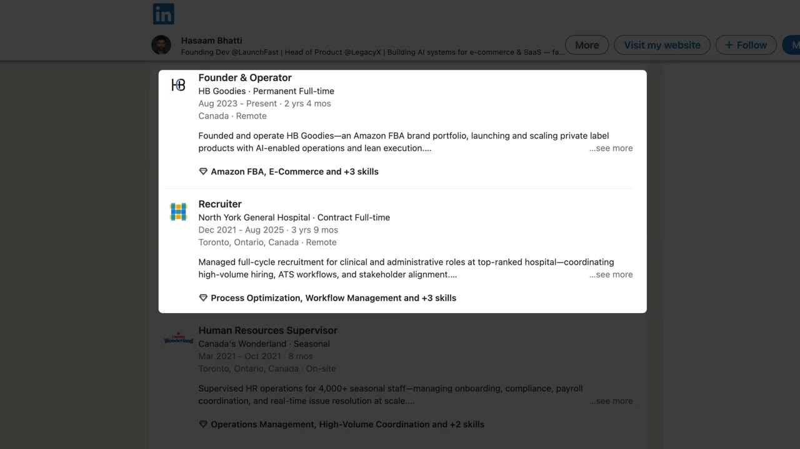
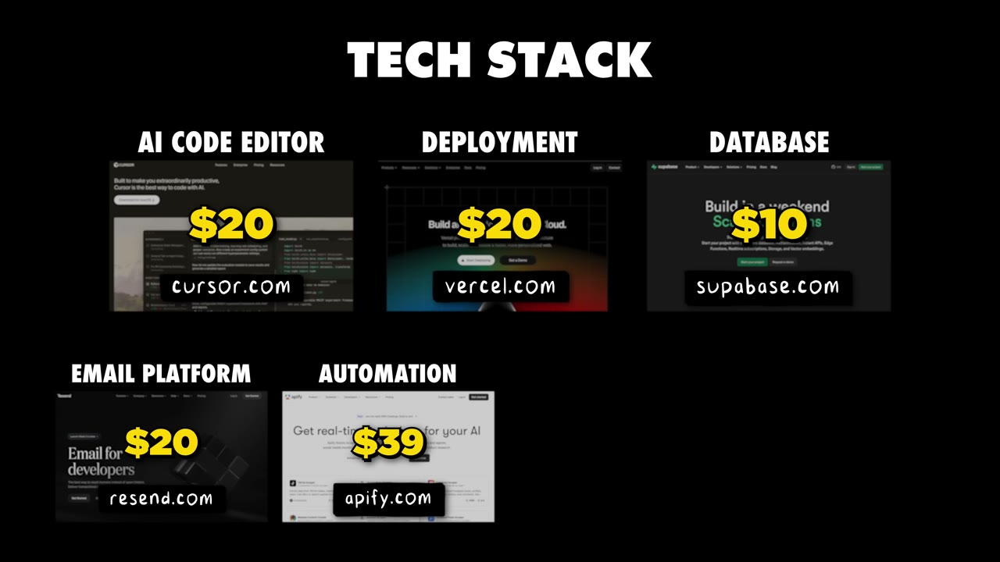

# How I built my first SaaS without an audience ($25K/month)

✅ **Đã phân tích sâu** → [`case.md`](case.md)

| | |
|---|---|
| **Video** | <https://www.youtube.com/watch?v=FCGpgPZqmkY> |
| **Đăng** | 04/01/2026 |
| **Thời lượng** | 14:58 |
| **Lượt xem** | 73,609 |
| **Lượt thích** | 1,885 |
| **Video ID** | `FCGpgPZqmkY` |

## Trong thư mục này

| File | Nội dung |
|---|---|
| [`case.md`](case.md) | **Phân tích đầy đủ** — ý tưởng, validate, GTM, áp dụng ở VN |
| [`meta.json`](meta.json) | Metadata gốc (chapters, heatmap, mô tả) |
| [`screenshots/`](screenshots/) | 10 ảnh 720p |

## Mô tả gốc

Hassam is a non-technical founder who built his app 100% with AI. Then he hacked distribution by using someone else's audience to share his work. This video breaks down his distribution strategy that helped him his $25K MRR in 90 days. 
0:00 - Intro
0:59 - Who is Hassam?
1:21 - App background
2:24 - Hassam's non-technical background
3:19 - Finding the idea
4:31 - Trading equity for distribution
6:32 - Ready to build?
7:23 - Why this project worked
8:23 - Domain knowledge playbook
11:01 - Tech stack
12:21 - Stop waiting and start building
13:22 - Pat and Gus takeaways
14:28 - Build apps with AI

## Số liệu bắt được từ transcript

> Các đoạn founder nhắc tới con số, kèm timestamp để tua thẳng tới đó trong video.

_(không bắt được con số nào)_

## Chương

- `00:00` Intro
- `00:59` Who is Hassam?
- `01:21` App background
- `02:24` Hassam's non-technical background
- `03:19` Finding the idea
- `04:31` Trading equity for distribution
- `06:32` Ready to build?
- `07:23` Why this project worked
- `08:23` Domain knowledge playbook
- `11:01` Tech stack
- `12:21` Stop waiting and start building
- `13:22` Pat and Gus takeaways
- `14:28` Build apps with AI fast

## Ảnh

1. `01_01m06s_replay.jpg` — 
2. `02_01m56s_usd-50.jpg` — 
3. `03_02m36s_ch-hassam-s-non-technical-background.jpg` — 
4. `04_03m31s_ch-finding-the-idea.jpg` — 
5. `05_04m43s_ch-trading-equity-for-distribution.jpg` — 
6. `06_06m43s_usd-20-000.jpg` — 
7. `07_07m35s_ch-why-this-project-worked.jpg` — 
8. `08_08m35s_ch-domain-knowledge-playbook.jpg` — 
9. `09_11m53s_replay.jpg` — 
10. `10_13m11s_usd-20-000-m.jpg` — 

---

← [Quay lại index](../../index.md) · [Toàn bộ video](../README.md)
