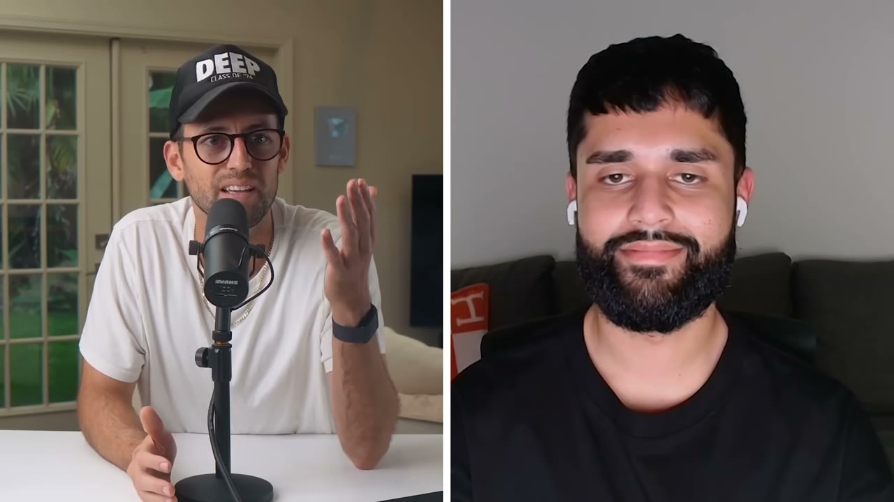
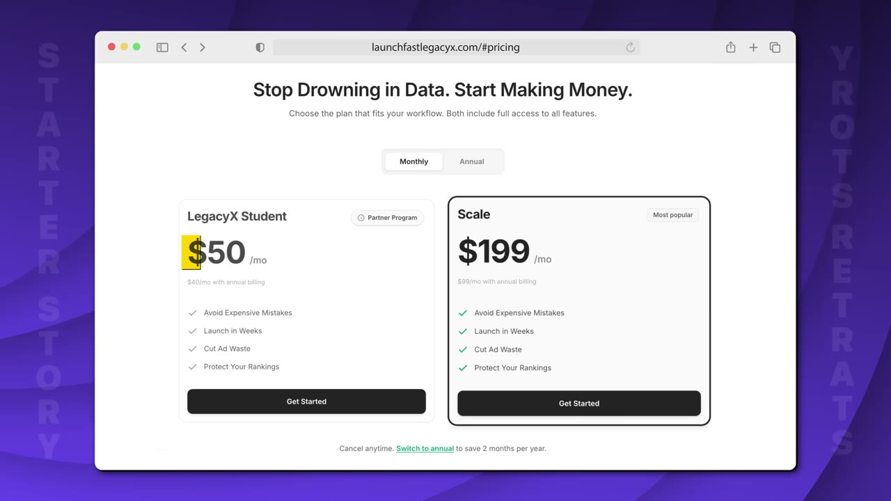
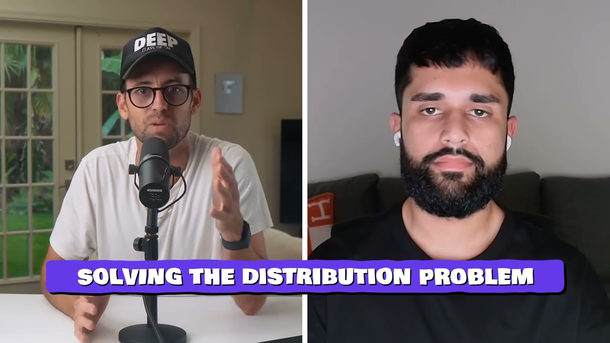
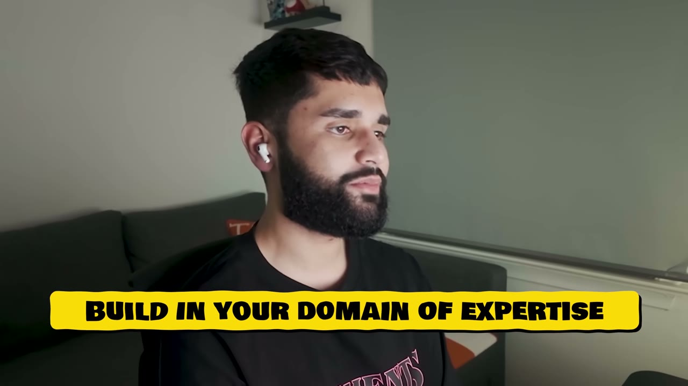
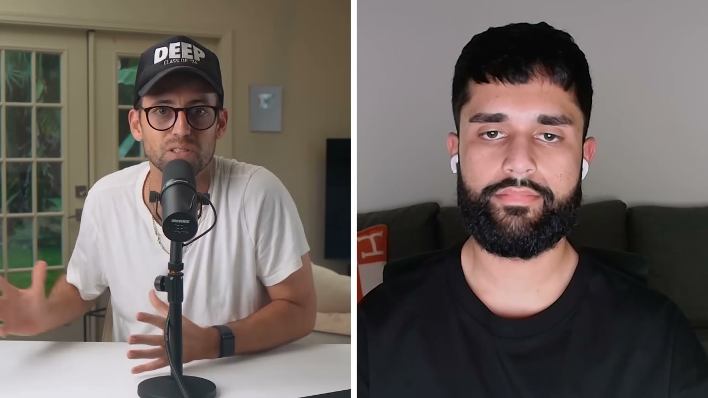

# LaunchFast — 21.8K MRR trong 90 ngày, không có một follower nào

> **Tóm tắt 30 giây:** Hassam là dân không biết code, làm việc văn phòng và bán hàng Amazon tay trái. Anh dùng Cursor build một công cụ nghiên cứu sản phẩm Amazon trong **48 giờ**, rồi thay vì đi xây audience, anh **pitch thẳng cho Legacy X — chương trình coaching mà chính anh từng bỏ tiền mua 2 năm trước** — và đổi cổ phần lấy quyền tiếp cận hàng nghìn học viên đang trả tiền. Ngày launch đã có khách. 30 ngày sau: 10K MRR. 90 ngày sau: ~21.8K MRR. Câu chốt của anh: *50% của 20K MRR vẫn hơn 50% của 0 MRR.*

## 1. Con số

| Chỉ số | Giá trị |
|---|---|
| MRR ngày 30 | $10.000 |
| MRR ngày 60 | $17.000 – $18.000 |
| MRR ngày 90 | **~$21.800** |
| Giá cho học viên Legacy X | $50/tháng |
| Giá cho khách ngoài | $199/tháng (xem ghi chú) |
| Chrome extension | 330 người dùng hoạt động |
| Thời gian build MVP | 48 giờ |
| Dự án thất bại trước đó | 10-12 |
| Cổ phần đã cho đi | ~50% (suy đoán trong video) |

**Mâu thuẫn số liệu — cần nói thẳng:**

1. **Tiêu đề video ghi $25K/tháng, mô tả ghi $25K MRR trong 90 ngày, nhưng trong phỏng vấn founder đọc rõ ràng: *now, 90 days in, we're at about 21.8K*.** Pat thì nói tròn thành "over $20,000". Tôi chọn **21.800** vì đó là con số duy nhất có mốc thời gian gắn kèm và do chính founder đọc. Chênh lệch giữa 21.8K và 25K ở tiêu đề là dấu hiệu điển hình của việc kênh làm tròn lên để tăng CTR — nên nhớ điều này khi đọc mọi tiêu đề của Starter Story.
2. **Giá công khai $1.99/tháng là lỗi ASR gần như chắc chắn.** Một công cụ B2B nghiên cứu sản phẩm Amazon bán $1.99/tháng thì không thể ra 21.8K MRR với vài trăm khách. Đối chiếu với mức $50/tháng cho học viên, con số hợp lý là **$199/tháng** cho khách ngoài. Tôi ghi rõ để bạn không lấy $1.99 làm chuẩn.
3. **Tên sản phẩm** được ASR viết lẫn lộn giữa *Launch Fast* và *Launchfast*; mô tả video không nêu tên sản phẩm. Tôi dùng **LaunchFast**. Lưu ý đừng nhầm với boilerplate cùng tên của Marc Lou — đây là sản phẩm khác hẳn.
4. **Tên founder** bị ASR đọc thành "Ham", "Assam", "Hassan". Tên đúng theo mô tả video là **Hassam** (X: @hasaamb).

## 2. Insight trung tâm — đổi cổ phần lấy phân phối ⭐⭐⭐

Đây là điểm khiến case này đáng đọc, và nó đi ngược gần như toàn bộ lời khuyên indie hacker thông thường.

**Vấn đề Hassam tự nhận diện được từ đầu:**

> *"Trong lúc tôi có ý tưởng này, tôi cũng nhận ra là mình có **zero audience**, và zero audience nghĩa là **zero distribution**. Nên kể cả khi tôi build ra công cụ tốt nhất thị trường, sẽ chẳng ai biết tới và nó chẳng có ý nghĩa gì."*

Phần lớn người trong hoàn cảnh đó chọn một trong hai đường: (a) bắt đầu post Twitter/YouTube và chờ 1-2 năm, hoặc (b) đốt tiền quảng cáo. Hassam chọn đường thứ ba: **đi tìm người ĐÃ có tệp khách đúng chuẩn ICP của mình**.

Và anh không phải đi tìm xa — **anh chính là khách hàng của họ**. Hai năm trước anh đã bỏ tiền mua chương trình coaching Legacy X, một công ty có hàng nghìn người bán Amazon đang hoạt động, tất cả đều đang đói công cụ.

**Cách anh pitch — chú ý cấu trúc, nó rất sạch:**

> *"Các anh, tôi build được cho các anh một công cụ nghiên cứu sản phẩm tốt hơn bất cứ thứ gì đang có trên thị trường. Cho tôi **48 giờ**, nếu các anh thích thứ nhìn thấy thì mình hợp tác. **Không ràng buộc gì, và các anh chẳng mất gì cả.**"*

Ba yếu tố làm pitch này khó từ chối:
- **Rủi ro của đối tác bằng 0.** Họ không bỏ tiền, không bỏ thời gian, không cam kết gì cho tới khi xem demo.
- **Deadline tự đặt cực ngắn (48 giờ).** Nó biến một lời hứa mơ hồ thành một sự kiện có ngày giờ, và tự chứng minh năng lực thực thi.
- **Anh là người trong ngành.** Anh biết nỗi đau vì chính anh từng ngồi copy-paste dữ liệu 20-30 tiếng cho mỗi sản phẩm.

Kết quả: hôm sau anh nhận cuộc gọi — *"Nghỉ việc đi. Mình làm cái này toàn thời gian."*

**Lý lẽ của anh về việc mất cổ phần:**

> *"Khi nói tới phần mềm, thay vì hy sinh những nguồn lực có thể còn giá trị hơn cổ phần — ví dụ **thời gian của tôi** — thì tôi sẵn sàng đánh đổi bất cứ ngày nào để lấy quyền tiếp cận phân phối của người khác. Kể cả ở mức 50%, tôi nói **50% của 20K MRR vẫn hơn 50% của 0 MRR**."*

**Cơ chế vì sao nó hiệu quả (phần quan trọng nhất — đừng chỉ nhớ câu quote):**

Giá trị của phân phối không tuyến tính. Với một sản phẩm B2B ngách, khoảng cách giữa "0 khách" và "100 khách đầu tiên" tốn 6-18 tháng và có xác suất thất bại rất cao. Khoảng cách giữa 100 và 1.000 khách thì dễ hơn nhiều vì đã có bằng chứng, có feedback, có case study. **Cổ phần bạn cho đi là để mua đứt đoạn khó nhất của đường cong — đoạn giết chết 90% sản phẩm.**

Nhưng cũng đúng ở chiều ngược lại: cổ phần là vĩnh viễn, còn nút thắt phân phối chỉ tồn tại một lần. Gus nói thẳng điều này trong phần takeaways:

> *"Bạn không phải bán một nửa app cho cái app tiếp theo bạn build, hay cái tiếp theo nữa. Nhưng với **cái đầu tiên**, đó là một thoả thuận khá hời. Tôi sẽ nhận nó bất cứ ngày nào trong tuần."*

## 3. Mâu thuẫn với các case khác trong kho ⭐⭐⭐

Đây là chỗ case này đáng giá nhất khi đặt cạnh những case khác.

| Cách giải bài toán phân phối | Ai làm | Cái giá | Đúng khi nào |
|---|---|---|---|
| **Cho cổ phần đổi lấy tệp khách** | Hassam (case này) | ~50% công ty, vĩnh viễn | Sản phẩm đầu tiên, không có audience, không có tiền ads, và tồn tại một tổ chức đang sở hữu đúng ICP của bạn |
| **Rev-share/affiliate với người có tệp khách** | [Ivan — Lancer](../2026-03-08_i-built-a-10k-month-saas-using-other-peoples-custome/case.md) | % doanh thu, tắt được bất cứ lúc nào | Khi bạn đủ tự tin sản phẩm giữ được khách; giữ 100% quyền sở hữu |
| **Tự xây audience trước rồi bán** | [Rob — SuperX](../2026-08-20_how-i-work-22k-month-solopreneur/case.md) | 1-2 năm và rất nhiều lần thất bại | Bạn chịu được không có thu nhập trong thời gian dài và bán cho chính cộng đồng bạn thuộc về |
| **Validate bằng nội dung trước khi code** | Alejandro và Mario — Pushscroll (case cùng đợt) | vài tuần làm video | Sản phẩm B2C có yếu tố hình ảnh, giải thích được trong 3 chữ |

**Phân định — điều kiện nào chọn cách nào:**

- Nếu tồn tại **một tổ chức duy nhất** kiểm soát phần lớn ICP của bạn (community, coaching program, agency, hiệp hội ngành) → cách của Hassam là ngắn nhất. Nhưng **hãy thử rev-share của Ivan TRƯỚC**. Ivan đạt $10K/tháng bằng cách biến các Upwork coach thành affiliate mà **không mất một đồng cổ phần nào**.
- Chỉ cho cổ phần khi đối tác phải **làm việc thật** — tích hợp sản phẩm vào chương trình đào tạo, đứng ra bảo chứng, gánh support. Nếu họ chỉ gửi một email quảng cáo thì affiliate 30% là quá đủ.
- Nếu ICP của bạn phân tán (người tiêu dùng phổ thông) thì **không có ai để bắt tay** — bắt buộc quay lại con đường nội dung/quảng cáo.

## 4. Vì sao dự án này sống trong khi 10-12 dự án trước chết ⭐⭐⭐

Hassam trước đó đã build 10-12 dự án, hầu hết chưa bao giờ lên production — anh gọi đó là *"nghĩa địa trong GitHub của tôi"*. Anh tự chẩn đoán rất chính xác:

> *"Tôi từng cố launch mấy thứ như AI video generator hay tự động hoá nộp đơn xin việc. **Tôi không thực sự biết người dùng cuối muốn gì**, hay tại sao phần mềm hiện tại không xứng với lời quảng cáo. Với thế giới Amazon, tôi đã hiểu từ A tới Z: người bán mới vấp phải vấn đề gì, họ cần dữ liệu nào."*

Nguồn gốc ý tưởng cũng thuần tuý là nỗi đau của chính anh: mỗi lần chuẩn bị tung một sản phẩm Amazon, anh mất **20-30 tiếng nghiên cứu**, copy-paste dữ liệu vào Google Sheets. Các công cụ có sẵn thì *"trông như đang giải vấn đề quan trọng trên giấy, nhưng không chạm được vào nút thắt thật"*.

> *"Tôi nhận ra mình có thứ mà **hầu hết developer không có** — kiến thức ngách về Amazon. Nên thay vì giải những vấn đề lý thuyết cho người bán, tôi build đúng công cụ tôi ước mình đã có."*

**Cơ chế:** AI đã làm phẳng lợi thế "biết code". Khi ai cũng build được trong 48 giờ, thứ khan hiếm không còn là kỹ năng kỹ thuật mà là **biết vấn đề nào đáng giải và giải sai chỗ nào**. Domain knowledge chính là thứ AI chưa sao chép được của bạn — và nó cũng là thứ khiến bạn pitch được cho đối tác phân phối, vì bạn nói cùng ngôn ngữ với khách của họ.

## 5. 48 giờ build MVP — chia giờ cụ thể ⭐⭐

Đáng chú ý ở chỗ **chỉ 8/40 giờ dành cho core feature**, còn lại là hiểu nghiệp vụ đối tác, test và làm đẹp.

| Giờ | Việc |
|---|---|
| 1-4 | Vẽ lại toàn bộ hệ thống và SOP hiện có **của Legacy X** — họ đang có dữ liệu gì, quy trình nào — rồi ghép với quy trình của chính mình để làm nền MVP |
| 5-12 | Dùng Cursor build các tính năng lõi. *Không cần hoàn hảo, chỉ cần chạy được* |
| 13-20 | Test, bắt bug, lặp |
| 21-30 | **Đánh bóng UI và branding.** *"Thứ tôi học được từ Amazon là branding là tất cả"* |
| 31-40 | Test lại, xử lý edge case |
| 41-48 | Đánh bóng lần cuối, chuẩn bị demo, **quay video demo và gửi đi** |

**Chi tiết bị bỏ qua nhưng rất quan trọng:** 4 giờ đầu tiên anh không code — anh đi map hệ thống của đối tác. Đây là lý do cái demo không phải là "một công cụ Amazon chung chung" mà là **một công cụ khớp đúng quy trình mà học viên Legacy X đã được dạy**. Đó là thứ khiến đối tác không thể từ chối, và cũng là thứ khiến sản phẩm được học viên dùng ngay.

## 6. Playbook 6 bước nếu làm lại từ đầu ⭐⭐

**Bước 1 — Xác định domain knowledge của bạn.** Viết ra 3-5 ngành hoặc lĩnh vực mà bạn hiểu sâu **và đã đích thân giải vấn đề trong đó**. Chữ "đã đích thân" là từ khoá — không phải ngành bạn quan tâm, mà ngành bạn đã đổ mồ hôi.

**Bước 2 — Tìm thị trường đã được xác thực.** Từ 3-5 domain đó, tìm ngách **đã có SaaS làm ra tiền**. Có người kiếm được tiền nghĩa là thị trường tồn tại. Công cụ anh nêu: Sensor Tower, Ahrefs (ASR đọc thành "RFS"), Google Search Console.

> *"Điểm mấu chốt là **bạn không cần một ý tưởng độc đáo**. Bạn chỉ cần thực thi tốt hơn trong một thị trường đã được chứng minh."*

**Bước 3 — Đào sâu nỗi đau người dùng.** Đi tới nơi khách hàng thật tụ tập: Reddit, Facebook group, X, các trang review. Xác định: ai là người dùng, mục tiêu tối thượng của họ là gì, và **công cụ họ đang dùng hỏng ở chỗ nào**.

**Bước 4 — Build MVP.** Chọn đúng **một tính năng có ROI cao nhất nhưng dễ triển khai nhất**. Đừng cầu toàn, chỉ cần chạy được và đưa vào tay người dùng nhanh nhất có thể.

**Bước 5 — Đừng xây audience từ số 0. Đi tìm người đã có.** Ai đang nắm quyền tiếp cận khách hàng mục tiêu của bạn? Công ty coaching? Community? Nhóm influencer? Gửi demo và đề nghị hợp tác.

> *"Liệt kê ra **5 đối tác phân phối tiềm năng** và cố liên hệ **3 người trong tuần này**."*

**Bước 6 — Sau khi launch, ship mỗi ngày.** Cam kết **ít nhất một cải tiến mỗi ngày trong 30 ngày** dựa trên feature request và bug thật từ người dùng.

Câu tổng kết của anh:

> *"Bạn không còn cần phải là kỹ sư để build phần mềm production nữa. Nếu bạn có thể dành **1.000 giờ** cho một dự án, test kỹ, và cài kiến thức chuyên ngành của bạn vào đó, bạn sẽ thành công."*

Lưu ý con số 1.000 giờ này mâu thuẫn nhẹ với câu chuyện 48 giờ — 48 giờ là để có demo, còn 1.000 giờ là để có doanh nghiệp. Đừng nhớ nhầm vế đầu và quên vế sau.

## 7. Tech stack — dành cho người không biết code

> *"Đây là tech stack mà **bất kỳ ai** cũng dùng được để đi từ ý tưởng tới MVP trong 48 giờ."*

| Hạng mục | Công cụ | Ghi chú của founder |
|---|---|---|
| Viết code | **Cursor** | gói max $200/tháng — khoản chi lớn nhất |
| Hosting | **Vercel** | deploy thẳng từ Cursor qua CLI, không cấu hình |
| Database, auth, storage | **Supabase** | thay Firebase; có Supabase MCP nên Cursor gọi trực tiếp |
| Email onboarding | **Resend** | cá nhân hoá email chào mừng |
| Thu thập dữ liệu | **Apify** | *"rất nhiều ngách phụ thuộc vào tổng hợp dữ liệu"* — đây là mảnh ghép ít người nhắc |
| Ngôn ngữ và framework | **TypeScript + Next.js** | *"stack hiện đại nhất và thân thiện với AI nhất — Cursor chạy tốt hơn hẳn với stack này"* |

> *"Cái hay của stack này là sau khi launch, chi phí gần như tối thiểu. Cursor với gói max $200 là khoản duy nhất đáng kể, và cho tới khi bạn tìm được sản phẩm thắng thì túi tiền vẫn chưa đau lắm."*

## 8. Cảnh báo thiên kiến nguồn

Case này có **mật độ quảng cáo cao bất thường**. Trong 15 phút, Pat chèn hai đoạn bán Starter Story Build (phút 6:32-7:23 và toàn bộ phần kết từ 14:28), và mô tả video đặt link khoá học ngay dòng đầu tiên. Thông điệp "ai cũng build được bằng AI" phục vụ trực tiếp cho việc bán khoá học đó.

Những gì **không** được nói ra trong video, và bạn nên tự hỏi:
- Tỷ lệ cổ phần thật là bao nhiêu? Founder tránh xác nhận. Con số 50% là do Pat và Gus đoán.
- Điều khoản hợp tác thế nào — ai sở hữu code, ai sở hữu khách hàng, có điều khoản thoát không? **Đây là phần rủi ro nhất của cả mô hình và video không đụng tới một chữ.**
- Bao nhiêu trong số 21.8K MRR đến từ khách $50 (học viên Legacy X) và bao nhiêu từ khách ngoài $199? Nếu gần như toàn bộ là khách của đối tác thì đây **không phải một SaaS**, mà là một tính năng của Legacy X có chia doanh thu — và giá trị doanh nghiệp thấp hơn hẳn.
- Chênh 25K ở tiêu đề so với 21.8K trong phỏng vấn.

Cũng lưu ý: sản phẩm mới 90 ngày tuổi. **Chưa có dữ liệu retention, chưa có churn.** Với B2B tool bán qua coaching program, làn sóng khách đầu tiên luôn dễ; câu hỏi thật là tháng thứ 6 còn bao nhiêu người trả tiền.

## 9. Áp dụng cho tôi (indie hacker VN)

### Sao chép được gì

**Mô hình này hợp với người Việt hơn nhiều so với các case xây audience tiếng Anh** — vì nó không đòi hỏi bạn viết hay, nói hay, hay lên hình.

Cách bắt đầu cụ thể trong tuần này:

1. **Liệt kê 3-5 domain bạn đã đích thân đổ mồ hôi.** Không phải sở thích — là công việc bạn từng làm, ngành bạn từng bán hàng, quy trình bạn từng vận hành. Ví dụ ở VN: vận hành shop Shopee/TikTok Shop, tuyển dụng, phòng khám, môi giới bất động sản, xuất nhập khẩu, kế toán thuế, dạy IELTS.
2. **Với mỗi domain, tìm tổ chức đang nắm ICP.** Ở VN đây là phần dễ bất ngờ: các khoá học online, group Facebook chục nghìn thành viên có admin bán khoá học, agency, hiệp hội ngành, các KOL chuyên ngành. Mỗi cái là một Legacy X tiềm năng.
3. **Chọn 5 cái, gửi 3 lời đề nghị trong tuần.** Copy đúng cấu trúc pitch của Hassam: *tôi build cho anh X, cho tôi 48-72 giờ, anh không mất gì, thích thì mình hợp tác.*
4. **Trước khi code, dành 4 giờ hiểu quy trình hiện tại của họ.** Đây là bước ai cũng bỏ qua và là lý do chính khiến demo bị từ chối.
5. **Đàm phán rev-share trước, cổ phần sau.** Bắt đầu ở 20-30% doanh thu. Chỉ nâng lên cổ phần khi họ đòi và khi họ phải gánh support/đào tạo.

### Rào cản thật

- **Cổ phần là vĩnh viễn, và bạn đang ký lúc yếu nhất.** Bạn có 0 doanh thu, họ có 1.000 khách — đó là vị thế đàm phán tệ nhất có thể. Ở VN gần như không ai làm hợp đồng cổ phần tử tế cho một công ty phần mềm 2 người: không có vesting, không có điều khoản thoát, không có định giá. **Rủi ro thật không phải mất 50% mà là 18 tháng sau bạn muốn ra đi và không có cơ chế nào để ra.** Nếu định làm, hãy chi tiền cho luật sư — đây đúng là chỗ mà lời khuyên *"trả thêm $200 cho lời khuyên có thể mang lại ROI khổng lồ"* trong case Pushscroll áp dụng được.
- **Rủi ro tập trung khách hàng ở mức cực đại.** Toàn bộ doanh thu đến từ một đối tác. Họ đổi ý, họ tự build, họ đóng cửa — bạn về 0 trong một tháng. Đây còn tệ hơn rủi ro nền tảng của [FollowBuddy với Instagram](../2026-03-19_i-make-17k-month-with-one-strategy/case.md), vì ít nhất Instagram không có động cơ giết riêng bạn.
- **ARPU $50-199/tháng không tồn tại ở thị trường VN.** Người bán Shopee VN không trả $199/tháng cho công cụ nghiên cứu sản phẩm; mức chấp nhận thực tế là 200-500K VNĐ/tháng và tỷ lệ churn cao hơn nhiều. Nếu làm mô hình này ở VN, hãy tính bài toán với ARPU khoảng 1/5 tới 1/10 — nghĩa là bạn cần nhiều khách hơn, hoặc phải nhắm khách quốc tế ngay từ đầu.
- **Rào cản tiếng Anh nếu nhắm quốc tế.** Pitch cho một coaching company Mỹ đòi hỏi bạn viết được email thuyết phục và gọi video được. Nhưng đây là rào cản **nhỏ hơn nhiều** so với việc phải làm content tiếng Anh đều đặn hàng ngày — bạn chỉ cần thắng vài cuộc hội thoại, không phải thắng thuật toán.
- **Chi phí Cursor $200/tháng là thật.** Cộng thêm Apify, Vercel, Supabase khi có tải, con số vận hành thực tế khoảng $250-400/tháng trước khi có đồng doanh thu đầu tiên. Không lớn với người Mỹ, nhưng là 6-10 triệu VNĐ/tháng.

### Khi nào KHÔNG dùng mô hình này

- **Khi bạn đã có audience.** Nếu bạn đã có 5.000 follower đúng ngách hoặc một danh sách email hoạt động, việc cho đi 50% cổ phần là lãng phí. Hãy làm như [Rob với SuperX](../2026-08-20_how-i-work-22k-month-solopreneur/case.md) — bán thẳng cho người đang theo dõi bạn.
- **Khi ICP của bạn phân tán.** App tiêu dùng phổ thông không có "một tổ chức nắm khách". Không có ai để bắt tay — hãy đi đường nội dung như Pushscroll.
- **Khi bạn định build nhiều sản phẩm.** Gus nói đúng: cho cổ phần chỉ hợp lý cho **sản phẩm đầu tiên**, khi giá trị lớn nhất bạn nhận được là bằng chứng rằng mình làm được. Từ sản phẩm thứ hai trở đi, bạn đã có case study, có audience nhỏ, có kỹ năng — hãy giữ 100%.
- **Khi đối tác chỉ đóng góp một email blast.** Đó là affiliate, không phải cổ đông. Đừng nhầm hai thứ.

## Nguồn

- Video: <https://www.youtube.com/watch?v=FCGpgPZqmkY> (14:58, đăng 04/01/2026, 73.609 view, 1.885 like)
- [Transcript đầy đủ](transcript.md) · [Ảnh chụp](screenshots/)
