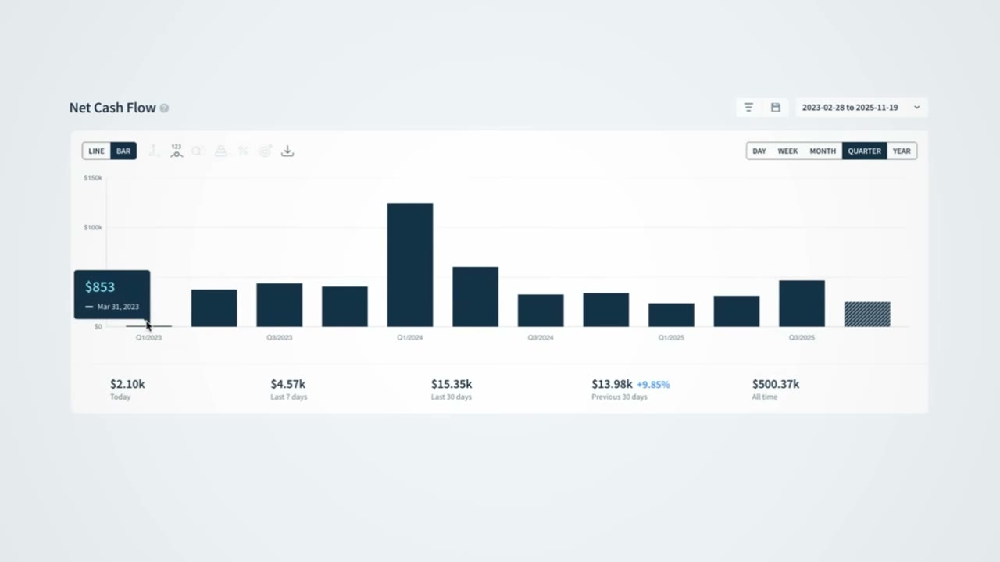
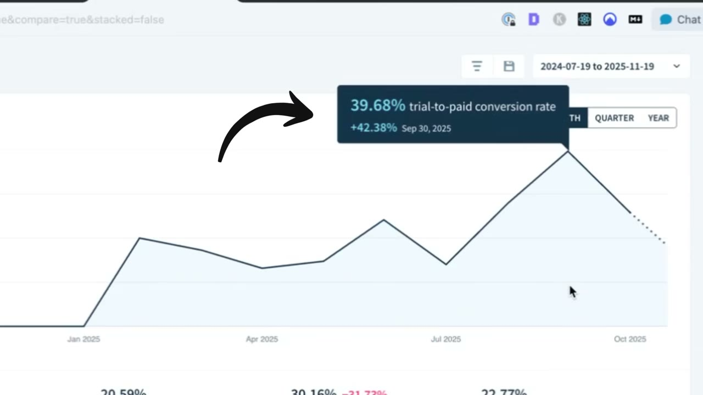
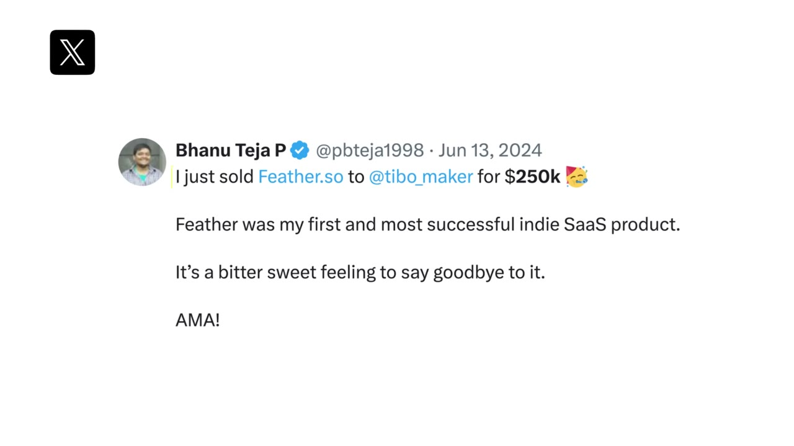
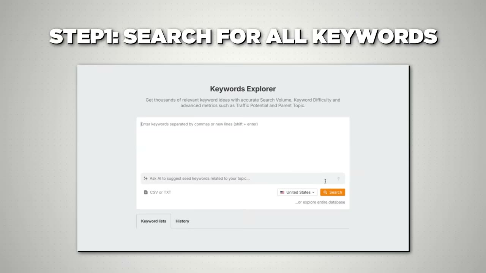

# SiteGPT — $13K MRR, gần 1 triệu lượt truy cập, $0 tiền marketing

> **Tóm tắt 30 giây:** Bhanu là kỹ sư Ấn Độ, bỏ việc sau 8 tháng, dọn về nhà bố mẹ **để không có chi phí sinh hoạt**. Anh nói thẳng: *"Tôi là builder, tôi không phải marketer."* Nên thay vì học marketing, anh **biến việc build thành marketing**: xây gần **50 công cụ miễn phí nhỏ**, mỗi cái nhắm một từ khoá có **keyword difficulty dưới 10** và **volume trên 1.000/tháng**. Kết quả: **50.000 click Google mỗi tháng, 90% đến từ đám công cụ miễn phí đó**, $0 quảng cáo. Với AI, mỗi công cụ mới giờ mất **dưới 5 phút** — anh chỉ cần bảo Cursor *"nhìn mấy tool này, làm cái tương tự cho từ khoá này"*. Nhưng phần video không nói mới là phần đáng đọc nhất: SiteGPT đạt **$10K MRR ngay tháng đầu tiên năm 2023** và ba năm sau mới ở **$13K**.



## ⚠️ Cảnh báo trước khi đọc

Video có **một đoạn quảng cáo dài** cho Starter Story Build kèm mã giảm giá mang tên chính founder (BHANU), một link affiliate HubSpot, và một lần chốt bán nữa ở cuối cho bootcamp "4x4". Kênh chỉ phỏng vấn người thành công. Ngoài ra, **video không hỏi một câu nào về churn hay về việc MRR gần như đứng yên suốt 3 năm** — tôi sẽ tự làm phần đó ở mục 6.

## 1. Con số và phễu

| Chỉ số | Giá trị |
|---|---|
| MRR | **$13.000** |
| Tổng doanh thu tích luỹ | **~$500.000** (từ 3/2023) |
| Lượt truy cập tích luỹ | gần **1 triệu** |
| Truy cập/tháng | ~**50.000** |
| Click Google/tháng | ~**50.000** — **90% nhờ free tools** |
| Tỉ trọng Google | 60-70% tổng traffic |
| Chi quảng cáo | **$0** |
| Khách hàng | **130 doanh nghiệp** |
| ARPU | ~**$100/tháng** |
| LTV | **$1.700-1.800** |
| Số free tool đã xây | gần **50** |
| Thời gian xây 1 tool mới | **dưới 5 phút** |
| Exit trước đó | **Feather**, bán $250.000 ở mức 5-6K MRR |

Phễu đầy đủ, theo lời founder:

```
50.000 visitor/tháng
      ↓  0,4%
   200 lead
      ↓  30%
   60 trial
      ↓  25-40%
15-24 khách mới/tháng
      ↓
130 khách × $100 = $13.000 MRR
```

*(Anh nói "200 lead" ở phút 2:50 rồi "300 lead" ở phút 6:12. Tôi dùng 200 vì nó nằm trong đoạn anh trình bày phễu liền mạch có kèm con số trial.)*



## 2. Bối cảnh — bỏ việc, về nhà bố mẹ, và một exit $250K ⭐⭐

1. Kỹ sư phần mềm, vào một startup rất lớn ngay sau đại học. **Tám tháng sau** anh thấy *"đây không phải thứ tôi muốn làm cả đời"*.
2. Nghỉ việc để tự xây. **Dọn về nhà bố mẹ để không có chi phí nào cả.**
3. Một sản phẩm cất cánh: **Feather** — công cụ viết blog, lên **$5.000-6.000 MRR**.
4. Tháng 1-2/2023, anh thấy feed Twitter đầy công cụ AI mới. *"Tôi cảm thấy mình đang bỏ lỡ."* Cách học của anh là **xây thứ gì đó bằng nó**.
5. Anh tự hỏi: *"Tôi có 100 khách hàng Feather. Tôi xây được gì cho họ?"* Ai cũng có blog → **chatbot trả lời mọi thứ trong blog của họ**.
6. Đang xây thì anh nhận ra: *"Sao lại giới hạn cái này cho 100 người của Feather?"* → tách ra thành sản phẩm riêng.
7. **Hai tuần từ ý tưởng tới launch.** Đạt **$10.000 MRR trong tháng đầu tiên.**
8. SiteGPT hút hết thời gian của anh. Nên anh **bán Feather $250.000** cho người có khả năng làm nó tốt hơn, rồi dồn toàn lực cho SiteGPT.

> **Ba bài học tách rời nhau trong đoạn này, đừng gộp:**
>
> **(a) Anh có 100 khách hàng TRƯỚC khi có ý tưởng.** Đây là lý do SiteGPT đạt $10K MRR trong 30 ngày — con số mà 99% sản phẩm không bao giờ chạm tới. Nếu bạn đang ở con số 0 khách, đừng lấy tốc độ này làm kỳ vọng.
>
> **(b) Bội số exit của Feather là dữ liệu hiếm và đáng ghi.** $250.000 trên khoảng $66.000 ARR ≈ **3,8x ARR**. Đây là mốc thực tế cho micro-SaaS solo — không phải 10x như báo chí startup hay nói. Nếu bạn định xây để bán, hãy dùng con số này khi tính.
>
> **(c) Anh bán sản phẩm ĐANG SỐNG để tập trung.** Rất nhiều indie hacker giữ 5 sản phẩm thoi thóp. Bhanu cắt cái đang có doanh thu ổn định vì cái mới lớn nhanh gấp đôi. Đây là quyết định khó và đúng.



## 3. Sản phẩm và mô hình

SiteGPT = *"GPT for your site"*.

> *"Nó giống như cho website của bạn một bộ não nhỏ. Bạn có một trợ lý AI 24/7 trả lời mọi thứ về nội dung doanh nghiệp của bạn."*

Cách dùng: vào web, tạo chatbot, gắn lên site của bạn. Trả phí tháng theo **số chatbot cần dùng**, **lượng nội dung**, và **số tin nhắn dự kiến mỗi tháng**.

Ba trục định giá này (seats-equivalent, content, usage) là lý do ARPU đạt **$100/tháng** — cao hơn nhiều so với micro-SaaS B2C. Đây cũng là lý do LTV lên **$1.700-1.800**: chatbot đã gắn vào website và đã được huấn luyện bằng nội dung của khách thì **chi phí chuyển đổi sang đối thủ rất cao**.

## 4. Free tools marketing — cơ chế thật ⭐⭐⭐

> *"Cách tôi có toàn bộ traffic này là qua thứ gọi là **free tools marketing**. Tôi xây hàng chục công cụ miễn phí — tổng cộng gần 50 cái."*

Ví dụ anh mở ra trong video:
- Upload PDF → nhận về Markdown.
- **Chatbot name generator** — nhập thông tin về chatbot của bạn, nó đặt tên.

Tiêu chí duy nhất anh đặt ra:

> *"Tôi phải liên hệ được nó với sản phẩm chính bằng cách nào đó. **Người dùng công cụ này phải là khách hàng tiềm năng của SiteGPT.**"*

**Cơ chế — vì sao chiến lược này chạy được:**

1. **Nó xếp hạng ở nơi bài blog không xếp hạng được.** Từ khoá kiểu *"chatbot name generator"* có **intent công cụ**, không phải intent đọc. Google trả về công cụ, không trả về bài viết. Một trang có công cụ thật gần như luôn thắng một bài blog về cùng từ khoá.
2. **Nó chọn đúng phân khúc từ khoá mà không ai thèm cạnh tranh.** Bhanu lọc **KD dưới 10** — mức mà *"bất kỳ website tử tế nào cũng lên hạng được"*. Các công ty lớn không làm vì volume quá nhỏ để đáng công một team. Một người dùng AI thì volume đó lại rất đáng.
3. **Chi phí biên gần bằng 0 và giảm dần.** Cái tool thứ nhất tốn thời gian. Cái thứ 50 tốn **5 phút**, vì đã có 49 cái làm mẫu cho AI. Đây là **tài sản cộng dồn**: mỗi tool là một cửa vào vĩnh viễn, không tắt khi bạn ngừng chi tiền như quảng cáo.
4. **Nó dùng đúng kỹ năng bạn đã có.** Đây là luận điểm cảm xúc của cả video, và Pat Walls nói rất thẳng:
   > *"Tôi ghét sales, marketing, cold email, viết content. Đây đều là những thứ mà kỹ sư và builder không thích làm. Và làm thứ bạn thích làm thì tốt hơn nhiều."*

**Vì sao AI làm chiến lược cũ này sống lại:**

> *"Nếu tôi muốn tạo một tool mới, nó mất **chưa tới 5 phút**, vì tôi đã có sẵn tất cả các tool kia. Tôi chỉ cần bảo Cursor: 'nhìn mấy free tool này, giờ làm một cái mới theo cách tương tự. Đây là từ khoá của nó' — và nó build ra trong dưới 5 phút."*

Pat xác nhận từ trải nghiệm riêng: *"Vài năm trước tôi làm rất nhiều free tools marketing cho Starter Story và nó khá cực trước thời AI."*

> **Đây chính là loại chiến lược mà AI dịch chuyển ranh giới:** trước đây free tools marketing chỉ khả thi với công ty có team engineer rảnh. Giờ nó khả thi với một người. Nhưng cũng vì thế, **cửa sổ này sẽ hẹp lại** — khi ai cũng sinh tool bằng AI, KD dưới 10 sẽ không còn nhiều, và Google nhiều khả năng sẽ siết chất lượng như đã từng làm với nội dung sinh hàng loạt. Ai làm sớm giữ được tài sản; ai làm muộn cạnh tranh với chính công cụ mình đang dùng.

## 5. Playbook 7 bước tìm từ khoá để xây tool ⭐⭐⭐

Đây là phần hành động được nhất của cả video. Công cụ dùng là **Ahrefs → Keywords Explorer**.

**Bước 1 — Để ô từ khoá TRỐNG rồi bấm search.**
> *"Đây là mẹo tôi thấy ai đó chia sẻ trên Twitter. Nó đặc biệt hữu ích khi tôi không biết chính xác người ta gõ từ khoá nào để tìm thứ đó."*

Thay vì đoán từ khoá rồi tìm, anh **lấy toàn bộ vũ trụ từ khoá rồi lọc dần**. Khác biệt tư duy quan trọng: bạn không bị giới hạn bởi trí tưởng tượng của chính mình.

**Bước 2 — Lọc bằng từ phải chứa (include).**
Anh làm AI SaaS nên include **"AI"**. Muốn tool dạng generator thì include thêm **"generator"** → ra toàn bộ từ khoá dạng *AI ... generator*.
Anh gợi ý thử thêm nhiều biến thể: **AI builder**, **AI creator**.

**Bước 3 — Lọc Keyword Difficulty dưới 10.**
> *"AI image generator có KD 87 — rất khó lên hạng."* Đặt filter **KD < 10**.
> *"Bất kỳ website tử tế nào cũng lên hạng được cho những từ khoá này."*

**Bước 4 — Lọc volume tối thiểu 1.000/tháng.**
> *"Ý tưởng chính của engineering as marketing là kéo traffic về website và hy vọng chuyển một phần thành khách hàng."* Nên phải có volume thật.

**Bước 5 — Liệt kê vào Notion.** Mỗi từ khoá kèm **global search volume** và **keyword difficulty**.

**Bước 6 — Thiết kế CTA TRƯỚC KHI xây tool.**
Đây là bước hay bị bỏ và là bước quyết định tool có mang lại khách hay không.

> *"Nếu sản phẩm của tôi là chat với PDF, tôi sẽ viết đại loại: 'Bạn vừa thử chat với một file PDF. **Sẽ thế nào nếu bạn tạo được một chatbot với toàn bộ nội dung doanh nghiệp của bạn?** Nếu muốn làm vậy, thử SiteGPT.'"*

Cấu trúc CTA đó rất đáng mổ xẻ: **xác nhận việc họ vừa làm → mở rộng nó thành phiên bản lớn hơn → mời dùng sản phẩm chính**. Nó không phải quảng cáo chen ngang; nó là **bước tiếp theo tự nhiên** của việc người dùng vừa làm xong.

**Bước 7 — Lập bảng ưu tiên.**
Cột: **từ khoá | volume | KD | công sức build | mức liên quan tới sản phẩm chính**. Rồi ưu tiên cái nào **volume cao, KD thấp, dễ build, liên quan cao**.



## 6. Phần video KHÔNG nói — và đây là phần quan trọng nhất ⭐⭐⭐

Ghép hai câu founder nói cách nhau ba phút:

- Phút 4:55: *"SiteGPT lên khoảng **$10.000 MRR ngay trong tháng đầu tiên**."* (tháng 3-4/2023)
- Phút 1:17: *"tôi đưa SiteGPT lên **$13.000 MRR**."* (tháng 1/2026)

**Gần ba năm, MRR tăng 30%.**

Giờ ghép với phễu anh vừa đưa: **15-24 khách mới mỗi tháng**, nhưng tổng khách vẫn là **130**. Nếu mỗi tháng thêm 15-24 khách mà tổng không đổi, nghĩa là **churn đang nuốt gần đúng bằng số khách mới**.

Con số này còn không khớp với chính LTV anh nêu: LTV $1.750 chia ARPU $100 = **vòng đời khoảng 17,5 tháng**, tức churn khoảng **5,7%/tháng**, tức mất khoảng **7,4 khách/tháng** trên nền 130. Với 15-24 khách mới, lẽ ra khách ròng phải tăng 8-16 mỗi tháng — tức **gấp đôi sau một năm**. Ba năm qua điều đó không xảy ra.

**Nghĩa là ít nhất một trong ba điều sau đúng:**
1. Tỉ lệ trial → paid thực tế thấp hơn nhiều so với "25-40%" anh nêu.
2. Churn thực tế cao hơn nhiều so với LTV ngụ ý.
3. Số 130 khách hoặc số lead là con số ở một thời điểm khác, không đồng bộ với nhau.

Tôi không kết luận anh nói sai — các con số này thường được đọc từ trí nhớ trong lúc quay. Nhưng **nếu bạn định copy chiến lược này, đây là câu hỏi bạn phải trả lời trước.**

**Và điểm quan trọng thứ hai — tỉ lệ 0,4%.**

50.000 visitor chỉ ra 200 lead. **Free tools traffic là traffic INTENT THẤP.** Người gõ *"chatbot name generator"* muốn một cái tên chatbot miễn phí, không muốn mua phần mềm chatbot $100/tháng.

Đối chiếu với [FollowBuddy](../2026-03-19_i-make-17k-month-with-one-strategy/case.md) trong cùng kho: Ben nhắm **từ khoá có ý định mua** (*"best Instagram unfollower tracker"*) và chuyển đổi tốt hơn nhiều lần trên mỗi lượt xem.

| | SiteGPT (Bhanu) | FollowBuddy (Ben) |
|---|---|---|
| Loại từ khoá | **intent sử dụng công cụ miễn phí** | **intent mua** |
| Kênh | Google, free tools | YouTube search |
| Chuyển đổi | rất thấp (~0,4% ra lead) | cao |
| Chi phí tạo mỗi đơn vị nội dung | **5 phút** | 20 phút quay video |
| Có cần lên hình không | **không** | có |
| Lợi thế thật | **khối lượng và tính cộng dồn** | **chất lượng traffic** |

**Hoà giải:** hai chiến lược không mâu thuẫn, chúng ở hai đầu của cùng một đánh đổi. Bhanu chấp nhận **traffic rác nhưng miễn phí và vô hạn**; Ben chấp nhận **traffic ít nhưng đúng người**. Nếu bạn ghét lên hình và thích viết code — chọn Bhanu. Nếu bạn chịu được camera và cần khách trong 90 ngày — chọn Ben. **Tốt nhất là làm Ben trước để có doanh thu, rồi làm Bhanu để có tài sản.**

## 7. Tech stack

| Việc | Công cụ |
|---|---|
| Code với AI | **Claude Code** (phụ đề đọc thành "Cloud Code"), **Cursor** cho việc nhân bản free tools |
| SEO và nghiên cứu từ khoá | **Ahrefs** |
| Hỗ trợ khách trên website | **SiteGPT** (tự dùng sản phẩm của mình) |
| Đặt lịch gọi khách | **cal.com** |
| Analytics | **DataFast** (phụ đề đọc thành "Data For") và **PostHog** |
| Ghi âm và tóm tắt cuộc gọi khách | **Sybill AI** (phụ đề đọc thành "Sibyl AI") |
| Gửi email | **Bento** |
| Viết bài blog | **Feather** — chính sản phẩm cũ anh đã bán |
| Feature request và bug report | **Featurebase** |
| Tài liệu | **Mintlify** |
| Subscription analytics | **ChartMogul** |


Điểm đáng chú ý: **anh vẫn dùng Feather sau khi bán nó.** Và anh dùng SiteGPT cho chính website SiteGPT — dogfooding là cách rẻ nhất để phát hiện lỗi của sản phẩm B2B.

## 8. Lời khuyên cuối của founder

> *"Tôi sẽ không dành hàng tháng trời để ra mắt một thứ gì đó. Tôi sẽ nói: **cứ launch với đúng tính năng lõi**, rồi để phản hồi của người dùng dẫn đường cho bạn biết sản phẩm nên đi tiếp thế nào. Hướng nào cho sản phẩm — hãy để phản hồi người dùng nói."*

Điều này khớp với hành động của anh: SiteGPT đi từ ý tưởng tới launch trong **2 tuần**, và chỉ với một tính năng.

Nó cũng khớp với [Once](../2026-05-10_i-built-a-20k-month-app-in-83-days/case.md) và [Algrow](../2026-01-14_i-built-a-14k-month-saas-using-discord/case.md) trong kho — cả ba đều ship dưới 2 tuần. **Điều kiện phân định vẫn là chi phí build:** dưới 2 tuần thì ship rồi học, trên một tháng thì validate trước.

## 9. Áp dụng cho tôi (indie hacker VN)

### Sao chép được gì

**Đây là case có tỉ lệ (giá trị / rào cản) cao nhất trong nhóm ba case tôi viết đợt này.** Lý do:

- **Không cần lên hình, không cần nói tiếng Anh, không cần quay video, không cần tiền quảng cáo.** Với người Việt ngại giao tiếp bằng tiếng Anh, đây là kênh phân phối gần như duy nhất mà rào cản ngôn ngữ có thể xử lý được — bạn chỉ cần viết đúng vài chục chữ trên một trang tool.
- **Bộ lọc Ahrefs 4 bước dùng được ngay tối nay.** Ahrefs có gói rẻ và có bản trial; Ubersuggest hoặc Keywords Everywhere cũng lọc được KD và volume nếu bạn chưa muốn trả tiền Ahrefs.
- **Nguyên tắc chọn tool: người dùng tool miễn phí phải là khách tiềm năng của sản phẩm chính.** Nếu bỏ nguyên tắc này, bạn chỉ đang xây một trang traffic rác không bán được gì.
- **Bước 6 (thiết kế CTA trước khi build)** là bước rẻ nhất và có ROI cao nhất. Làm ngay cả khi bạn chỉ xây một tool.
- **Chiến lược này áp dụng được cho từ khoá TIẾNG VIỆT** — nơi KD gần như luôn dưới 10 và gần như không ai làm free tools. Ví dụ ngách thật: công cụ tính lãi vay, tra cứu mã số thuế, đổi số sang chữ, tính thuế TNCN, tạo QR VietQR, chuyển đổi file. Volume tiếng Việt cho các từ khoá này rất lớn.
- **Mô hình dogfood + bán tool cũ** — Bhanu bán Feather $250K ở 5-6K MRR. Nếu bạn đang có một micro-SaaS $3-5K MRR mà không còn hứng, **3,8x ARR là mốc để đàm phán**.

### Rào cản thật

- **Tỉ lệ chuyển đổi 0,4% nghĩa là bạn cần RẤT nhiều traffic.** Để có 15-24 khách mới/tháng, Bhanu cần 50.000 visitor. Nếu ARPU của bạn là $10 thay vì $100, bạn cần **10 lần lượng traffic đó** để ra cùng doanh thu — tức 500.000 visitor/tháng. **Kết luận thẳng: free tools marketing chỉ hoạt động khi ARPU cao.** Nó phù hợp với B2B, không phù hợp với app B2C giá $5/tháng.
- **Đây là kênh có độ trễ dài.** Google mất 3-6 tháng để xếp hạng một trang mới trên domain chưa có uy tín. Bhanu bắt đầu từ 2023 và tài sản của anh là **gần 1 triệu lượt truy cập tích luỹ**, không phải một cú hit. Nếu bạn cần doanh thu trong 90 ngày, đây **không phải** kênh của bạn — hãy nhìn con đường ads của [Prayer Lock](../2026-01-18_i-built-a-20k-month-mobile-app-heres-my-entire-playb/case.md) hoặc cộng đồng của [Algrow](../2026-01-14_i-built-a-14k-month-saas-using-discord/case.md).
- **Chi phí công cụ SEO bằng USD.** Ahrefs gói thấp nhất khoảng $99-129/tháng. Với thu nhập VN, đây là khoản thật. Cách đi vòng: dùng bản trial để làm **một đợt research lớn duy nhất**, xuất ra 200 từ khoá vào Notion, rồi huỷ. Bạn không cần Ahrefs hằng tháng để build tool.
- **Bạn đang cạnh tranh trong tiếng Anh với người bản xứ nếu nhắm thị trường Mỹ.** Nội dung trang tool ít chữ nên rào cản thấp hơn viết blog — nhưng đừng đánh giá thấp phần landing page và email onboarding.
- **Rủi ro nền tảng là Google.** Toàn bộ 60-70% traffic đến từ một công ty. Google đã nhiều lần hạ hàng loạt trang mỏng và trang sinh bằng AI. Một bản cập nhật thuật toán có thể xoá nửa doanh thu trong một đêm. Đây là rủi ro cùng loại với [AngelMatch + InvestorHunt](../2026-08-23_i-make-32k-month-from-3-simple-boring-websites/case.md).
- **Và rủi ro mới hơn: AI answer engine.** Khi người dùng hỏi ChatGPT/Gemini thay vì gõ Google, nhu cầu vào một trang "chatbot name generator" giảm mạnh — vì AI làm luôn việc đó trong khung chat. **Free tools marketing đang bị chính công nghệ tạo ra nó ăn mòn.** Video không đề cập điều này, nhưng đây là rủi ro lớn nhất với mô hình trong 24 tháng tới.
- **MRR đứng yên ba năm là cảnh báo thật.** Free tools marketing giỏi mang **traffic** về, nhưng nó không tự giải bài toán **giữ chân khách**. Nếu bạn copy chiến lược này mà bỏ qua churn, bạn sẽ đổ công sức vào một cái xô thủng — chỉ là cái xô miễn phí.

### Khi nào KHÔNG dùng mô hình này

- **Khi ARPU dưới $30/tháng.** Toán không ra. Phễu 0,4% cần giá trị mỗi khách đủ lớn để bù.
- **Khi bạn cần doanh thu trong 3 tháng.** SEO không có núm vặn tốc độ.
- **Khi sản phẩm giải một vấn đề người ta chưa biết mình có.** Không ai gõ tìm thứ họ chưa biết là vấn đề — cùng giới hạn mà [FollowBuddy](../2026-03-19_i-make-17k-month-with-one-strategy/case.md) đã chỉ ra với thang nhận thức.
- **Khi bạn KHÔNG biết code.** Đây là chiến lược đổi kỹ năng build lấy phân phối. Nếu bạn không build được, bạn không có gì để đổi — hãy dùng cách của [Algrow](../2026-01-14_i-built-a-14k-month-saas-using-discord/case.md) (cộng đồng) hoặc [BulkMockup](../2026-02-11_how-i-built-a-12k-month-micro-saas/case.md) (nội dung giải nỗi đau).
- **Khi bạn định xây tool không liên quan tới sản phẩm chỉ để có traffic.** Đó là cách nhanh nhất để có 100.000 visitor và 0 khách hàng.

## Nguồn

- Video: <https://www.youtube.com/watch?v=Adl5_lJfkEE> (14:55, đăng 07/01/2026, 252.461 view)
- Sản phẩm: <https://sitegpt.ai/> · Founder: <https://x.com/pbteja1998>
- [Transcript đầy đủ](transcript.md) · [Ảnh chụp](screenshots/)
