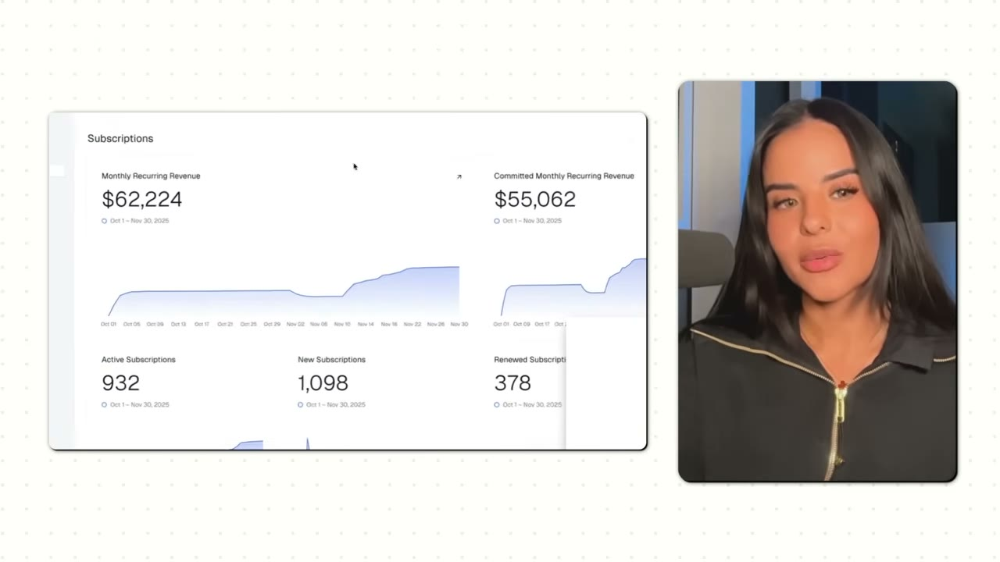
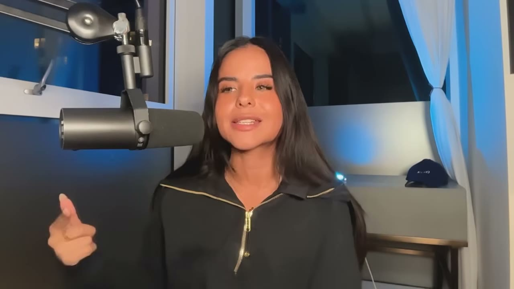
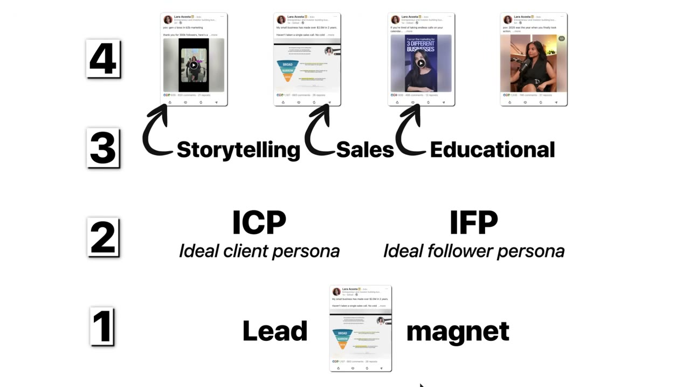
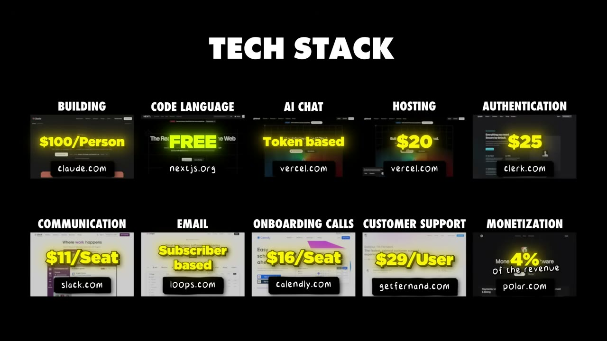

# How My App Hit $60K/Month in 2 Months

✅ **Đã phân tích sâu** → [`case.md`](case.md)

| | |
|---|---|
| **Video** | <https://www.youtube.com/watch?v=XifgHi9R5Rc> |
| **Đăng** | 11/01/2026 |
| **Thời lượng** | 19:51 |
| **Lượt xem** | 113,749 |
| **Lượt thích** | 3,148 |
| **Video ID** | `XifgHi9R5Rc` |

## Trong thư mục này

| File | Nội dung |
|---|---|
| [`case.md`](case.md) | **Phân tích đầy đủ** — ý tưởng, validate, GTM, áp dụng ở VN |
| [`meta.json`](meta.json) | Metadata gốc (chapters, heatmap, mô tả) |
| [`screenshots/`](screenshots/) | 4 ảnh 720p |

## Mô tả gốc

Lara just launched an AI writing tool for LinkedIn. They made $30K in 4 days, and went from $0 to $60K/month in less than 2 months. The secret? The Kleo Launch Playbook. This video breaks down exactly how they built up hype for their app, launched to a private beta, and hit $30K MRR in just a few days.
This video is an educational case study of this founder’s experience. It is not financial advice and does not guarantee any income or results. Every business is different and your results may vary.

## Số liệu bắt được từ transcript

> Các đoạn founder nhắc tới con số, kèm timestamp để tua thẳng tới đó trong video.

_(không bắt được con số nào)_

## Chương

_(không có chapter)_

## Ảnh

1. `01_01m56s_metric.jpg` — 
2. `02_06m08s_usd-30-000.jpg` — 
3. `03_11m46s_replay.jpg` — 
4. `04_16m20s_replay.jpg` — 

---

← [Quay lại index](../../index.md) · [Toàn bộ video](../README.md)
