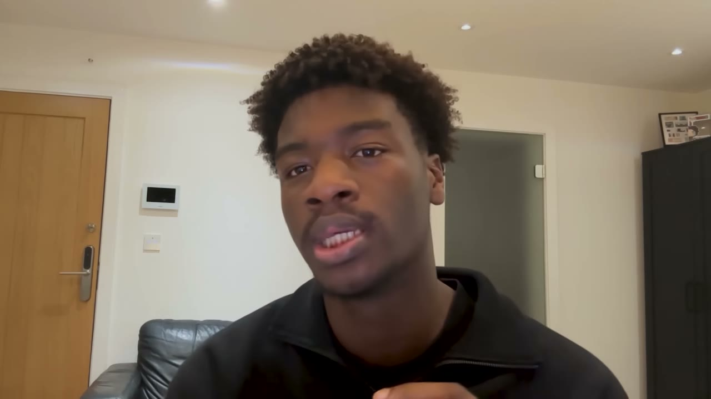

# I built a $14K/month SaaS using Discord

✅ **Đã phân tích sâu** → [`case.md`](case.md)

| | |
|---|---|
| **Video** | <https://www.youtube.com/watch?v=9r0qPeSJGog> |
| **Đăng** | 14/01/2026 |
| **Thời lượng** | 15:16 |
| **Lượt xem** | 47,594 |
| **Lượt thích** | 1,529 |
| **Video ID** | `9r0qPeSJGog` |

## Trong thư mục này

| File | Nội dung |
|---|---|
| [`case.md`](case.md) | **Phân tích đầy đủ** — ý tưởng, validate, GTM, áp dụng ở VN |
| [`meta.json`](meta.json) | Metadata gốc (chapters, heatmap, mô tả) |
| [`screenshots/`](screenshots/) | 5 ảnh 720p |

## Mô tả gốc

Sam Adeniyi used Discord to validate and launch his first saas and now it makes $14K MRR (built entirely with ChatGPT + Cursor). This video breaks down how he used Discord to validate his idea and how knowing a niche community lets you build the perfect product. 
This video is an educational case study of this founder’s experience. It is not financial advice and does not guarantee any income or results. Every business is different and your results may vary.

## Số liệu bắt được từ transcript

> Các đoạn founder nhắc tới con số, kèm timestamp để tua thẳng tới đó trong video.

_(không bắt được con số nào)_

## Chương

_(không có chapter)_

## Ảnh

1. `01_01m09s_usd-14-000.jpg` — 
2. `02_01m55s_usd-80.jpg` — 
3. `03_03m29s_usd-10-000.jpg` — 
4. `04_05m33s_usd-10-000.jpg` — 
5. `05_12m33s_usd-200.jpg` — 

---

← [Quay lại index](../../index.md) · [Toàn bộ video](../README.md)
