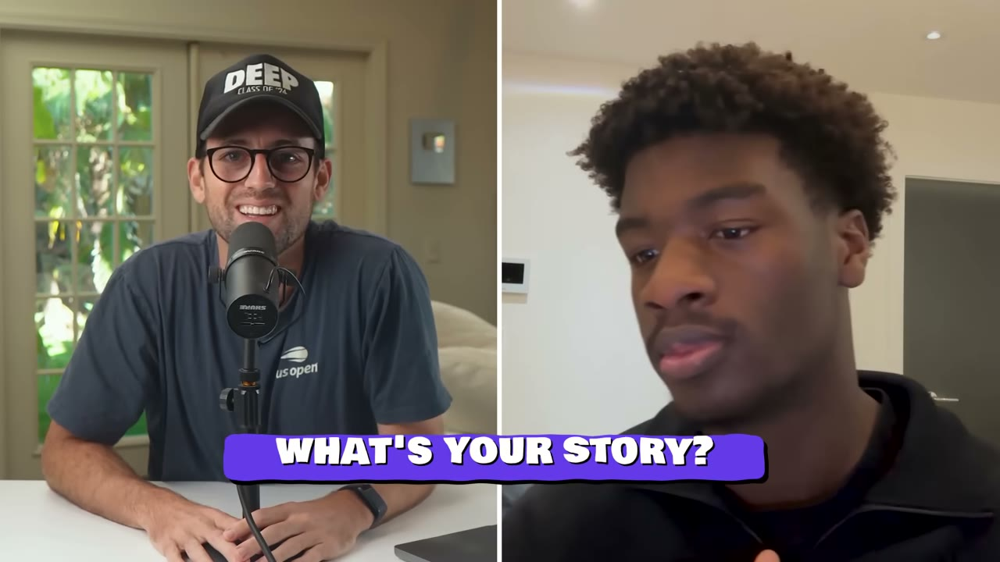
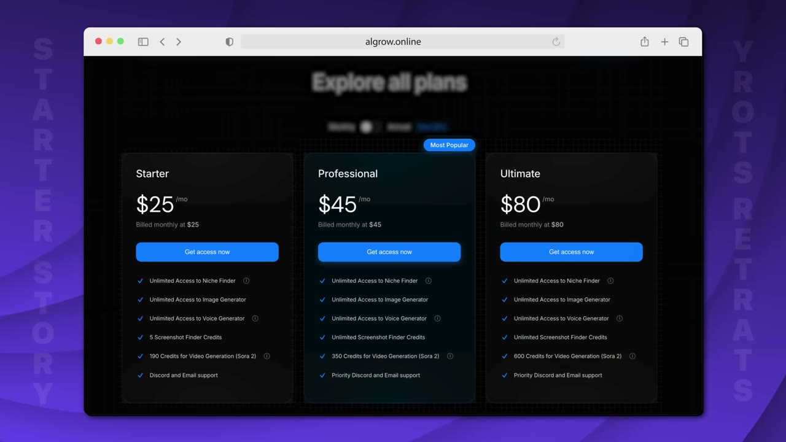
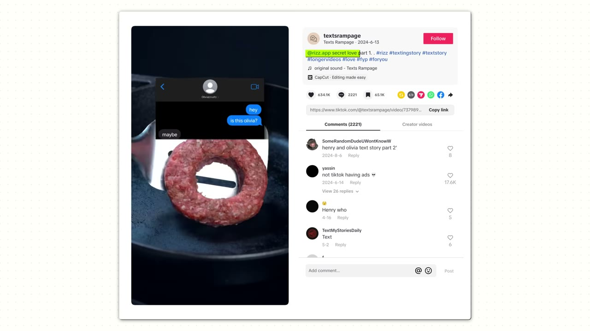
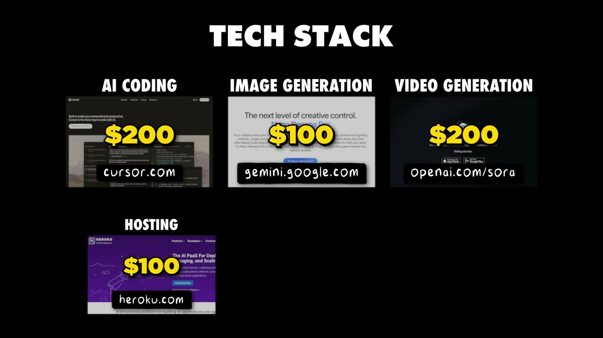

# Algrow — $14K/tháng từ một chiến thuật Discord mà gần như không ai làm

> **Tóm tắt 30 giây:** Sam Adeniyi là sinh viên đại học, không biết code. MVP đầu tiên anh viết bằng cách **copy-paste code từ ChatGPT vào Notepad**, deploy lên Heroku, và người dùng đầu tiên mở lên thì gặp lỗi *application error* — nhưng vẫn dùng được tính năng lõi, nên anh cứ để vậy. Cách anh lấy 400 khách đầu tiên độc đáo tới mức Pat Walls nói chưa từng thấy: anh vào **voice chat của một server Discord ngách, tắt mic, không nói một lời, chỉ share màn hình đang dùng công cụ của chính mình** — và để người khác tự hỏi "cái gì đấy Sam?". Anh làm vậy một tuần liền. Chủ server tự quay hẳn một video YouTube dài quảng cáo cho công cụ, **không ai nhờ, không ai trả tiền**. Sáu tháng sau: hơn 10.000 user, 480 khách mới trong tháng, khoảng $14K/tháng.

## ⚠️ Cảnh báo trước khi đọc

Video có **một đoạn quảng cáo dài** cho playbook miễn phí của Starter Story và **hai lần chốt bán** Starter Story Build. Đặc biệt: **câu mở đầu video ("last month I did over $40,000 in revenue") mâu thuẫn trực tiếp với dashboard mà chính founder mở ra** (hơn £10.000 trong 4 tuần ≈ $13-14K). Tôi chọn con số $14K vì nó có dashboard, khớp tiêu đề và khớp mô tả. Nhưng việc một video mở màn bằng con số cao gấp ba con số thật là điều bạn nên ghi nhớ khi đọc mọi case của kênh này.

## 1. Con số

| Chỉ số | Giá trị |
|---|---|
| Doanh thu 4 tuần gần nhất | hơn **£10.000** ≈ **$13-14K** |
| Khách mới trong tháng | **480** |
| Tổng user | hơn **10.000** |
| 400 khách đầu tiên | 100% từ Discord |
| Giá | **$25 / $45 / $80** mỗi tháng |
| Thời gian từ 0 tới đây | 6 tháng |
| Team | 1 người |
| Chi phí vận hành | khoảng **$780-1.180/tháng** |

Vài phép tính đáng làm mà video không làm:

- **$13.500 chia 480 khách mới ≈ $28/khách** → tuyệt đại đa số đang ở gói **$25**, gần như không ai lên gói $80.
- **10.000 user, 480 khách trả tiền → tỉ lệ free-to-paid khoảng 4,8%.** Thấp nhưng bình thường với sản phẩm freemium dạng công cụ.
- **Chi phí $780-1.180 trên doanh thu $13.500 → biên gộp khoảng 91-94%.** Nghe rất đẹp, nhưng đọc mục 9 trước khi mừng — cấu trúc chi phí này có một cái bẫy.

## 2. Sản phẩm làm gì

Hai tính năng lõi, đúng cặp *nghiên cứu → thực thi*:

1. **Research format viral.** Phân tích số subscriber, view trung bình mỗi video của các kênh, rồi trả về danh sách **format đang trending theo thời gian thực**. Thấy kênh nào hay thì lưu lại.
2. **Tái tạo format đó.** Cắm kênh mẫu vào **AI video generator** ngay trong Algrow (chạy Sora 2), sinh video, tải xuống, tối ưu cho từng nền tảng, đăng.

Ban đầu Sam làm cho **faceless YouTuber** — đúng nhóm anh thuộc về. Về sau influencer và dropshipper cũng dùng. Đây là mẫu tăng trưởng lành mạnh: **ngách hẹp trước, lan ra sau**, chứ không phải mở rộng ngay từ đầu.

## 3. Con đường tới ý tưởng — ba lần thử, mỗi lần học một thứ ⭐⭐

1. **Affiliate marketing.** Sam và hai người bạn thân đăng **video texting story faceless** (các tình huống bịa) để quảng bá cho một app đối tác. Kiếm được **hơn $10.000**. Nhưng *"nó không bền vững"*.
   *(Tên công ty đối tác trong phụ đề tự động lúc là "Resap", lúc là "RZAB" — không xác định được tên thật. Không quan trọng về mặt bài học.)*
2. **YouTube automation.** Anh chuyển sang đăng video kiếm tiền quảng cáo.
3. **Ý tưởng đến từ một câu hỏi của bạn.** Người bạn tên Mason hỏi: *"Sao không ai xây một cách để tụi mình tìm thêm kênh shorts mà chạy? Càng nhiều kênh thì càng nhiều cơ hội kiếm tiền."*

> **Đây là mẫu đáng học nhất trong phần này:** Sam không đi *tìm* ý tưởng. Anh đang ở trong một ngách, kiếm tiền trong ngách đó, và ý tưởng đến từ **nỗi đau của chính người bên cạnh anh**. Cùng cơ chế với [Lancer](../2026-03-08_i-built-a-10k-month-saas-using-other-peoples-custome/case.md) — Ivan không đi tìm khách, anh đi tìm người **đã có sẵn khách**. Sam không đi tìm nhu cầu, anh đã sống trong nhu cầu.

## 4. MVP hỏng vẫn ship — và vì sao điều đó đúng ⭐⭐

Trình tự build đầu tiên, kể nguyên văn:

1. Mở **Notepad**, bật voice mode của ChatGPT, **nói ra toàn bộ ý tưởng**.
2. Nhận về một đống code, **copy-paste qua lại vào Notepad**.
3. Google ra một thứ tên **Visual Studio Code**, vẫn không biết làm gì, nên tiếp tục copy-paste — chỉ là trong VS Code thay vì Notepad.
4. Đưa cho Mason xem. Mason bảo: *"Raw-dogging trong VS Code là ngu khi đã có Cursor."*
   > *"Tôi không biết cursor là gì. Lúc đó tôi tưởng nó nói về con trỏ chuột."*
5. Tải Cursor về. Từ đó dùng Cursor mãi.

MVP mất **khoảng một tuần**. Host trên **Heroku**. Người đầu tiên anh đưa link cho **gặp lỗi application error** — nhưng vẫn dùng được các tính năng lõi.

> *"Đúng, có bug. Đúng, có vấn đề. Nhưng ý tưởng chính của app thì chạy. **Miễn là thứ bạn đang cố giải quyết chạy được, tôi nghĩ bạn ship được bất cứ thứ gì.**"*

**Cơ chế vì sao ngưỡng chất lượng thấp lại đúng ở đây — và khi nào nó sai:**

Ngưỡng chất lượng bạn cần **tỉ lệ thuận với chi phí chuyển đổi của người dùng và nghịch với độ đau của vấn đề**. Người dùng của Sam đang mất hàng giờ mỗi tuần để tìm kênh thủ công. Một trang lỗi không ngăn được người đang đau. Ngưỡng này **sai ngay** khi: bạn bán B2B có hợp đồng, sản phẩm động tới tiền/dữ liệu của khách, hoặc bạn có một cơ hội duy nhất với một khách hàng lớn.

So sánh với [Once](../2026-05-10_i-built-a-20k-month-app-in-83-days/case.md) trong kho — Brian validate trước khi viết code. Phân định: **chi phí build**. MVP của Sam mất một tuần, nên ship rồi học rẻ hơn validate. Nếu build mất một tháng thì ngược lại.

## 5. Chiến thuật Discord gốc — im lặng share màn hình ⭐⭐⭐

Đây là phần đáng giá nhất của cả case.

**Bước tìm cộng đồng.** Anh vào **disboard.org** (phụ đề đọc thành "discboard"), gõ bất kỳ từ khoá hay ngách nào → nó trả về danh sách server Discord của ngách đó.

**Bước phát hiện nhu cầu — mẹo tốt nhất trong video.** Anh vào một server tên *moneymind*, gõ vào **thanh tìm kiếm của server** từ khoá **"niches"**. Kết quả trả về: hàng loạt người hỏi *"làm sao tìm được niche?"*, *"làm sao replicate niche này?"*.

> **Khi thấy người ta lặp đi lặp lại cùng một câu hỏi, đó chính là cầu.**

> **Vì sao mẹo này mạnh:** thanh tìm kiếm của một server Discord thực chất là **một công cụ đo volume tìm kiếm miễn phí cho một ngách**, với dữ liệu mà Ahrefs hay Google Trends không bao giờ có — người thật, hỏi thật, bằng đúng chữ họ dùng, trong bối cảnh có ngày giờ. Nó là phiên bản định tính và miễn phí của việc nghiên cứu từ khoá. Ai làm được việc này trong 30 phút thì tiết kiệm được vài tuần đoán mò.

**Bước validate — và đây là phần chưa ai làm:**

> *"Tôi vào server đó, vào voice chat Discord, **tắt mic của mình**, không nói gì cả — chỉ ngồi share màn hình đang dùng công cụ của mình. Và tôi thấy người ta hỏi: 'Sam, cậu đang dùng cái gì đấy?' 'Sam, đây là cái gì?' Tôi trả lời: 'À, một cái tool tôi tự làm.' Tôi làm vậy khoảng một tuần liền."*

Kết quả ngoài dự tính: **chủ server tự làm một video YouTube dài quảng bá công cụ.**

> *"Tôi không nhờ. Tôi không trả tiền. Tôi không làm gì cả."*

**Cơ chế — vì sao chiến thuật này hiệu quả hơn mọi kiểu self-promo:**

- **Nó đảo chiều bán hàng.** Anh không đẩy, người khác kéo. Câu "cậu đang dùng gì đấy?" là **người mua tự mở lời** — trạng thái tâm lý hoàn toàn khác với "chào mọi người, mình có tool này".
- **Nó lách luật server một cách hợp lệ, không phải lách một cách gian.** Gần như server nào cũng có luật *no self-promo*. Sam không quảng cáo. Anh chỉ **làm việc của mình ở nơi công cộng**. Không có điều luật nào cấm điều đó.
- **Nó chứng minh sản phẩm bằng cách dùng, không bằng cách mô tả.** Người xem thấy công cụ giải quyết vấn đề trong thời gian thực. Đây là demo mạnh nhất tồn tại.
- **Nó làm chủ server hưởng lợi.** Cộng đồng của anh ta trở nên giá trị hơn khi có công cụ này trong đó. Vì vậy anh ta quảng bá — **vì lợi ích của chính anh ta**, không phải vì ơn nghĩa. Đây là lý do nó bền, khác hẳn với việc đi xin share.

**Bước chuyển đổi.** Sau vài tuần ngồi trong server, anh làm thứ đơn giản nhất: **mở waitlist** và đăng link vào các server. *"Nếu muốn thử tool, đăng ký ở đây, khi ra mắt tụi mình gửi email."* Đó là cách Algrow bắt đầu.

## 6. Vì sao anh không bị ban — và lời khuyên về rapport ⭐⭐

Pat hỏi thẳng: Discord đầy spam, sao anh không bị ban, sao người ta lại tự nguyện quảng bá hộ anh?

> *"Hầu hết server đều có luật no self-promo, nếu không sẽ bị ban. Và đa số người ta vẫn cứ vào server nói 'chào, mình có tool này, dùng thử đi'. **Nhưng bạn trông y như spam. Bạn trông như một kẻ phiền phức.** Việc chính bạn phải làm trước là xây một chút rapport trong cộng đồng."*

Cách anh xây rapport rất cụ thể và sao chép được ngay:

> **Có người nói ra loại kênh họ đang tìm → anh dùng chính công cụ của mình để tìm giúp họ.**

Anh **không bán trực tiếp**. Anh **giải vấn đề cụ thể của một người cụ thể, công khai**, bằng sản phẩm của mình. Và:

> *"Cuối cùng thì những người đó sẽ kể cho bạn bè họ. Word of mouth cực lớn với tôi ở giai đoạn đầu — chỉ vì nó giải một painpoint quá lớn. Tôi hỏi họ 'bạn từ đâu tới?', họ trả lời 'à, bạn tôi bảo'."*

## 7. Playbook 5 bước lấy khách từ cộng đồng ngách ⭐⭐⭐

**Bước 1 — Tìm nơi ICP của bạn sống.**
Tìm xem ngách của bạn có cộng đồng Discord không. Ví dụ anh đưa ra: nếu làm SaaS tạo asset 3D thì vào **mọi server Blender**, xem output của họ, rồi làm y hệt với **Cinema 4D**. *Vào hết, không chọn lọc.*

**Bước 2 — Nghe trước khi xây bất cứ thứ gì.**
Mẹo kỹ thuật cụ thể:
> Trên Discord bạn **cuộn lên và copy-paste được nhiều ngày lịch sử chat**. Dán hết vào ChatGPT với prompt: *"Liệt kê cho tôi tất cả painpoint mà những người này đã nói tới trong vài ngày qua."*

Thứ cần tìm là **painpoint lặp lại** — vì cái lặp lại là cái có cầu lớn. *"Càng nhiều vật lộn thì sản phẩm càng có khả năng làm tốt."*

**Bước 3 — Validate bằng hội thoại thật, có mục tiêu.**
DM người ta, nhưng **phải có mục tiêu trong đầu**. Gửi họ một **Loom quay nhanh, tua nhanh** về công cụ. Nếu họ phản hồi kiểu *"trời, đây đúng là thứ tôi đang tìm"* → tín hiệu mạnh là bạn đang xây đúng thứ.
> Điều kiện: **ít nhất 5-6 người, ở các server khác nhau.** Không phải 5 người trong cùng một phòng chat — đó là echo chamber.

**Bước 4 — Build in public VỚI cộng đồng, không phải build in public TRÊN Twitter.**
> *"Tôi không có ý nói kiểu build-in-public trên Twitter, ghi chép lại quá trình bạn xây SaaS. **Tôi thật lòng nghĩ cái đó là một đống rác** — nhưng đó là quan điểm cá nhân của tôi. Tôi nghĩ bạn nên xây sản phẩm CÙNG người dùng của bạn."*

Cụ thể: waitlist là được, nhưng thứ tốt hơn là **tự mở Discord server riêng cho sản phẩm của bạn**.
> *"Thay vì sợ bị ban vì self-promo trong các cộng đồng lớn, bạn xây cộng đồng Discord riêng và **rót khách hàng lý tưởng vào đó**."*

Về email:
> *"Tôi rất ủng hộ email, email tuyệt vời. Nhưng **Discord tốt hơn gấp 10 lần** về mặt xây quan hệ với user. Người trẻ vào Discord nhiều hơn là họ check email."*

**Bước 5 — Biến user đầu tiên thành người đi bán hộ bạn.**
Sam **cho toàn bộ early user quyền dùng miễn phí**. Cơ chế anh mô tả chính xác:

> Early user có **free access**. Bạn của anh ta thì phải trả tiền. Nhưng bạn anh ta còn nghi ngờ tool có chạy không — **và early user chỉ cần mở tool ra cho xem, vì anh ta đang có quyền dùng**. *"Đó là cách Algrow lớn nhanh như vậy."*

> **Đây là insight bị đánh giá thấp nhất trong video.** Free access cho early user thường được coi là *quà cảm ơn*. Sam biến nó thành **hạ tầng bán hàng**: mỗi early user trở thành một **demo sống, miễn phí, có sẵn niềm tin sẵn có với người nghe**. Chi phí biên gần bằng 0 (họ không phải khách sẽ trả tiền dù sao đi nữa), nhưng mỗi người có thể chuyển đổi vài người khác. So sánh: [SuperDemo](../2026-03-11_how-this-250k-month-saas-got-its-first-100-users-ste/case.md) đạt cùng hiệu ứng bằng watermark trên sản phẩm — cùng cơ chế, khác cách cài đặt.

## 8. Vì sao Discord — và khi nào nó KHÔNG hợp

Producer Gus nói thẳng ở cuối video: *"Có thể tôi già rồi. Tôi không dùng Discord, nên chắc đó là một phần vấn đề."* Pat chốt lại điều quan trọng nhất:

> *"Anh ấy có nói mấy lần: user của tôi trẻ hơn và họ ở trên Discord. Họ không check email. Tôi nghĩ điều đó rất quan trọng. Và nếu bạn xây doanh nghiệp này rồi đem đi quảng bá trên **LinkedIn** — cái đó sẽ không chạy."*

**Nguyên tắc rút ra: kênh phân phối được quyết định bởi nhân khẩu học của ICP, không bởi sở thích của bạn.**

| ICP | Kênh có khả năng cao nhất |
|---|---|
| Gen Z, gamer, creator, crypto, AI hobbyist | **Discord** |
| Dev, người làm ngành dọc (IT, kế toán, nông nghiệp) | Reddit, forum chuyên ngành — như [Packager](../2026-03-15_i-make-60k-month-from-the-most-boring-saas-on-the-in/case.md) |
| Người mua B2B có ngân sách, quản lý cấp trung | LinkedIn, cold email, partner directory |
| Người tiêu dùng phổ thông | TikTok/Reels, quảng cáo trả tiền |

**Khi Discord KHÔNG hợp:** khách hàng của bạn trên 35 tuổi và mua bằng ngân sách công ty; sản phẩm cần chu kỳ bán dài; hoặc bạn không có thời gian **ngồi trong cộng đồng nhiều tuần**. Chiến thuật của Sam đòi hỏi *hiện diện*, không phải *chiến dịch*. Nó không tự động hoá được, không thuê ngoài được, không mua được.

## 9. Tech stack — và cái bẫy trong cấu trúc chi phí ⭐⭐

| Hạng mục | Công cụ | Chi phí/tháng |
|---|---|---|
| Code | **Cursor** (đã nâng từ gói $20 lên gói $200) | $200 |
| Sinh ảnh AI | **Nano Banana** | ~$100 |
| Sinh video AI | **Sora 2** và các model tương tự | ~$200 |
| Hosting | **Heroku** (vẫn dùng từ ngày đầu) | ~$100 |
| Email marketing | **MailerLite** (phụ đề đọc thành "Mailorite") | ~$80 |
| AI compute khác | **Gemini** | $300-500 |
| **Tổng** | | **$980-1.180** |

**Cái bẫy:** Algrow bán **subscription giá cố định** ($25/$45/$80) nhưng COGS là **AI theo mức sử dụng** — Sora 2 và Gemini. Đây là mô hình *"AI wrapper với chi phí biến đổi trên doanh thu cố định"*, và nó có một cơ chế hỏng rất cụ thể:

- Khách nhẹ trả $25 dùng vài lần → lãi to.
- Khách nặng trả $80 sinh hàng trăm video Sora → **có thể lỗ trên chính khách đó**.
- Khi sản phẩm phổ biến hơn, tỉ lệ khách nặng tăng → biên gộp **giảm dần theo quy mô**, ngược với SaaS thông thường.

Hiện tại chi phí AI chỉ chiếm khoảng 5% doanh thu — con số này thấp bất thường với sinh video, gợi ý anh đang có **giới hạn usage** khá chặt hoặc phần lớn user chỉ dùng tính năng research. Video không nói. **Nếu bạn copy mô hình này, hãy thiết kế credit/usage cap TRƯỚC khi bán gói đầu tiên** — sửa giá sau khi đã có khách là việc rất đau.

Rủi ro thứ hai: sản phẩm phụ thuộc vào **dữ liệu kênh YouTube** (subscriber, view trung bình) và vào **API của OpenAI/Google**. Cả hai đều là rủi ro nền tảng nằm ngoài tầm kiểm soát.

## 10. Lời khuyên cuối của founder — và một phản biện

> *"Lời khuyên chính của tôi là: **xây tool của bạn để chịu được quy mô ngay từ đầu**. Bạn phải cược vào chính mình. Nghĩ rằng: ok, mình sẽ có 100.000 user. Và bạn cần có framework cho việc đó. Bạn có thể không biết chúng, nhưng **khi bạn bảo Cursor nghĩ theo cách đó, nó sẽ đổi tư duy** trong cách nó gợi ý bạn làm — nó sẽ gợi ý theo hướng phục vụ 100.000 user thay vì chỉ một user là bạn. Việc đó tiết kiệm cho bạn cực nhiều thời gian và tiền về sau."*

**Phản biện cần nói ra:** lời khuyên này **mâu thuẫn trực tiếp với chính hành động của anh** ở đầu video — anh ship một MVP lỗi application error viết trong Notepad. Anh cũng vẫn đang chạy Heroku ở $14K/tháng.

Cách hoà giải mà tôi cho là đúng: **kiến trúc thì nghĩ lớn, tính năng thì nghĩ nhỏ.** Bảo AI chọn cấu trúc dữ liệu, cách phân tách service, cách xử lý job nền như thể sẽ có 100.000 user — việc này gần như miễn phí ở giai đoạn prompt. Nhưng đừng *xây* tính năng cho 100.000 user khi bạn có 3. Sam nói về vế thứ nhất; anh sống theo vế thứ hai.

## 11. Áp dụng cho tôi (indie hacker VN)

### Sao chép được gì

- **Toàn bộ chiến thuật Discord dùng được nguyên xi, hôm nay, miễn phí.** Đây là điểm mạnh nhất của case: rào cản vào cuộc gần bằng 0. Không cần vốn, không cần lên hình, không cần tiếng Anh hoàn hảo (chat viết dễ hơn nói).
- **Mẹo search thanh tìm kiếm server** để đo cầu — làm được trong 30 phút tối nay. Vào disboard.org, tìm 5 server thuộc ngách bạn quan tâm, gõ 3-4 từ khoá painpoint, đếm số lần câu hỏi lặp lại.
- **Mẹo copy lịch sử chat vào ChatGPT** để rút painpoint — cực rẻ, cực nhanh, và cho bạn *ngôn ngữ thật của khách* để viết landing page.
- **Nguyên tắc "giải vấn đề công khai bằng chính sản phẩm"** áp dụng được cho Facebook Group Việt Nam, Zalo group, và các Discord Việt (game, edit video, MMO, dropship). Cộng đồng MMO/YouTube automation Việt Nam rất đông và rất giống ICP của Sam.
- **Free access cho early user như hạ tầng bán hàng** — sao chép được ngay, chi phí biên gần 0.
- **Ngưỡng "MVP hỏng vẫn ship"** hợp với người mới: nó giết được vòng lặp hoàn thiện vô tận vốn là nguyên nhân chính khiến người Việt mới làm không bao giờ ra mắt.

### Rào cản thật

- **Sam bán $25-80/tháng cho khách quốc tế.** Nếu bạn bán vào ngách MMO/creator Việt Nam, mức giá thực tế là 100-300K/tháng, tức khoảng $4-12. Để đạt $14K/tháng bạn cần **1.500-3.000 khách trả tiền** thay vì 480. Với cùng lượng công sức. **Kết luận: chiến thuật Discord thì học từ Sam, nhưng thị trường thì nên nhắm quốc tế.**
- **Chiến thuật này tốn THỜI GIAN CÓ MẶT, không tốn tiền.** Sam ngồi trong voice chat *một tuần liền*, rồi vài tuần nữa trong server. Nếu bạn đang đi làm full-time, đây là 2-3 giờ mỗi tối trong nhiều tuần, và phải trùng múi giờ với cộng đồng. Với server Mỹ, đó là **đêm khuya giờ Việt Nam**. Đây là rào cản thật và nhiều người đánh giá thấp nó.
- **Rào cản tiếng Anh ở đây là NÓI, không chỉ viết.** Sam thoát được nhờ tắt mic ở giai đoạn đầu — mẹo này thực sự có lợi cho người Việt. Nhưng sau đó anh phải trả lời chat, DM, làm Loom. Loom có thể quay bằng phụ đề, không cần giọng. Hãy tận dụng.
- **Chi phí AI là chi phí bằng USD, trả trước.** Gemini + Sora + Cursor $200 = gần **$1.000/tháng ngay từ khi chưa có khách nào** nếu bạn xây sản phẩm sinh video. Đây không phải mô hình khởi động với 2 triệu đồng. Hãy bắt đầu bằng tính năng research (rẻ) trước, thêm generation sau.
- **Rủi ro cấm cửa.** Nếu bạn làm sai — quảng cáo lộ liễu — bạn bị ban khỏi server và **mất luôn kênh đó vĩnh viễn**, không như quảng cáo trả tiền có thể mở lại. Đây là kênh không tha thứ.
- **Rủi ro nền tảng kép:** dữ liệu YouTube (điều khoản có thể siết) và API model (giá có thể tăng, model có thể bị hạn chế thương mại).
- **Số liệu chưa qua kiểm chứng thời gian.** 6 tháng tuổi, chưa biết churn. Với công cụ dạng "tìm format viral", nguy cơ churn cao là có thật — khách dùng vài tháng, tìm được format, rồi huỷ.

### Khi nào KHÔNG dùng mô hình này

- **Khi ICP của bạn không tụ tập ở đâu cả.** Chiến thuật cộng đồng đòi hỏi cộng đồng có sẵn. Nếu khách của bạn là chủ tiệm tạp hoá hay kế toán doanh nghiệp, họ không ở trong Discord — hãy dùng cách của [Packager](../2026-03-15_i-make-60k-month-from-the-most-boring-saas-on-the-in/case.md) hoặc [Hero Analytics](../2026-06-10_i-built-a-1m-saas-in-a-hidden-niche/case.md).
- **Khi bạn không thể có mặt đều đặn nhiều tuần.** Đây là kênh của sự hiện diện. Không có phiên bản "chạy 2 tiếng cuối tuần".
- **Khi bạn cần doanh thu có thể dự báo được.** Kênh cộng đồng không có núm vặn — bạn không tăng gấp đôi được bằng cách chi gấp đôi, khác hẳn con đường quảng cáo của [Prayer Lock](../2026-01-18_i-built-a-20k-month-mobile-app-heres-my-entire-playb/case.md).
- **Khi sản phẩm của bạn đụng tới tiền hoặc dữ liệu nhạy cảm của khách.** Ngưỡng "ship bản hỏng" của Sam sẽ giết bạn ở đó.

## Nguồn

- Video: <https://www.youtube.com/watch?v=9r0qPeSJGog> (15:16, đăng 14/01/2026, 47.594 view)
- Sản phẩm: <https://algrow.online/> · Founder: <https://x.com/samgrows>
- [Transcript đầy đủ](transcript.md) · [Ảnh chụp](screenshots/)
