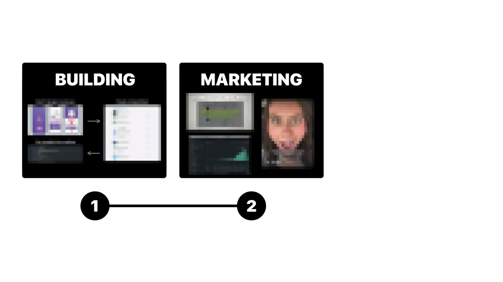
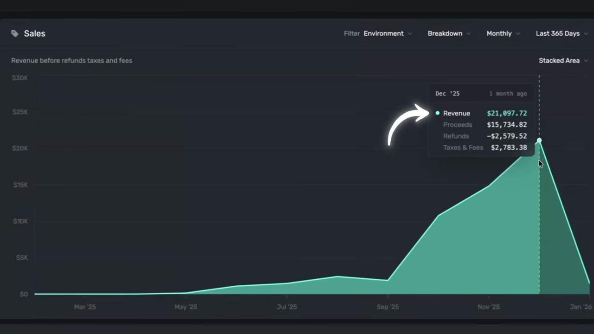

# I Built a $20K/Month Mobile App: Here’s My Entire Playbook

✅ **Đã phân tích sâu** → [`case.md`](case.md)

| | |
|---|---|
| **Video** | <https://www.youtube.com/watch?v=yBjcmMhXSDk> |
| **Đăng** | 18/01/2026 |
| **Thời lượng** | 17:34 |
| **Lượt xem** | 211,225 |
| **Lượt thích** | 7,057 |
| **Video ID** | `yBjcmMhXSDk` |

## Trong thư mục này

| File | Nội dung |
|---|---|
| [`case.md`](case.md) | **Phân tích đầy đủ** — ý tưởng, validate, GTM, áp dụng ở VN |
| [`meta.json`](meta.json) | Metadata gốc (chapters, heatmap, mô tả) |
| [`screenshots/`](screenshots/) | 8 ảnh 720p |

## Mô tả gốc

Mau is a solo founder who built and grew his mobile app to $20K/month. This video is the complete playbook for building mobile apps in 2026: how he built it with AI, grew organically, and is scaling with paid ads. 
This video is an educational case study of this founder’s experience. It is not financial advice and does not guarantee any income or results. Every business is different and your results may vary.

## Số liệu bắt được từ transcript

> Các đoạn founder nhắc tới con số, kèm timestamp để tua thẳng tới đó trong video.

_(không bắt được con số nào)_

## Chương

_(không có chapter)_

## Ảnh

1. `01_00m35s_usd-20-000.jpg` — 
2. `02_01m53s_usd-21-000.jpg` — 
3. `03_06m18s_usd-20-000.jpg` — 
4. `04_10m00s_usd-20.jpg` — 
5. `05_11m17s_usd-3.jpg` — 
6. `06_12m00s_replay.jpg` — 
7. `07_14m22s_usd-25.jpg` — 
8. `08_15m08s_usd-360.jpg` — 

---

← [Quay lại index](../../index.md) · [Toàn bộ video](../README.md)
