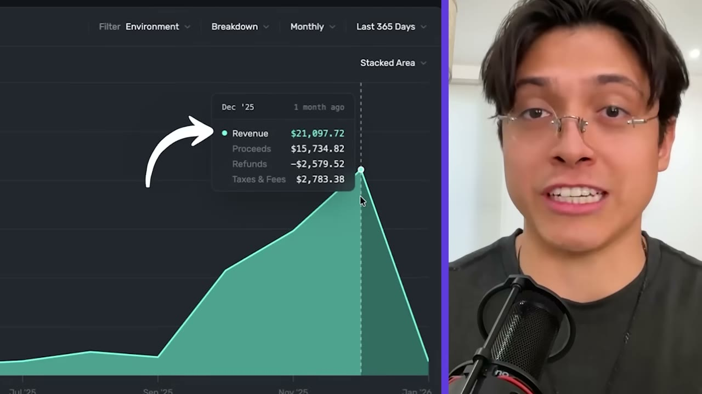
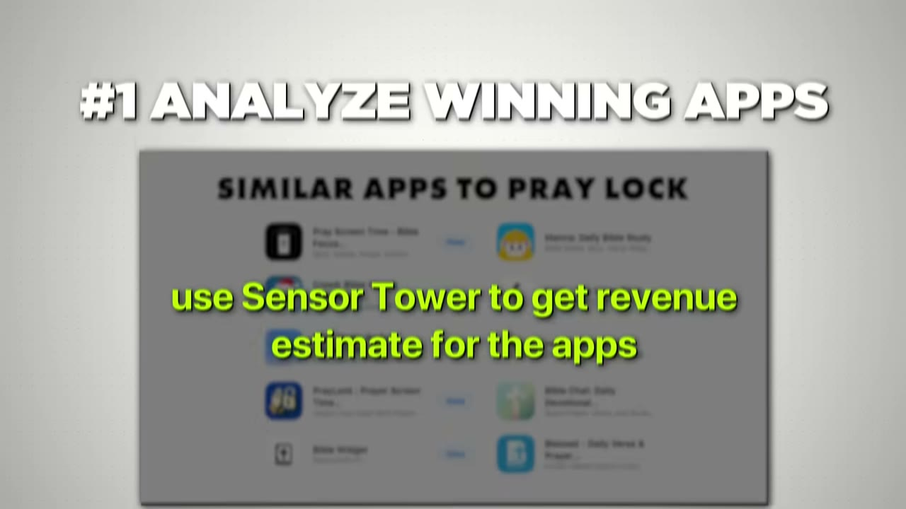
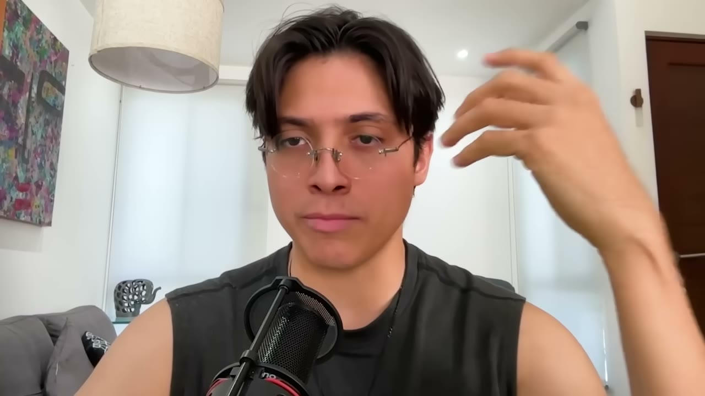
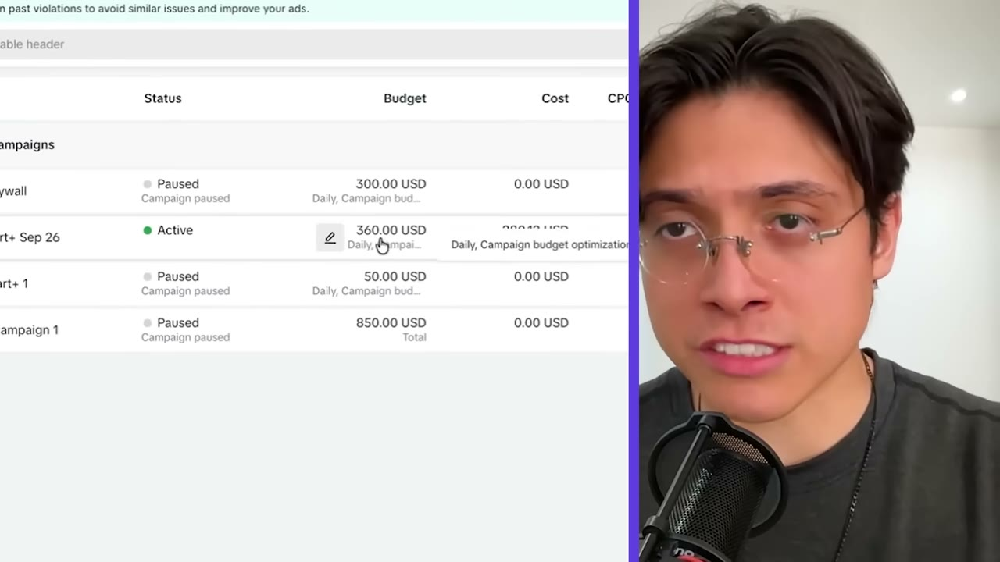
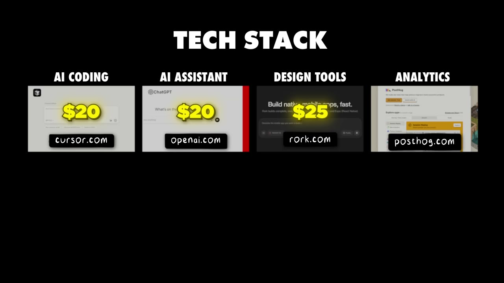

# Prayer Lock — $21K trong tháng 12, sáu tháng sau khi viết dòng code đầu tiên

> **Tóm tắt 30 giây:** Mau Baron học tài chính, không phải dân tech. Tháng 1/2025 anh xây một app AI content người lớn, làm xong thì *"cảm thấy ghê tởm chính mình"*, nên pivot 180 độ sang thị trường Kitô giáo. Anh tìm thấy một app đối thủ khoá điện thoại tới khi bạn cầu nguyện, quyết định **làm lại tốt hơn**, code trong **3 ngày** bằng Cursor. Sáu tháng sau: 58.000 lượt tải, $21.000 doanh số tháng 12, tăng trưởng hơn 50%/tháng. App **không có đăng nhập, không có database**. Đòn bẩy lớn nhất không phải sản phẩm mà là **kéo dài onboarding từ 5 phút lên 15 phút — tỉ lệ chuyển đổi tăng hơn 3 lần**, rồi đổ TikTok Spark Ads lên chính các video organic đã thắng, hạ giá mỗi trial từ $10 (Meta) xuống $1,88.

## ⚠️ Cảnh báo trước khi đọc

Video này có **hai đoạn quảng cáo dài** cho Starter Story Build (khoá học của kênh) chèn giữa nội dung, cộng một link affiliate HubSpot ở mô tả. Con số $40K/tháng cho tháng 1 là **dự phóng của founder**, chưa xảy ra. Case mới 6 tháng tuổi nên **chưa có dữ liệu retention hay refund của gói năm** — điều quan trọng nhất với mô hình subscription lại chính là thứ chưa ai kiểm chứng được. Đọc với tâm thế đó.

## 1. Con số

| Chỉ số | Giá trị |
|---|---|
| Doanh số tháng 12 | **$21.000** (founder nói tròn "20K") |
| Đường tăng trưởng | Jul $1,5K → Aug $2,4K → Oct $10K → Nov $15K → Dec $21K |
| Tốc độ | hơn 50%/tháng |
| Lượt tải | gần 58.000 |
| Đánh giá | 6.700 rating, 4,9 sao — tỉ lệ để lại review **hơn 12%** |
| Conversion rate | 43% (founder nêu) |
| Proceeds/khách trả tiền | $23,6 |
| Total proceeds tích luỹ | $41.000 |
| Giá | $49,99/năm hoặc $9,99/tuần |
| Chi ads tháng 12 | ~$9.000 |
| Chi ads hiện tại | $360/ngày |
| Cost per trial | $1,88 |
| Thứ hạng | #22 category Reference (tháng 11) |
| Thời gian build | 3 ngày |

**Đọc kỹ chỗ này — nó quan trọng hơn con số $21K:** founder nói *total proceeds* mới chỉ $41.000, trong khi cộng các tháng doanh số anh liệt kê (1,5 + 2,4 + 10 + 15 + 21 = **hơn $50K**). Chênh lệch đó chính là **phần Apple giữ lại** (15% với chương trình Small Business, 30% với phần còn lại) cộng thuế/refund. Nghĩa là **"$21K/tháng" không phải tiền vào túi**.

Làm phép tính lợi nhuận thật cho tháng 12:

| Khoản | Số tiền |
|---|---|
| Doanh số gross | $21.000 |
| Trừ phần Apple (~15-18%) | còn khoảng **$17.500** |
| Trừ chi quảng cáo | −$9.000 |
| Trừ toàn bộ tool | −$100 |
| **Lợi nhuận thật** | **khoảng $8.400** |

Quảng cáo ăn **43% doanh số gross**. Đây là mô hình *mua tăng trưởng bằng tiền mặt*, không phải mô hình biên lợi nhuận cao. Bất kỳ ai định copy phải hiểu điều này trước tiên.

## 2. Nguồn gốc ý tưởng — pivot vì thấy tệ với chính mình ⭐⭐

Trình tự đúng như anh kể:

1. Học tài chính, không có nền tảng tech. Năm 2022 gặp model Codex đầu tiên → *"yêu công nghệ và AI, quyết định đó là thứ tôi muốn làm cả đời"*, tự học code.
2. Tháng 1/2025: xây một **app AI content người lớn**. Làm xong thì *"tôi cảm thấy hoàn toàn ghê tởm và thất vọng với chính mình"*.
3. Quyết định *"pivot kỳ lạ nhất lịch sử"* — sang thị trường Kitô giáo để kết nối lại với đức tin của mình.
4. **3 tháng xây những app không ai muốn.**
5. Gặp một app tên *Praycreen* (phụ đề tự động, tên thật nhiều khả năng là **PrayScreen** — kênh không hiện tên trên màn hình) làm đúng việc khoá điện thoại tới khi bạn cầu nguyện.
6. Anh nhìn design, nhìn feature, nhìn cách họ phân phối và kết luận: *"tôi có thể làm tốt hơn họ"*. Prayer Lock ra đời.

Pat Walls chốt lại đúng điểm: thứ làm nên khác biệt không phải kỹ thuật mà là **anh đã trở thành khách hàng của chính mình**. Anh quay lại với đức tin, nên anh biết cảm giác mở điện thoại rồi quên mất mình định cầu nguyện.

> **Đây là bản sao của luận điểm [CalBuddy](../2026-08-09_i-copied-a-huge-app-now-i-make-80k-month/case.md)** — bê một app đã được thị trường chứng minh rồi làm phiên bản tốt hơn cho một tệp cụ thể. Khác biệt: Tomer copy sang **ngôn ngữ khác** (Hebrew), Mau copy sang **cùng thị trường tiếng Anh nhưng thi hành tốt hơn**. Cách của Mau khó hơn nhiều vì đối thủ vẫn ở đó cạnh tranh trực tiếp; thứ cứu anh là distribution, không phải sản phẩm.

## 3. Build 3 ngày — 5 nguyên tắc dùng AI của Mau ⭐⭐

**1. Đừng thiết kế mock-up. Đi thẳng vào code.**
Thay vào đó, nghiên cứu app tốt nhất trong ngách của bạn *và ở các ngách khác* bằng công cụ như **Screensdesign**. Mau tạo một file Canva, dán vào đó **toàn bộ màn hình onboarding đẹp nhất** của các app anh thích và của đối thủ, rồi chọn ra cái tốt nhất và bê vào app mình.

**2. Dùng nhiều tool khác nhau cho mục đích khác nhau — vì lý do tiền.**
Cursor (chạy Sonnet) làm daily driver, Codex CLI cho việc phức tạp, ChatGPT cho câu hỏi và sửa nhỏ. Lý do anh nói thẳng: *"Tôi nghèo. Bạn không muốn đốt hàng trăm hay hàng nghìn đô vào token."* Chia việc ra nhiều tool = **chia nhỏ chi phí token qua nhiều gói subscription cố định** thay vì đốt một chỗ theo usage. Một mẹo dòng tiền rất thực tế cho người ít vốn.

**3. Đừng one-shot cả app.**
> *"AI chưa tới mức bạn nói 'làm cho tôi một mobile app, đừng sai, đừng ảo giác'. Cái đó không chạy đâu."*

Cái AI giỏi là: **chẻ app thành từng khối**, rồi one-shot **một feature** hoặc **một màn hình** mỗi lần.

**4. App hiện đại không cần authentication.**
> *"App của tôi không có auth, không có database, và tôi đang in tiền."*

Hai lý do: (a) **giảm ma sát** — không bắt user mất thời gian đăng ký; (b) **tiết kiệm chi phí** — lưu hết trên máy thì không phải trả tiền database. Phản biện "đổi điện thoại thì mất dữ liệu" anh gạt đi: *"Chẳng ai nghĩ tới chuyện đó. Đó là ca rất hiếm."*

**5. Chấp nhận thời gian duyệt.** Code 3 ngày, chờ App Store **hơn 1 tuần**.

**Cẩn trọng với nguyên tắc 4:** không auth/không DB đúng cho app *công cụ cá nhân, dữ liệu không quý*. Nó sai ngay khi app của bạn có dữ liệu người dùng tích luỹ có giá trị (nhật ký, ảnh, tiến trình dài hạn) hoặc cần đồng bộ đa thiết bị. Prayer Lock thoát được vì giá trị nằm ở *hành vi hôm nay*, không nằm ở lịch sử.

## 4. Phân phối giai đoạn 0 — 40 bài/ngày trên 12 tài khoản ⭐⭐⭐

Đây là phần thật nhất của case và cũng là phần người ta hay bỏ qua.

**Giai đoạn dò tìm:** anh không biết cái gì chạy, nên **đăng khoảng 40 lần mỗi ngày trên 12 tài khoản khác nhau**, thử đủ format.

> *"Volume really matters here."*

**Giai đoạn tìm ra format:** thứ thắng là **video girl-reaction kèm demo** — chính là format một trong những đối thủ lớn nhất của anh đang dùng và *"đang giết thị trường với nó"*.

**Giai đoạn không có tiền:** anh không đủ tiền thuê creator hay mua clip. Anh nhờ **bạn gái (giờ là vợ)** tự quay reaction. *"Cô ấy làm quá tốt."* Hai người đăng 2 lần/ngày.

> **Phải tới bài thứ 40 anh mới tìm được một hook chạy được.** Rồi anh spam đúng hook đó trên cả TikTok lẫn Instagram.

Kết quả: **10.000 view/ngày từ một tài khoản duy nhất → khoảng 200-300 lượt tải/ngày → $1.000/tháng đầu tiên**.

**Tỉ lệ view sang download là 2-3%** — Mau nói rõ đây là con số cao bất thường vì *"format này được tối ưu riêng cho download"*. Đừng lấy tỉ lệ này làm chuẩn cho format khác.

Nhân bản: anh thuê thêm một UGC creator nữ. Mất **14 ngày** mới có video đầu tiên đạt 20K view organic. Với hai tài khoản (vợ + creator), tháng 7 được $1.500, tháng 8 được $2.400.

Pat Walls chốt bài học đúng: **bạn chỉ cần một nền tảng và một format**, làm đi làm lại rất nhiều lần. Không cần có mặt trên TikTok + YouTube + X + personal brand cùng lúc.

> **Cơ chế vì sao "spam một format" hiệu quả:** thuật toán TikTok/Reels phân phối theo *creative*, không theo *tài khoản*. Mỗi video là một lần rút xổ số độc lập. Khi bạn tìm được hook có tỉ lệ giữ chân cao, việc cần làm không phải là sáng tạo cái mới mà là **tăng số lần rút xổ số với cùng con số**. Đây cũng chính là hệ thống mà [Flame](../2026-06-21_i-built-a-10k-month-app-with-this-one-system/case.md) chạy với 15-20 tài khoản trên 5 điện thoại, và [Glam Up + Sprout](../2026-05-17_my-two-apps-make-150k-month-each/case.md) chạy với 200+ creator. Mau đang ở phiên bản 1 người của cùng hệ thống đó.

## 5. Đòn bẩy lớn nhất — kéo onboarding từ 5 phút lên 15 phút ⭐⭐⭐

Lần đầu chạy quảng cáo, anh **thất bại hoàn toàn**. Hai lỗi anh tự chỉ ra:

1. **Tối ưu cho download thay vì cho trial.** (Bảo Meta/TikTok đi tìm người *cài app* thì thuật toán sẽ mang về người thích cài app rồi xoá — không phải người trả tiền.)
2. **Onboarding quá tệ.** *"It was trash."*

Anh nâng onboarding từ **5 phút lên 15 phút**.

> *"Nói chung onboarding càng dài càng tốt — **miễn là nó đang thêm giá trị và đang kể một câu chuyện**."*

Kết quả: **tỉ lệ chuyển đổi organic tăng hơn 3 lần**, chưa cần đồng quảng cáo nào.

**Vì sao onboarding dài lại chuyển đổi tốt hơn — cơ chế:**

- Với mobile app, **onboarding CHÍNH LÀ trang bán hàng**. Không có landing page, không có sales call. Bạn có 15 phút để xây niềm tin thay vì 5.
- Mỗi màn hình là **một cam kết nhỏ**. Người đã trả lời 12 câu hỏi về đời sống tâm linh của mình rất khó đứng dậy bỏ đi ở màn hình paywall — họ đã đầu tư.
- Dữ liệu thu được ở onboarding **quay lại làm sản phẩm cá nhân hoá hơn** (lời cầu nguyện AI sinh ra dựa trên câu trả lời) → giá trị cảm nhận tăng thật, không phải mẹo tâm lý suông.
- Nó **lọc bớt người tải hời hợt** trước khi họ chạm paywall, nên tỉ lệ trial trên số người *đến được* paywall tăng vọt.

**Điều kiện để đúng:** chỉ khi mỗi bước *thêm giá trị hoặc kể chuyện*. Onboarding dài mà toàn màn hình quảng cáo tính năng thì chỉ làm tăng drop-off. Mau nói rõ điều kiện này, đừng bỏ vế sau.

## 6. Quảng cáo — TikTok Spark Ads đè bẹp Meta ⭐⭐⭐

Trình tự chính xác:

| Bước | Việc | Kết quả |
|---|---|---|
| Thuê influencer | flop | không đi tới đâu |
| Meta ads, $20/ngày | có kết quả "tạm ổn" | **$10/trial** |
| TikTok ads, $20/ngày, **broad hoàn toàn** | chỉ set location = US, không set audience, nhét các video girl-reaction organic thắng nhất vào | **$4/trial** |
| All-in $4.000 tiền tiết kiệm | tháng 10 | **$10K** |
| Tìm được Matthew, UGC creator 15 tuổi | organic 10K view/video đều đặn | — |
| **Spark Ads trên video của Matthew** | | **$3/trial** |
| Vay thêm $6.000 đổ vào ads | tháng 11 | **$15K** |
| Tăng ad spend đều mỗi tuần | tháng 12 | **$21K**, cost/trial xuống **$1,88** |

**Vì sao Spark Ads thắng — ba cơ chế cộng dồn:**

1. **Quảng cáo chính là bài organic thật**, giữ nguyên lượt like/comment/share. Người xem thấy social proof, không thấy quảng cáo → CTR cao, CPM thấp.
2. **Sáng tạo đã được thuật toán chấm điểm miễn phí trước đó.** Bạn không trả tiền để *test* creative; bạn trả tiền để *nhân bản một creative đã thắng*. Đây là khác biệt căn bản so với cách chạy Meta thông thường.
3. **Broad targeting hoạt động vì creative chính là targeting.** Một video reaction về việc cầu nguyện sẽ tự lọc ra người Kitô giáo. Ngách tôn giáo lại là ngách Meta hạn chế interest targeting — nên broad + creative đúng vượt trội hơn.

Kinh tế đơn vị đơn giản: **$1,88 cho một trial, gói năm bán $49,99** (thực nhận sau Apple khoảng $42). Trial chỉ cần chuyển đổi ở mức **~4,5%** là hoà vốn. Đó là biên an toàn rất rộng — và giải thích vì sao anh dám tăng chi từ $20/ngày lên **$360/ngày**.

**Chi tiết dòng tiền không nên bỏ qua:**

> *"Tôi nhận ra là mình có thể mắc nợ và trả sạch nợ bằng lần thanh toán Apple kế tiếp."*

Anh vay $6.000 để chạy ads, dựa trên việc Apple sẽ trả tiền trong chu kỳ sau. Đây là **đòn bẩy dòng tiền, không phải phép màu**. Nó chỉ hoạt động khi cost/trial ổn định. Nếu CPM tăng hoặc creative chết trong lúc bạn đang nợ, bạn kẹt. Đọc kỹ mục 10.

## 7. Playbook 6 bước nếu làm lại từ đầu năm 2026

Đây là phần founder trả lời trực tiếp câu hỏi "nếu bắt đầu lại":

1. **Tìm ngách có app đang làm hơn $50K/tháng.** Dùng **Sensor Tower** để ước lượng doanh thu app.
2. **Chọn một app bạn thích và cải thiện nó một cách đáng kể.**
3. **Code trong dưới 2 tuần.** Đặt đó làm giới hạn cứng. *"Rất quan trọng — nếu không bạn sẽ muốn cải tiến sản phẩm mãi. Tôi từng ở đó rồi, tin tôi đi."*
4. **Đừng động vào app nữa. Ám ảnh về distribution.** *"Tôi chưa động vào app hơn 3 tháng rồi."* Copy format đang chạy trong ngách và đăng **ít nhất 20 lần/ngày**.
5. **Lặp onboarding như một kẻ điên** cho tới khi đạt **tối thiểu 10% download → trial**. Đây là ngưỡng bắt buộc *trước khi* chạy paid ads.
6. **Đổ tiền quảng cáo lên chính các video organic đã vượt 10K view.** Ưu tiên **TikTok Spark Ads** hơn Meta.

> **Bước 5 là bộ lọc quan trọng nhất và hay bị bỏ qua nhất.** Nó nói: *paid ads không phải cách sửa một sản phẩm chuyển đổi kém — nó là cách nhân một sản phẩm đã chuyển đổi tốt*. Nếu chưa đạt 10% download→trial, tiền quảng cáo của bạn đang đổ vào một cái xô thủng. Mau đã tự trả giá cho bài học này ở lần chạy ads đầu tiên.

## 8. Sản phẩm hoạt động thế nào

Đơn giản tới mức gần như thô:

1. Vào app, chọn các app muốn khoá (anh khuyên "khoá hết").
2. Về màn hình chính. Mở bất kỳ app nào bị khoá → nó chặn lại và nhắc bạn cầu nguyện.
3. Prayer Lock mở lên, hỏi **2 câu**: hôm nay mối quan hệ của bạn với Chúa thế nào? Hôm nay bạn cảm thấy ra sao?
4. Dựa vào đó, AI sinh ra một lời cầu nguyện. Bạn phải **đọc nó lên** để mở khoá.
5. Bấm "I've prayed today" → chọn lịch khoá tiếp theo (tự động, hoặc tuỳ chỉnh 50 phút/1 tiếng).
6. Nhận streak + một câu Kinh Thánh đẹp trong ngày. Rồi lướt thoải mái.

Pat Walls: *"Điên rồ là một app siêu đơn giản lại kiếm được nhiều tiền như vậy — nhưng đó là điều tôi đã học được. Chìa khoá nằm ở sự đơn giản."*

**Điểm thiết kế đáng học:** app dùng **streak** — vòng lặp giữ chân đã được chứng minh — nhưng streak ở đây gắn với một hành vi người dùng *vốn đã muốn làm*. Đó là lý do review rate đạt **hơn 12%**, cao bất thường (app trung bình dưới 2%). Người dùng biết ơn sản phẩm, không chỉ hài lòng.

## 9. Tech stack và chi phí thật

| Hạng mục | Công cụ | Chi phí |
|---|---|---|
| Code | **Cursor** | $20/tháng |
| Hỏi đáp + code nhẹ | **ChatGPT** (kèm Codex CLI) | $20/tháng |
| Lặp design nhanh | tool $25/tháng — phụ đề tự động đọc thành *"a lot"*, **nhiều khả năng là Lovable** (đúng giá $25). Không xác nhận được. | $25/tháng |
| Analytics | **PostHog** | ~$10/tháng |
| Paywall + revenue analytics | **Superwall** | $0,20/conversion |
| MMP (đo lường quảng cáo) | **Singular** | $0,05/conversion sau 15K conversion miễn phí |
| Backend, hosting web | **AWS** | ~$2/tháng |
| AI trong app | **Google Gemini 2.5 Flash** | ~$9/tháng |
| Nghiên cứu design | **Screensdesign** | — |
| Ước lượng doanh thu app | **Sensor Tower** | — |

Tổng chi phí cố định: **dưới $100/tháng.** Toàn bộ chi phí thật nằm ở quảng cáo.

**Một đính chính kỹ thuật:** founder mô tả Singular là *"phần mềm bạn dùng để làm paid ads"*. Không chính xác. MMP (Mobile Measurement Partner) là công cụ **quy kết** — nó cho bạn biết lượt cài đặt nào đến từ quảng cáo nào, đặc biệt quan trọng trên iOS sau ATT. Bạn vẫn chạy ads trong Ads Manager của TikTok/Meta. Nếu bạn định copy stack này, đừng nhầm vai trò của nó.

## 10. Mâu thuẫn với các case khác — và điều kiện phân định ⭐⭐

| Quan điểm | Ai nói | Đúng khi nào |
|---|---|---|
| **Copy một app đã thành công**, đừng xây app trong mơ | Mau (case này), [Tomer/CalBuddy](../2026-08-09_i-copied-a-huge-app-now-i-make-80k-month/case.md) | Bạn chưa có kinh nghiệm ship và cần một thị trường đã được chứng minh. Mau nói thẳng: *"Tôi phí nhiều năm xây thứ không ai muốn."* |
| **Tìm ngách siêu hẹp chưa ai phục vụ** | [Cut Coach](../2026-04-08_my-app-makes-20k-month-how-i-found-a-simple-idea-and/case.md), [Packager](../2026-03-15_i-make-60k-month-from-the-most-boring-saas-on-the-in/case.md) | Bạn *thuộc về* ngách đó và có lợi thế thông tin. Ngách hẹp = ít cạnh tranh nhưng trần thấp hơn |
| **Influencer marketing là kênh chính** | [Locked (14 tuổi)](../2026-04-01_im-14-and-i-built-a-14k-month-app/case.md) | Bạn đàm phán được hợp đồng có **bảo đảm lượt xem**. Mau thử influencer một lần và *"flop"* — vì anh làm deal một lần, không có cấu trúc |
| **Ads là kênh chính từ sớm** | [Journable](../2026-03-25_i-built-a-100k-month-android-app/case.md) (Google Ads), Mau (TikTok) | Bạn đã đạt ngưỡng conversion (Mau nói 10% download→trial) và có vốn chịu lỗ vài tuần |
| **Personal brand kéo tất cả** | [Stella](../2026-07-12_she-built-this-340k-month-app-in-60-days/case.md) (2,8M follower TikTok) | Bạn *đã có* audience. Nếu chưa có, đây không phải lựa chọn — nó là hệ quả của 5 năm trước |

**Phân định thực dụng:** Mau và Stella cùng bán vào thị trường tâm linh/niềm tin và cùng dùng TikTok, nhưng **Stella sở hữu khán giả còn Mau đi thuê thuật toán**. Stella có thể tung app mới bất cứ lúc nào; Mau ngừng trả tiền ads là doanh thu tụt. Nếu bạn không có sẵn audience, con đường của Mau là con đường khả thi duy nhất trong hai cái — nhưng hãy biết rằng bạn đang **thuê phân phối, không sở hữu nó**.

## 11. Lời khuyên cuối của founder

> *"Tôi đã phí nhiều năm xây những thứ không ai muốn. Lý do là vì bạn còn quá nhiều thứ phải học. Đừng phí thời gian cố xây app trong mơ của bạn ngay từ đầu. Thay vào đó, **hãy cải thiện một app đã thành công**. Thêm cá tính của bạn vào. Copy chiến lược phân phối của người khác. Chỉ khi đã tích luỹ được kinh nghiệm về app và về distribution, hãy nhảy vào những thứ tham vọng hơn."*

Pat Walls tóm lại điểm mạnh nhất của case: Mau **không có nền tảng dev**, **không có nền tảng làm content**, **không có nền tảng chạy ads**. Anh học cả ba trong 6 tháng. *"Đó là sức mạnh của công cụ AI — không chỉ để xây, mà để học và để thực thi."*

## 12. Áp dụng cho tôi (indie hacker VN)

### Sao chép được gì

- **Quy trình nghiên cứu ngách bằng Sensor Tower/AppFigures** dùng được ngay, miễn phí ở mức cơ bản. Tìm app đang làm hơn $50K/tháng, xem review 1-2 sao của nó — đó là danh sách tính năng bạn nên làm tốt hơn.
- **Nguyên tắc "không auth, không database"** cắt gần hết chi phí backend và gần hết công việc. Với app công cụ cá nhân, đây là quyết định đúng và tiết kiệm nhiều tuần.
- **Ngưỡng 10% download→trial trước khi chạy ads.** Đây là con số bạn có thể tự đo bằng Superwall/RevenueCat. Đừng chạy đồng nào trước khi qua ngưỡng này.
- **Kéo dài onboarding.** Rẻ nhất trong tất cả các đòn bẩy ở đây — không tốn tiền, chỉ tốn vài buổi tối. Nếu app của bạn đang có onboarding 3 màn hình, đây là việc nên làm tuần này.
- **Người quay UGC là người thân.** Mau nhờ vợ. Bạn không cần thuê creator ở giai đoạn 0.
- **Ngách tương đương ở VN:** thị trường tâm linh Việt Nam rất lớn và gần như không có app tử tế — app tụng kinh/niệm Phật có streak, app nhắc thời khoá, app xem ngày. Cùng cấu trúc tâm lý (thói quen + niềm tin + streak), cùng kiểu người dùng biết ơn sản phẩm.

### Rào cản thật

- **Dòng tiền âm với Apple là rào cản số một.** Apple thanh toán khoảng **30-45 ngày sau khi kết thúc kỳ**. Mau chạy $360/ngày tức hơn **$10.000/tháng tiền quảng cáo phải trả TRƯỚC** trong khi tiền về sau. Anh giải bằng cách vay $6.000. Ở VN, bạn không có thẻ tín dụng hạn mức chục nghìn đô, và việc nhận tiền từ Apple còn phải qua ngân hàng, chứng minh nguồn thu, thuế TNCN/TNDN. **Đây là rào cản vốn, không phải rào cản kỹ năng.**
- **ARPU thị trường VN không đỡ nổi mô hình này.** $49,99/năm là giá bán vào Mỹ. Người Việt trả cho một app subscription ở mức nào? Thực tế thường dưới 200-300K/năm. Với giá đó, cost/trial phải xuống dưới **$0,4** mới hoà — gần như bất khả thi. **Kết luận: nếu copy mô hình này, hãy nhắm US/EU ngay từ ngày đầu**, nghĩa là toàn bộ UGC phải bằng tiếng Anh, người quay phải nói tiếng Anh tự nhiên. Đây là rào cản lớn hơn code rất nhiều.
- **Quyền Screen Time.** Prayer Lock chặn app khác, tức dùng **Family Controls / Screen Time API** của Apple — nhóm entitlement Apple duyệt riêng và **thường xuyên từ chối**. Mau chờ hơn 1 tuần nhưng anh không nói về việc xin entitlement. Nếu bạn định làm app blocking, hãy xin entitlement trước khi viết dòng code nào.
- **Chi phí cứng:** Apple Developer $99/năm, cần máy Mac, cần iPhone thật để test. Cộng vốn ads tối thiểu — Mau all-in $4.000 mới bật lên được $10K. Đừng bắt đầu với $200.
- **Nội dung tôn giáo là nhóm nhạy cảm trên quảng cáo.** Meta và TikTok đều hạn chế targeting theo tín ngưỡng. Mau thoát được vì anh chạy **broad và để creative tự lọc** — nhưng chính sách quảng cáo có thể siết bất cứ lúc nào, và ở VN nội dung tôn giáo còn có rào cản pháp lý riêng.
- **Rủi ro nền tảng chồng ba lớp:** App Store (có thể gỡ app), TikTok (có thể đổi thuật toán hoặc chính sách Spark Ads), Apple (có thể đổi tỉ lệ ăn chia hoặc API). Doanh thu này nên coi là **tiền thuê**, không phải tài sản.
- **Case mới 6 tháng.** Chưa có ai gia hạn gói năm. Chưa biết refund rate. Chưa biết retention tháng 12. Đừng lấy đường tăng trưởng 50%/tháng làm cơ sở kế hoạch.

### Khi nào KHÔNG dùng mô hình này

- **Khi bạn không có ít nhất $4.000-5.000 vốn nhàn rỗi chịu mất được.** Toàn bộ bước nhảy từ $2K lên $10K/tháng của Mau là do all-in tiền tiết kiệm. Không có vốn thì mô hình này dừng ở mức $1-2K/tháng — và đó là mức mà organic UGC một mình đưa bạn tới.
- **Khi bạn không thể sản xuất 20+ video mỗi ngày** hoặc không có ai sẵn sàng lên hình. Đây là công việc thể lực, không phải công việc trí óc. Nếu bạn ghét quay video, hãy đọc case [SiteGPT](../2026-01-07_how-i-grew-my-app-to-13k-month-even-though-i-hate-ma/case.md) trong cùng kho này — cùng khoảng doanh thu, không cần lên hình một giây nào.
- **Khi sản phẩm của bạn là B2B hoặc cần bán qua niềm tin/hợp đồng.** Girl-reaction video không bán được phần mềm cho phòng IT.
- **Khi bạn cần một doanh nghiệp có thể bán lại.** Doanh nghiệp này có biên lợi nhuận thật khoảng 40% sau ads và phụ thuộc hoàn toàn vào một kênh trả tiền. Người mua trả bội số thấp cho loại tài sản đó.

## Nguồn

- Video: <https://www.youtube.com/watch?v=yBjcmMhXSDk> (17:34, đăng 18/01/2026, 211.225 view)
- Sản phẩm: <https://www.prayerlock.com/> · Founder: <https://x.com/maubaron>
- [Transcript đầy đủ](transcript.md) · [Ảnh chụp](screenshots/)
