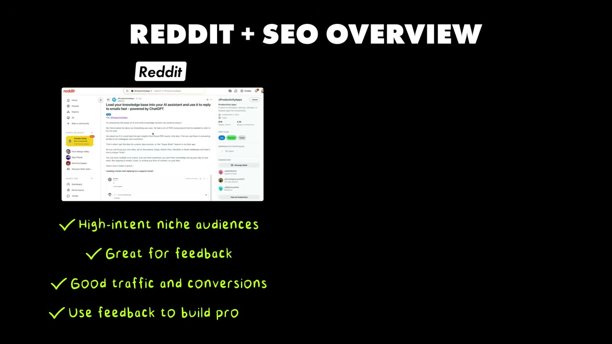
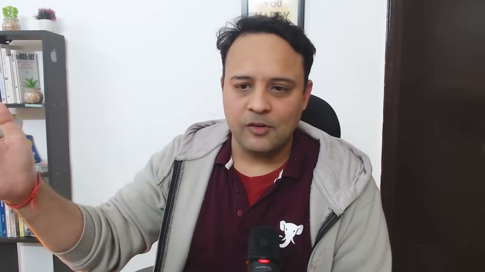
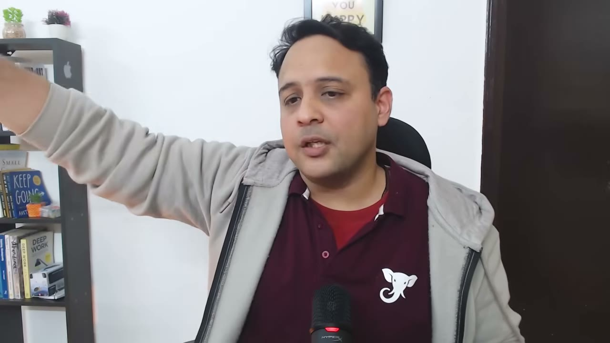
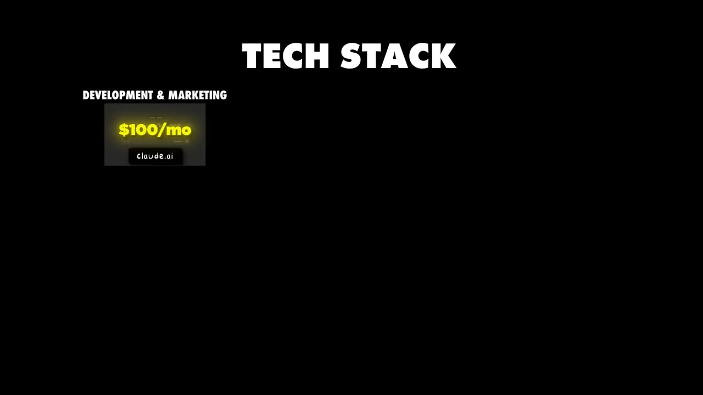
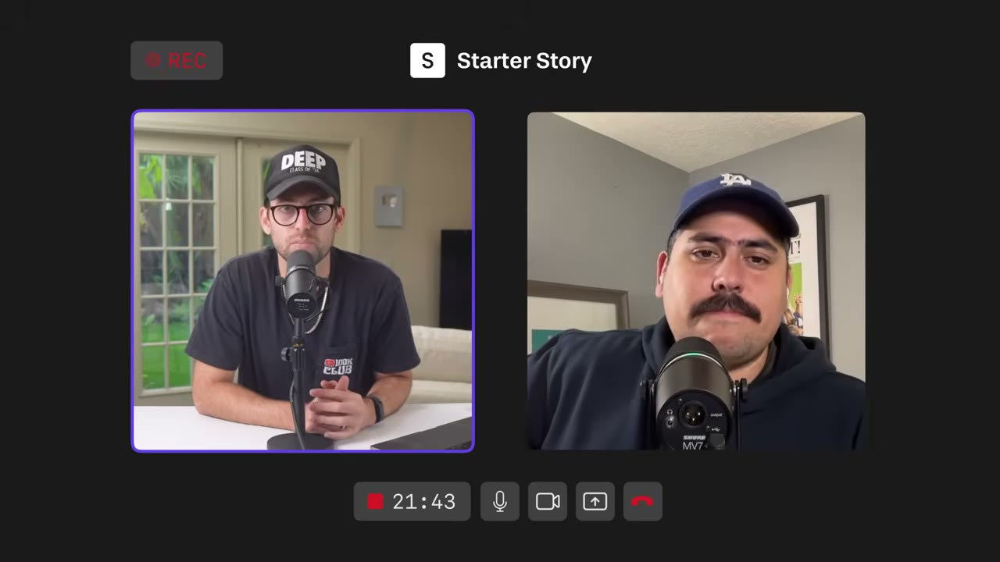

# How I Built a $13K/Month SaaS

✅ **Đã phân tích sâu** → [`case.md`](case.md)

| | |
|---|---|
| **Video** | <https://www.youtube.com/watch?v=R4BS_UiTBPw> |
| **Đăng** | 21/01/2026 |
| **Thời lượng** | 23:08 |
| **Lượt xem** | 43,254 |
| **Lượt thích** | 1,240 |
| **Video ID** | `R4BS_UiTBPw` |

## Trong thư mục này

| File | Nội dung |
|---|---|
| [`case.md`](case.md) | **Phân tích đầy đủ** — ý tưởng, validate, GTM, áp dụng ở VN |
| [`meta.json`](meta.json) | Metadata gốc (chapters, heatmap, mô tả) |
| [`screenshots/`](screenshots/) | 5 ảnh 720p |

## Mô tả gốc

Ayush built Elephas, an AI app that’s making $150K/year. He grew the business in two phases: Phase 1 was Reddit and Phase 2 was SEO. This video breaks down his exact Reddit playbook and his SEO strategy, that helped him go from zero to $150K/year in just a few years.
This video is an educational case study of this founder’s experience. It is not financial advice and does not guarantee any income or results. Every business is different and your results may vary.

## Số liệu bắt được từ transcript

> Các đoạn founder nhắc tới con số, kèm timestamp để tua thẳng tới đó trong video.

_(không bắt được con số nào)_

## Chương

_(không có chapter)_

## Ảnh

1. `01_04m11s_usd-3-000.jpg` — 
2. `02_04m57s_usd-70-000.jpg` — 
3. `03_14m46s_usd-129.jpg` — 
4. `04_17m35s_usd-100.jpg` — 
5. `05_21m28s_usd-10-000.jpg` — 

---

← [Quay lại index](../../index.md) · [Toàn bộ video](../README.md)
