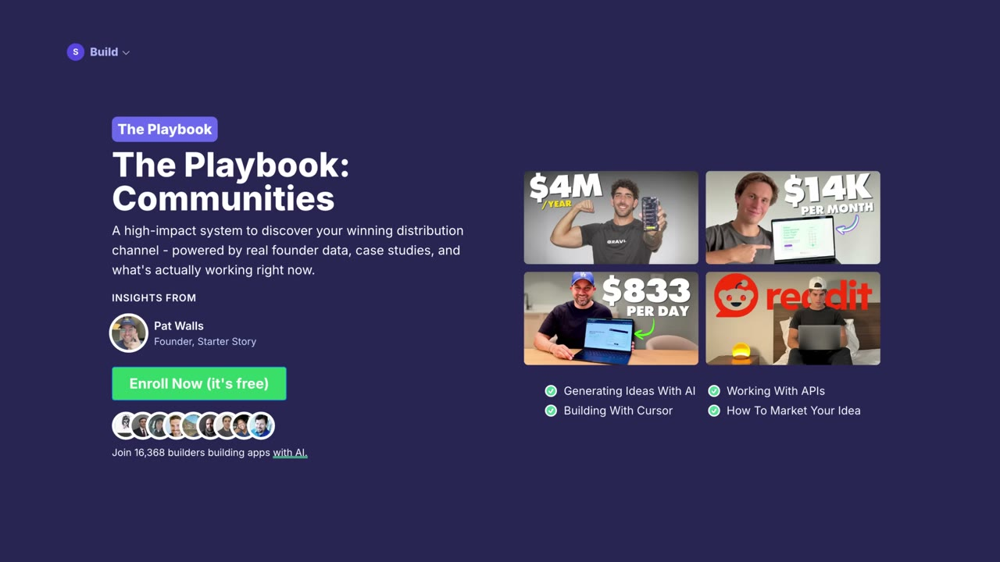
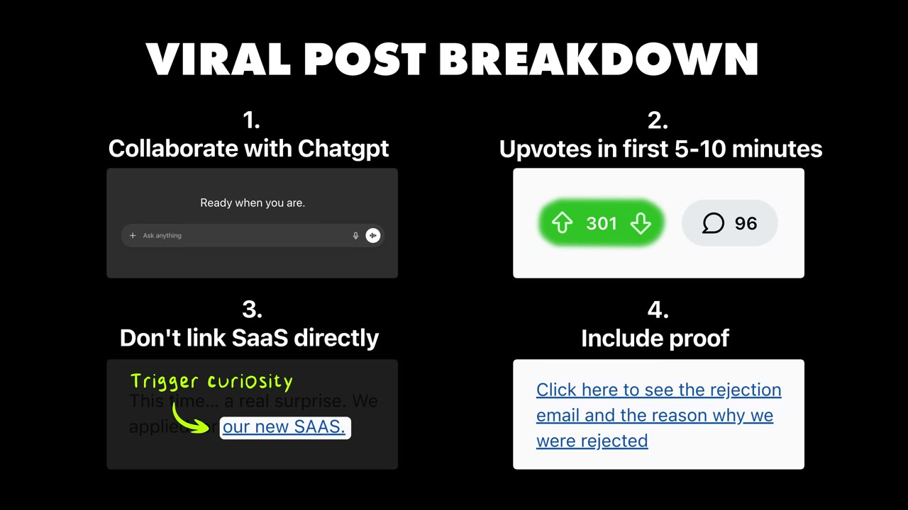
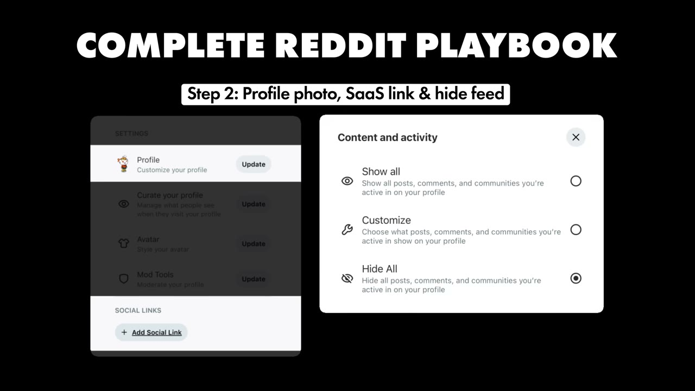
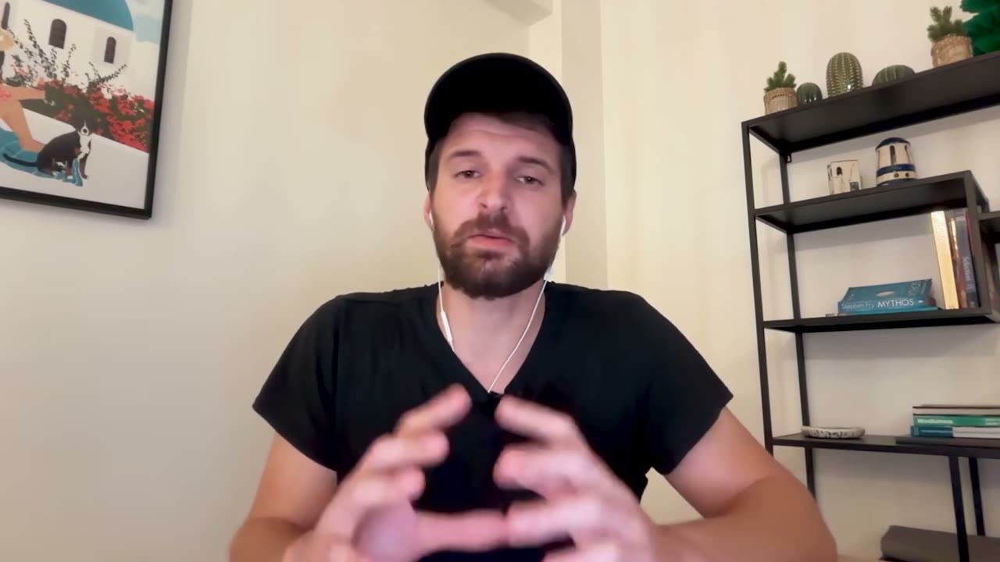
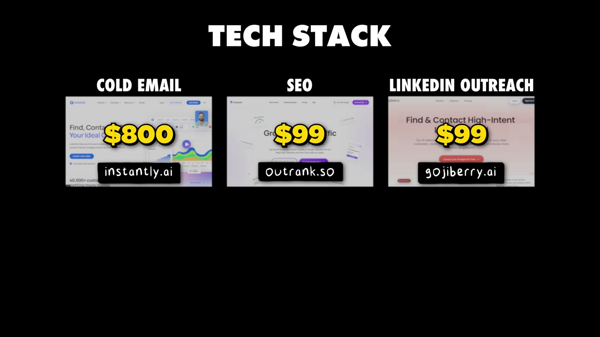

# How I Used Reddit to Build a $34K/Month SaaS

✅ **Đã phân tích sâu** → [`case.md`](case.md)

| | |
|---|---|
| **Video** | <https://www.youtube.com/watch?v=pvjalHFNM9Q> |
| **Đăng** | 25/01/2026 |
| **Thời lượng** | 16:42 |
| **Lượt xem** | 78,259 |
| **Lượt thích** | 2,379 |
| **Video ID** | `pvjalHFNM9Q` |

## Trong thư mục này

| File | Nội dung |
|---|---|
| [`case.md`](case.md) | **Phân tích đầy đủ** — ý tưởng, validate, GTM, áp dụng ở VN |
| [`meta.json`](meta.json) | Metadata gốc (chapters, heatmap, mô tả) |
| [`screenshots/`](screenshots/) | 10 ảnh 720p |

## Mô tả gốc

Romàn Czerny runs a SaaS that makes $34K per month. And much of his early growth is thanks to a genius Reddit strategy. This video is a focused, tactical Reddit playbook: the templates that work, how to avoid getting banned, and how to turn Reddit into a consistent revenue channel for your app.
This video is an educational case study of this founder’s experience. It is not financial advice and does not guarantee any income or results. Every business is different and your results may vary.
00:00:00 Intro
00:01:01 Grab the Reddit playbook (free)
00:01:33 Who is Roman
00:02:03 App dashboard and a

## Số liệu bắt được từ transcript

> Các đoạn founder nhắc tới con số, kèm timestamp để tua thẳng tới đó trong video.

_(không bắt được con số nào)_

## Chương

- `00:00` Intro
- `01:01` Grab the Reddit playbook (free)
- `01:33` Who is Roman
- `02:03` App dashboard and analytics
- `03:05` Founder background
- `03:52` How Reddit impacted the business
- `04:30` Example of Reddit post
- `05:39` Check out the Hustle (sponsor)
- `06:37` Why a Reddit post goes viral
- `07:48` The complete Reddit playbook
- `10:29` Handling haters on Reddit
- `11:49` How his app works
- `12:39` Marketing tech stack
- `13:41` Final advice
- `14:14` Pat and Gus reflections
- `16:09` CHeck out Starter Story Build

## Ảnh

1. `01_00m36s_usd-30-000.jpg` — 
2. `02_01m13s_ch-grab-the-reddit-playbook-free.jpg` — 
3. `03_02m44s_usd-30k.jpg` — 
4. `04_04m32s_usd-1-250.jpg` — 
5. `05_06m49s_ch-why-a-reddit-post-goes-viral.jpg` — 
6. `06_07m45s_replay.jpg` — 
7. `07_08m25s_replay.jpg` — 
8. `08_10m41s_ch-handling-haters-on-reddit.jpg` — 
9. `09_12m01s_ch-how-his-app-works.jpg` — 
10. `10_13m12s_usd-99.jpg` — 

---

← [Quay lại index](../../index.md) · [Toàn bộ video](../README.md)
