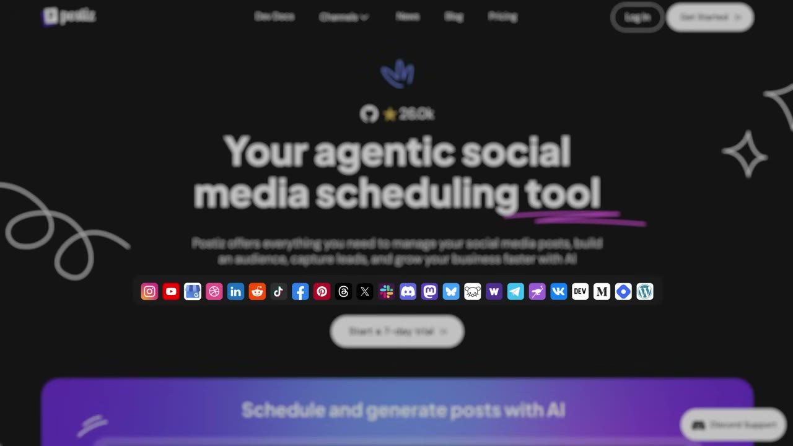
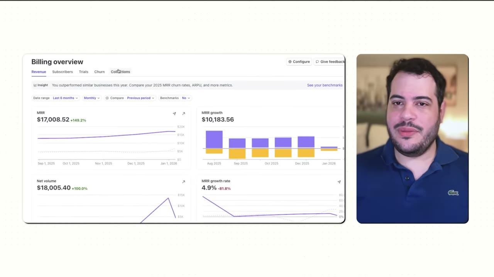
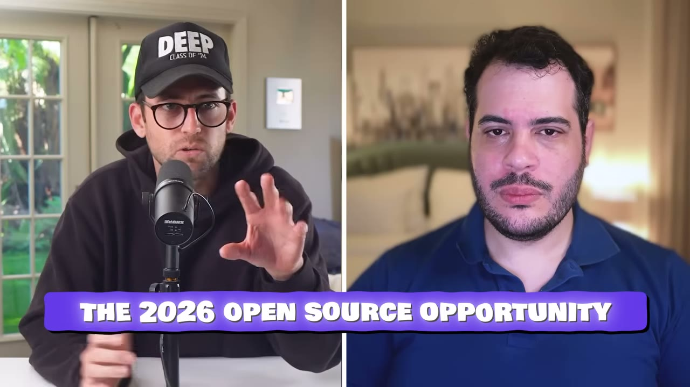
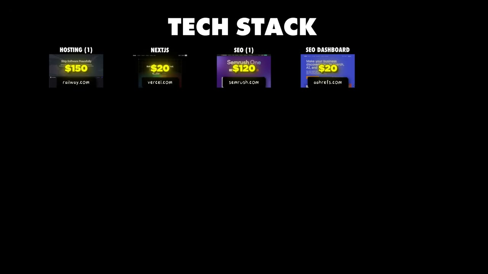
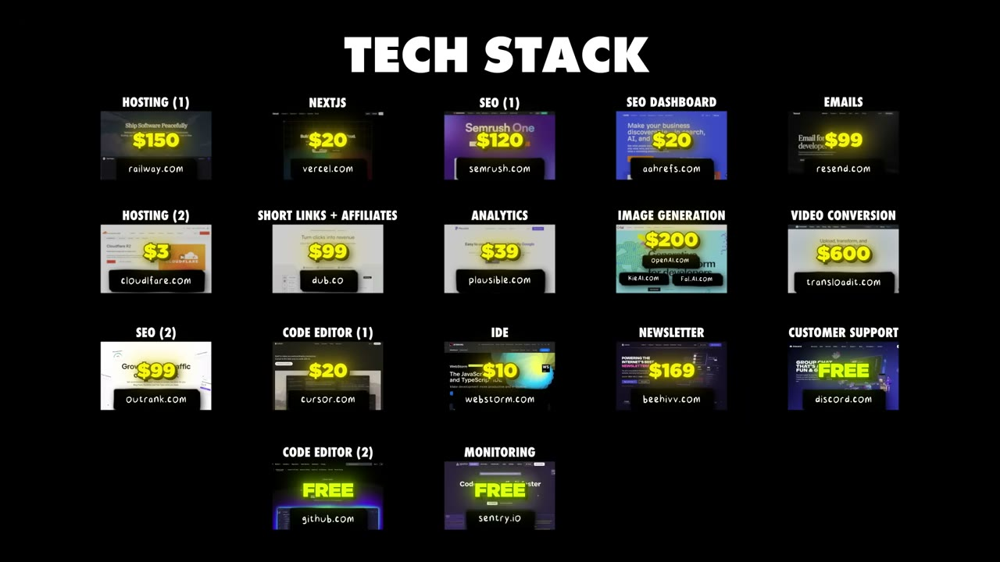

# How I Built It: $17K/Month Open Source SaaS

✅ **Đã phân tích sâu** → [`case.md`](case.md)

| | |
|---|---|
| **Video** | <https://www.youtube.com/watch?v=RPM4ImzcIFc> |
| **Đăng** | 28/01/2026 |
| **Thời lượng** | 22:52 |
| **Lượt xem** | 35,875 |
| **Lượt thích** | 972 |
| **Video ID** | `RPM4ImzcIFc` |

## Trong thư mục này

| File | Nội dung |
|---|---|
| [`case.md`](case.md) | **Phân tích đầy đủ** — ý tưởng, validate, GTM, áp dụng ở VN |
| [`meta.json`](meta.json) | Metadata gốc (chapters, heatmap, mô tả) |
| [`screenshots/`](screenshots/) | 10 ảnh 720p |

## Mô tả gốc

Nevo built an open source SaaS called Postiz. Over the past few years he has gotten over 25K GitHub stars and grown the app to over $17K MRR. This video breaks down how to market open-source projects in 2026 and beyond.
This video is an educational case study of this founder’s experience. It is not financial advice and does not guarantee any income or results. Every business is different and your results may vary.
0:00 - Intro
0:58 - Niche Communities Playbook
1:40 - Who is Nevo?
2:14 - Business Analytics
4:06 - Founder Background
5:14 - Get Compliant with Delve 
6:22 - Why Open Source is a Gr

## Số liệu bắt được từ transcript

> Các đoạn founder nhắc tới con số, kèm timestamp để tua thẳng tới đó trong video.

_(không bắt được con số nào)_

## Chương

- `00:00` Intro
- `00:58` Niche Communities Playbook
- `01:40` Who is Nevo?
- `02:14` Business Analytics
- `04:06` Founder Background
- `05:14` Get Compliant with Delve
- `06:22` Why Open Source is a Great Opportunity
- `10:31` Open Source Playbook
- `16:07` Niche Open Source Communities
- `17:15` How the App Works
- `19:05` Tech Stack
- `20:39` Advice for Open Source
- `22:04` Pat's Final Word

## Ảnh

1. `01_01m10s_ch-niche-communities-playbook.jpg` — 
2. `02_01m54s_usd-17k.jpg` — 
3. `03_02m59s_metric.jpg` — 
4. `04_04m18s_ch-founder-background.jpg` — 
5. `05_05m21s_usd-17-000.jpg` — 
6. `06_06m34s_ch-why-open-source-is-a-great-opportunity.jpg` — 
7. `07_10m43s_ch-open-source-playbook.jpg` — 
8. `08_16m19s_ch-niche-open-source-communities.jpg` — 
9. `09_19m35s_usd-20.jpg` — 
10. `10_20m23s_usd-0.jpg` — 

---

← [Quay lại index](../../index.md) · [Toàn bộ video](../README.md)
