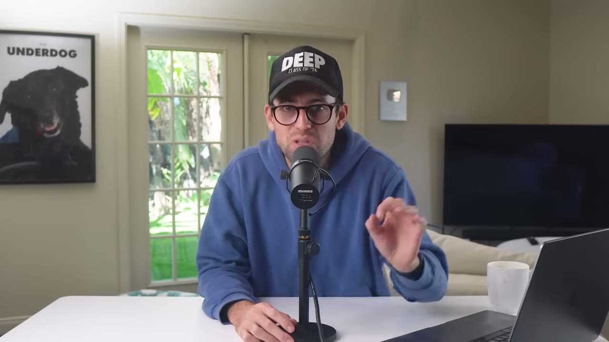
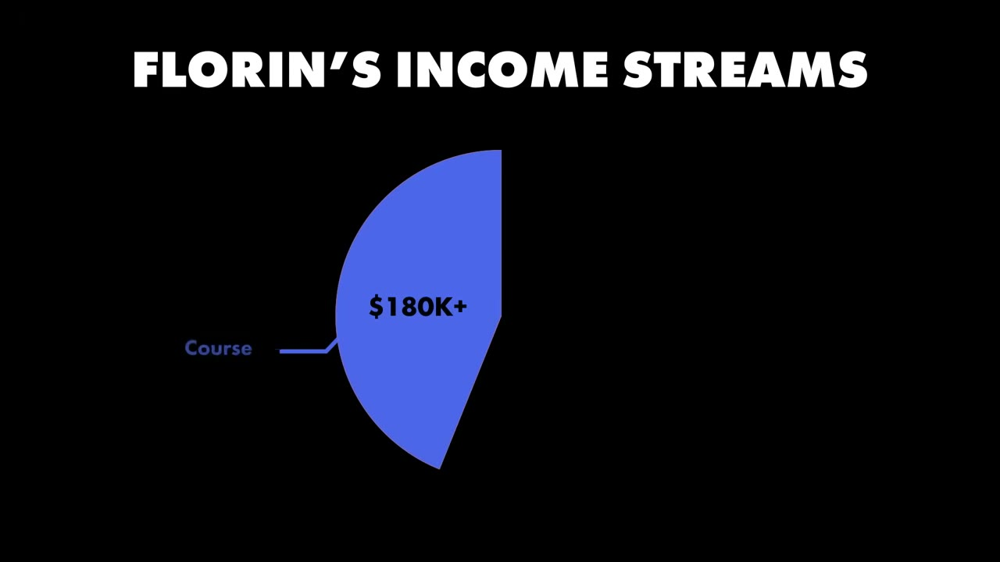
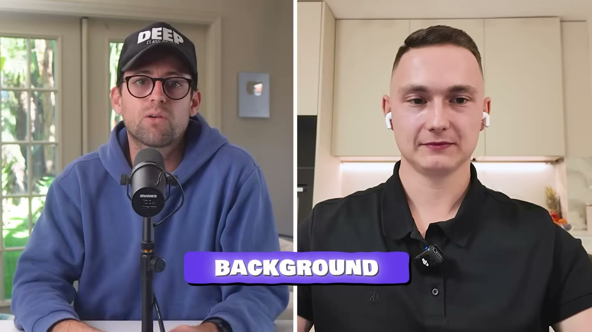
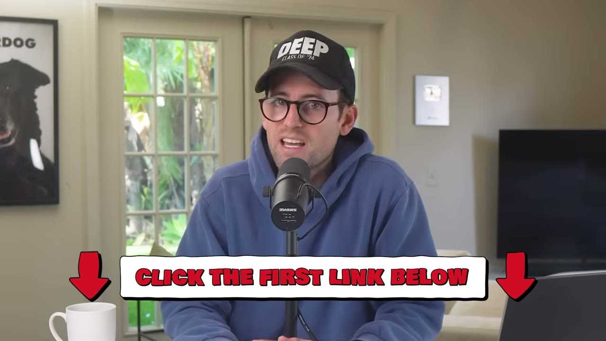
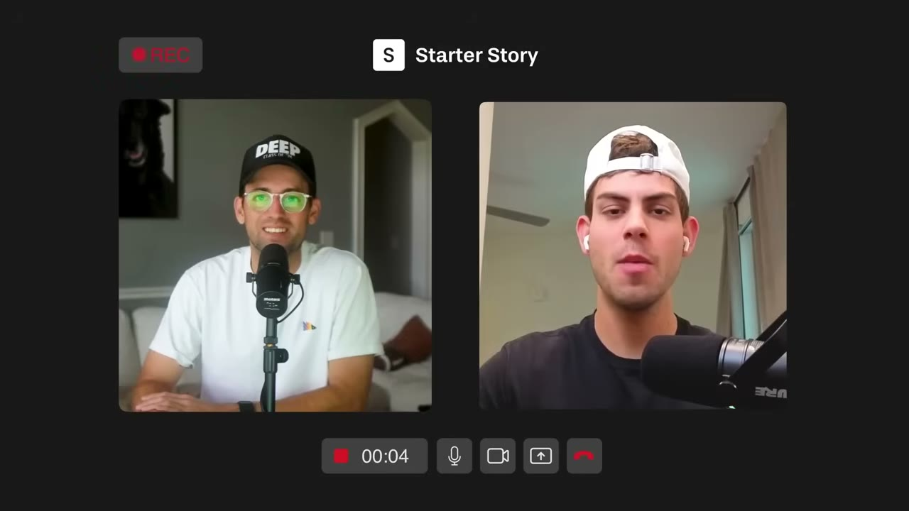
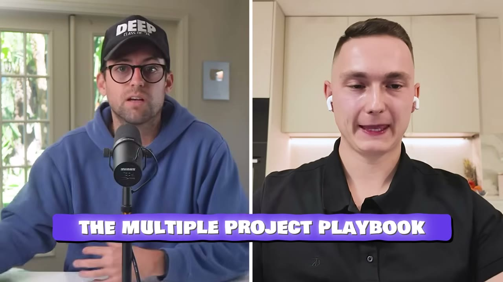
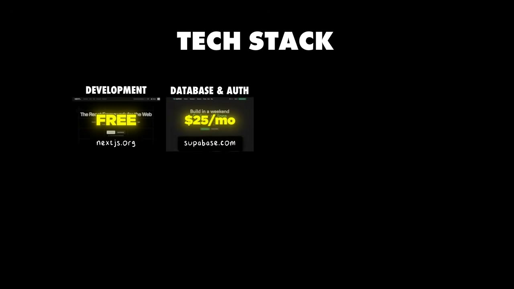
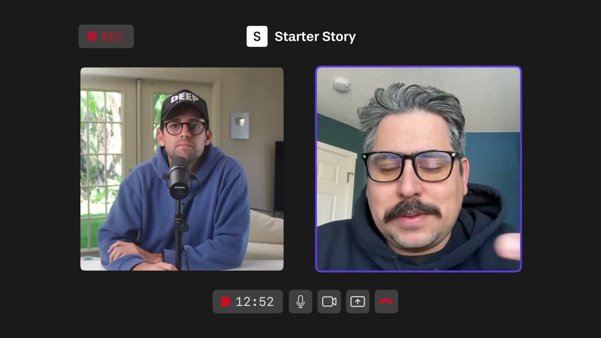

# I Made $500K From 8 Different Income Streams

✅ **Đã phân tích sâu** → [`case.md`](case.md)

| | |
|---|---|
| **Video** | <https://www.youtube.com/watch?v=47QXbPGyzBI> |
| **Đăng** | 01/02/2026 |
| **Thời lượng** | 15:17 |
| **Lượt xem** | 36,321 |
| **Lượt thích** | 995 |
| **Video ID** | `47QXbPGyzBI` |

## Trong thư mục này

| File | Nội dung |
|---|---|
| [`case.md`](case.md) | **Phân tích đầy đủ** — ý tưởng, validate, GTM, áp dụng ở VN |
| [`meta.json`](meta.json) | Metadata gốc (chapters, heatmap, mô tả) |
| [`screenshots/`](screenshots/) | 10 ảnh 720p |

## Mô tả gốc

Florin Pop is a developer who's made $500K over 6 years – not from one breakout hit, but by stacking dozens of tiny projects. This video breaks down his building framework and why playing the long game with a portfolio of projects beats chasing one big win.
This video is an educational case study of this founder’s experience. It is not financial advice and does not guarantee any income or results. Every business is different and your results may vary.
0:00 - Intro
0:53 - Build your first project
1:17 - Who is Florin?
1:44 - Different income streams and projects
2:35 - Founder background
3:28 -

## Số liệu bắt được từ transcript

> Các đoạn founder nhắc tới con số, kèm timestamp để tua thẳng tới đó trong video.

_(không bắt được con số nào)_

## Chương

- `00:00` Intro
- `00:53` Build your first project
- `01:17` Who is Florin?
- `01:44` Different income streams and projects
- `02:35` Founder background
- `03:28` Make sure your company is compliant (sponsor)
- `04:39` Why multiple projects works
- `06:18` How to manage multiple projects/apps
- `07:15` What it takes to build a successful portfolio
- `08:19` Ready to launch your own project?
- `08:59` Multi-project playbook
- `11:31` Tech stack
- `12:00` Final advice
- `12:34` Pat and Gus final thoughts
- `14:53` Take action!!

## Ảnh

1. `01_01m05s_ch-build-your-first-project.jpg` — 
2. `02_01m55s_usd-180-000.jpg` — 
3. `03_02m47s_ch-founder-background.jpg` — 
4. `04_04m28s_usd-1-000.jpg` — 
5. `05_06m30s_ch-how-to-manage-multiple-projects-apps.jpg` — 
6. `06_07m27s_ch-what-it-takes-to-build-a-successful-portfo.jpg` — 
7. `07_08m31s_ch-ready-to-launch-your-own-project.jpg` — 
8. `08_09m11s_ch-multi-project-playbook.jpg` — 
9. `09_11m43s_ch-tech-stack.jpg` — 
10. `10_12m46s_ch-pat-and-gus-final-thoughts.jpg` — 

---

← [Quay lại index](../../index.md) · [Toàn bộ video](../README.md)
