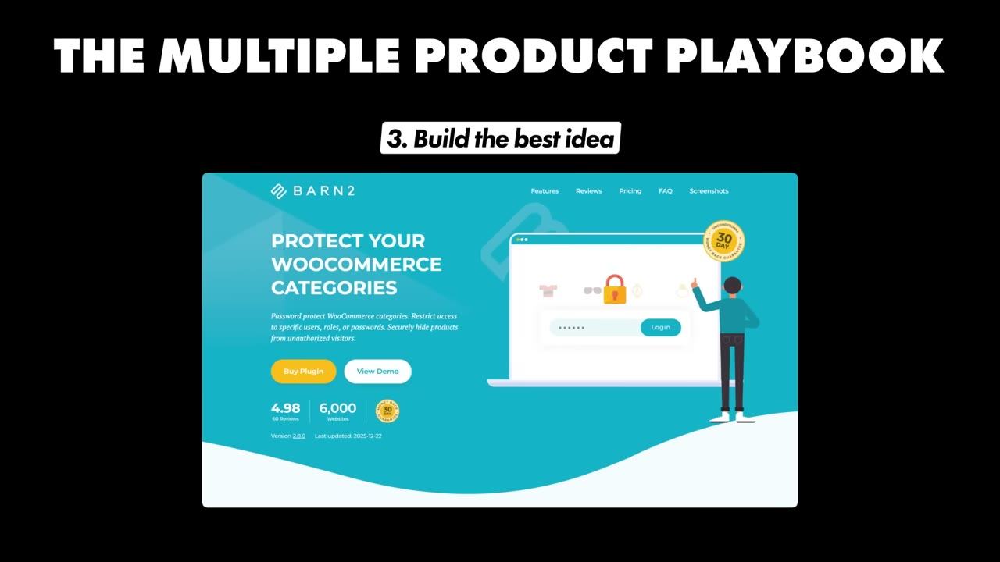
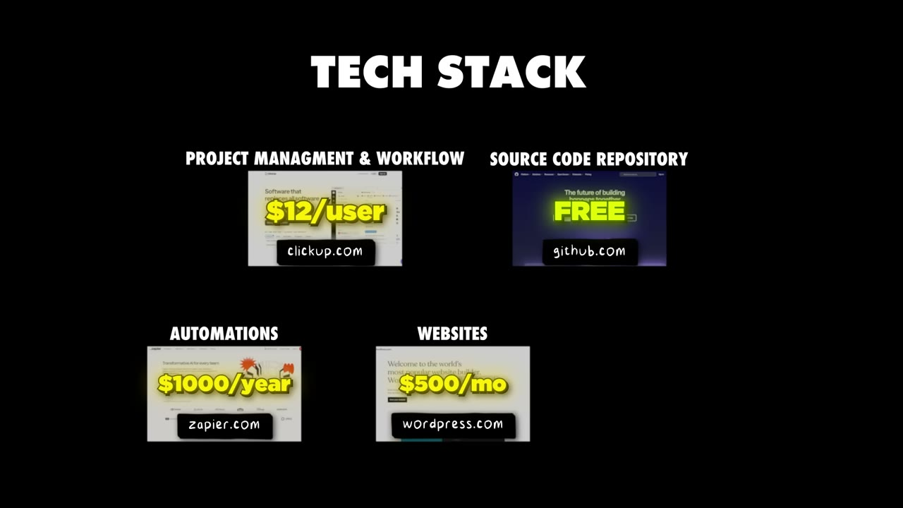

# I Make $150K/Month From 20 Tiny Apps

✅ **Đã phân tích sâu** → [`case.md`](case.md)

| | |
|---|---|
| **Video** | <https://www.youtube.com/watch?v=9sJ2R0rM3CA> |
| **Đăng** | 08/02/2026 |
| **Thời lượng** | 16:53 |
| **Lượt xem** | 150,903 |
| **Lượt thích** | 3,423 |
| **Video ID** | `9sJ2R0rM3CA` |

## Trong thư mục này

| File | Nội dung |
|---|---|
| [`case.md`](case.md) | **Phân tích đầy đủ** — ý tưởng, validate, GTM, áp dụng ở VN |
| [`meta.json`](meta.json) | Metadata gốc (chapters, heatmap, mô tả) |
| [`screenshots/`](screenshots/) | 10 ảnh 720p |

## Mô tả gốc

Katie Keith runs a portfolio of plugins that generate over $1M/year in revenue. This video breaks down her multi-product playbook: how she built 20 products and how she allocates resources across them. 
This video is an educational case study of this founder’s experience. It is not financial advice and does not guarantee any income or results. Every business is different and your results may vary.
0:00 - Intro
1:52 - Apps Overview and Analytics
3:40 - Finding the first app idea
5:16 - Growth multiple products
6:23 - Make sure your app is compliant (sponsor)
7:41 - Cross-promotion growth strate

## Số liệu bắt được từ transcript

> Các đoạn founder nhắc tới con số, kèm timestamp để tua thẳng tới đó trong video.

_(không bắt được con số nào)_

## Chương

- `00:00` Intro
- `01:52` Apps Overview and Analytics
- `03:40` Finding the first app idea
- `05:16` Growth multiple products
- `06:23` Make sure your app is compliant (sponsor)
- `07:41` Cross-promotion growth strategy
- `09:08` The multi-product playbook
- `11:52` Tech stack
- `13:09` Final advice
- `14:10` Pat and Gus reflections
- `16:33` Build your first app!!

## Ảnh

1. `01_01m40s_usd-1-8-m.jpg` — 
2. `02_02m56s_usd-150-000.jpg` — 
3. `03_03m52s_ch-finding-the-first-app-idea.jpg` — 
4. `04_05m28s_ch-growth-multiple-products.jpg` — 
5. `05_07m21s_usd-1-500.jpg` — 
6. `06_09m20s_ch-the-multi-product-playbook.jpg` — 
7. `07_10m42s_replay.jpg` — 
8. `08_12m04s_ch-tech-stack.jpg` — 
9. `09_12m54s_replay.jpg` — 
10. `10_14m22s_ch-pat-and-gus-reflections.jpg` — 

---

← [Quay lại index](../../index.md) · [Toàn bộ video](../README.md)
