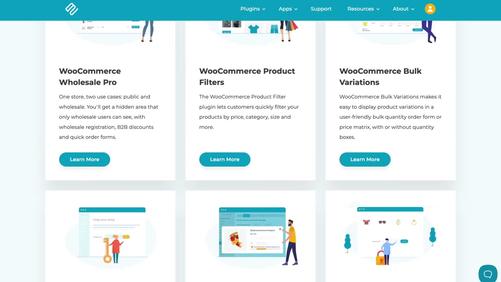
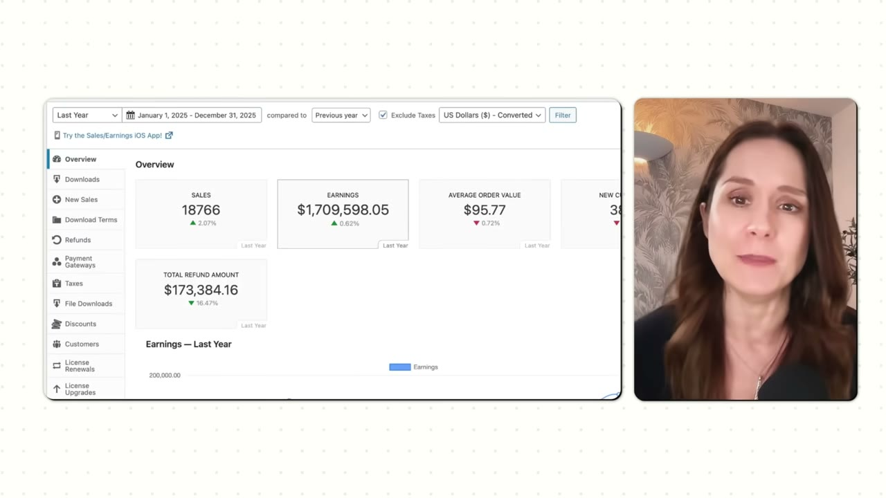
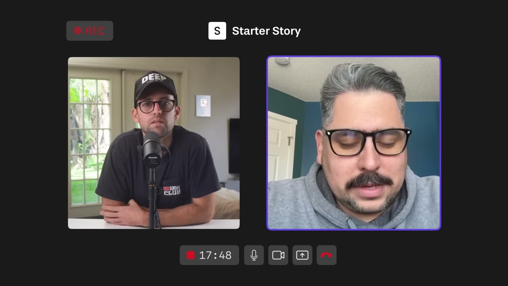

# Barn 2 Plugins — $150K/tháng từ 20 plugin nhỏ bán cho cùng một tệp khách

> **Tóm tắt 30 giây:** Katie Keith có 19 plugin WordPress + 1 app Shopify, trung bình **$150.000/tháng**, lũy kế **9,8 triệu USD** trong 10 năm. Điều khác biệt không nằm ở số lượng app mà ở **cấu trúc**: cả 20 sản phẩm bán cho **cùng một người mua** (chủ site WordPress / cửa hàng WooCommerce), nên mỗi khách mua được nhiều lần. Ý tưởng plugin đầu tiên lấy từ **forum bình chọn tính năng của WooCommerce** — chọn cái nhiều người vote nhất; các ý tưởng sau đến từ chính yêu cầu tính năng của khách. Và nguyên tắc cứng: *"Đừng build nhiều sản phẩm rồi tung ra cùng lúc."*

## 1. Con số

| Chỉ số | Giá trị |
|---|---|
| Số sản phẩm | 20 (19 plugin WordPress + 1 app Shopify) |
| Doanh thu 2025 | **hơn $1,7 triệu** (dashboard) |
| Trung bình tháng | **~$150.000** |
| Doanh thu lũy kế | **$9,8 triệu** plugin đã bán |
| Khách trả tiền (subscription) | **17.000** đang hoạt động |
| Site đang cài | hơn 90.000 |
| Tỉ trọng gói lifetime | 15% doanh thu |
| Gói bán | 1 site / 5 site / 20 site — theo năm hoặc lifetime |
| Mùa vụ | cao nhất tháng 11, thấp nhất tháng 12 |

**Ba điểm cần soi kỹ về số liệu — kho này không tô hồng:**

1. **$1,8 triệu vs $1,7 triệu.** Katie mở đầu bằng "$1,8 triệu/năm", rồi khi bật dashboard lại nói: *"You can see it's just over 1.7 million dollars. I know I said 1.8 million earlier. That's because we have other revenue streams such as affiliate income. And we offer some development services."* Nghĩa là **$1,7 triệu là doanh thu phần mềm**, phần chênh ~$100K là affiliate + dịch vụ. Tôi lấy $1,7 triệu làm cơ sở vì có ảnh dashboard.
2. **Con số 90.000 site tự mâu thuẫn.** Nguyên văn: *"our plugins are used on over 90,000 sites. That's the premium plugins. And also we have free versions of some of our plugins. So, that is the total number."* Hai câu này chỏi nhau — không rõ 90.000 là chỉ bản trả phí hay gồm cả bản miễn phí. Đừng dùng con số này để tính tỉ lệ chuyển đổi.
3. **17.000 khách chưa phải tổng số khách trả tiền.** Katie nói rõ con số này **không tính người mua lifetime** — mà lifetime chiếm 15% doanh thu. Tổng khách trả tiền thật sự cao hơn đáng kể.

**Bối cảnh quan trọng nhất:** đây là doanh nghiệp **10 năm tuổi**, có **đội remote**, không phải một solo founder chạy 20 app bằng AI trong 12 tháng. Tiêu đề video ("20 tiny apps") gợi ý một thứ dễ hơn thực tế rất nhiều.

## 2. Cấu trúc thật sự đứng sau con số ⭐⭐⭐

Đây là phần quan trọng nhất và cũng là phần dễ bị hiểu sai nhất của case này. Producer Gus tóm gọn chính xác:

> *"Khi cô ấy làm **sai cách**, cô ấy build những app ngẫu nhiên cho những khách hàng khác nhau. Khi cô ấy làm **đúng cách** theo chiến lược đa sản phẩm, cô ấy build những app khác nhau cho **cùng một khách hàng**, nhưng bán riêng lẻ. Thay vì nhét nó vào làm tính năng của một app monolith khổng lồ, cô ấy tạo ra một app khác rồi cross-sell — điều này thực ra **tốt hơn cho khách**, vì họ không cần tất cả mọi thứ và app to sẽ làm họ rối."*

Hãy đọc lại câu đó thật chậm. Nó là ranh giới giữa Barn 2 và [người build 100 app mà kiếm $0](../2026-08-22_he-built-100-apps-and-made-0-can-he-fix-it-in-30-day/case.md).

**Cơ chế kinh tế** (phần này video không giải thích, tôi bổ sung):

| Yếu tố | Danh mục app ngẫu nhiên | Danh mục cùng một ICP (Barn 2) |
|---|---|---|
| CAC | Trả lại từ đầu cho mỗi sản phẩm | Trả **một lần**, khấu hao qua nhiều sản phẩm |
| Nội dung SEO | Mỗi app một cụm từ khoá riêng, không cộng dồn | Cùng một cụm chủ đề, domain authority cộng dồn |
| Email list | 20 list nhỏ vô dụng | **Một list lớn**, mỗi sản phẩm mới là một chiến dịch bán hàng |
| Support | 20 miền kiến thức khác nhau | Một miền kiến thức, nhân viên support dùng chung |
| Ý tưởng mới | Phải đi tìm | **Khách tự gửi tới** dưới dạng feature request |

Nói cách khác, tài sản Katie xây trong 10 năm **không phải 20 plugin**. Tài sản là **17.000 khách WordPress cùng thuộc một thế giới** — và 20 plugin chỉ là 20 cách rút tiền từ tài sản đó.

Đây cũng là điều phân biệt case này với các case đa sản phẩm khác trong kho: [Marc Lou](../2026-04-26_how-i-work-77k-month-solopreneur/case.md) dùng personal brand làm chất kết dính, [Jacky Chow](../2026-03-22_i-make-250k-month-from-13-businesses-after-losing-ev/case.md) dùng nhiều ngành khác nhau để phân tán rủi ro. Katie thì dùng **một ICP duy nhất** làm chất kết dính — cách này chậm hơn nhưng cross-sell mạnh nhất.

## 3. Ý tưởng đến từ đâu — ba nguồn, theo đúng thứ tự thời gian ⭐⭐⭐

Katie phủ nhận thẳng cái huyền thoại "ngồi nghĩ ra 19 ý tưởng":

> *"Chúng tôi chưa bao giờ có 19 ý tưởng. Chúng tôi không ngồi xuống và nghĩ 'nào, hãy build 19 plugin WordPress rồi tung một app Shopify'. Nó diễn ra hữu cơ hơn thế nhiều."*

**Nguồn 1 — Forum bình chọn tính năng (plugin đầu tiên).**
Có một website tên **WooCommerce Ideas Forum**, nơi người dùng đăng và **vote** cho tính năng họ muốn. Katie chọn **ý tưởng nhiều người vote nhất** và build đúng cái đó: *WooCommerce Protected Categories* — chặn quyền truy cập vào một số danh mục trong cửa hàng. *"Dead simple"*, theo lời cô.

Vì sao cách này hiệu quả: một forum vote **đã làm sẵn việc validate cho bạn**. Số vote là bằng chứng nhu cầu; và quan trọng hơn, nó cho bạn **chính xác câu chữ** mà người dùng dùng để mô tả vấn đề — nguyên liệu thô cho SEO sau này.

**Nguồn 2 — Dự án khách hàng (plugin thứ hai).**
*Post Table Pro* (liệt kê bất kỳ loại nội dung nào của WordPress thành bảng có tìm kiếm) sinh ra từ một dự án làm thuê. Họ tiếp tục thêm tính năng rồi phát hành thành plugin trả phí.

Đây là mô hình "**agency to product**" cổ điển: khách trả tiền cho bạn để build phiên bản đầu tiên, bạn giữ quyền sở hữu code.

**Nguồn 3 — Yêu cầu tính năng của khách (mọi plugin sau đó).** Và đây là mấu chốt:

> *"Khách bắt đầu gửi cho chúng tôi yêu cầu tính năng mới cho plugin đó. Và đôi khi, cách tốt nhất để đạt được điều họ muốn **không phải là một tính năng, mà là một plugin hoàn toàn khác**."*

> *"Hãy đưa một sản phẩm ra ngoài kia rồi mở tai ra, vì đó là lúc thông tin tự chảy về phía bạn mà không cần phải đi hỏi."*

**Vì sao đây là insight đắt:** hầu hết founder nghe feature request và tự động nhét nó vào sản phẩm hiện tại — sản phẩm phình lên, onboarding rối, churn tăng. Katie làm ngược lại: **coi mỗi feature request lớn như một SKU mới**. Với plugin WordPress điều này đặc biệt hợp lý vì như Gus nói: *"Với plugin, bạn có thể cài cả 19 cái và nó vẫn chạy."* Kiến trúc plugin cho phép tách sản phẩm mà không bắt người dùng phải chuyển đổi công cụ.

## 4. Kênh tăng trưởng: organic search — và lời thú nhận trung thực ⭐⭐

> *"Hầu hết khách hàng của chúng tôi luôn đến từ organic search."*

Câu chuyện plugin đầu tiên:
1. Họ tìm thấy **khoảng trống thị trường** trên forum — không có plugin nào làm việc đó.
2. Katie (vốn là marketer) viết bài blog và tutorial: *cách đặt mật khẩu bảo vệ danh mục trong WooCommerce*.
3. Vì chủ đề độc nhất → **lên top Google gần như ngay lập tức**.
4. **Có đơn hàng đầu tiên trong vòng vài ngày.**

Rồi cô nói thẳng điều mà rất ít người trên các kênh này chịu nói:

> *"Giờ thì tôi biết là không dễ để tìm được một ý tưởng độc nhất như vậy, **đặc biệt là 10 năm sau**. Nhưng đó là cái chúng tôi đã làm."*

**Hãy tin câu này.** Cửa sổ "build cái duy nhất trong ngách rồi lên top Google trong vài ngày" của năm 2016 đã đóng. Nếu bạn muốn tái lập kết quả này năm 2026, bạn cần một cơ chế phân phối khác — ví dụ [YouTube search của FollowBuddy](../2026-03-19_i-make-17k-month-with-one-strategy/case.md) hoặc [content flywheel của BulkMockup](../2026-02-11_how-i-built-a-12k-month-micro-saas/case.md) — chứ không phải lặp lại chiến thuật SEO của 10 năm trước.

Phần bền vững hơn trong lời cô: *"Chúng tôi luôn rất giỏi trong việc sản xuất nội dung thật sự hữu ích và độc đáo về **một dải rộng các use case** liên quan tới plugin của mình."* Chú ý từ **use case** — không phải viết về sản phẩm, mà viết về từng tình huống cụ thể mà người dùng đang gặp. Với 20 plugin, số lượng use case có thể viết là con số nhân, và đó chính là lý do danh mục sản phẩm và SEO cộng hưởng với nhau.

## 5. Bộ máy cross-promotion — chi tiết chiến thuật ⭐⭐⭐

Đây là phần hành động được ngay, và cũng là phần khiến 20 sản phẩm sinh ra nhiều hơn tổng của chúng.

> *"Có nhiều sản phẩm — nhất là những sản phẩm **rất liên quan tới nhau** — cực kỳ hữu ích, vì nó cho phép chúng tôi cross-promote và **lấy nhiều đơn hàng từ cùng một khách**."*

Cụ thể Barn 2 làm:

| Chiến thuật | Chi tiết |
|---|---|
| **Bundle** | Có các gói bundle nhiều plugin, bán kèm nhau |
| **Cặp upsell định sẵn** | Với **mỗi** sản phẩm, họ **chọn trước** một plugin liên quan chặt để upsell — không upsell ngẫu nhiên |
| **Email hậu mua hàng** | **3 ngày sau khi mua**, gửi email giảm **50%** cho plugin tiếp theo |
| **Black Friday phân tách** | Hai chiến dịch riêng: một cho khách tiềm năng, một cho khách hiện hữu. Với khách hiện hữu dùng câu chữ *"giảm giá cho plugin **tiếp theo** của bạn"* |
| **Phân khúc danh sách** | Chỉ gợi ý sản phẩm **rất liên quan** tới cái họ đang dùng |
| **Banner trong sản phẩm** | Đặt banner ngay trên **trang settings** của plugin — nhắc liên tục rằng có sản phẩm bổ trợ |

> *"Mẹo ở đây là nhắm đúng khách và phân khúc danh sách để bạn gợi ý những sản phẩm rất liên quan tới cái họ đang dùng. Điều đó tối đa hoá khả năng họ sẽ mua."*

**Vì sao "3 ngày" là con số thông minh:** ngày thứ 3 sau khi mua là lúc khách vừa cài xong, vừa cảm nhận được giá trị đầu tiên, và **vẫn còn đang ở trong bối cảnh của vấn đề**. Chờ 30 ngày thì họ đã quay lại công việc khác; gửi ngay ngày đầu thì họ chưa kịp thấy sản phẩm đầu tiên có hoạt động không.

**Vì sao banner trên trang settings là kênh rẻ nhất:** đó là **traffic bạn đã sở hữu, chi phí biên bằng 0, và đến đúng lúc người dùng đang mở công cụ ra để làm việc**. Không quảng cáo trả phí nào sánh được về tỉ lệ chuyển đổi trên mỗi đồng bỏ ra. Đây là lợi thế mà chỉ danh mục sản phẩm cùng ICP mới có — nếu 20 app của bạn phục vụ 20 nhóm khác nhau, banner này vô nghĩa.

## 6. Playbook 5 bước nếu làm lại từ đầu năm 2026 ⭐⭐⭐

Pat hỏi thẳng: nếu bắt đầu lại hôm nay thì làm thế nào? Katie trả lời có cấu trúc:

**Bước 1 — Chọn lĩnh vực bạn ĐÃ quen.**
> *"Nếu tôi đang build website WordPress cho khách, thì tôi sẽ nhìn vào việc tạo sản phẩm WordPress. Hãy nghĩ xem kinh nghiệm của bạn nằm ở đâu, vì đó là nơi bạn có **insight độc nhất về các khoảng trống** và về thứ người dùng đang tìm."*

**Bước 2 — Nghĩ ra NHIỀU ý tưởng CÙNG LÚC (nhưng chỉ nghĩ, chưa build).**
Bắt đầu bằng một danh sách dài → research và validate **từng ý tưởng** → chọn ra một nhóm nhỏ có tiềm năng nhất → và tiêu chí lọc then chốt:
> *"...và ưu tiên những ý tưởng có **thị trường chồng lấn nhau**, để bạn có được cơ hội cross-promotion đó."*

Đây là bước mà 99% người làm danh mục app bỏ qua. Họ chọn ý tưởng theo "cái nào dễ build nhất" hoặc "cái nào đang hot". Katie chọn theo **mức độ chồng lấn của tệp khách**.

**Bước 3 — Build đúng MỘT cái, cái có tiềm năng lớn nhất, và tung ra như sản phẩm duy nhất.**
Tiêu chí chọn: audience lớn nhất mà bạn vẫn tin mình giành được thị phần **về mặt marketing** (chú ý: tiêu chí marketing, không phải tiêu chí kỹ thuật).
> *"Đừng build nhiều sản phẩm rồi tung ra cùng lúc, vì mỗi lần build một sản phẩm, bạn cần cho nó một khoảng thời gian tử tế để làm marketing và tăng trưởng mà không bị phân tâm, và cũng để lắng nghe những người dùng đầu tiên. **Đừng dàn mỏng mình ra bằng cách tung 5 sản phẩm một lúc.**"*

**Bước 4 — Sản phẩm thứ hai: bán như sản phẩm độc lập + cross-promotion nâng cao.**
Nhấn mạnh "**standalone**": mỗi plugin phải tự đứng được, tự có trang bán hàng, tự có nội dung SEO riêng. Cross-promotion là phần cộng thêm, không phải phần chống đỡ. Chiến thuật cụ thể: liên kết chéo trên website, email khách hiện hữu kèm giảm giá, mời họ beta test, thêm trang về sản phẩm mới vào **tài liệu hướng dẫn** của sản phẩm cũ, email hậu mua hàng.

**Bước 5 — Lặp lại, nhưng có ngưỡng dừng.**
> *"...cho tới khi bạn có một danh mục sản phẩm tử tế, **mỗi cái đều tạo ra doanh thu**, nhưng bạn chưa dàn mỏng đến mức không làm tốt được cái nào."*

**Điều làm playbook này khác với "ship 20 app": nó chỉ cho phép bạn sang sản phẩm tiếp theo khi sản phẩm hiện tại đã tự tạo doanh thu.** Đó là ràng buộc mà [người build 100 app kiếm $0](../2026-08-22_he-built-100-apps-and-made-0-can-he-fix-it-in-30-day/case.md) đã không có.

## 7. Mâu thuẫn giữa các founder: build nhiều hay tập trung một? ⭐⭐

Kho này đã tích lũy đủ dữ liệu để phân định câu hỏi kinh điển đó. Không ai đúng tuyệt đối — điều kiện mới quyết định.

| Quan điểm | Ai | Đúng khi nào |
|---|---|---|
| Danh mục nhiều sản phẩm **cùng một ICP**, tuần tự, mỗi cái phải sinh lời rồi mới sang cái kế | Katie Keith (case này) | Bạn đã có kiến thức sâu về một ngách và kênh phân phối cộng dồn (SEO, email list) |
| Ship thật nhiều, thật nhanh, để thị trường chọn | [Marc Lou](../2026-04-26_how-i-work-77k-month-solopreneur/case.md) | Bạn có sẵn audience để tung sản phẩm và chi phí build gần bằng 0 |
| Đa dạng hoá qua nhiều **ngành** để chống rủi ro nền tảng | [Jacky Chow](../2026-03-22_i-make-250k-month-from-13-businesses-after-losing-ev/case.md) | Bạn đã có dòng tiền và đang phòng thủ, không còn đang tìm sản phẩm đầu tiên |
| Build 100 app → **$0** | [case 100 app](../2026-08-22_he-built-100-apps-and-made-0-can-he-fix-it-in-30-day/case.md) | Đây là kết quả mặc định nếu bạn build nhiều mà **không có ICP chung và không có kênh phân phối** |

**Phân định:** biến quyết định **không phải số lượng sản phẩm**, mà là **bạn đã có tài sản phân phối chưa**.

- Chưa có audience, chưa có list, chưa có domain rank → **làm đúng một cái** cho tới khi nó tự sinh khách. Đây chính là bước 3 của Katie.
- Đã có tài sản phân phối cho một ICP → **mỗi sản phẩm mới gần như miễn phí về mặt CAC**, và lúc đó danh mục là chiến lược thắng.

Nói gọn: **danh mục sản phẩm là phần thưởng cho việc đã có phân phối, không phải cách để có được phân phối.**

## 8. Mô hình giá — chi tiết nhỏ nhưng quan trọng

| Yếu tố | Cách Barn 2 làm |
|---|---|
| Trục định giá | Theo **số lượng site**: 1 / 5 / 20 |
| Chu kỳ | Subscription theo **năm**, hoặc mua **lifetime** |
| Tỉ trọng lifetime | 15% doanh thu |

**Vì sao trục "số site" thông minh hơn trục "số tính năng":** khách WordPress lớn nhất là **agency và freelancer làm site cho nhiều khách**. Họ không cần tính năng nhiều hơn, họ cần **cài trên nhiều site hơn**. Định giá theo trục này khiến giá tăng đúng theo giá trị khách nhận được, và không bắt người dùng nhỏ phải trả cho tính năng họ không dùng.

**Về gói lifetime:** Katie giữ nó ở mức 15% doanh thu. Đây là mức lành mạnh — lifetime deal kéo dòng tiền về sớm nhưng ăn vào doanh thu tương lai và tạo gánh nặng support vĩnh viễn. So sánh với [Floga](../2026-03-29_my-app-made-120k-in-24-hours/case.md) — nơi lifetime deal là một sự kiện dòng tiền một lần — thì Barn 2 dùng lifetime như **một kênh phụ có kiểm soát**, không phải trụ cột.

## 9. Tech stack — đơn giản đến mức đáng ngạc nhiên

| Hạng mục | Công cụ | Ghi chú |
|---|---|---|
| Quản lý dự án + chấm công + chat nội bộ | **ClickUp** | Dùng rất nặng, gộp cả ba chức năng vào một |
| Source code | **GitHub** | Miễn phí |
| Tự động hoá | **Zapier** | Dùng nhiều |
| Website công ty | **WordPress** | Hiển nhiên |
| Bán hàng + cấp license + giao file | **Easy Digital Downloads** | **~$300/năm** cho toàn bộ hệ thống bán 20 sản phẩm |

$300/năm để vận hành hạ tầng thanh toán và cấp license cho một doanh nghiệp $1,7 triệu/năm. Chi phí công cụ **không phải là rào cản** trong mô hình này — rào cản là 10 năm nội dung và quan hệ khách hàng.

## 10. Lời khuyên cuối và phần phản biện của Pat/Gus

Katie:
> *"Lời khuyên của tôi là **cứ làm đi**. Nghĩa là bắt tay vào việc và tung ra một sản phẩm. Vì một khi bạn đưa được thứ gì đó ra thế giới, cơ hội sẽ bắt đầu tìm đến bạn. Kể cả nếu sản phẩm đầu tiên không thành công, bạn sẽ học được cực nhiều, và hy vọng nhận được phản hồi cùng những yêu cầu tính năng — thứ có thể dẫn tới các sản phẩm thành công sau này. Còn nếu bạn không làm gì, thì sẽ chẳng có gì xảy ra với bạn."*

Pat bổ sung một quan sát về **thời điểm** — và đây là lý do case 10 năm tuổi này vẫn đáng đọc năm 2026:

> *"Trước đây bạn sẽ bị coi là điên nếu có nhiều sản phẩm. Vì sao? Vì build nhiều sản phẩm nghĩa là nhiều đội kỹ thuật. Nếu phần mềm của bạn có một bug mỗi ngày, mà bạn có 19 phần mềm, thì bạn có **19 bug mỗi ngày**, và đời bạn thành địa ngục. Nhưng với AI, bạn không thật sự cần đội kỹ thuật để build nữa. Bạn có thể dựng một app trong một ngày. Và **audience cùng khách hàng mới là thứ có giá trị**."*

**Cần đọc câu này cẩn thận.** AI hạ chi phí *build*, nhưng **không** hạ chi phí *vận hành* 19 sản phẩm: support, bug thật của khách thật, tương thích với WordPress mỗi lần cập nhật, hoàn tiền, tài liệu. Katie có một **đội remote** để làm những việc đó. Nếu bạn là một người, con số 19 sản phẩm là ảo tưởng — bắt đầu bằng 2.

Gus chốt lại đúng bài học nên mang về:
> *"Điều đáng rút ra là chúng ta có thể phấn khích về 5 hay 20 app sắp build, nhưng bài học lớn nhất của cô ấy là: **tìm một ý tưởng bạn đã biết chút gì đó về nó, rồi build cái đầu tiên**. Cô ấy không nói build 5 cái liên tiếp. Cô ấy nói build cái đầu tiên, rồi ý tưởng sẽ tự chảy đến như nước."*

## 11. Cảnh báo thiên kiến nguồn

- Kênh Starter Story đã được **HubSpot** mua lại và **bán khoá học Starter Story Build**. Video này có **hai lần chèn quảng cáo** cho khoá học (đầu và cuối) cộng một sponsor (Delve, nền tảng compliance) chiếm khoảng 1 phút 20 giây trên tổng 16 phút.
- Phần sponsor về **SOC 2 / ISO 27001** được gài vào giữa câu chuyện với ngụ ý rằng bạn sẽ cần compliance. **Với plugin WordPress bán cho SMB, điều này gần như không liên quan** — Barn 2 không hề nói họ có SOC 2. Đừng để đoạn quảng cáo đó khiến bạn nghĩ đây là chi phí bắt buộc.
- Kênh chỉ phỏng vấn người thành công. Không ai hỏi Katie về những plugin **thất bại** trong 20 cái, hay plugin nào chiếm bao nhiêu phần trăm doanh thu. Rất có thể phân bố doanh thu cực kỳ lệch — 2-3 plugin gánh phần lớn con số $150K, còn lại chỉ đủ trả chi phí. Video không cho bạn dữ liệu để kiểm chứng.
- Video **hoàn toàn không nói** về: chi phí vận hành, quy mô đội, lương, biên lợi nhuận, tỉ lệ gia hạn subscription hàng năm. Đó là những con số quyết định xem $1,7 triệu doanh thu tương ứng với bao nhiêu lợi nhuận.

## 12. Áp dụng cho tôi (indie hacker VN)

### Sao chép được gì — cụ thể, làm được tuần này

1. **Đi tìm "forum vote" của ngách bạn chọn.** Cách Katie tìm ý tưởng đầu tiên vẫn còn dùng được, chỉ đổi nơi: WordPress.org support forums, Shopify Community, kênh #feature-requests trên Discord của các công cụ lớn, GitHub Issues gắn nhãn `wontfix` hoặc `help wanted` của repo nổi tiếng, subreddit của ngành. **Tìm thứ nhiều người xin mà chủ sản phẩm từ chối làm.** Đó là plugin đầu tiên của bạn.
2. **Chọn ICP trước, chọn ý tưởng sau.** Viết ra một câu: *"Khách của tôi là ______ và họ dùng ______ hàng ngày."* Mọi sản phẩm sau này phải bán được cho đúng người đó. Nếu ý tưởng thứ hai của bạn không bán được cho khách của ý tưởng thứ nhất, **nó không thuộc danh mục này**.
3. **Bắt đầu bằng hệ sinh thái plugin, không phải SaaS.** WordPress (và Shopify) cho bạn ba thứ mà SaaS tự dựng không có: người mua đã sẵn sàng trả tiền, kênh khám phá sẵn có, và người dùng có thể cài **nhiều** sản phẩm của bạn cùng lúc mà không phải chuyển đổi công cụ.
4. **Định giá theo trục "số lượng site/store"**, không theo tính năng — để agency trả nhiều hơn mà người dùng nhỏ vẫn vào được.
5. **Dựng ba chiến thuật cross-sell rẻ nhất ngay từ sản phẩm thứ hai:** email 50% off vào ngày thứ 3 sau khi mua, banner trên trang settings, và trang tài liệu chéo giữa các sản phẩm. Ba thứ này gần như miễn phí và là toàn bộ lý do danh mục sản phẩm có ý nghĩa.

### Rào cản thật

- **Rào cản tiếng Anh là rào cản chính, không phải code.** Kênh tăng trưởng của Katie là **nội dung**: bài blog, tutorial, tài liệu, email marketing, và support bằng tiếng Anh cho 17.000 khách. Nếu bạn viết được code nhưng không viết được 50 bài hướng dẫn tiếng Anh tự nhiên, bạn đang thiếu đúng cái động cơ của case này. Hãy tính chi phí thuê người viết/support tiếng Anh vào mô hình ngay từ đầu.
- **Cửa sổ SEO 2016 đã đóng.** *"Không dễ để tìm được một ý tưởng độc nhất như vậy, đặc biệt là 10 năm sau"* — chính lời cô. Đừng lên kế hoạch dựa trên giả định "viết bài là lên top trong vài ngày".
- **Support là chi phí thật và tăng tuyến tính theo số sản phẩm.** Plugin WordPress phải tương thích với hàng trăm theme và plugin khác; mỗi bản cập nhật WordPress/WooCommerce là một đợt ticket. Katie có đội remote. Một mình bạn với 5 plugin sẽ dành phần lớn thời gian trả lời email, không phải build.
- **Rủi ro nền tảng.** Toàn bộ doanh nghiệp phụ thuộc vào WordPress/WooCommerce (Automattic) và Shopify. Một thay đổi kiến trúc lớn hoặc một tính năng được đưa vào lõi miễn phí có thể xoá sổ một plugin. Đây là loại rủi ro đã được ghi nhận trong [case Jacky Chow](../2026-03-22_i-make-250k-month-from-13-businesses-after-losing-ev/case.md).
- **Chu kỳ dài, không hợp người cần tiền gấp.** Đây là mô hình 10 năm. Nó cộng dồn rất đẹp ở năm thứ 5, nhưng năm đầu tiên có thể chỉ vài trăm đô/tháng. Nếu bạn cần thu nhập trong 6 tháng, chọn mô hình khác.
- **Thanh toán.** Bán ra quốc tế cần Paddle/Lemon Squeezy/Stripe (qua pháp nhân nước ngoài). Easy Digital Downloads chỉ là lớp bán hàng, phía dưới vẫn cần cổng thanh toán nhận được tiền về VN. Hãy giải bài toán này **trước** khi viết dòng code đầu tiên.
- **Vốn thì thấp.** Điểm sáng: chi phí công cụ khoảng $300-500/năm. Rào cản là thời gian và tiếng Anh, không phải tiền.

### Khi nào KHÔNG dùng mô hình này

- **Khi bạn chưa có sản phẩm nào đang sinh ra doanh thu.** Chính Katie nói: build một cái, để nó tự đứng, rồi mới sang cái kế. Nếu bạn đang đọc case này và hào hứng muốn ship 5 app trong 5 tuần, bạn đang chuẩn bị đi lại con đường của [case 100 app / $0](../2026-08-22_he-built-100-apps-and-made-0-can-he-fix-it-in-30-day/case.md).
- **Khi các ý tưởng của bạn không chung một tệp khách.** Một app fitness + một B2B SaaS cho creator + một công cụ AI = ba doanh nghiệp riêng biệt với ba CAC riêng biệt, không phải một danh mục. Không có cross-sell thì lợi thế duy nhất của mô hình này biến mất.
- **Khi bạn làm một mình và không chịu nổi khối lượng support.** Danh mục sản phẩm nhân chi phí vận hành lên; nếu bạn muốn "kiếm tiền khi ngủ", một sản phẩm SaaS tự phục vụ với tài liệu tốt sẽ hợp hơn 5 plugin.
- **Khi sản phẩm của bạn sống trên nền tảng không cho phép cài đồng thời.** Lợi thế "cài cả 19 cái vẫn chạy" là đặc thù của kiến trúc plugin. Với app di động hay SaaS độc lập, mỗi sản phẩm mới là một lần bắt người dùng đăng ký lại — ma sát cao hơn nhiều, và bạn cần một cơ chế cross-sell khác (xem [CardStock + Scanemon](../2026-06-07_i-built-two-apps-that-make-120k-month/case.md) và [Glowly + Overflow](../2026-08-12_the-lazy-method-how-i-build-10k-month-apps/case.md)).

## Nguồn

- Video: <https://www.youtube.com/watch?v=9sJ2R0rM3CA> (16:53, đăng 08/02/2026, 150.903 view)
- Sản phẩm: Barn 2 Plugins — barn2.com · Founder: Katie Keith (x.com/KatieKeithBarn2)
- [Transcript đầy đủ](transcript.md) · [Ảnh chụp](screenshots/)
