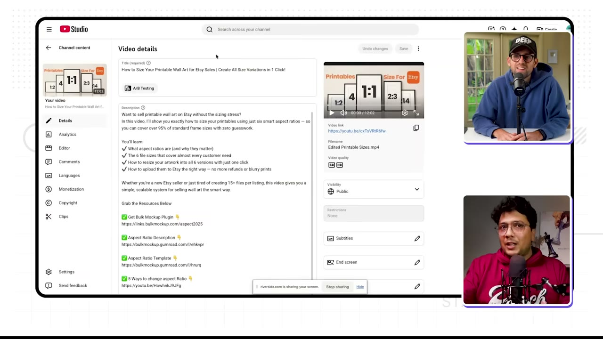
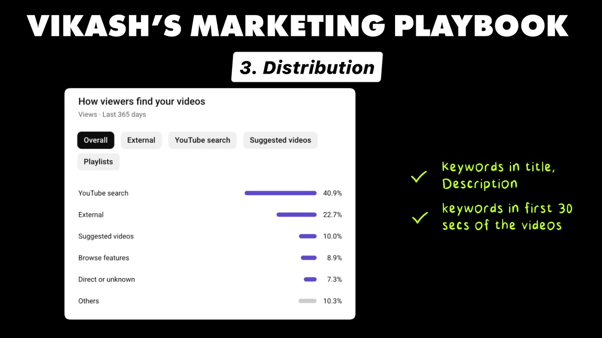
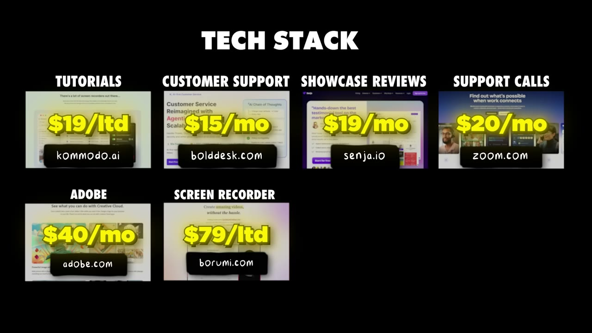

# How I Built a $12K/Month Micro-SaaS

✅ **Đã phân tích sâu** → [`case.md`](case.md)

| | |
|---|---|
| **Video** | <https://www.youtube.com/watch?v=W48emwbUlUE> |
| **Đăng** | 11/02/2026 |
| **Thời lượng** | 17:21 |
| **Lượt xem** | 58,502 |
| **Lượt thích** | 1,487 |
| **Video ID** | `W48emwbUlUE` |

## Trong thư mục này

| File | Nội dung |
|---|---|
| [`case.md`](case.md) | **Phân tích đầy đủ** — ý tưởng, validate, GTM, áp dụng ở VN |
| [`meta.json`](meta.json) | Metadata gốc (chapters, heatmap, mô tả) |
| [`screenshots/`](screenshots/) | 10 ảnh 720p |

## Mô tả gốc

Vikash built Bulkmockup, a Photoshop plugin that makes $12K/month. This video breaks down the three-step content system he uses to grow and get customers on auto-pilot
This video is an educational case study of this founder’s experience. It is not financial advice and does not guarantee any income or results. Every business is different and your results may vary.
0:00 - Intro
1:13 - BulkMockup overview
1:32 - Business analytics and dashboards
2:13 - Founder background and idea
3:34 - Going from idea to product
4:34 - Content  through customer pain
5:25 - Real examples of content
6:40 - Content

## Số liệu bắt được từ transcript

> Các đoạn founder nhắc tới con số, kèm timestamp để tua thẳng tới đó trong video.

_(không bắt được con số nào)_

## Chương

- `00:00` Intro
- `01:13` BulkMockup overview
- `01:32` Business analytics and dashboards
- `02:13` Founder background and idea
- `03:34` Going from idea to product
- `04:34` Content through customer pain
- `05:25` Real examples of content
- `06:40` Content Flywheel Playbook pt. 1
- `08:40` Solve one problem
- `09:38` Content Flywheel Playbook pt. 2
- `11:30` App Demo
- `12:48` Tech Stack
- `13:33` Final advice
- `14:18` Pat and Gus reflections
- `16:50` Build your own app!

## Ảnh

1. `01_01m48s_replay.jpg` — 
2. `02_02m25s_ch-founder-background-and-idea.jpg` — 
3. `03_03m46s_ch-going-from-idea-to-product.jpg` — 
4. `04_04m32s_usd-12-000-m.jpg` — 
5. `05_05m49s_usd-15.jpg` — 
6. `06_06m52s_ch-content-flywheel-playbook-pt-1.jpg` — 
7. `07_08m52s_ch-solve-one-problem.jpg` — 
8. `08_10m50s_replay.jpg` — 
9. `09_11m30s_usd-12-000-m.jpg` — 
10. `10_13m16s_usd-20.jpg` — 

---

← [Quay lại index](../../index.md) · [Toàn bộ video](../README.md)
