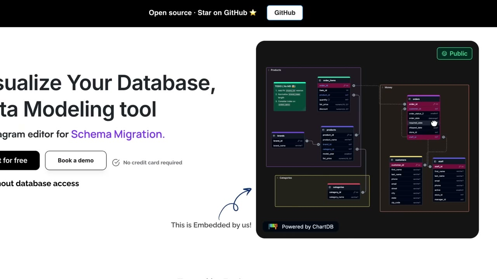
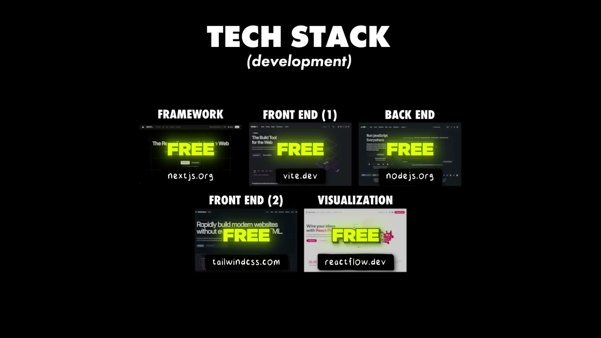
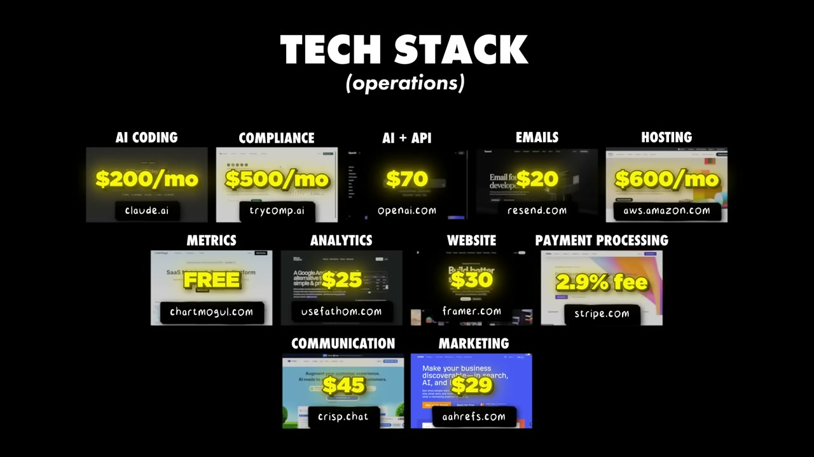
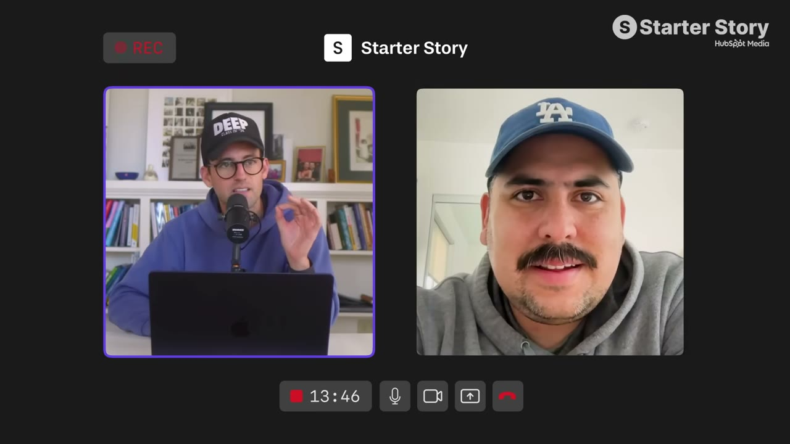

# I Built a Niche App to $9K MRR

✅ **Đã phân tích sâu** → [`case.md`](case.md)

| | |
|---|---|
| **Video** | <https://www.youtube.com/watch?v=7vz6b_Ohdl0> |
| **Đăng** | 25/02/2026 |
| **Thời lượng** | 15:29 |
| **Lượt xem** | 68,896 |
| **Lượt thích** | 1,531 |
| **Video ID** | `7vz6b_Ohdl0` |

## Trong thư mục này

| File | Nội dung |
|---|---|
| [`case.md`](case.md) | **Phân tích đầy đủ** — ý tưởng, validate, GTM, áp dụng ở VN |
| [`meta.json`](meta.json) | Metadata gốc (chapters, heatmap, mô tả) |
| [`screenshots/`](screenshots/) | 10 ảnh 720p |

## Mô tả gốc

Jonathan Fishner built ChartDB, an open source database visualization tool for developers. This video breaks down how to identify and sell to your ICP, no matter how "small" you think the audience is. 
This video is an educational case study of this founder’s experience. It is not financial advice and does not guarantee any income or results. Every business is different and your results may vary.
0:00 - Intro
0:46 - Ideas template
1:04 - Founder background
1:35 - What is ChartDB?
2:25 - How to find developer tool ideas
3:55 - Initial growth and marketing
4:51 - Why the hacker news post worked

## Số liệu bắt được từ transcript

> Các đoạn founder nhắc tới con số, kèm timestamp để tua thẳng tới đó trong video.

_(không bắt được con số nào)_

## Chương

- `00:00` Intro
- `00:46` Ideas template
- `01:04` Founder background
- `01:35` What is ChartDB?
- `02:25` How to find developer tool ideas
- `03:55` Initial growth and marketing
- `04:51` Why the hacker news post worked
- `05:45` How to find $1M ideas hiding in plain sight
- `06:36` Developer Tools Playbook
- `09:38` ChartDB demo
- `10:41` Tech stack and costs
- `11:57` Advice to founders
- `13:00` Pat and Gus reflections
- `15:10` Build your own niche app

## Ảnh

1. `01_00m58s_ch-ideas-template.jpg` — 
2. `02_01m47s_ch-what-is-chartdb.jpg` — 
3. `03_02m37s_ch-how-to-find-developer-tool-ideas.jpg` — 
4. `04_04m07s_ch-initial-growth-and-marketing.jpg` — 
5. `05_05m03s_ch-why-the-hacker-news-post-worked.jpg` — 
6. `06_05m57s_ch-how-to-find-1m-ideas-hiding-in-plain-sight.jpg` — 
7. `07_06m48s_ch-developer-tools-playbook.jpg` — 
8. `08_10m55s_replay.jpg` — 
9. `09_11m50s_replay.jpg` — 
10. `10_13m51s_usd-10-000.jpg` — 

---

← [Quay lại index](../../index.md) · [Toàn bộ video](../README.md)
