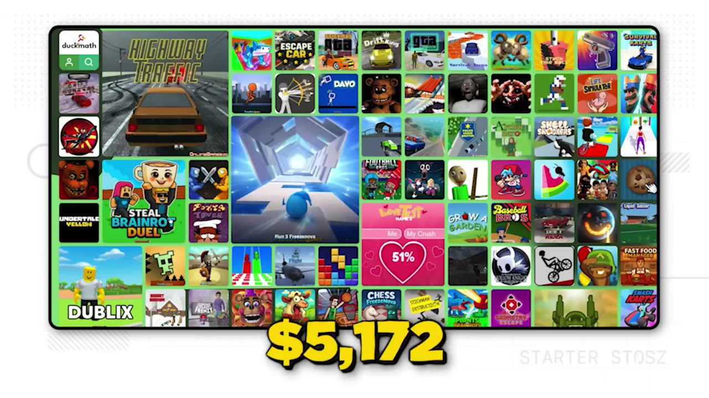
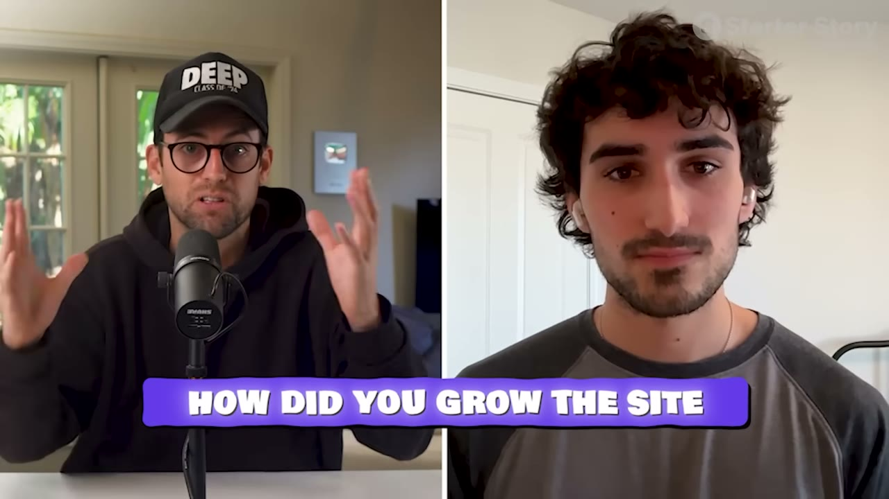
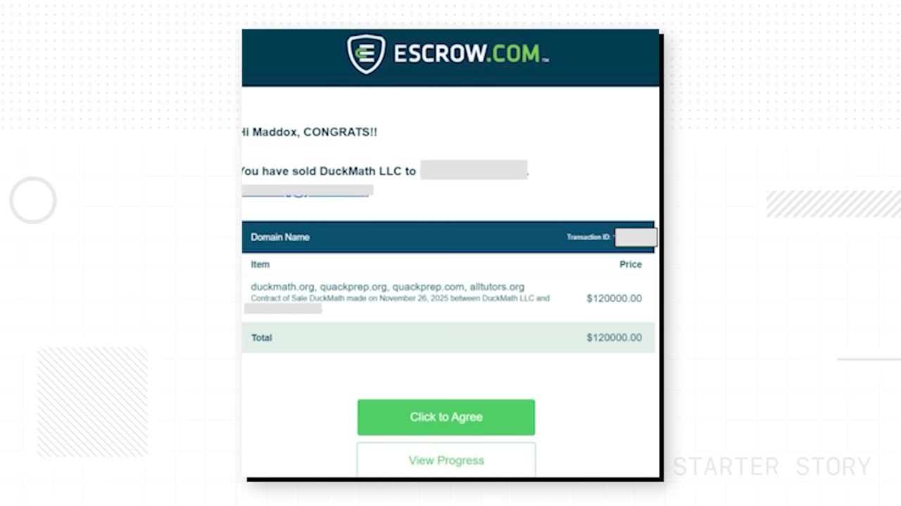
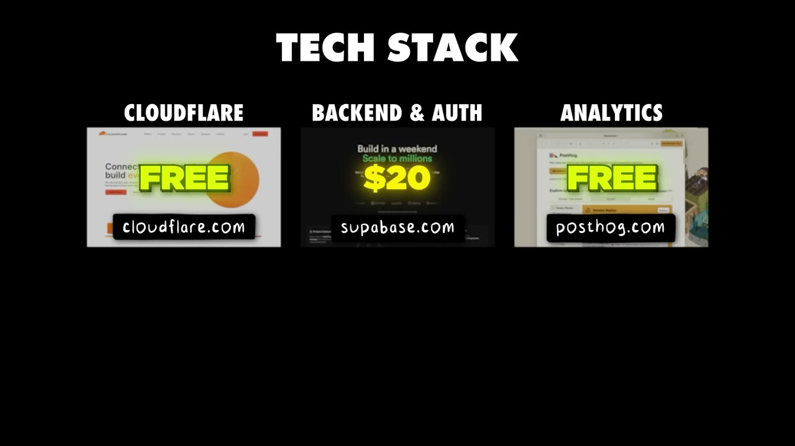
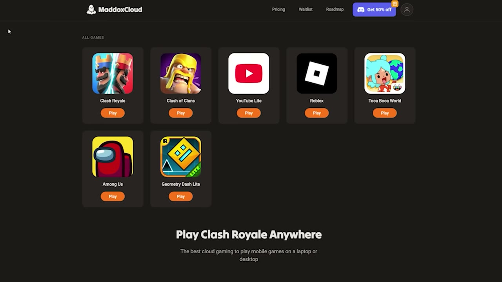

# I Make $15K/Month From One Website

✅ **Đã phân tích sâu** → [`case.md`](case.md)

| | |
|---|---|
| **Video** | <https://www.youtube.com/watch?v=qIlX7cQ2UdU> |
| **Đăng** | 01/03/2026 |
| **Thời lượng** | 16:19 |
| **Lượt xem** | 119,709 |
| **Lượt thích** | 3,809 |
| **Video ID** | `qIlX7cQ2UdU` |

## Trong thư mục này

| File | Nội dung |
|---|---|
| [`case.md`](case.md) | **Phân tích đầy đủ** — ý tưởng, validate, GTM, áp dụng ở VN |
| [`meta.json`](meta.json) | Metadata gốc (chapters, heatmap, mô tả) |
| [`screenshots/`](screenshots/) | 10 ảnh 720p |

## Mô tả gốc

Maddox built a $15K/month gaming website. This video breaks down his exact strategy for driving massive traffic to a simple website.
This video is an educational case study of this founder’s experience. It is not financial advice and does not guarantee any income or results. Every business is different and your results may vary.
0:00 - By the end of the video... 
0:45 - Founder Background
1:10 - $15K/month gaming website (stats, revenue)
2:39 - Finding the idea
4:06 - How he built the website
5:10 - Growth strategy with TikTok
6:28 - Math behind a 5M view video
7:29 - Organic short-form playbo

## Số liệu bắt được từ transcript

> Các đoạn founder nhắc tới con số, kèm timestamp để tua thẳng tới đó trong video.

_(không bắt được con số nào)_

## Chương

- `00:00` By the end of the video...
- `00:45` Founder Background
- `01:10` 15K/month gaming website (stats, revenue)
- `02:39` Finding the idea
- `04:06` How he built the website
- `05:10` Growth strategy with TikTok
- `06:28` Math behind a 5M view video
- `07:29` Organic short-form playbook
- `08:33` Selling the website
- `09:27` Website playbook in 2026
- `10:35` Tech stack and tools
- `12:12` Power of staying consistent
- `13:01` What's next?
- `13:26` Pat and Gus reflections
- `15:45` It's time to BUILD!

## Ảnh

1. `01_00m15s_ch-by-the-end-of-the-video.jpg` — 
2. `02_00m53s_replay.jpg` — 
3. `03_02m51s_ch-finding-the-idea.jpg` — 
4. `04_03m26s_usd-240.jpg` — 
5. `05_04m18s_ch-how-he-built-the-website.jpg` — 
6. `06_05m22s_ch-growth-strategy-with-tiktok.jpg` — 
7. `07_07m20s_usd-1-000.jpg` — 
8. `08_08m55s_usd-100-000.jpg` — 
9. `09_11m14s_usd-50-000.jpg` — 
10. `10_13m08s_replay.jpg` — 

---

← [Quay lại index](../../index.md) · [Toàn bộ video](../README.md)
